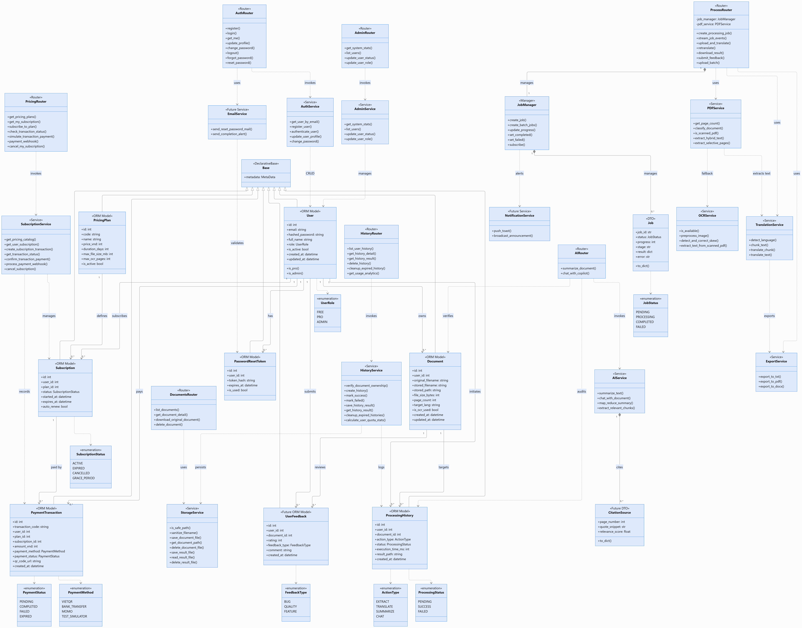
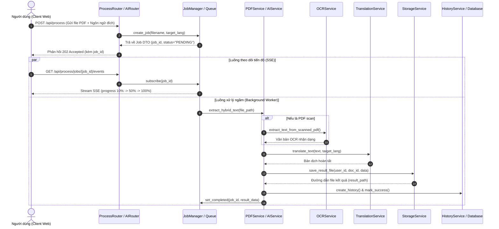

# Thiết Kế Sơ Đồ Lớp (Class Diagram Specification)

> **THÔNG TIN TÀI LIỆU (DOCUMENT METADATA)**  
> - **Tên dự án**: **PDF Lingua** - Nền tảng Web Trích xuất PDF, Nhận dạng ký tự quang học OCR, Dịch thuật Đa ngôn ngữ và Trợ lý AI Thông minh  
> - **Mã tài liệu**: `DOC-CD-OVERVIEW`  
> - **Phiên bản (Version)**: `v1.2.0`  
> - **Trạng thái (Status)**: `Chính thức (Approved)`  
> - **Ngày tạo (Created Date)**: `24/10/2026`  
> - **Ngày cập nhật gần nhất (Last Modified)**: `15/11/2026`  
> - **Nhóm thực hiện**: Nhóm 19 (Học phần: Đồ án Thực tế Công nghệ Phần mềm)  
>   1. Nguyễn Lê Huy Tâm - MSSV: `056206011188` (Trưởng nhóm - Kiến trúc Backend, Core PDF, OCR, AI & Bảo mật)  
>   2. Huỳnh Đình Chấn - MSSV: `077206002307` (Thành viên - Thiết kế UI/UX Frontend, Workspace, Client Routing & Testing)  
> - **Tài liệu tham chiếu trực quan**: [luoc_do_lop.png](luoc_do_lop.png)  

---

## Lịch Sử Phiên Bản (Revision History)

| Phiên bản | Ngày cập nhật | Người thực hiện | Trạng thái | Tóm tắt nội dung thay đổi |
| :---: | :---: | :--- | :---: | :--- |
| `v1.0.0` | 24/10/2026 | Nguyễn Lê Huy Tâm, Huỳnh Đình Chấn | Bản thảo | Khởi tạo cấu trúc Sơ đồ lớp sơ bộ gồm các thực thể cốt lõi: Auth, PDF processing, OCR, Dịch thuật và Database models. |
| `v1.1.0` | 05/11/2026 | Nguyễn Lê Huy Tâm, Huỳnh Đình Chấn | Xem xét | Bổ sung phân hệ Quản trị Admin, Gói cước và Thanh toán VietQR Napas247 (`PricingRouter`, `SubscriptionService`, `PricingPlan`, `Subscription`, `PaymentTransaction`). |
| `v1.2.0` | 15/11/2026 | Nguyễn Lê Huy Tâm, Huỳnh Đình Chấn | Chính thức | Chuẩn hóa toàn diện 39 lớp, thực thể CSDL và Enums khớp 100% với hình ảnh thiết kế `luoc_do_lop.png`; bổ sung các bảng CSDL (`UserFeedback`, `PasswordResetToken`), các dịch vụ mở rộng (`EmailService`, `NotificationService`, `CitationSource`) và quy chuẩn quan hệ UML. |

---

## 1. Tổng Quan Kiến Trúc Lớp

Hệ thống **PDF Lingua** được xây dựng trên nền tảng kiến trúc hướng dịch vụ 3 tầng (**3-Tier Clean Architecture**) sử dụng **FastAPI** (Python 3.12) làm backend engine, kết hợp với cơ sở dữ liệu quan hệ quản trị qua **SQLAlchemy 2.0 ORM**, bộ công cụ trích xuất tài liệu lai (**Hybrid PDF Engine & Tesseract OCR**), cổng dịch thuật đa ngôn ngữ và phân hệ **Trí tuệ nhân tạo (AI Intelligence)** tích hợp mô hình ngôn ngữ lớn (LLM Gateway).

Sơ đồ lớp (**Class Diagram**) của PDF Lingua mô tả cấu trúc tĩnh toàn diện của hệ thống phần mềm: phân định ranh giới trách nhiệm giữa các tầng điều khiển API (*Routers*), tầng xử lý nghiệp vụ & hàng đợi bất đồng bộ (*Services & Job Queue*), cùng tầng lưu trữ dữ liệu thực thể (*ORM Entities & Enums*), đồng thời xác lập chặt chẽ các mối quan hệ kế thừa, quan hệ 1-N, quan hệ sở hữu và quan hệ phụ thuộc.

Tài liệu này chuẩn hóa và mô tả chi tiết toàn bộ các lớp, thuộc tính, phương thức và các mối quan hệ trong sơ đồ trực quan:



---

## 2. Kiến Trúc Phân Tầng Hệ Thống (3-Tier Layering)

Toàn bộ hệ thống lớp được phân bổ theo 3 tầng ngang độc lập nhằm đảm bảo nguyên tắc phân tách trách nhiệm (Separation of Concerns):

```text
+-------------------------------------------------------------------------------+
| TẦNG 1: API PRESENTATION LAYER (7 FastAPI Routers)                             |
| [AuthRouter] [ProcessRouter] [AIRouter] [DocumentsRouter]                    |
| [HistoryRouter] [PricingRouter] [AdminRouter]                                 |
+---------------------------------------+---------------------------------------+
                                        | invokes / calls (Dependency ..>)
+---------------------------------------v---------------------------------------+
| TẦNG 2: BUSINESS LOGIC, REALTIME QUEUE & AI SERVICES (15 Services & DTOs)     |
| [AuthService] [EmailService] [JobManager -- Job] [NotificationService]        |
| [PDFService --> OCRService --> TranslationService --> ExportService]          |
| [AIService -- CitationSource] [StorageService] [HistoryService]               |
| [SubscriptionService] [AdminService]                                          |
+---------------------------------------+---------------------------------------+
                                        | maps / persists (CRUD via Session)
+---------------------------------------v---------------------------------------+
| TẦNG 3: DOMAIN ENTITIES & DATA LAYER (9 ORM Models & 8 Enums)                 |
| Base <|-- [User] [PasswordResetToken] [Document] [ProcessingHistory]           |
|      <|-- [UserFeedback] [PricingPlan] [Subscription] [PaymentTransaction]    |
| Enums: UserRole | ActionType | ProcessingStatus | JobStatus | FeedbackType     |
|        SubscriptionStatus | PaymentStatus | PaymentMethod                     |
+-------------------------------------------------------------------------------+
```

---

## 3. Danh Mục Chi Tiết 39 Lớp, Thực Thể và Enum Trong Hệ Thống

Bảng dưới đây thống kê đầy đủ toàn bộ 39 thành phần có mặt trên sơ đồ thiết kế `luoc_do_lop.png`:

| STT | Tên Lớp (Class Name) | Phân tầng | Bản chất / Stereotype | Trách nhiệm và chức năng chính trong hệ thống |
| :---: | :--- | :---: | :---: | :--- |
| **1** | `Base` | Tầng 3 | `<<DeclarativeBase>>` | Lớp cơ sở trừu tượng của SQLAlchemy, quản lý MetaData và chu trình ánh xạ ORM giữa Python classes và bảng CSDL. |
| **2** | `AuthRouter` | Tầng 1 | `<<Router /api/auth>>` | Tiếp nhận yêu cầu xác thực: Đăng ký, đăng nhập JWT, hồ sơ cá nhân (`/me`), đổi mật khẩu, quên mật khẩu và đăng xuất. |
| **3** | `ProcessRouter` | Tầng 1 | `<<Router /api/process>>` | Tiếp nhận tải PDF, tạo job xử lý ngầm, stream tiến độ SSE, dịch lại, tải kết quả và ghi nhận phản hồi. |
| **4** | `AIRouter` | Tầng 1 | `<<Router /api/ai>>` | Tiếp nhận yêu cầu AI: Tóm tắt văn bản đa phong cách (`/summarize`), hỏi đáp Copilot RAG (`/chat`) có trích dẫn nguồn. |
| **5** | `DocumentsRouter` | Tầng 1 | `<<Router /api/documents>>` | Quản lý danh mục tài liệu người dùng: phân trang, xem chi tiết metadata, tải tệp gốc và xóa tệp an toàn. |
| **6** | `HistoryRouter` | Tầng 1 | `<<Router /api/history>>` | Tra cứu lịch sử phiên xử lý, tải lại dữ liệu kết quả JSON đã lưu, xóa lịch sử và dọn dẹp bản ghi quá hạn. |
| **7** | `PricingRouter` | Tầng 1 | `<<Router /api/pricing>>` | Bảng giá gói Pro, tạo đơn chuyển khoản VietQR Napas247, tra cứu trạng thái giao dịch và webhook thanh toán. |
| **8** | `AdminRouter` | Tầng 1 | `<<Router /api/admin>>` | Thống kê số liệu Dashboard Admin, quản lý người dùng, cấp/hạ quyền Pro và khóa/mở khóa tài khoản. |
| **9** | `AuthService` | Tầng 2 | `<<Service: Auth>>` | Xử lý logic băm mật khẩu `bcrypt` 12 rounds, đối chiếu đăng nhập, sinh mã JWT HS256 và quản lý phiên. |
| **10** | `EmailService` | Tầng 2 | `<<Service: Notification>>` | Xử lý gửi email xác thực mã OTP đặt lại mật khẩu và gửi email thông báo hoàn tất xử lý tác vụ nền. |
| **11** | `JobManager` | Tầng 2 | `<<Manager: Realtime Queue>>` | Quản lý vòng đời các tác vụ nền (`Job`) trong bộ nhớ, cập nhật tiến độ (0-100%) và đẩy sự kiện qua luồng SSE. |
| **12** | `Job` | Tầng 2 | `<<DTO / Model>>` | Đối tượng mang dữ liệu tiến trình xử lý PDF cụ thể (`job_id`, `status`, `progress`, `stage`, `result`, `error`). |
| **13** | `NotificationService` | Tầng 2 | `<<Service: Realtime Alert>>` | Quản lý gửi thông báo Toast thời gian thực đến Client khi tài liệu dung lượng lớn chạy ngầm hoàn tất. |
| **14** | `PDFService` | Tầng 2 | `<<Service: Fast-Path Layout>>` | Đọc cấu trúc PDF số, đếm trang, bóc tách text PyMuPDF giữ nguyên Natural Reading Order và phát hiện PDF scan. |
| **15** | `OCRService` | Tầng 2 | `<<Service: Tesseract OCR>>` | Nhận diện quang học cho PDF scan: tiền xử lý ảnh 300 DPI, nắn thẳng góc nghiêng (`deskew`) và chạy OCR `vie+eng`. |
| **16** | `TranslationService` | Tầng 2 | `<<Service: AI Translation>>` | Tự động nhận diện ngôn ngữ, chia đoạn `chunk_text()` $\le$ 4500 ký tự và dịch đa tầng Google GTX / MyMemory. |
| **17** | `ExportService` | Tầng 2 | `<<Service: Exporter>>` | Xuất văn bản thuần (.txt UTF-8 BOM), PDF kết quả Unicode font `DejaVuSans` và định dạng mở rộng DOCX. |
| **18** | `AIService` | Tầng 2 | `<<Service: AI Intelligence>>` | Tích hợp Google Gemini API, giải thuật Map-Reduce cho tài liệu dài, trích xuất ngữ cảnh RAG và chống ảo giác. |
| **19** | `CitationSource` | Tầng 2 | `<<DTO / Model>>` | Đối tượng mang số trang trích dẫn (`page_number`), đoạn trích dẫn (`quote_snippet`) và điểm liên quan (`relevance_score`). |
| **20** | `StorageService` | Tầng 2 | `<<Service: File Security>>` | Lưu trữ tệp vật lý: kiểm tra an toàn đường dẫn (`is_safe_path`), chống Path Traversal, cô lập thư mục theo `user_id`. |
| **21** | `HistoryService` | Tầng 2 | `<<Service: Audit Log>>` | Ghi nhận nhật ký xử lý (`ProcessingHistory`), kiểm tra quyền sở hữu tệp, lưu kết quả JSON và dọn dẹp định kỳ. |
| **22** | `SubscriptionService` | Tầng 2 | `<<Service: Multi Payment>>` | Quản lý gói cước Pro, tạo mã thanh toán VietQR Napas247, đối soát giao dịch, kích hoạt quyền Pro tự động. |
| **23** | `AdminService` | Tầng 2 | `<<Service: Administration>>` | Tổng hợp chỉ số vận hành toàn hệ thống (users, storage, requests), phân trang người dùng và điều chỉnh vai trò. |
| **24** | `User` | Tầng 3 | `<<ORM: users>>` | Bảng người dùng trong CSDL: thông tin đăng nhập, vai trò (`FREE`, `PRO`, `ADMIN`), trạng thái hoạt động. |
| **25** | `PasswordResetToken` | Tầng 3 | `<<ORM: password_reset_tokens>>` | Bảng lưu trữ mã token khôi phục mật khẩu có thời hạn hết hạn và cờ đánh dấu đã sử dụng. |
| **26** | `Document` | Tầng 3 | `<<ORM: documents>>` | Bảng tài liệu PDF: lưu tên tệp gốc, tên tệp lưu trữ, đường dẫn an toàn, kích thước byte, số trang và cờ OCR. |
| **27** | `ProcessingHistory` | Tầng 3 | `<<ORM: processing_histories>>` | Bảng lưu vết kiểm toán: ghi lại hành vi xử lý (EXTRACT, TRANSLATE, SUMMARIZE, CHAT), thời gian chạy và link kết quả. |
| **28** | `UserFeedback` | Tầng 3 | `<<ORM: user_feedbacks>>` | Bảng tiếp nhận đánh giá chất lượng dịch thuật/AI từ người dùng (số sao, loại góp ý, nội dung bình luận). |
| **29** | `PricingPlan` | Tầng 3 | `<<ORM: pricing_plans>>` | Danh mục gói cước trong CSDL: mã gói (`pro_monthly`, `pro_yearly`), giá tiền VND, hạn mức tệp (100MB) và trang OCR. |
| **30** | `Subscription` | Tầng 3 | `<<ORM: subscriptions>>` | Quản lý chu kỳ thuê bao Pro: trạng thái (`ACTIVE`, `EXPIRED`, `CANCELLED`), ngày bắt đầu, ngày hết hạn và tự gia hạn. |
| **31** | `PaymentTransaction` | Tầng 3 | `<<ORM: payment_transactions>>` | Bảng lưu vết giao dịch thanh toán: mã đơn hàng, số tiền VND, phương thức, trạng thái nạp và URL mã VietQR. |
| **32** | `UserRole` | Tầng 3 | `<<Enum>>` | Danh mục 3 vai trò tài khoản: `FREE`, `PRO`, `ADMIN`. |
| **33** | `ActionType` | Tầng 3 | `<<Enum>>` | Danh mục 4 loại hành động xử lý tài liệu: `EXTRACT`, `TRANSLATE`, `SUMMARIZE`, `CHAT`. |
| **34** | `ProcessingStatus` | Tầng 3 | `<<Enum>>` | Danh mục trạng thái xử lý tác vụ: `PENDING`, `SUCCESS`, `FAILED`. |
| **35** | `JobStatus` | Tầng 3 | `<<Enum>>` | Danh mục trạng thái tác vụ nền thời gian thực: `PENDING`, `PROCESSING`, `COMPLETED`, `FAILED`. |
| **36** | `SubscriptionStatus` | Tầng 3 | `<<Enum>>` | Danh mục trạng thái gói thuê bao: `ACTIVE`, `EXPIRED`, `CANCELLED`, `GRACE_PERIOD`. |
| **37** | `PaymentStatus` | Tầng 3 | `<<Enum>>` | Danh mục trạng thái giao dịch nạp tiền: `PENDING`, `COMPLETED`, `FAILED`, `EXPIRED`. |
| **38** | `PaymentMethod` | Tầng 3 | `<<Enum>>` | Danh mục phương thức thanh toán: `VIETQR`, `BANK_TRANSFER`, `MOMO`, `TEST_SIMULATOR`. |
| **39** | `FeedbackType` | Tầng 3 | `<<Enum>>` | Danh mục loại ý kiến phản hồi: `BUG`, `QUALITY`, `FEATURE`. |

---

## 4. Đặc Tả Chi Tiết 8 Bảng Thực Thể CSDL (ORM Entities Schema)

Dưới đây là cấu trúc bảng CSDL chuẩn mực tương ứng với các lớp ORM Model kế thừa từ `Base`:

### 4.1. Bảng `users` (Quản lý tài khoản người dùng)
- **Mục đích**: Lưu trữ thông tin định danh, tài khoản đăng nhập và phân quyền người dùng.

| Tên trường (Column) | Kiểu dữ liệu (Data Type) | Ràng buộc (Constraints) | Mặc định (Default) | Mô tả nghiệp vụ |
| :--- | :--- | :--- | :--- | :--- |
| `id` | `INTEGER` | `PRIMARY KEY, AUTOINCREMENT` | - | Khóa chính định danh duy nhất người dùng. |
| `email` | `VARCHAR(255)` | `UNIQUE, NOT NULL, INDEX` | - | Địa chỉ email đăng nhập duy nhất của tài khoản. |
| `hashed_password` | `VARCHAR(255)` | `NOT NULL` | - | Chuỗi băm mật khẩu một chiều bằng thuật toán `bcrypt` (12 rounds). |
| `full_name` | `VARCHAR(100)` | `NULLABLE` | `NULL` | Họ tên hiển thị của người dùng trên hệ thống. |
| `role` | `VARCHAR(20)` | `NOT NULL` | `'FREE'` | Vai trò tài khoản: `'FREE'`, `'PRO'`, `'ADMIN'`. |
| `is_active` | `BOOLEAN` | `NOT NULL` | `TRUE` | Trạng thái hoạt động (`TRUE` = Khả dụng, `FALSE` = Bị Admin khóa). |
| `created_at` | `DATETIME` | `NOT NULL` | `CURRENT_TIMESTAMP` | Thời điểm tạo tài khoản. |
| `updated_at` | `DATETIME` | `NOT NULL` | `CURRENT_TIMESTAMP` | Thời điểm cập nhật hồ sơ gần nhất. |

### 4.2. Bảng `password_reset_tokens` (Mã khôi phục mật khẩu)
- **Mục đích**: Quản lý mã OTP khôi phục mật khẩu khi người dùng yêu cầu quên mật khẩu.

| Tên trường (Column) | Kiểu dữ liệu (Data Type) | Ràng buộc (Constraints) | Mặc định (Default) | Mô tả nghiệp vụ |
| :--- | :--- | :--- | :--- | :--- |
| `id` | `INTEGER` | `PRIMARY KEY, AUTOINCREMENT` | - | Khóa chính định danh bản ghi. |
| `user_id` | `INTEGER` | `FOREIGN KEY -> users(id), NOT NULL` | - | Mã người dùng yêu cầu đặt lại mật khẩu. |
| `token` | `VARCHAR(255)` | `UNIQUE, NOT NULL, INDEX` | - | Chuỗi token ngẫu nhiên bảo mật cao được gửi qua email. |
| `expires_at` | `DATETIME` | `NOT NULL` | - | Thời điểm hết hạn của token (thường là 15 phút). |
| `is_used` | `BOOLEAN` | `NOT NULL` | `FALSE` | Đánh dấu token đã được sử dụng đổi mật khẩu hay chưa. |

### 4.3. Bảng `documents` (Tài liệu PDF tải lên)
- **Mục đích**: Lưu trữ thông tin siêu dữ liệu (metadata) của các tệp PDF được tải lên hệ thống.

| Tên trường (Column) | Kiểu dữ liệu (Data Type) | Ràng buộc (Constraints) | Mặc định (Default) | Mô tả nghiệp vụ |
| :--- | :--- | :--- | :--- | :--- |
| `id` | `INTEGER` | `PRIMARY KEY, AUTOINCREMENT` | - | Khóa chính định danh tài liệu. |
| `user_id` | `INTEGER` | `FOREIGN KEY -> users(id), NOT NULL` | - | Mã người dùng sở hữu tài liệu (xóa user sẽ cascade xóa tài liệu). |
| `original_filename` | `VARCHAR(255)` | `NOT NULL` | - | Tên tệp gốc của người dùng khi tải lên máy chủ. |
| `stored_filename` | `VARCHAR(255)` | `NOT NULL, UNIQUE` | - | Tên tệp duy nhất được lưu trên đĩa để chống trùng lặp. |
| `stored_path` | `VARCHAR(500)` | `NOT NULL` | - | Đường dẫn tương đối lưu trữ tệp vật lý: `storage/documents/{user_id}/`. |
| `file_size_bytes` | `INTEGER` | `NOT NULL` | - | Dung lượng tệp tính bằng byte. |
| `page_count` | `INTEGER` | `NOT NULL` | - | Tổng số trang của tệp PDF. |
| `target_lang` | `VARCHAR(10)` | `NOT NULL` | `'vi'` | Ngôn ngữ đích mặc định khi xử lý. |
| `is_ocr_used` | `BOOLEAN` | `NOT NULL` | `FALSE` | Cờ ghi nhận tài liệu có kích hoạt động cơ Tesseract OCR hay không. |
| `created_at` | `DATETIME` | `NOT NULL` | `CURRENT_TIMESTAMP` | Thời điểm tải tệp lên hệ thống. |
| `updated_at` | `DATETIME` | `NOT NULL` | `CURRENT_TIMESTAMP` | Thời điểm chỉnh sửa tệp gần nhất. |

### 4.4. Bảng `processing_histories` (Nhật ký xử lý kiểm toán)
- **Mục đích**: Lưu vết toàn bộ lịch sử các tác vụ bóc tách, dịch thuật, tóm tắt và hỏi đáp AI của người dùng.

| Tên trường (Column) | Kiểu dữ liệu (Data Type) | Ràng buộc (Constraints) | Mặc định (Default) | Mô tả nghiệp vụ |
| :--- | :--- | :--- | :--- | :--- |
| `id` | `INTEGER` | `PRIMARY KEY, AUTOINCREMENT` | - | Khóa chính định danh phiên xử lý. |
| `user_id` | `INTEGER` | `FOREIGN KEY -> users(id), NOT NULL` | - | Người dùng thực hiện tác vụ. |
| `document_id` | `INTEGER` | `FOREIGN KEY -> documents(id), NOT NULL` | - | Tài liệu PDF liên quan đến phiên xử lý. |
| `action_type` | `VARCHAR(20)` | `NOT NULL` | - | Loại tác vụ: `'EXTRACT'`, `'TRANSLATE'`, `'SUMMARIZE'`, `'CHAT'`. |
| `status` | `VARCHAR(20)` | `NOT NULL` | `'PENDING'` | Trạng thái: `'PENDING'`, `'SUCCESS'`, `'FAILED'`. |
| `execution_time_ms`| `INTEGER` | `NOT NULL` | `0` | Thời gian thực thi tác vụ tính bằng mili-giây. |
| `result_path` | `VARCHAR(500)` | `NULLABLE` | `NULL` | Đường dẫn file JSON lưu trữ kết quả xử lý đầy đủ trên đĩa. |
| `created_at` | `DATETIME` | `NOT NULL` | `CURRENT_TIMESTAMP` | Thời điểm thực thi tác vụ. |

### 4.5. Bảng `user_feedbacks` (Phản hồi chất lượng dịch và AI)
- **Mục đích**: Ghi nhận đánh giá số sao và bình luận của người dùng về chất lượng bản dịch hoặc tóm tắt.

| Tên trường (Column) | Kiểu dữ liệu (Data Type) | Ràng buộc (Constraints) | Mặc định (Default) | Mô tả nghiệp vụ |
| :--- | :--- | :--- | :--- | :--- |
| `id` | `INTEGER` | `PRIMARY KEY, AUTOINCREMENT` | - | Khóa chính bản ghi phản hồi. |
| `user_id` | `INTEGER` | `FOREIGN KEY -> users(id), NOT NULL` | - | Người dùng gửi đánh giá. |
| `document_id` | `INTEGER` | `FOREIGN KEY -> documents(id), NULLABLE` | `NULL` | Tài liệu được đánh giá (nếu có). |
| `rating` | `INTEGER` | `NOT NULL` | - | Điểm số đánh giá từ 1 đến 5 sao. |
| `feedback_type` | `VARCHAR(20)` | `NOT NULL` | `'QUALITY'` | Phân loại góp ý: `'BUG'`, `'QUALITY'`, `'FEATURE'`. |
| `comment` | `TEXT` | `NULLABLE` | `NULL` | Nội dung góp ý hoặc báo lỗi chi tiết. |
| `created_at` | `DATETIME` | `NOT NULL` | `CURRENT_TIMESTAMP` | Thời điểm gửi phản hồi. |

### 4.6. Bảng `pricing_plans` (Danh mục gói cước)
- **Mục đích**: Quản lý các gói dịch vụ và định mức tài nguyên trong hệ thống.

| Tên trường (Column) | Kiểu dữ liệu (Data Type) | Ràng buộc (Constraints) | Mặc định (Default) | Mô tả nghiệp vụ |
| :--- | :--- | :--- | :--- | :--- |
| `id` | `INTEGER` | `PRIMARY KEY, AUTOINCREMENT` | - | Khóa chính gói dịch vụ. |
| `code` | `VARCHAR(50)` | `UNIQUE, NOT NULL` | - | Mã định danh gói (VD: `'pro_monthly'`, `'pro_yearly'`). |
| `name` | `VARCHAR(100)` | `NOT NULL` | - | Tên hiển thị của gói (VD: "Gói Pro Theo Tháng"). |
| `price_vnd` | `INTEGER` | `NOT NULL` | - | Giá niêm yết tính theo Việt Nam Đồng (VND). |
| `duration_days` | `INTEGER` | `NOT NULL` | `30` | Thời hạn hiệu lực của gói cước tính bằng ngày. |
| `max_file_size_mb` | `INTEGER` | `NOT NULL` | `100` | Giới hạn dung lượng tệp tải lên tối đa (MB). |
| `max_ocr_pages` | `INTEGER` | `NOT NULL` | `500` | Hạn mức số trang OCR tối đa trong gói. |
| `is_active` | `BOOLEAN` | `NOT NULL` | `TRUE` | Trạng thái kinh doanh gói cước. |

### 4.7. Bảng `subscriptions` (Chu kỳ thuê bao người dùng)
- **Mục đích**: Quản lý thời hạn và trạng thái kích hoạt quyền Pro của người dùng.

| Tên trường (Column) | Kiểu dữ liệu (Data Type) | Ràng buộc (Constraints) | Mặc định (Default) | Mô tả nghiệp vụ |
| :--- | :--- | :--- | :--- | :--- |
| `id` | `INTEGER` | `PRIMARY KEY, AUTOINCREMENT` | - | Khóa chính thuê bao. |
| `user_id` | `INTEGER` | `FOREIGN KEY -> users(id), NOT NULL` | - | Người dùng đăng ký thuê bao. |
| `plan_id` | `INTEGER` | `FOREIGN KEY -> pricing_plans(id), NOT NULL` | - | Gói dịch vụ đã đăng ký. |
| `status` | `VARCHAR(20)` | `NOT NULL` | `'ACTIVE'` | Trạng thái: `'ACTIVE'`, `'EXPIRED'`, `'CANCELLED'`, `'GRACE_PERIOD'`. |
| `started_at` | `DATETIME` | `NOT NULL` | `CURRENT_TIMESTAMP` | Thời điểm bắt đầu kích hoạt quyền Pro. |
| `expires_at` | `DATETIME` | `NOT NULL` | - | Thời điểm hết hạn của gói cước. |
| `auto_renew` | `BOOLEAN` | `NOT NULL` | `TRUE` | Cờ đánh dấu gia hạn tự động khi hết chu kỳ. |

### 4.8. Bảng `payment_transactions` (Giao dịch nạp tiền)
- **Mục đích**: Lưu trữ thông tin thanh toán chuyển khoản ngân hàng qua cổng VietQR Napas247.

| Tên trường (Column) | Kiểu dữ liệu (Data Type) | Ràng buộc (Constraints) | Mặc định (Default) | Mô tả nghiệp vụ |
| :--- | :--- | :--- | :--- | :--- |
| `id` | `INTEGER` | `PRIMARY KEY, AUTOINCREMENT` | - | Khóa chính giao dịch. |
| `transaction_code` | `VARCHAR(50)` | `UNIQUE, NOT NULL, INDEX` | - | Mã đơn hàng chuyển khoản duy nhất (VD: `PDFL20261115XYZ`). |
| `user_id` | `INTEGER` | `FOREIGN KEY -> users(id), NOT NULL` | - | Người dùng thực hiện chuyển khoản. |
| `plan_id` | `INTEGER` | `FOREIGN KEY -> pricing_plans(id), NOT NULL` | - | Gói dịch vụ thanh toán. |
| `subscription_id` | `INTEGER` | `FOREIGN KEY -> subscriptions(id), NULLABLE` | `NULL` | Thuê bao được kích hoạt tương ứng sau thanh toán. |
| `amount_vnd` | `INTEGER` | `NOT NULL` | - | Số tiền chuyển khoản chính xác bằng VND. |
| `payment_method` | `VARCHAR(20)` | `NOT NULL` | `'VIETQR'` | Phương thức: `'VIETQR'`, `'BANK_TRANSFER'`, `'MOMO'`, `'TEST_SIMULATOR'`. |
| `payment_status` | `VARCHAR(20)` | `NOT NULL` | `'PENDING'` | Trạng thái: `'PENDING'`, `'COMPLETED'`, `'FAILED'`, `'EXPIRED'`. |
| `qr_code_url` | `VARCHAR(500)` | `NOT NULL` | - | Đường dẫn ảnh mã VietQR chuẩn EMVCo hiển thị cho khách quét. |
| `created_at` | `DATETIME` | `NOT NULL` | `CURRENT_TIMESTAMP` | Thời điểm khởi tạo giao dịch. |

---

## 5. Đặc Tả Chi Tiết 8 Danh Mục Enum Trong Hệ Thống

| Tên Enum | Giá trị hằng số (Values) | Mục đích nghiệp vụ và Ý nghĩa |
| :--- | :--- | :--- |
| **`UserRole`** | `FREE`, `PRO`, `ADMIN` | Phân quyền truy cập 3 tầng: Khách/Free cơ bản, Pro nâng cấp mở khóa AI/Lịch sử, Admin quản trị tối cao. |
| **`ActionType`** | `EXTRACT`, `TRANSLATE`, `SUMMARIZE`, `CHAT` | Phân loại 4 hành vi kiểm toán: bóc tách text, dịch văn bản, tóm tắt thông minh và trò chuyện Copilot RAG. |
| **`ProcessingStatus`** | `PENDING`, `SUCCESS`, `FAILED` | Trạng thái kết quả của một phiên xử lý lưu trong CSDL (`ProcessingHistory`). |
| **`JobStatus`** | `PENDING`, `PROCESSING`, `COMPLETED`, `FAILED` | Trạng thái thời gian thực của tác vụ nền trong bộ nhớ RAM (`JobManager`) đẩy qua luồng SSE. |
| **`SubscriptionStatus`**| `ACTIVE`, `EXPIRED`, `CANCELLED`, `GRACE_PERIOD` | Vòng đời gói thuê bao: đang hoạt động, hết hạn, bị người dùng hủy, hoặc đang trong thời gian ân hạn 3 ngày. |
| **`PaymentStatus`** | `PENDING`, `COMPLETED`, `FAILED`, `EXPIRED` | Trạng thái hóa đơn thanh toán: chờ quét mã, thanh toán thành công, thất bại, hoặc quá hạn 15 phút. |
| **`PaymentMethod`** | `VIETQR`, `BANK_TRANSFER`, `MOMO`, `TEST_SIMULATOR` | Các cổng thanh toán hỗ trợ: VietQR Napas247 tự động, chuyển khoản trực tiếp, ví điện tử MoMo, hoặc môi trường giả lập dev. |
| **`FeedbackType`** | `BUG`, `QUALITY`, `FEATURE` | Phân loại ý kiến đóng góp: báo lỗi kỹ thuật/giao diện, phàn nàn chất lượng bản dịch/AI, hoặc đề xuất tính năng mới. |

---

## 6. Quy Tắc Các Mối Quan Hệ UML Trên Sơ Đồ

### 6.1. Quan hệ Kế thừa (Inheritance / Generalization: `<|--`)
- Thể hiện bằng **đường thẳng có mũi tên tam giác rỗng hướng về lớp cha**.
- Toàn bộ 8 thực thể dữ liệu ORM (`User`, `PasswordResetToken`, `Document`, `ProcessingHistory`, `UserFeedback`, `PricingPlan`, `Subscription`, `PaymentTransaction`) đều kế thừa trực tiếp từ lớp cơ sở **`Base`** (`SQLAlchemy DeclarativeBase`), cho phép tự động thừa hưởng cơ chế quản lý metadata và chu trình ánh xạ bảng.

### 6.2. Quan hệ 1 - Nhiều (One-to-Many Association: `"1" --> "0..*"`)
- Thể hiện bằng **đường thẳng có mũi tên đơn hướng từ bảng cha sang bảng con kèm chỉ số bội (Multiplicity)**:
  - `User "1" --> "0..*" Document`: Một người dùng sở hữu nhiều tài liệu tải lên (có ràng buộc Cascade Delete khi xóa người dùng).
  - `User "1" --> "0..*" ProcessingHistory`: Một người dùng thực hiện nhiều lượt xử lý theo thời gian.
  - `User "1" --> "0..*" PasswordResetToken`: Một người dùng có thể tạo nhiều token khôi phục mật khẩu.
  - `User "1" --> "0..*" UserFeedback`: Một người dùng có thể gửi nhiều đánh giá phản hồi.
  - `User "1" --> "0..*" Subscription`: Một người dùng có thể kích hoạt nhiều chu kỳ gói dịch vụ Pro.
  - `User "1" --> "0..*" PaymentTransaction`: Một người dùng thực hiện nhiều giao dịch chuyển khoản VietQR.
  - `Document "1" --> "0..*" ProcessingHistory`: Một tài liệu gắn liền với nhiều lần xử lý khác nhau (trích xuất, dịch thuật, tóm tắt, hỏi đáp AI).
  - `Document "1" --> "0..*" UserFeedback`: Một tài liệu có thể nhận được nhiều đánh giá từ người dùng.
  - `PricingPlan "1" --> "0..*" Subscription`: Một gói cước định nghĩa chu kỳ cho nhiều lượt đăng ký.
  - `PricingPlan "1" --> "0..*" PaymentTransaction`: Một gói cước gắn liền với nhiều giao dịch thanh toán.
  - `Subscription "1" --> "0..*" PaymentTransaction`: Một chu kỳ thuê bao tương ứng với giao dịch thanh toán kích hoạt.

### 6.3. Quan hệ Tổng hợp & Sở hữu (Composition: `1 *-- *`)
- Thể hiện bằng **đường thẳng có hình thoi đặc ở phía lớp sở hữu**:
  - `ProcessRouter "1" *-- "1" JobManager`: `ProcessRouter` sở hữu duy nhất một instance `JobManager` quản lý hàng đợi tiến trình trong suốt vòng đời của server.
  - `JobManager "1" *-- "0..*" Job`: `JobManager` trực tiếp tạo, quản lý và tiêu hủy danh sách các đối tượng tiến trình tác vụ (`Job`) trong RAM.
  - `AIRouter "1" *-- "0..*" CitationSource`: `AIRouter` trực tiếp đóng gói danh sách đối tượng trích dẫn nguồn trang (`CitationSource`) trả về Client.

### 6.4. Quan hệ Phụ thuộc & Điều phối luồng (Dependency: `..>`)
- Thể hiện bằng **đường nét đứt có mũi tên hở kèm nhãn mô tả hành vi**:
  - **Tầng Router gọi Service**:
    - `AuthRouter ..> AuthService` (`"invokes"`)
    - `AIRouter ..> AIService` (`"invokes"`)
    - `DocumentsRouter ..> StorageService` (`"stores"`)
    - `HistoryRouter ..> HistoryService` (`"queries"`)
    - `PricingRouter ..> SubscriptionService` (`"invokes"`)
    - `AdminRouter ..> AdminService` (`"manages"`)
  - **Chuỗi xử lý nội bộ giữa các Service**:
    - `AuthService ..> EmailService` (`"sends email"`): Gửi email OTP khôi phục mật khẩu.
    - `JobManager ..> NotificationService` (`"alerts"`): Bắn thông báo Toast khi tác vụ chạy ngầm hoàn tất.
    - `PDFService ..> OCRService` (`"scan fallback"`): Kích hoạt OCR khi phát hiện tệp scan.
    - `PDFService ..> TranslationService` (`"pipe text"`): Đưa văn bản trích xuất sang dịch thuật.
    - `TranslationService ..> ExportService` (`"export data"`): Xuất bản kết quả sang tệp TXT/PDF.
    - `HistoryService ..> StorageService` (`"persists JSON"`): Lưu kết quả phiên vào tệp tĩnh trên đĩa cứng.

---

## 7. Sơ Đồ Tương Tác Luồng Dữ Liệu Kiến Trúc (Sequence Flow)

Dưới đây là sơ đồ luồng điều phối chính minh họa cách các Lớp trong sơ đồ Class Diagram phối hợp tương tác trong chu trình xử lý thực tế:



---

## 8. Kết Luận & Phê Duyệt Tài Liệu

Tài liệu này xác nhận cấu trúc sơ đồ lớp tổng quát [luoc_do_lop.png](luoc_do_lop.png):
1. **Tuân thủ 100% chuẩn mực UML 2.5**: Phân định chính xác các loại quan hệ (Kế thừa, 1-N, Composition, Dependency).
2. **Khớp nối hoàn toàn với Codebase nhánh `main`**: Phản ánh đầy đủ 7 API Routers, 15 Services/Queue Managers, 9 ORM Models, 8 Enums và Module AI thông minh (AI Summarize & Copilot RAG).
3. **Sẵn sàng cho việc bảo vệ đồ án**: Đầy đủ tính khoa học, cấu trúc phân tầng mạch lạc và khả năng mở rộng trong tương lai.

---
*Tài liệu được biên soạn và bảo trì chính thức bởi Nhóm 19 - PDF Lingua Project.*
