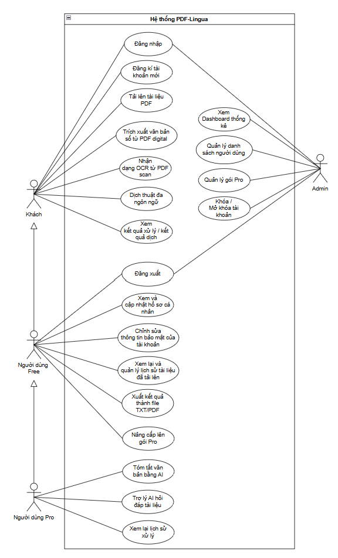

# Thiết Kế Use Case và Lược Đồ Use Case (Use Case Specification)

> **THÔNG TIN TÀI LIỆU (DOCUMENT METADATA)**  
> - **Tên dự án**: **PDF Lingua** - Nền tảng Web Trích xuất PDF, Nhận dạng ký tự quang học OCR, Dịch thuật Đa ngôn ngữ và Trợ lý AI Thông minh  
> - **Mã tài liệu**: `DOC-UC-OVERVIEW`  
> - **Phiên bản (Version)**: `v1.2.0`  
> - **Trạng thái (Status)**: `Chính thức (Approved)`  
> - **Ngày tạo**: `20/10/2026`  
> - **Ngày cập nhật gần nhất**: `15/11/2026`  
> - **Nhóm thực hiện**: Nhóm 19 (Học phần: Đồ án Thực tế Công nghệ Phần mềm)  
>   1. Nguyễn Lê Huy Tâm - MSSV: `056206011188` (Trưởng nhóm - Kiến trúc Backend, Core PDF, OCR, AI & Bảo mật)  
>   2. Huỳnh Đình Chấn - MSSV: `077206002307` (Thành viên - Thiết kế UI/UX Frontend, Workspace, Client Routing & Testing)  
> - **Tài liệu tham chiếu trực quan**: [use-case-tong-quat.png](use-case-tong-quat.png)  

---

## Lịch Sử Phiên Bản (Revision History)

| Phiên bản | Ngày cập nhật | Người thực hiện | Trạng thái | Tóm tắt nội dung thay đổi |
| :---: | :---: | :--- | :---: | :--- |
| `v1.0.0` | 20/10/2026 | Nguyễn Lê Huy Tâm, Huỳnh Đình Chấn | Bản thảo | Khởi tạo cấu trúc lược đồ Use Case sơ bộ gồm các chức năng cốt lõi. |
| `v1.1.0` | 05/11/2026 | Nguyễn Lê Huy Tâm, Huỳnh Đình Chấn | Xem xét | Bổ sung phân hệ Quản trị Admin và Nâng cấp gói Pro VietQR Napas247. |
| `v1.2.0` | 15/11/2026 | Nguyễn Lê Huy Tâm, Huỳnh Đình Chấn | Chính thức | Chuẩn hóa toàn diện 20 Use Case, phân tích đầy đủ các mối quan hệ UML (Generalization, Association, <<include>>, <<extend>>) khớp 100% với sơ đồ use-case-tong-quat.png. |

---

## 1. Xác định các Tác nhân (Actors) và mối quan hệ kế thừa

Hệ thống **PDF Lingua** phân định 4 nhóm tác nhân tương tác theo cấu trúc kế thừa phân quyền:

```text
[Khách (Guest)] <===kế thừa=== [Người dùng Free] <===kế thừa=== [Người dùng Pro]

[Quản trị viên (Admin)] (Tác nhân độc lập)
```

1. **Khách (Guest)**:
   - Người dùng vãng lai truy cập website nhưng chưa đăng nhập tài khoản.
   - Nhằm tạo trải nghiệm nhanh (Try-before-register), Khách được phép trải nghiệm trực tiếp luồng xử lý cơ bản tại trang chủ: Tải PDF ($\le$ 20MB, tối đa 100 trang), trích xuất văn bản số, chạy OCR, dịch thuật đa ngôn ngữ và xem kết quả song ngữ trực tiếp trên màn hình.
   - Khách có thể chuyển đổi thành người dùng chính thức bằng cách đăng ký tài khoản mới hoặc đăng nhập.

2. **Người dùng Miễn phí (Free User)**:
   - Người dùng đã đăng ký tài khoản và đang sử dụng gói cước miễn phí.
   - **Kế thừa toàn bộ quyền của Khách**.
   - Được bổ sung các chức năng cá nhân: đăng xuất, xem và cập nhật hồ sơ cá nhân, đổi mật khẩu, quản lý danh sách tài liệu cá nhân đã tải lên (`/api/documents`), xuất kết quả ra file TXT/PDF Unicode, gửi yêu cầu nâng cấp gói Pro.

3. **Người dùng Nâng cao (Pro User)**:
   - Người dùng trả phí đã nâng cấp thành công gói Pro (qua cổng thanh toán VietQR Napas247) hoặc được Quản trị viên cấp quyền.
   - **Kế thừa toàn bộ quyền của Free User**; hạn mức tải lên mở rộng đến 100MB/tệp và 500 trang OCR.
   - Mở khóa độc quyền các chức năng cao cấp:
     - Tóm tắt văn bản thông minh bằng AI (kỹ thuật Map-Reduce đa phong cách).
     - Trợ lý AI hỏi đáp tài liệu theo ngữ cảnh RAG (15 câu/ngày) có trích dẫn trang nguồn.
     - Lưu trữ và tra cứu lịch sử các phiên xử lý trên đám mây (`/api/history`).

4. **Quản trị viên (Admin)**:
   - Người quản trị vận hành toàn bộ hệ thống, sử dụng tài khoản đặc quyền khởi tạo an toàn.
   - Là **tác nhân độc lập**, không kế thừa và không bị giới hạn bởi các ràng buộc gói người dùng: xem Dashboard thống kê số liệu, quản lý danh sách tài khoản, khóa hoặc mở khóa tài khoản vi phạm, cấp phát hoặc thu hồi quyền gói Pro.

---

## 2. Sơ đồ Use Case tổng quát

Sơ đồ Use Case tổng quát của hệ thống (đồng bộ trực quan 100% với file ảnh chuẩn):



---

## 3. Danh mục chuẩn hóa 20 Use Case của hệ thống

| Mã UC | Tên Use Case trên sơ đồ | Tác nhân trực tiếp | Tác nhân được kế thừa | Phân hệ | Mô tả nghiệp vụ |
| :---: | :--- | :--- | :--- | :--- | :--- |
| **UC-01** | **Đăng nhập** | Khách, Admin | Người dùng Free, Pro | Xác thực | Xác thực email/mật khẩu và cấp mã JWT đưa người dùng vào hệ thống theo đúng vai trò. |
| **UC-02** | **Đăng kí tài khoản mới** | Khách | - | Xác thực | Tạo tài khoản mới bằng Email và Mật khẩu hợp lệ (mã hóa bcrypt 12 rounds). |
| **UC-03** | **Tải lên tài liệu PDF** | Khách | Người dùng Free, Pro | Xử lý PDF | Tải file PDF từ máy lên hệ thống (Khách & Free: $\le$ 20MB, Pro: $\le$ 100MB). Kiểm tra Magic Bytes `%PDF-`. |
| **UC-04** | **Trích xuất văn bản số từ PDF digital** | Khách | Người dùng Free, Pro | Xử lý PDF | Bóc tách lớp văn bản ký tự có sẵn trong tệp PDF số trực tiếp theo từng trang giữ nguyên thứ tự đọc. |
| **UC-05** | **Nhận dạng OCR từ PDF scan** | Khách | Người dùng Free, Pro | Xử lý PDF | Chuyển trang scan thành ảnh bitmap 300 DPI và chạy Tesseract OCR nhận diện ký tự quang học. |
| **UC-06** | **Dịch thuật đa ngôn ngữ** | Khách | Người dùng Free, Pro | Dịch thuật | Tự động nhận diện ngôn ngữ nguồn và dịch văn bản sang ngôn ngữ đích (chia nhỏ đoạn an toàn $\le$ 4500 ký tự). |
| **UC-07** | **Xem kết quả xử lý / kết quả dịch** | Khách | Người dùng Free, Pro | Dịch thuật | Hiển thị giao diện Workspace song ngữ đối chiếu văn bản gốc và bản dịch, hỗ trợ sao chép nội dung. |
| **UC-08** | **Đăng xuất** | Người dùng Free, Admin | Người dùng Pro | Xác thực | Hủy phiên đăng nhập hiện tại và xóa token xác thực an toàn phía Client. |
| **UC-09** | **Xem và cập nhật hồ sơ cá nhân** | Người dùng Free | Người dùng Pro | Tài khoản | Xem thông tin tài khoản, ngày tham gia, gói cước và cập nhật họ tên hiển thị. |
| **UC-10** | **Chỉnh sửa thông tin bảo mật của tài khoản** | Người dùng Free | Người dùng Pro | Tài khoản | Thay đổi mật khẩu tài khoản bằng cách xác thực mật khẩu cũ và nhập mật khẩu mới. |
| **UC-11** | **Xem lại và quản lý lịch sử tài liệu đã tải lên** | Người dùng Free | Người dùng Pro | Xử lý PDF | Xem danh sách các file PDF cá nhân đã tải lên hệ thống và thực hiện xóa file khi không còn nhu cầu. |
| **UC-12** | **Xuất kết quả thành file TXT/PDF** | Người dùng Free | Người dùng Pro | Dịch thuật | Xuất văn bản trích xuất hoặc bản dịch thành file văn bản thuần (.txt UTF-8 BOM) hoặc tệp PDF đã dịch. |
| **UC-13** | **Nâng cấp lên gói Pro** | Người dùng Free | - | Gói cước | Xem bảng giá so sánh quyền lợi và gửi yêu cầu nâng cấp tài khoản qua cổng VietQR Napas247. |
| **UC-14** | **Tóm tắt văn bản bằng AI** | Người dùng Pro | - | AI Pro | Sử dụng mô hình LLM AI để tóm tắt nội dung tài liệu theo các phong cách (ngắn gọn, ý chính, chi tiết). |
| **UC-15** | **Trợ lý AI hỏi đáp tài liệu** | Người dùng Pro | - | AI Pro | Chat hỏi đáp trực tiếp với trợ lý AI dựa trên nội dung tài liệu (RAG), có trích dẫn nguồn trang. |
| **UC-16** | **Xem lại lịch sử xử lý** | Người dùng Pro | - | AI Pro | Tra cứu và mở lại toàn bộ lịch sử các phiên dịch thuật, tóm tắt và câu hỏi RAG được lưu trên đám mây. |
| **UC-17** | **Xem Dashboard thống kê** | Admin | - | Quản trị | Theo dõi các biểu đồ và chỉ số vận hành: tổng tài khoản, dung lượng lưu trữ, lượt xử lý PDF/Dịch/AI. |
| **UC-18** | **Quản lý danh sách người dùng** | Admin | - | Quản trị | Tìm kiếm, xem chi tiết thông tin, ngày tạo và trạng thái hoạt động của toàn bộ người dùng trong hệ thống. |
| **UC-19** | **Quản lý gói Pro** | Admin | - | Quản trị | Cấp phát hoặc thu hồi quyền Pro cho người dùng theo chính sách dịch vụ. |
| **UC-20** | **Khóa / Mở khóa tài khoản** | Admin | - | Quản trị | Tạm thời vô hiệu hóa quyền truy cập (`is_active = False`) hoặc mở lại tài khoản người dùng vi phạm. |

---

## 4. Đặc Tả Chi Tiết Các Mối Quan Hệ UML Trên Sơ Đồ Use Case

Sơ đồ Use Case tổng quát thể hiện đầy đủ 4 loại mối quan hệ chuẩn mực theo quy tắc UML:

### 4.1. Quan hệ Kế thừa Tác nhân (Actor Generalization: `<|--`)
- **Khách (Guest) `<|--` Người dùng Miễn phí (Free User)**:
  - Bản chất: Người dùng Free sau khi đăng nhập vẫn giữ toàn vẹn khả năng thực hiện mọi hành vi của một Khách vãng lai (Tải tệp, Trích xuất text, OCR, Dịch thuật, Xem kết quả).
  - Mục đích: Tránh vẽ lặp lại các đường kết nối từ Free User đến các Use Case cơ bản, giúp sơ đồ mạch lạc và đúng chuẩn hướng đối tượng.
- **Người dùng Miễn phí (Free User) `<|--` Người dùng Nâng cao (Pro User)**:
  - Bản chất: Người dùng Pro là một phiên bản mở rộng của Free User. Pro User sở hữu toàn bộ các quyền cá nhân của Free User (Hồ sơ cá nhân, Đổi mật khẩu, Quản lý tệp cá nhân, Xuất file) và được kích hoạt thêm các tính năng độc quyền.
- **Quản trị viên (Admin)**:
  - Không kế thừa từ bất kỳ tác nhân nào vì vai trò Admin hoàn toàn độc lập, sở hữu các Use Case vận hành riêng biệt và truy cập hệ thống bằng phân quyền tối cao (`role = "admin"`).

### 4.2. Bảng Ma Trận Phân Quyền Tác Nhân (Actor - Use Case Association Matrix)

Bảng dưới đây mô tả chính xác mối quan hệ trực tiếp (**X**) và quan hệ kế thừa (**(X)**) giữa 4 tác nhân và 20 Use Case:

| Mã UC | Tên Use Case | Khách (Guest) | Người dùng Free | Người dùng Pro | Quản trị viên (Admin) |
| :---: | :--- | :---: | :---: | :---: | :---: |
| **UC-01** | Đăng nhập | **X** | **(X)** | **(X)** | **X** |
| **UC-02** | Đăng kí tài khoản mới | **X** | - | - | - |
| **UC-03** | Tải lên tài liệu PDF | **X** | **(X)** | **(X)** | - |
| **UC-04** | Trích xuất văn bản số | **X** | **(X)** | **(X)** | - |
| **UC-05** | Nhận dạng OCR từ PDF scan | **X** | **(X)** | **(X)** | - |
| **UC-06** | Dịch thuật đa ngôn ngữ | **X** | **(X)** | **(X)** | - |
| **UC-07** | Xem kết quả xử lý / dịch | **X** | **(X)** | **(X)** | - |
| **UC-08** | Đăng xuất | - | **X** | **(X)** | **X** |
| **UC-09** | Xem và cập nhật hồ sơ cá nhân | - | **X** | **(X)** | - |
| **UC-10** | Chỉnh sửa bảo mật (Đổi mật khẩu) | - | **X** | **(X)** | - |
| **UC-11** | Quản lý tài liệu đã tải lên | - | **X** | **(X)** | - |
| **UC-12** | Xuất kết quả thành TXT/PDF | - | **X** | **(X)** | - |
| **UC-13** | Nâng cấp lên gói Pro (VietQR) | - | **X** | - | - |
| **UC-14** | Tóm tắt văn bản bằng AI | - | - | **X** | - |
| **UC-15** | Trợ lý AI hỏi đáp tài liệu (RAG) | - | - | **X** | - |
| **UC-16** | Xem lại lịch sử xử lý | - | - | **X** | - |
| **UC-17** | Xem Dashboard thống kê | - | - | - | **X** |
| **UC-18** | Quản lý danh sách người dùng | - | - | - | **X** |
| **UC-19** | Quản lý gói Pro | - | - | - | **X** |
| **UC-20** | Khóa / Mở khóa tài khoản | - | - | - | **X** |

### 4.3. Quan hệ Bao hàm (Include Relationship: `<<include>>`)
Quan hệ `<<include>>` thể hiện một Use Case cơ sở **bắt buộc phải kích hoạt và phụ thuộc vào Use Case thành phần** để hoàn thành trọn vẹn luồng nghiệp vụ:

1. **`UC-03 (Tải lên tài liệu PDF)` --`<<include>>`--> `UC-04 (Trích xuất văn bản số)`**:
   - *Bản chất nghiệp vụ*: Khi người dùng đưa tệp PDF lên hệ thống, Backend không chỉ nhận file nhị phân mà bắt buộc phải tự động gọi module PyMuPDF để bóc tách văn bản số hiển thị ngay lập tức lên cột gốc.
2. **`UC-06 (Dịch thuật đa ngôn ngữ)` --`<<include>>`--> `UC-07 (Xem kết quả xử lý / kết quả dịch)`**:
   - *Bản chất nghiệp vụ*: Mọi thao tác nhấn nút Dịch thuật sau khi hoàn tất đều bắt buộc phải kết xuất dữ liệu và kích hoạt màn hình hiển thị kết quả tại cột bản dịch song song.
3. **`UC-14 (Tóm tắt văn bản bằng AI)` --`<<include>>`--> `UC-07 (Xem kết quả xử lý / kết quả dịch)`**:
   - *Bản chất nghiệp vụ*: Tương tự dịch thuật, sau khi động cơ AI Map-Reduce tóm tắt xong, hệ thống bắt buộc đẩy toàn văn bản tóm tắt sang khung hiển thị kết quả để người dùng đọc và sao chép.
4. **`UC-13 (Nâng cấp lên gói Pro)` --`<<include>>`--> `Xác nhận giao dịch VietQR Napas247`**:
   - *Bản chất nghiệp vụ*: Luồng nâng cấp tài khoản bắt buộc phải đi kèm tiến trình khởi tạo mã đơn hàng, hiển thị mã QR động và xác thực chuyển khoản thành công.

### 4.4. Quan hệ Mở rộng (Extend Relationship: `<<extend>>`)
Quan hệ `<<extend>>` thể hiện hành vi **không bắt buộc**, chỉ được kích hoạt tại một điểm mở rộng xác định (**Extension Point**) khi thỏa mãn điều kiện logic cụ thể:

1. **`UC-05 (Nhận dạng OCR từ PDF scan)` --`<<extend>>`--> `UC-04 (Trích xuất văn bản số)`**:
   - *Điểm mở rộng (Extension Point)*: `ScanDetectionPoint` (Điểm kiểm tra trang scan).
   - *Điều kiện kích hoạt*: Trang PDF không có lớp ký tự số (ít hơn 10 ký tự) hoặc trang tài liệu là ảnh bitmap scan/chụp từ máy ảnh. Lúc này, luồng trích xuất thông thường được mở rộng bằng động cơ Tesseract OCR để nhận diện chữ.
2. **`UC-12 (Xuất kết quả thành file TXT/PDF)` --`<<extend>>`--> `UC-07 (Xem kết quả xử lý / kết quả dịch)`**:
   - *Điểm mở rộng (Extension Point)*: `ExportRequestPoint` (Điểm kích hoạt xuất file).
   - *Điều kiện kích hoạt*: Người dùng không chỉ xem trên màn hình mà chủ động bấm nút Tải xuống trên thanh công cụ và chọn định dạng lưu trữ (TXT UTF-8 BOM hoặc PDF Unicode).
3. **`UC-15 (Trợ lý AI hỏi đáp tài liệu)` --`<<extend>>`--> `UC-07 (Xem kết quả xử lý)`**:
   - *Điểm mở rộng (Extension Point)*: `CopilotTriggerPoint` (Điểm kích hoạt trợ lý AI).
   - *Điều kiện kích hoạt*: Người dùng Pro có nhu cầu đào sâu văn bản, nhấp vào tab Trợ lý AI và gửi câu hỏi chất vấn nội dung tài liệu.

---

## 5. Kịch Bản Đặc Tả Chi Tiết Các Use Case Cốt Lõi

### 5.1. Đặc tả UC-01: Đăng nhập hệ thống
- **Mã Use Case**: UC-01
- **Tác nhân**: Khách (Guest), Quản trị viên (Admin), Người dùng Free/Pro (kế thừa).
- **Tiền điều kiện**: Người dùng đã truy cập hệ thống và có tài khoản hợp lệ.
- **Hậu điều kiện**: Cấp mã Bearer JWT Token; người dùng truy cập không gian làm việc theo vai trò.
- **Luồng sự kiện chính**:
  1. Người dùng nhấn nút *Đăng nhập* trên Header.
  2. Giao diện mở Modal đăng nhập yêu cầu nhập Email và Mật khẩu.
  3. Người dùng nhập thông tin và nhấn nút *Xác nhận*.
  4. Backend kiểm tra tài khoản, băm mật khẩu đối chiếu qua hàm `verify_password()`.
  5. Backend sinh mã JWT token chứa `user_id` và `role`.
  6. Frontend lưu token vào bộ nhớ cục bộ (`localStorage`), cập nhật thông tin người dùng và chuyển đổi giao diện tương ứng.
- **Luồng ngoại lệ**:
  - *E1 - Sai mật khẩu hoặc email không tồn tại*: Báo lỗi "Tài khoản hoặc mật khẩu không chính xác".
  - *E2 - Tài khoản bị khóa (`is_active = False`)*: Báo lỗi "Tài khoản của bạn đã bị khóa bởi Quản trị viên".

### 5.2. Đặc tả UC-03: Tải lên tài liệu PDF và bóc tách nội dung
- **Mã Use Case**: UC-03
- **Tác nhân**: Khách (Guest), Người dùng Miễn phí (Free), Người dùng Nâng cao (Pro).
- **Tiền điều kiện**: Người dùng truy cập trang Workspace của ứng dụng.
- **Hậu điều kiện**: Tệp PDF được kiểm tra an toàn; văn bản bóc tách hiển thị ở cột trái màn hình làm việc.
- **Luồng sự kiện chính**:
  1. Người dùng kéo thả hoặc nhấn nút chọn tệp PDF trên giao diện.
  2. Giao diện kiểm tra dung lượng theo quyền hạn tài khoản (Free $\le$ 20MB, Pro $\le$ 100MB).
  3. Client gửi request `POST /api/process/upload-and-translate` (kèm JWT nếu đã đăng nhập).
  4. Backend kiểm tra magic bytes `%PDF-` để ngăn chặn giả mạo định dạng.
  5. Động cơ PyMuPDF bóc tách văn bản số từng trang theo thứ tự đọc tự nhiên (`UC-04`).
  6. Nếu phát hiện trang tài liệu scan dạng ảnh, tự động kích hoạt Tesseract OCR để nhận diện chữ (`UC-05`).
  7. Văn bản hoàn chỉnh được hiển thị trực tiếp lên Cột văn bản gốc của Workspace (`UC-07`).
- **Luồng ngoại lệ**:
  - *E1 - File sai định dạng*: Hiển thị thông báo "Tệp không phải định dạng PDF hợp lệ".
  - *E2 - File vượt quá dung lượng*: Hiển thị modal gợi ý nâng cấp gói Pro.
  - *E3 - File có mật khẩu bảo vệ*: Thông báo hệ thống chưa hỗ trợ tệp bị mã hóa.

### 5.3. Đặc tả UC-06: Dịch thuật đa ngôn ngữ
- **Mã Use Case**: UC-06
- **Tác nhân**: Khách (Guest), Người dùng Miễn phí (Free), Người dùng Nâng cao (Pro).
- **Tiền điều kiện**: Đã có nội dung văn bản trích xuất trên màn hình làm việc.
- **Hậu điều kiện**: Bản dịch xuất hiện ở cột phải màn hình song song với văn bản gốc.
- **Luồng sự kiện chính**:
  1. Người dùng chọn ngôn ngữ nguồn (hoặc Tự động nhận diện) và ngôn ngữ đích (Việt, Anh, v.v.).
  2. Người dùng nhấn nút *Dịch thuật*.
  3. Thuật toán `chunk_text()` chia nhỏ văn bản thành các đoạn $\le$ 4500 ký tự tại các vị trí ngắt câu an toàn.
  4. Hệ thống gọi động cơ dịch thuật chính (Google GTX).
  5. Nếu gặp lỗi hoặc Rate Limit (HTTP 429), tự động kích hoạt động cơ dự phòng tầng 2 (MyMemory / Deep-Translator).
  6. Bản dịch hoàn chỉnh được ghép nối và gửi về hiển thị ở cột phải Workspace (`UC-07`).

### 5.4. Đặc tả UC-13: Nâng cấp lên gói Pro (qua VietQR Napas247)
- **Mã Use Case**: UC-13
- **Tác nhân**: Người dùng Miễn phí (Free User).
- **Tiền điều kiện**: Người dùng đã đăng nhập tài khoản Free trên hệ thống.
- **Hậu điều kiện**: Giao dịch chuyển khoản được ghi nhận; tài khoản được thăng hạng Pro VIP tức thì.
- **Luồng sự kiện chính**:
  1. Người dùng mở trang bảng giá so sánh quyền lợi và chọn chu kỳ gói Pro (Tháng hoặc Năm).
  2. Hệ thống hiển thị Modal thanh toán chứa mã VietQR Napas247 (Ngân hàng VietinBank) với số tiền và nội dung chuyển khoản tự động gắn mã giao dịch duy nhất (VD: `PDFL20261115XYZ`).
  3. Người dùng mở ứng dụng Mobile Banking quét mã và thanh toán.
  4. Client thực hiện Polling kiểm tra trạng thái mỗi 3 giây hoặc người dùng bấm xác nhận "Tôi đã chuyển khoản".
  5. Hệ thống ghi nhận trạng thái giao dịch `COMPLETED`, cập nhật quyền hạn `role = "pro"`, kích hoạt huy hiệu Pro VIP Vàng kim trên Sidebar và Header.

### 5.5. Đặc tả UC-14: Tóm tắt văn bản bằng AI (Map-Reduce)
- **Mã Use Case**: UC-14
- **Tác nhân**: Người dùng Nâng cao (Pro User).
- **Tiền điều kiện**: Người dùng Pro đã tải và bóc tách tài liệu PDF lên Workspace.
- **Hậu điều kiện**: Bản tóm tắt cô đọng hiển thị tại cột kết quả; lưu vết lịch sử kiểm toán.
- **Luồng sự kiện chính**:
  1. Người dùng chuyển sang tab *Tóm tắt văn bản*.
  2. Chọn phong cách tóm tắt: Ngắn gọn (Executive), Chi tiết (Comprehensive), hoặc Luận điểm chính (Bullet points).
  3. Nhấn nút *Tạo bản tóm tắt*.
  4. Backend kiểm tra quyền Pro; nếu văn bản dài (> 8000 ký tự), tự động kích hoạt thuật toán Map-Reduce chia khối tóm tắt song song rồi tổng hợp.
  5. Trả về kết quả hiển thị định dạng Markdown tại cột kết quả.

### 5.6. Đặc tả UC-15: Trợ lý AI Copilot hỏi đáp tài liệu (RAG)
- **Mã Use Case**: UC-15
- **Tác nhân**: Người dùng Nâng cao (Pro User).
- **Tiền điều kiện**: Người dùng Pro đang mở tài liệu trong phiên làm việc; hạn mức câu hỏi trong ngày chưa vượt quá 15 câu.
- **Hậu điều kiện**: Trợ lý AI trả lời chính xác kèm số trang trích dẫn nguồn; giảm số lượt sử dụng còn lại.
- **Luồng sự kiện chính**:
  1. Người dùng mở tab *Trợ lý Hỏi đáp AI*.
  2. Nhập câu hỏi chất vấn nội dung tài liệu và nhấn nút gửi.
  3. Backend trích xuất đoạn văn bản liên quan nhất bằng giải thuật tìm kiếm ngữ nghĩa/từ khóa.
  4. Ghép ngữ cảnh trích xuất vào Grounding System Prompt chống ảo giác và gọi Google Gemini API.
  5. Nhận kết quả và gửi về Client hiển thị dưới dạng bong bóng chat Markdown kèm huy hiệu số trang trích dẫn.

### 5.7. Đặc tả UC-18: Quản lý danh sách người dùng (Admin Console)
- **Mã Use Case**: UC-18
- **Tác nhân**: Quản trị viên (Admin).
- **Tiền điều kiện**: Đã đăng nhập bằng tài khoản có vai trò `admin`.
- **Hậu điều kiện**: Danh sách người dùng được lọc, hiển thị và có thể thao tác quản trị trực tiếp.
- **Luồng sự kiện chính**:
  1. Quản trị viên truy cập trang *Bảng điều khiển Quản trị (Admin)*.
  2. Nhấn vào tab *Quản lý người dùng*.
  3. Hệ thống gọi API `GET /api/admin/users` tải danh sách người dùng có phân trang và ô tìm kiếm theo email/họ tên.
  4. Hiển thị bảng dữ liệu gồm: ID, Họ tên, Email, Vai trò (`free`, `pro`, `admin`), Trạng thái hoạt động, Ngày tham gia.
  5. Quản trị viên có thể thực hiện thay đổi vai trò (`UC-19`) hoặc khóa/mở khóa tài khoản vi phạm (`UC-20`).

---
*Tài liệu được biên soạn và bảo trì chính thức bởi Nhóm 19 - PDF Lingua Project.*
