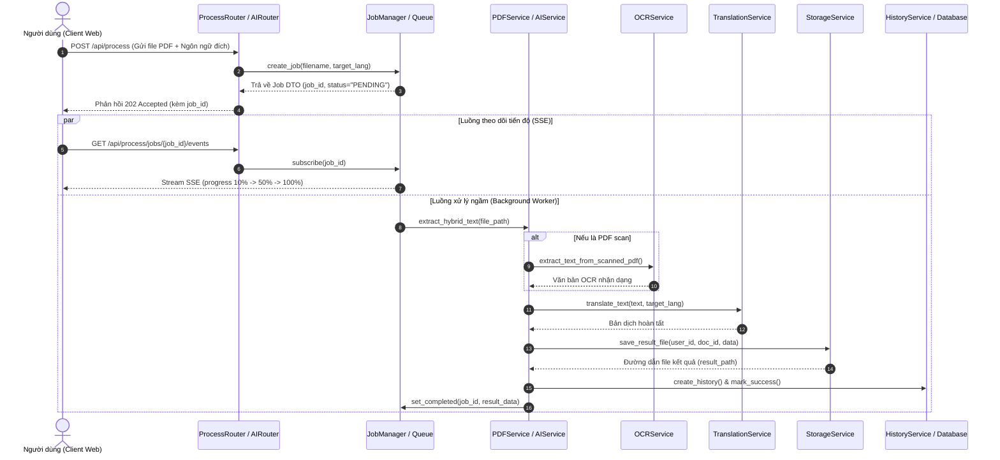

# Báo Cáo Thuyết Minh Chi Tiết Thiết Kế Hệ Thống - PDF Lingua

> **THÔNG TIN TÀI LIỆU (DOCUMENT METADATA)**  
> - **Tên dự án**: **PDF Lingua** - Nền tảng Web Trích xuất PDF, Nhận dạng ký tự quang học OCR, Dịch thuật Đa ngôn ngữ và Trợ lý AI Thông minh  
> - **Mã tài liệu**: `DOC-MASTER-DESIGN`  
> - **Phiên bản (Version)**: `v1.2.0`  
> - **Trạng thái (Status)**: `Chính thức (Approved)`  
> - **Ngày tạo**: `20/10/2026`  
> - **Ngày cập nhật gần nhất**: `15/11/2026`  
> - **Nhóm thực hiện**: Nhóm 19 (Học phần: Đồ án Thực tế Công nghệ Phần mềm)  
>   1. Nguyễn Lê Huy Tâm - MSSV: `056206011188` (Trưởng nhóm - Kiến trúc Backend, Core PDF, OCR, AI & Bảo mật)  
>   2. Huỳnh Đình Chấn - MSSV: `077206002307` (Thành viên - Thiết kế UI/UX Frontend, Workspace, Client Routing & Testing)  
> 
> **Nội dung trọng tâm**: Báo cáo thiết kế chi tiết gồm 3 phần: **Kiến trúc hệ thống**, **Sơ đồ Use Case** và **Sơ đồ Lớp (Class Diagram)**.

---

## Mục lục nội dung

1. [Kiến Trúc Hệ Thống](#1-kiến-trúc-hệ-thống)
   - [1.1. Mô hình kiến trúc phân tầng (3-Tier Layered Architecture)](#11-mô-hình-kiến-trúc-phân-tầng-chuyên-sâu-3-tier-layered-architecture)
   - [1.2. Sơ đồ kiến trúc tổng thể](#12-sơ-đồ-kiến-trúc-tổng-thể)
   - [1.3. Phân rã 8 phân hệ kiến trúc cốt lõi (Communities)](#13-phân-rã-8-phân-hệ-kiến-trúc-cốt-lõi-communities)
   - [1.4. Các luồng dữ liệu chính của hệ thống](#14-các-luồng-dữ-liệu-chính-của-hệ-thống)
2. [Sơ Đồ Use Case](#2-sơ-đồ-use-case)
   - [2.1. Xác định các Tác nhân (Actors) và quan hệ kế thừa](#21-xác-định-các-tác-nhân-actors-và-quan-hệ-kế-thừa)
   - [2.2. Lược đồ Use Case tổng quát](#22-lược-đồ-use-case-tổng-quát)
   - [2.3. Danh mục 20 Use Case chuẩn hóa](#23-danh-mục-20-use-case-chuẩn-hóa)
   - [2.4. Phân tích các mối quan hệ UML trong Lược đồ Use Case](#24-phân-tích-các-mối-quan-hệ-uml-trong-lược-đồ-use-case)
   - [2.5. Đặc tả chi tiết các Use Case cốt lõi](#25-đặc-tả-chi-tiết-các-use-case-cốt-lõi)
3. [Sơ Đồ Lớp (Class Diagram)](#3-sơ-đồ-lớp-class-diagram)
   - [3.1. Kiến trúc phân tầng hệ thống (3-Tier Layering)](#31-kiến-trúc-phân-tầng-hệ-thống-3-tier-layering)
   - [3.2. Lược đồ Lớp tổng thể hệ thống (Class Diagram)](#32-lược-đồ-lớp-tổng-thể-hệ-thống-class-diagram)
   - [3.3. Danh mục chi tiết 39 Lớp, Thực thể CSDL và Kiểu Liệt Kê](#33-danh-mục-chi-tiết-39-lớp-thực-thể-csdl-và-kiểu-liệt-kê-trong-hệ-thống)
   - [3.4. Đặc tả chi tiết các Lớp theo phân tầng](#34-đặc-tả-chi-tiết-các-lớp-theo-phân-tầng)
     - [3.4.1. Tầng API Routers (Presentation Layer)](#341-tầng-api-routers-presentation-layer)
     - [3.4.2. Tầng Dịch vụ & Hàng đợi thời gian thực (Service & Queue Layer)](#342-tầng-dịch-vụ--hàng-đợi-thời-gian-thực-service--queue-layer)
     - [3.4.3. Tầng Thực thể Dữ liệu & Enums (ORM & Data Layer)](#343-tầng-thực-thể-dữ-liệu--enums-orm--data-layer)
   - [3.5. Quy tắc và bản chất các mối quan hệ UML trên sơ đồ](#35-quy-tắc-và-bản-chất-các-mối-quan-hệ-uml-trên-sơ-đồ)
   - [3.6. Sơ đồ tương tác luồng dữ liệu kiến trúc (Data & Control Flow)](#36-sơ-đồ-tương-tác-luồng-dữ-liệu-kiến-trúc-data--control-flow)
   - [3.7. Quy hoạch các lớp mở rộng trong tương lai](#37-quy-hoạch-các-lớp-mở-rộng-trong-tương-lai)
---

# 1. Kiến Trúc Hệ Thống

> **Tài liệu đặc tả chuyên sâu**: Toàn văn thuyết minh kiến trúc phân tầng, phân rã 8 phân hệ, đặc tả chi tiết 7 luồng dữ liệu (Mermaid sequence), bảo mật OWASP Top 10 và sơ đồ triển khai vật lý được trình bày chi tiết tại [Kiến trúc hệ thống - kien_truc_he_thong.md](Kiến%20trúc%20hệ%20thống/kien_truc_he_thong.md).

## 1.1. Mô hình kiến trúc phân tầng chuyên sâu (3-Tier Layered Architecture)
Hệ thống **PDF Lingua** được xây dựng dựa trên mô hình kiến trúc phân tầng kết hợp hướng dịch vụ (3-Tier Service-Oriented Layered Architecture), tuân thủ 6 nguyên tắc cốt lõi: Phân tách trách nhiệm (SoC), Ghép nối lỏng (Loose Coupling), Kiến trúc phi trạng thái (Stateless Services), An toàn bảo mật từ thiết kế (Security by Design), Cơ chế chịu lỗi dự phòng đa tầng (Multi-Tier Fallback), và Tương tác phản hồi tức thì (Reactive SSE & Priority Toasts).

1. **Tầng 1: Presentation Layer (Client Browser)**:
   - Single Page Application (SPA) xây dựng trên chuẩn HTML5 Semantic, CSS3 Variables Tokens và JavaScript ES6+ thuần (tối ưu tải trang dưới 1 giây).
   - Không gian làm việc đối chiếu song ngữ độc quyền (Dual-pane Workspace), Sidebar thu phóng linh hoạt (phím tắt `Ctrl+B`).
   - Hệ thống thông báo popup Toast (`#toastContainer`, `z-index: 99999`) đảm bảo thông điệp cảnh báo luôn nổi bật trên nền làm mờ (Modal Backdrop).
   - Giao tiếp máy chủ hai chiều qua Fetch API (kèm Bearer JWT Token) và kênh Server-Sent Events (SSE) theo dõi tiến trình nền thời gian thực (0% - 100%).

2. **Tầng 2: Application & Service Layer (FastAPI Backend Engine)**:
   - Nền tảng framework Python 3.12, FastAPI bất đồng bộ (Asynchronous Non-blocking I/O) và Pydantic v2 validation.
   - Hệ thống 7 RESTful API Routers độc lập: `/api/auth`, `/api/process`, `/api/documents`, `/api/history`, `/api/ai`, `/api/pricing`, `/api/admin`.
   - Bộ điều phối tác vụ nền `JobManager` quản lý hàng đợi tiến trình bất đồng bộ (`PENDING`, `PROCESSING`, `COMPLETED`, `FAILED`).
   - Tầng dịch vụ nghiệp vụ (Business Services) gồm 8 service chuyên biệt xử lý logic nghiệp vụ và bọc ngoại lệ chuẩn mực (`AppException`).

3. **Tầng 3: Data & Infrastructure Layer (Dữ liệu & Tích hợp Hạ tầng)**:
   - SQLAlchemy 2.0 ORM hỗ trợ SQLite Write-Ahead Logging (WAL mode) cho môi trường phát triển cục bộ và PostgreSQL 16 cho môi trường sản xuất.
   - Hệ thống lưu trữ tệp tin cô lập theo định danh người dùng: `storage/documents/{user_id}/`.
   - Động cơ nhận dạng ký tự quang học Tesseract OCR (bộ dữ liệu song ngữ `vie + eng`).
   - Cổng tích hợp đám mây bên ngoài: B.AI Multi-Model Gateway (Google Gemini API LLM), động cơ dịch thuật Google GTX & MyMemory, và cổng thanh toán VietQR Napas247.

## 1.2. Sơ đồ kiến trúc tổng thể


```mermaid
flowchart TD
    %% ==========================================
    %% TẦNG 1: PRESENTATION LAYER (CLIENT BROWSER)
    %% ==========================================
    subgraph TIER1 ["TẦNG 1: PRESENTATION LAYER (Client Browser - SPA)"]
        direction TB

        subgraph C8_UI ["C8: Giao Diện Người Dùng (UI Modules)"]
            direction LR
            WORKSPACE["Dual-Pane Workspace<br/>(Cột Văn bản gốc & Bản dịch/Tóm tắt)"]
            SIDEBAR["Responsive Sidebar<br/>(Điều hướng thu phóng Ctrl+B)"]
            TOAST["Toast Container<br/>(Ưu tiên hiển thị z-index: 99999)"]
            MODALS["Auth & Pricing Modals<br/>(Hộp thoại Đăng nhập/Đăng ký & VietQR)"]
            TABLES["Document & History Tables<br/>(Quản lý tệp tải lên & Lịch sử)"]
        end

        subgraph FE_CTRL ["Frontend Controllers (Vanilla ES6+)"]
            direction LR
            CTRL_APP["app.js / router.js<br/>(Điều hướng SPA)"]
            CTRL_AUTH["auth.js<br/>(Quản lý phiên JWT)"]
            CTRL_WORK["workspace.js<br/>(Xử lý kéo thả & dịch)"]
            CTRL_AI["ai_summary.js & ai_copilot.js<br/>(Tóm tắt & Chat RAG)"]
            CTRL_ADMIN["admin.js & pricing.js<br/>(Quản trị & Thanh toán)"]
        end

        subgraph FE_COMM ["Giao Tiếp Mạng Phía Client"]
            direction LR
            FETCH_CLIENT["Fetch API Client<br/>(Gắn Header Authorization: Bearer JWT)"]
            SSE_CLIENT["EventSource (SSE Client)<br/>(Lắng nghe luồng tiến trình thời gian thực)"]
        end

        C8_UI --> FE_CTRL
        FE_CTRL --> FE_COMM
    end

    %% ==========================================
    %% TẦNG 2: APPLICATION & SERVICE LAYER (BACKEND)
    %% ==========================================
    subgraph TIER2 ["TẦNG 2: APPLICATION & SERVICE LAYER (FastAPI Backend)"]
        direction TB

        subgraph GATEWAY ["API Gateway & Middleware Bảo Vệ"]
            direction LR
            CORS["CORSMiddleware<br/>(Kiểm soát Trusted Origins)"]
            EXC_HANDLER["Global Exception Handler<br/>(Bắt AppException, trả về JSON chuẩn)"]
            AUTH_GUARD["Security Auth Guard & RBAC<br/>(Kiểm tra JWT & Phân quyền Free/Pro/Admin)"]
        end

        subgraph ROUTERS ["7 RESTful API Routers"]
            direction TB
            R_AUTH["AuthRouter<br/>/api/auth"]
            R_PROCESS["ProcessRouter<br/>/api/process"]
            R_DOCS["DocumentsRouter<br/>/api/documents"]
            R_HIST["HistoryRouter<br/>/api/history"]
            R_AI["AIRouter<br/>/api/ai"]
            R_PRICE["PricingRouter<br/>/api/pricing"]
            R_ADMIN["AdminRouter<br/>/api/admin"]
        end

        subgraph ASYNC_ENGINE ["Async Job Engine (Xử Lý Nền Thời Gian Thực)"]
            direction LR
            JOB_MGR["JobManager Engine<br/>(Trạng thái: PENDING/PROCESSING/COMPLETED/FAILED)"]
            SSE_STREAM["SSE Event Streamer<br/>(/api/process/jobs/{id}/progress)"]
            BG_WORKER["Background Task Workers<br/>(FastAPI BackgroundTasks Pool)"]
        end

        subgraph SERVICES ["8 Dịch Vụ Nghiệp Vụ Cốt Lõi (Core Business Services)"]
            direction TB
            S_AUTH["C1: AuthService<br/>(Bcrypt 12 rounds, cấp phát & giải mã JWT HS256)"]
            S_PDF["C2: PDFService<br/>(Magic Bytes, bóc tách văn bản số PyMuPDF)"]
            S_DOCS["C2: StorageService<br/>(Quản lý lưu trữ an toàn & cô lập tệp theo User ID)"]
            S_OCR["C3: OCRService<br/>(Render 300 DPI, Pillow deskew, Tesseract vie+eng)"]
            S_TRANS["C4: TranslationService<br/>(Phân đoạn chunk_text <= 4500 ký tự, Fallback đa tầng)"]
            S_AI["C5: AIService<br/>(Map-Reduce Summarizer, Copilot RAG Grounding Prompt)"]
            S_EXPORT["C6: ExportService<br/>(Xuất tệp TXT UTF-8 BOM, PDF Unicode & Anti-Path Traversal)"]
            S_SUB["C7: SubscriptionService<br/>(Tạo mã VietQR Napas247, chu kỳ cước & kiểm tra đơn)"]
            S_ADMIN["C7: AdminService & HistoryService<br/>(Thống kê số liệu hệ thống, quản lý người dùng, audit log)"]
        end

        GATEWAY --> ROUTERS
        ROUTERS --> SERVICES
        R_PROCESS --> ASYNC_ENGINE
        ASYNC_ENGINE --> S_PDF
        ASYNC_ENGINE --> S_OCR
        ASYNC_ENGINE --> S_TRANS
    end

    %% ==========================================
    %% TẦNG 3: DATA & INFRASTRUCTURE LAYER
    %% ==========================================
    subgraph TIER3 ["TẦNG 3: DATA & INFRASTRUCTURE LAYER"]
        direction TB

        subgraph STORAGE_LAYER ["Lưu Trữ Cơ Sở Dữ Liệu & Tệp Tin"]
            direction LR
            ORM["SQLAlchemy 2.0 ORM<br/>(Entities: User, Document, History, PricingPlan, Subscription)"]
            DB[("Database Engine<br/>SQLite WAL Mode (Dev) / PostgreSQL 16 (Prod)")]
            FILES[("Physical File Storage<br/>storage/documents/{user_id}/<br/>storage/results/")]
        end

        subgraph INFRA_SERVICES ["Động Cơ Cục Bộ & Cổng Tích Hợp Đám Mây Ngoài"]
            direction LR
            TESS_BIN["Tesseract OCR Binary<br/>(Bộ dữ liệu ngôn ngữ vie + eng)"]
            LLM_GW["B.AI / Google Gemini API<br/>(Mô hình LLM thông minh)"]
            TRANS_GW["Cloud Translation Services<br/>(Google Translate GTX / MyMemory / Deep-Translator)"]
            VIETQR_GW["Cổng Thanh Toán Ngân Hàng<br/>(VietQR Napas247 EMVCo chuẩn)"]
        end

        ORM --> DB
    end

    %% ==========================================
    %% CÁC KẾT NỐI LIÊN TẦNG (INTER-TIER CONNECTIONS)
    %% ==========================================
    FETCH_CLIENT ==>|HTTPS / REST API Requests| GATEWAY
    SSE_STREAM -.->|Server-Sent Events Stream (0% - 100%)| SSE_CLIENT

    S_AUTH --> ORM
    S_DOCS --> FILES
    S_PDF --> FILES
    S_EXPORT --> FILES
    S_OCR --> TESS_BIN
    S_TRANS --> TRANS_GW
    S_AI --> LLM_GW
    S_SUB --> VIETQR_GW
    S_SUB --> ORM
    S_ADMIN --> ORM
```

## 1.3. Phân rã 8 phân hệ kiến trúc cốt lõi (Communities)

| Mã | Tên phân hệ | Trách nhiệm chính | Thành phần kỹ thuật chủ chốt |
| :---: | :--- | :--- | :--- |
| **C1** | **Auth & Identity** | Quản lý danh tính người dùng, mã hóa mật khẩu `bcrypt` (12 rounds salt), cấp phát và giải mã JWT token, kiểm soát quyền truy cập theo 3 vai trò (`free`, `pro`, `admin`). | `app.api.auth`, `AuthService`, `User`, `security.py` |
| **C2** | **PDF Processing Engine** | Tiếp nhận tệp tải lên qua luồng multipart, kiểm tra an toàn magic bytes `%PDF-`, trích xuất văn bản số bằng PyMuPDF theo thứ tự đọc tự nhiên. | `app.api.process`, `PDFService`, `Document`, `StorageService` |
| **C3** | **OCR Pipeline** | Tự động nhận diện trang ảnh scan, chuyển đổi trang tài liệu sang ảnh bitmap 300 DPI, tăng cường tương phản bằng Pillow và nhận dạng ký tự quang học qua Tesseract OCR. | `OCRService`, `Tesseract Engine`, `Pillow`, `deskew/orientation` |
| **C4** | **Translation Engine** | Chia nhỏ văn bản an toàn ($\le$ 4500 ký tự) không cắt ngang câu, chuyển dịch đa ngôn ngữ qua Google GTX với cơ chế chuyển đổi dự phòng đa tầng (MyMemory / Deep-Translator). | `TranslationService`, `chunk_text()`, `Deep-Translator` |
| **C5** | **AI Intelligence Suite** | Mô-đun tóm tắt tài liệu thông minh theo phương pháp Map-Reduce và Trợ lý AI Copilot hỏi đáp ngữ cảnh tài liệu theo kiến trúc RAG kèm số trang trích dẫn. | `app.api.ai`, `AIService`, `Gemini API Gateway`, `ai_copilot.js` |
| **C6** | **Export & Delivery** | Xuất tệp TXT chuẩn UTF-8 BOM hiển thị tiếng Việt chính xác trên Windows Notepad, xuất tệp PDF kết quả Unicode, kiểm soát an toàn Path Traversal. | `ExportService`, `ReportLab`, `download_result()` |
| **C7** | **History, Billing & Admin** | Lưu trữ nhật ký kiểm toán trên đám mây cho tài khoản Pro, quy trình nâng cấp gói cước tự động qua mã VietQR Napas247 và Admin Console giám sát số liệu hệ thống. | `HistoryService`, `SubscriptionService`, `AdminService`, `VietQR` |
| **C8** | **Frontend UI Layer** | Không gian làm việc kép Dual-pane, Sidebar thu phóng linh hoạt, hệ thống thông báo trạng thái Toast ưu tiên cao và Client Router. | `workspace.js`, `sidebar.js`, `workspace.css`, `sidebar.css` |

## 1.4. Các luồng dữ liệu chính của hệ thống

Hệ thống điều phối 7 luồng dữ liệu chuẩn hóa bảo đảm tính toàn vẹn và hiệu năng:

1. **Luồng bóc tách tài liệu lai (Hybrid Extraction)**: Tải file $\rightarrow$ Kiểm định Magic Bytes `%PDF-` $\rightarrow$ Duyệt từng trang qua PyMuPDF (bóc tách trực tiếp nếu có văn bản số) $\rightarrow$ Tự động kích hoạt Tesseract OCR 300 DPI nếu là ảnh scan $\rightarrow$ Lưu metadata và trả về hiển thị cột gốc.
2. **Luồng xử lý tệp lớn bất đồng bộ qua SSE Streaming (Background Jobs)**: Khởi tạo tiến trình tại `JobManager` $\rightarrow$ Trả về HTTP 202 Accepted $\rightarrow$ Mở luồng `EventSource` lắng nghe SSE $\rightarrow$ Background worker cập nhật 4 pha xử lý theo thời gian thực (0% - 100%) $\rightarrow$ Hoàn tất và tự động hiển thị kết quả.
3. **Luồng dịch thuật có cơ chế dự phòng đa tầng (Multi-Tier Fallback)**: Thuật toán `chunk_text()` chia đoạn $\le$ 4500 ký tự tại vị trí ngắt câu $\rightarrow$ Gửi tầng 1 (Google GTX) $\rightarrow$ Nếu lỗi/Rate Limit chuyển mạch tầng 2 (MyMemory / Deep-Translator) $\rightarrow$ Ghép nối toàn vẹn bản dịch trả về.
4. **Luồng tóm tắt tài liệu AI qua thuật toán Map-Reduce**: Văn bản ngắn ($\le$ 8000 ký tự) tóm tắt trực tiếp; Văn bản dài chia các đoạn (Map Phase) tóm tắt song song $\rightarrow$ Gom bản tóm tắt thành phần (Reduce Phase) $\rightarrow$ Gửi LLM tổng hợp báo cáo đa góc nhìn (Luận điểm chính, Bảng biểu số liệu, Khuyến nghị).
5. **Luồng Trợ lý AI Copilot hỏi đáp tài liệu theo mô hình RAG**: Người dùng Pro đặt câu hỏi $\rightarrow$ Trích xuất phân đoạn tài liệu liên quan $\rightarrow$ Ghép ngữ cảnh vào Grounding System Prompt $\rightarrow$ Gọi Google Gemini API $\rightarrow$ Trả về câu trả lời định dạng Markdown kèm huy hiệu số trang trích dẫn.
6. **Luồng nâng cấp gói Pro tự động qua cổng thanh toán VietQR Napas247**: Khởi tạo đơn hàng $\rightarrow$ Sinh mã VietQR chuẩn EMVCo $\rightarrow$ Giao diện đếm ngược 15 phút và Polling trạng thái mỗi 3 giây $\rightarrow$ Ngân hàng xác nhận thanh toán $\rightarrow$ Nâng cấp User Role lên `pro` tức thì.
7. **Luồng xác thực bảo mật và phân quyền vai trò (Auth & RBAC Flow)**: Đăng nhập băm `bcrypt` $\rightarrow$ Cấp JWT Token (HS256) $\rightarrow$ Mọi API bảo vệ kiểm định tính hợp lệ và thời hạn qua Dependency Injection Guard $\rightarrow$ Chặn đứng truy cập trái phép bằng HTTP 401/403.

---

# 2. Sơ Đồ Use Case

> **Tài liệu đặc tả chuyên sâu**: Toàn văn thuyết minh 20 Use Case, phân tích các tác nhân, kịch bản chính và luồng ngoại lệ được trình bày chi tiết tại [Lược đồ usecase - luoc_do_usecase.md](Lược%20đồ%20usecase/luoc_do_usecase.md).

## 2.1. Xác định các Tác nhân (Actors) và quan hệ kế thừa
Hệ thống **PDF Lingua** phân định 4 nhóm tác nhân tương tác theo mô hình kế thừa UML:

```text
+------------------+
|   Khách (Guest)  |  (Chưa đăng nhập, trải nghiệm trực tiếp tính năng cơ bản)
+--------+---------+
         ^
         | inherits (<|--)
+--------+---------+
| Người dùng Free  |  (Đã đăng ký, quản lý hồ sơ, tệp cá nhân, xuất TXT/PDF)
+--------+---------+
         ^
         | inherits (<|--)
+--------+---------+
|  Người dùng Pro  |  (Nâng cấp VIP, mở khóa AI Summarize, Copilot RAG, Lịch sử)
+------------------+

+------------------+
| Quản trị viên    |  (Tác nhân độc lập: Giám sát Dashboard, Quản lý tài khoản)
+------------------+
```

- **Khách (Guest)**: Người dùng vãng lai chưa đăng nhập. Được phép trải nghiệm trực tiếp luồng xử lý cơ bản ngay tại trang chủ (PDF <= 20MB, tối đa 100 trang, bóc tách text số, chạy OCR, dịch thuật và xem kết quả song ngữ). Có thể đăng ký tài khoản mới hoặc đăng nhập.
- **Người dùng Miễn phí (Free User)**: Người dùng đã đăng ký tài khoản. Kế thừa toàn bộ quyền của Khách; được bổ sung các chức năng: đăng xuất, xem và cập nhật hồ sơ cá nhân, đổi mật khẩu, quản lý tệp đã tải lên, xuất kết quả thành file TXT/PDF, gửi yêu cầu nâng cấp Pro.
- **Người dùng Nâng cao (Pro User)**: Người dùng trả phí đã nâng cấp thành công gói Pro. Kế thừa toàn bộ quyền của Free User; hạn mức mở rộng đến 100MB/tệp, 500 trang OCR; mở khóa độc quyền các chức năng AI (Tóm tắt văn bản, Trợ lý AI Copilot hỏi đáp tài liệu) và Lưu trữ lịch sử đám mây.
- **Quản trị viên (Admin)**: Tác nhân quản trị độc lập toàn bộ hệ thống: xem Dashboard thống kê số liệu, quản lý danh sách người dùng, cấp phát hoặc thu hồi quyền Pro, khóa hoặc mở khóa tài khoản người dùng vi phạm.

## 2.2. Lược đồ Use Case tổng quát


## 2.3. Danh mục 20 Use Case chuẩn hóa

| Mã UC | Tên Use Case trên sơ đồ | Tác nhân trực tiếp | Tác nhân được kế thừa | Phân hệ | Mô tả nghiệp vụ |
| :---: | :--- | :--- | :--- | :--- | :--- |
| **UC-01** | **Đăng nhập** | Khách, Admin | Người dùng Free, Pro | Xác thực | Xác thực email/mật khẩu và cấp mã JWT đưa người dùng vào hệ thống theo đúng vai trò. |
| **UC-02** | **Đăng kí tài khoản mới** | Khách | - | Xác thực | Tạo tài khoản mới bằng Email và Mật khẩu hợp lệ (mã hóa bcrypt 12 rounds). |
| **UC-03** | **Tải lên tài liệu PDF** | Khách | Người dùng Free, Pro | Xử lý PDF | Tải file PDF từ máy lên hệ thống (Khách & Free: <= 20MB, Pro: <= 100MB). Kiểm tra Magic Bytes `%PDF-`. |
| **UC-04** | **Trích xuất văn bản số từ PDF digital** | Khách | Người dùng Free, Pro | Xử lý PDF | Bóc tách lớp văn bản ký tự có sẵn trong tệp PDF số trực tiếp theo từng trang giữ nguyên thứ tự đọc. |
| **UC-05** | **Nhận dạng OCR từ PDF scan** | Khách | Người dùng Free, Pro | Xử lý PDF | Chuyển trang scan thành ảnh bitmap 300 DPI và chạy Tesseract OCR nhận diện ký tự quang học. |
| **UC-06** | **Dịch thuật đa ngôn ngữ** | Khách | Người dùng Free, Pro | Dịch thuật | Tự động nhận diện ngôn ngữ nguồn và dịch văn bản sang ngôn ngữ đích (chia nhỏ đoạn an toàn <= 4500 ký tự). |
| **UC-07** | **Xem kết quả xử lý / kết quả dịch** | Khách | Người dùng Free, Pro | Dịch thuật | Hiển thị giao diện Workspace song ngữ đối chiếu văn bản gốc và bản dịch, hỗ trợ sao chép nội dung. |
| **UC-08** | **Đăng xuất** | Người dùng Free, Admin | Người dùng Pro | Xác thực | Hủy phiên đăng nhập hiện tại và xóa token xác thực an toàn phía Client. |
| **UC-09** | **Xem và cập nhật hồ sơ cá nhân** | Người dùng Free | Người dùng Pro | Tài khoản | Xem thông tin tài khoản, ngày tham gia, gói cước và cập nhật họ tên hiển thị. |
| **UC-10** | **Chỉnh sửa thông tin bảo mật của tài khoản** | Người dùng Free | Người dùng Pro | Tài khoản | Thay đổi mật khẩu tài khoản bằng cách xác thực mật khẩu cũ và nhập mật khẩu mới. |
| **UC-11** | **Xem lại và quản lý lịch sử tài liệu đã tải lên** | Người dùng Free | Người dùng Pro | Xử lý PDF | Xem danh sách các file PDF cá nhân đã tải lên hệ thống và thực hiện xóa file khi không còn nhu cầu. |
| **UC-12** | **Xuất kết quả thành file TXT/PDF** | Người dùng Free | Người dùng Pro | Dịch thuật | Xuất văn bản trích xuất hoặc bản dịch thành file văn bản thuần (.txt UTF-8 BOM) hoặc tệp PDF đã dịch. |
| **UC-13** | **Nâng cấp lên gói Pro** | Người dùng Free | - | Gói cước | Xem bảng giá so sánh quyền lợi và gửi yêu cầu nâng cấp tài khoản qua cổng VietQR Napas247. |
| **UC-14** | **Tóm tắt văn bản bằng AI** | Người dùng Pro | - | AI Pro | Sử dụng mô hình LLM AI để tóm tắt nội dung tài liệu theo các phong cách (ngắn gọn, ý chính, chi tiết). |
| **UC-15** | **Trợ lý AI hỏi đáp tài liệu** | Người dùng Pro | - | AI Pro | Chat hỏi đáp trực tiếp với trợ lý AI dựa trên nội dung tài liệu (RAG), có trích dẫn nguồn trang. |
| **UC-16** | **Xem lại lịch sử xử lý** | Người dùng Pro | - | AI Pro | Tra cứu và mở lại toàn bộ lịch sử các phiên dịch thuật, tóm tắt và câu hỏi RAG được lưu trên đám mây. |
| **UC-17** | **Xem Dashboard thống kê** | Admin | - | Quản trị | Theo dõi các biểu đồ và chỉ số vận hành: tổng tài khoản, dung lượng lưu trữ, lượt xử lý PDF/Dịch/AI. |
| **UC-18** | **Quản lý danh sách người dùng** | Admin | - | Quản trị | Tìm kiếm, xem chi tiết thông tin, ngày tạo và trạng thái hoạt động của toàn bộ người dùng trong hệ thống. |
| **UC-19** | **Quản lý gói Pro** | Admin | - | Quản trị | Cấp phát hoặc thu hồi quyền Pro cho người dùng theo chính sách dịch vụ. |
| **UC-20** | **Khóa / Mở khóa tài khoản** | Admin | - | Quản trị | Tạm thời vô hiệu hóa quyền truy cập (`is_active = False`) hoặc mở lại tài khoản người dùng vi phạm. |

## 2.4. Phân tích các mối quan hệ UML trong Lược đồ Use Case

### 2.4.1. Quan hệ Kế thừa giữa các Tác nhân (Generalization: `<|--`)
- **Khách (Guest) `<|--` Người dùng Miễn phí (Free User)**:
  - Bản chất: Người dùng Free sau khi đăng nhập vẫn giữ toàn vẹn khả năng thực hiện mọi hành vi của một Khách vãng lai (Tải tệp, Trích xuất text, OCR, Dịch thuật, Xem kết quả).
  - Mục đích: Tránh vẽ lặp lại các đường kết nối từ Free User đến các Use Case cơ bản, giúp sơ đồ mạch lạc và đúng chuẩn hướng đối tượng.
- **Người dùng Miễn phí (Free User) `<|--` Người dùng Nâng cao (Pro User)**:
  - Bản chất: Người dùng Pro là một phiên bản mở rộng của Free User. Pro User sở hữu toàn bộ các quyền cá nhân của Free User (Hồ sơ cá nhân, Đổi mật khẩu, Quản lý tệp cá nhân, Xuất file) và được kích hoạt thêm các tính năng độc quyền (AI Summarize, Copilot RAG, Cloud History).
- **Quản trị viên (Admin)**:
  - Không kế thừa từ bất kỳ tác nhân nào vì vai trò Admin hoàn toàn độc lập, sở hữu các Use Case vận hành riêng biệt và truy cập hệ thống bằng phân quyền tối cao (`role = "admin"`).

### 2.4.2. Bảng Ma Trận Phân Quyền Tác Nhân (Actor - Use Case Association Matrix)

Bảng dưới đây mô tả chính xác mối quan hệ trực tiếp (**X**) và quan hệ kế thừa (**(X)**) giữa 4 tác nhân và 20 Use Case:

| Mã UC | Tên Use Case | Khách (Guest) | Người dùng Free | Người dùng Pro | Quản trị viên (Admin) |
| :---: | :--- | :---: | :---: | :---: | :---: |
| **UC-01** | Đăng nhập | **X** | **(X)** | **(X)** | **X** |
| **UC-02** | Đăng kí tài khoản mới | **X** | - | - | - |
| **UC-03** | Tải lên tài liệu PDF | **X** | **(X)** | **(X)** | - |
| **UC-04** | Trích xuất văn bản số | **X** | **(X)** | **(X)** | - |
| **UC-05** | Nhận dạng OCR từ PDF scan | **X** | **(X)** | **(X)** | - |
| **UC-06** | Dịch thuật đa ngôn ngữ | **X** | **(X)** | **(X)** | - |
| **UC-07** | Xem kết quả xử lý / dịch | **X** | **(X)** | **(X)** | - |
| **UC-08** | Đăng xuất | - | **X** | **(X)** | **X** |
| **UC-09** | Xem và cập nhật hồ sơ cá nhân | - | **X** | **(X)** | - |
| **UC-10** | Chỉnh sửa bảo mật (Đổi mật khẩu) | - | **X** | **(X)** | - |
| **UC-11** | Quản lý tài liệu đã tải lên | - | **X** | **(X)** | - |
| **UC-12** | Xuất kết quả thành TXT/PDF | - | **X** | **(X)** | - |
| **UC-13** | Nâng cấp lên gói Pro (VietQR) | - | **X** | - | - |
| **UC-14** | Tóm tắt văn bản bằng AI | - | - | **X** | - |
| **UC-15** | Trợ lý AI hỏi đáp tài liệu (RAG) | - | - | **X** | - |
| **UC-16** | Xem lại lịch sử xử lý | - | - | **X** | - |
| **UC-17** | Xem Dashboard thống kê | - | - | - | **X** |
| **UC-18** | Quản lý danh sách người dùng | - | - | - | **X** |
| **UC-19** | Quản lý gói Pro | - | - | - | **X** |
| **UC-20** | Khóa / Mở khóa tài khoản | - | - | - | **X** |

### 2.4.3. Quan hệ Bao hàm (Include Relationship: `<<include>>`)
Quan hệ `<<include>>` thể hiện một Use Case cơ sở **bắt buộc phải kích hoạt và phụ thuộc vào Use Case thành phần** để hoàn thành trọn vẹn luồng nghiệp vụ:

1. **`UC-03 (Tải lên tài liệu PDF)` --`<<include>>`--> `UC-04 (Trích xuất văn bản số)`**:
   - *Bản chất nghiệp vụ*: Khi người dùng đưa tệp PDF lên hệ thống, Backend không chỉ nhận file nhị phân mà bắt buộc phải tự động gọi module PyMuPDF để bóc tách văn bản số hiển thị ngay lập tức lên cột gốc.
2. **`UC-06 (Dịch thuật đa ngôn ngữ)` --`<<include>>`--> `UC-07 (Xem kết quả xử lý / kết quả dịch)`**:
   - *Bản chất nghiệp vụ*: Mọi thao tác nhấn nút Dịch thuật sau khi hoàn tất đều bắt buộc phải kết xuất dữ liệu và kích hoạt màn hình hiển thị kết quả tại cột bản dịch song song.
3. **`UC-14 (Tóm tắt văn bản bằng AI)` --`<<include>>`--> `UC-07 (Xem kết quả xử lý / kết quả dịch)`**:
   - *Bản chất nghiệp vụ*: Tương tự dịch thuật, sau khi động cơ AI Map-Reduce tóm tắt xong, hệ thống bắt buộc đẩy toàn văn bản tóm tắt sang khung hiển thị kết quả để người dùng đọc và sao chép.
4. **`UC-13 (Nâng cấp lên gói Pro)` --`<<include>>`--> `Xác nhận giao dịch VietQR Napas247`**:
   - *Bản chất nghiệp vụ*: Luồng nâng cấp tài khoản bắt buộc phải đi kèm tiến trình khởi tạo mã đơn hàng, hiển thị mã QR động và xác thực chuyển khoản thành công.

### 2.4.4. Quan hệ Mở rộng (Extend Relationship: `<<extend>>`)
Quan hệ `<<extend>>` thể hiện hành vi **không bắt buộc**, chỉ được kích hoạt tại một điểm mở rộng xác định (**Extension Point**) khi thỏa mãn điều kiện logic cụ thể:

1. **`UC-05 (Nhận dạng OCR từ PDF scan)` --`<<extend>>`--> `UC-04 (Trích xuất văn bản số)`**:
   - *Điểm mở rộng (Extension Point)*: `ScanDetectionPoint` (Điểm kiểm tra trang scan).
   - *Điều kiện kích hoạt*: Trang PDF không có lớp ký tự số (ít hơn 10 ký tự) hoặc trang tài liệu là ảnh bitmap scan/chụp từ máy ảnh. Lúc này, luồng trích xuất thông thường được mở rộng bằng động cơ Tesseract OCR để nhận diện chữ.
2. **`UC-12 (Xuất kết quả thành file TXT/PDF)` --`<<extend>>`--> `UC-07 (Xem kết quả xử lý / kết quả dịch)`**:
   - *Điểm mở rộng (Extension Point)*: `ExportRequestPoint` (Điểm kích hoạt xuất file).
   - *Điều kiện kích hoạt*: Người dùng không chỉ xem trên màn hình mà chủ động bấm nút Tải xuống trên thanh công cụ và chọn định dạng lưu trữ (TXT UTF-8 BOM hoặc PDF Unicode).
3. **`UC-15 (Trợ lý AI hỏi đáp tài liệu)` --`<<extend>>`--> `UC-07 (Xem kết quả xử lý)`**:
   - *Điểm mở rộng (Extension Point)*: `CopilotTriggerPoint` (Điểm kích hoạt trợ lý AI).
   - *Điều kiện kích hoạt*: Người dùng Pro có nhu cầu đào sâu văn bản, nhấp vào tab Trợ lý AI và gửi câu hỏi chất vấn nội dung tài liệu.

## 2.5. Đặc tả chi tiết các Use Case cốt lõi

### Đặc tả UC-01: Đăng nhập hệ thống
- **Mã Use Case**: UC-01
- **Tác nhân**: Khách (Guest), Quản trị viên (Admin), Người dùng Free/Pro (kế thừa).
- **Tiền điều kiện**: Người dùng đã truy cập hệ thống và có tài khoản hợp lệ.
- **Hậu điều kiện**: Cấp mã Bearer JWT Token; người dùng truy cập không gian làm việc theo vai trò.
- **Luồng sự kiện chính**:
  1. Người dùng nhấn nút *Đăng nhập* trên Header.
  2. Giao diện mở Modal đăng nhập yêu cầu nhập Email và Mật khẩu.
  3. Người dùng nhập thông tin và nhấn nút *Xác nhận*.
  4. Backend kiểm tra tài khoản, băm mật khẩu đối chiếu qua hàm `verify_password()`.
  5. Backend sinh mã JWT token chứa `user_id` và `role`.
  6. Frontend lưu token vào bộ nhớ cục bộ (`localStorage`), cập nhật thông tin người dùng và chuyển đổi giao diện tương ứng.
- **Luồng ngoại lệ**:
  - *E1 - Sai mật khẩu hoặc email không tồn tại*: Báo lỗi "Tài khoản hoặc mật khẩu không chính xác".
  - *E2 - Tài khoản bị khóa (`is_active = False`)*: Báo lỗi "Tài khoản của bạn đã bị khóa bởi Quản trị viên".

### Đặc tả UC-03: Tải lên tài liệu PDF và trích xuất nội dung
- **Mã Use Case**: UC-03
- **Tác nhân**: Khách (Guest), Người dùng Miễn phí (Free), Người dùng Nâng cao (Pro).
- **Tiền điều kiện**: Người dùng truy cập trang Workspace của ứng dụng.
- **Hậu điều kiện**: Tệp PDF được kiểm tra an toàn; văn bản bóc tách hiển thị ở cột trái màn hình làm việc.
- **Luồng sự kiện chính**:
  1. Người dùng kéo thả hoặc nhấn chọn tệp PDF vào vùng tải lên.
  2. Giao diện kiểm tra dung lượng theo quyền tài khoản (Khách/Free: 20MB, Pro: 100MB).
  3. Frontend gửi tệp qua API `POST /api/process/upload-and-translate`.
  4. Backend kiểm tra magic bytes `%PDF-`, lưu tạm và mở bằng PyMuPDF.
  5. Hệ thống bóc tách văn bản số từng trang theo thứ tự đọc tự nhiên (Natural Reading Order).
  6. Nếu phát hiện trang scan, hệ thống tự động gọi OCR Tesseract 300 DPI.
  7. Kết quả hoàn tất được trả về hiển thị tại cột trái của Workspace.
- **Luồng ngoại lệ**:
  - *E1 - Tệp sai định dạng*: Hệ thống hiển thị thông báo "Tệp không phải định dạng PDF hợp lệ".
  - *E2 - Tệp vượt quá dung lượng*: Hệ thống chặn tải lên và gợi ý nâng cấp gói Pro.
  - *E3 - Tệp có mật khẩu*: Thông báo hệ thống chưa hỗ trợ tệp bị mã hóa bảo vệ.

### Đặc tả UC-06: Dịch thuật đa ngôn ngữ
- **Mã Use Case**: UC-06
- **Tác nhân**: Khách (Guest), Người dùng Miễn phí (Free), Người dùng Nâng cao (Pro).
- **Tiền điều kiện**: Đã có nội dung văn bản trích xuất trên màn hình làm việc.
- **Hậu điều kiện**: Bản dịch hoàn chỉnh xuất hiện tại cột phải Workspace đối chiếu song song.
- **Luồng sự kiện chính**:
  1. Người dùng chọn ngôn ngữ nguồn và ngôn ngữ đích (mặc định: Tiếng Việt `vi`).
  2. Người dùng nhấn nút *Dịch thuật*.
  3. Backend phân tách văn bản thành các đoạn an toàn <= 4500 ký tự bằng thuật toán `chunk_text()`.
  4. Gọi động cơ dịch chính (Google GTX). Nếu lỗi hoặc quá tải (HTTP 429), tự động chuyển sang động cơ dự phòng tầng 2 (MyMemory / Deep-Translator).
  5. Ghép nối các đoạn dịch và gửi kết quả về hiển thị ở cột phải Workspace.

### Đặc tả UC-13: Nâng cấp gói dịch vụ Pro qua VietQR
- **Mã Use Case**: UC-13
- **Tác nhân**: Người dùng Miễn phí (Free User).
- **Tiền điều kiện**: Người dùng đã đăng nhập tài khoản Free trên hệ thống.
- **Hậu điều kiện**: Yêu cầu thanh toán được ghi nhận; tài khoản được thăng hạng lên Pro VIP.
- **Luồng sự kiện chính**:
  1. Người dùng mở trang Bảng giá hoặc bấm nút *Nâng cấp Pro*.
  2. Chọn chu kỳ thanh toán (Gói Tháng hoặc Gói Năm).
  3. Hệ thống hiển thị Modal thanh toán chứa mã VietQR ngân hàng VietinBank chuẩn 1:1 kèm mã đơn hàng duy nhất.
  4. Người dùng quét mã trên ứng dụng Mobile Banking, nội dung chuyển khoản được định danh tự động.
  5. Người dùng bấm xác nhận *Tôi đã chuyển khoản* (hoặc Webhook tự động kích hoạt).
  6. Tài khoản người dùng được cập nhật `role = "pro"` và cấp huy hiệu Pro VIP Vàng kim.

### Đặc tả UC-14: Tóm tắt văn bản bằng AI
- **Mã Use Case**: UC-14
- **Tác nhân**: Người dùng Nâng cao (Pro User).
- **Tiền điều kiện**: Người dùng đã đăng nhập tài khoản Pro và đã có văn bản trích xuất trong Workspace.
- **Hậu điều kiện**: Văn bản tóm tắt cô đọng hiển thị trên màn hình kết quả.
- **Luồng sự kiện chính**:
  1. Người dùng chuyển sang tab *Tóm tắt AI* trên thanh điều khiển.
  2. Lựa chọn phong cách tóm tắt: Ngắn gọn (Brief), Ý chính (Key Points), hoặc Chi tiết (Detailed).
  3. Nhấn nút *Tạo bản tóm tắt*.
  4. Backend kích hoạt thuật toán Map-Reduce: chia đoạn văn bản, tóm tắt song song và tổng hợp kết quả cuối cùng.
  5. Bản tóm tắt hoàn chỉnh được trả về hiển thị tại cột kết quả của Workspace.
- **Luồng ngoại lệ**:
  - *E1 - Tài khoản Free cố tình gọi API*: Hệ thống chặn với lỗi HTTP 403 Forbidden và thông báo "Tính năng này chỉ dành cho tài khoản Pro VIP".

### Đặc tả UC-15: Trợ lý AI hỏi đáp tài liệu (Copilot RAG)
- **Mã Use Case**: UC-15
- **Tác nhân**: Người dùng Nâng cao (Pro User).
- **Tiền điều kiện**: Người dùng đã đăng nhập tài khoản Pro và tài liệu đã được bóc tách nội dung.
- **Hậu điều kiện**: Trợ lý AI trả lời câu hỏi kèm số trang trích dẫn chính xác từ tài liệu gốc.
- **Luồng sự kiện chính**:
  1. Người dùng mở tab *Trợ lý AI Copilot* tại khung bên phải.
  2. Nhập câu hỏi chất vấn nội dung tài liệu và nhấn Gửi.
  3. Hệ thống trích xuất các đoạn văn bản có độ tương đồng cao nhất liên quan đến câu hỏi.
  4. Ghép ngữ cảnh vào Grounding System Prompt và gửi tới Google Gemini API.
  5. Trợ lý AI phản hồi câu trả lời định dạng Markdown kèm huy hiệu số trang trích dẫn nguồn.
  6. Ghi nhận nhật ký câu hỏi vào lịch sử kiểm toán của người dùng.

### Đặc tả UC-18: Quản lý danh sách người dùng
- **Mã Use Case**: UC-18
- **Tác nhân**: Quản trị viên (Admin).
- **Tiền điều kiện**: Đăng nhập tài khoản có quyền `role = "admin"`.
- **Hậu điều kiện**: Thông tin người dùng được truy xuất, tìm kiếm và cập nhật trạng thái.
- **Luồng sự kiện chính**:
  1. Admin truy cập trang Quản trị (`/admin.html`).
  2. Hệ thống tải danh sách người dùng có phân trang từ API `GET /api/admin/users`.
  3. Admin có thể nhập từ khóa để tìm kiếm người dùng theo Email hoặc Họ tên.
  4. Admin xem chi tiết thông tin: Vai trò, Ngày đăng ký, Trạng thái hoạt động (`is_active`).
  5. Admin có thể thao tác: Cấp/Hạ quyền Pro, hoặc Khóa/Mở khóa tài khoản người dùng vi phạm.

---

# 3. Sơ Đồ Lớp (Class Diagram)

> **Tài liệu đặc tả chuyên sâu**: Toàn văn thuyết minh chi tiết 39 lớp, thực thể CSDL, Enums, danh mục thuộc tính, phương thức và các mối quan hệ cấu trúc tĩnh UML được trình bày chi tiết tại [Lược đồ lớp - luoc_do_lop.md](Lược%20đồ%20lớp/luoc_do_lop.md).

## 3.1. Kiến trúc phân tầng hệ thống (3-Tier Layering)

Hệ thống **PDF Lingua** được thiết kế dựa trên mô hình kiến trúc hướng dịch vụ 3 tầng (**3-Tier Clean Architecture**) sử dụng framework **FastAPI** (Python 3.12) làm nền tảng máy chủ ứng dụng, kết hợp với cơ sở dữ liệu quan hệ quản trị qua **SQLAlchemy 2.0 ORM**, bộ công cụ bóc tách tài liệu lai (**Hybrid PDF Engine & Tesseract OCR**), cổng dịch thuật đa ngôn ngữ và phân hệ **Trí tuệ nhân tạo (AI Intelligence)** tích hợp mô hình ngôn ngữ lớn (LLM Gateway):

```text
+-------------------------------------------------------------------------------+
| TẦNG 1: API PRESENTATION LAYER (7 FastAPI Routers)                             |
| [AuthRouter] [ProcessRouter] [AIRouter] [DocumentsRouter]                    |
| [HistoryRouter] [PricingRouter] [AdminRouter]                                 |
+---------------------------------------+---------------------------------------+
                                        | invokes / calls (Dependency ..>)
+---------------------------------------v---------------------------------------+
| TẦNG 2: BUSINESS LOGIC, REALTIME QUEUE & AI SERVICES (15 Services & DTOs)     |
| [AuthService] [EmailService] [JobManager -- Job] [NotificationService]        |
| [PDFService --> OCRService --> TranslationService --> ExportService]          |
| [AIService -- CitationSource] [StorageService] [HistoryService]               |
| [SubscriptionService] [AdminService]                                          |
+---------------------------------------+---------------------------------------+
                                        | maps / persists (CRUD via Session)
+---------------------------------------v---------------------------------------+
| TẦNG 3: DOMAIN ENTITIES & DATA LAYER (9 ORM Models & 8 Enums)                 |
| Base <|-- [User] [PasswordResetToken] [Document] [ProcessingHistory]           |
|      <|-- [UserFeedback] [PricingPlan] [Subscription] [PaymentTransaction]    |
| Enums: UserRole | ActionType | ProcessingStatus | JobStatus | FeedbackType     |
|        SubscriptionStatus | PaymentStatus | PaymentMethod                     |
+-------------------------------------------------------------------------------+
```

- **Tầng 1: API Presentation Layer (Routers / Controllers)**: Đảm nhận vai trò tiếp nhận HTTP Request từ Client/Frontend, thực thi kiểm tra tính hợp lệ dữ liệu đầu vào qua Pydantic Schemas, giải mã JWT Bearer Token, kiểm soát phân quyền theo vai trò (RBAC), kiểm tra hạn mức sử dụng và điều hướng lời gọi tới các Service tương ứng.
- **Tầng 2: Application & Business Service Layer (Services & Realtime Queue)**: Chứa đựng 100% logic thuật toán nghiệp vụ cốt lõi, điều phối hàng đợi tác vụ nền bất đồng bộ (in-memory Job Queue và stream Server-Sent Events), giao tiếp với Tesseract OCR, các cổng dịch thuật đám mây, Google Gemini API Gateway và quản lý lưu trữ an toàn.
- **Tầng 3: Domain Entities & Database Layer (ORM Models & Enums)**: Định nghĩa cấu trúc 8 bảng thực thể dữ liệu kế thừa từ `DeclarativeBase` của SQLAlchemy, thiết lập chặt chẽ các ràng buộc toàn vẹn khóa chính (PK), khóa ngoại (FK), chỉ mục (Indexes) và các quan hệ 1-N.

---

## 3.2. Lược đồ Lớp tổng thể hệ thống (Class Diagram)

Sơ đồ trực quan dưới đây mô hình hóa toàn diện 39 lớp, thuộc tính, phương thức và các mối quan hệ cấu trúc tĩnh trong toàn bộ hệ thống khớp 100% với tài liệu thiết kế:

```mermaid
classDiagram
    direction TB

    %% ========================================================
    %% LỚP CƠ SỞ KẾ THỪA (INHERITANCE BASE)
    %% ========================================================
    class Base {
        <<SQLAlchemy DeclarativeBase>>
        +metadata: MetaData
    }

    %% ========================================================
    %% TẦNG 1: API PRESENTATION LAYER (7 FASTAPI ROUTERS)
    %% ========================================================
    class AuthRouter {
        <<Router /api/auth>>
        -prefix: str = "/api/auth"
        +register(user_in: UserCreate) ApiResponse~UserResponse~
        +login(creds: UserLogin) ApiResponse~TokenResponse~
        +get_me() ApiResponse~UserResponse~
        +update_profile(user_update: UserUpdate) ApiResponse~UserResponse~
        +change_password(req: PasswordChangeRequest) ApiResponse
        +logout() ApiResponse
        +forgot_password(email_req: EmailRequest) dict
        +reset_password(req: ResetPasswordRequest) dict
    }

    class ProcessRouter {
        <<Router /api/process>>
        -prefix: str = "/api/process"
        -job_manager: JobManager
        -pdf_service: PDFService
        +create_processing_job(file, target_lang) ApiResponse~JobProgressData~
        +stream_job_events(job_id) SSE
        +upload_and_translate(file, target_lang) ApiResponse~ProcessResponseData~
        +retranslate(req: RetranslateRequest) ApiResponse~dict~
        +download_result(req: DownloadRequest) Response
        +submit_feedback(data: FeedbackRequest) ApiResponse~dict~
        +upload_batch(files, target_lang) dict
    }

    class AIRouter {
        <<Router /api/ai>>
        -prefix: str = "/api/ai"
        -ai_service: AIService
        +summarize_document(payload: SummarizeRequest) ApiResponse~SummarizeResponseData~
        +chat_with_copilot(payload: ChatRequest) ApiResponse~ChatResponseData~
    }

    class DocumentsRouter {
        <<Router /api/documents>>
        -prefix: str = "/api/documents"
        -storage: StorageService
        +list_documents(page, limit) ApiResponse~list~
        +get_document_detail(document_id) ApiResponse~DocumentResponse~
        +download_original_document(document_id) Response
        +delete_document(document_id) ApiResponse~dict~
    }

    class HistoryRouter {
        <<Router /api/history>>
        -prefix: str = "/api/history"
        -history_service: HistoryService
        +list_user_history(page, size) ApiResponse~list~
        +get_history_detail(history_id) ApiResponse~ProcessingHistoryResponse~
        +get_history_result(history_id) ApiResponse~ProcessingResultResponse~
        +delete_history(history_id) ApiResponse~HistoryDeleteResponse~
        +cleanup_expired_history(days) ApiResponse~HistoryCleanupResponse~
        +get_usage_analytics() AnalyticsResponse
    }

    class PricingRouter {
        <<Router /api/pricing>>
        -prefix: str = "/api/pricing"
        -sub_service: SubscriptionService
        +get_pricing_plans() ApiResponse~PricingCatalogResponse~
        +get_my_subscription() ApiResponse~MySubscriptionResponse~
        +subscribe_to_plan(body: SubscribeRequest) ApiResponse~SubscribeResponse~
        +check_transaction_status(code) ApiResponse~TransactionStatusResponse~
        +simulate_transaction_payment(code) ApiResponse~TransactionStatusResponse~
        +payment_webhook(body: PaymentWebhookRequest) ApiResponse
        +cancel_my_subscription() ApiResponse~SubscriptionDetailSchema~
    }

    class AdminRouter {
        <<Router /api/admin>>
        -prefix: str = "/api/admin"
        -admin_service: AdminService
        +get_system_stats() ApiResponse~AdminStatsResponse~
        +list_users(page, size, search) ApiResponse~AdminUserListResponse~
        +update_user_status(user_id, is_active) ApiResponse~AdminUserListItem~
        +update_user_role(user_id, role) ApiResponse~AdminUserListItem~
    }

    %% ========================================================
    %% TẦNG 2: CORE SERVICES, REALTIME QUEUE & DTOS (15 CLASSES)
    %% ========================================================
    class AuthService {
        <<Service: Authentication>>
        -pwd_context: CryptContext
        +get_user_by_email(db, email) User
        +register_user(db, user_in) User
        +authenticate_user(db, user_in) User
        +update_user_profile(db, user, user_update) User
        +change_password(db, user, data) bool
    }

    class EmailService {
        <<Service: Notification>>
        +send_reset_password_email(email, token)
        +send_completion_alert(email, job_id)
    }

    class JobManager {
        <<Manager: Realtime Queue>>
        -jobs: dict~str, Job~
        +create_job(filename, lang) Job
        +create_batch_jobs(filenames, lang) list
        +update_progress(job_id, percent, stage)
        +set_completed(job_id, result)
        +set_failed(job_id, error)
        +subscribe(job_id) Queue
    }

    class Job {
        <<Model / DTO>>
        +job_id: str
        +status: JobStatus
        +progress: int
        +stage: str
        +result: dict | None
        +error: str | None
        +to_dict() dict
    }

    class NotificationService {
        <<Service: Realtime Alert>>
        +notify_user(user_id, message)
        +broadcast_announcement(msg)
    }

    class AIService {
        <<Service: AI Intelligence & Copilot RAG>>
        -api_key: str
        -base_url: str
        -default_model: str = "gemini-1.5-flash"
        +summarize_text(text, style, length, model) dict
        +chat_with_document(question, doc_text, history, model) dict
        -_map_reduce_summary(chunks, style, length) str
        -_extract_relevant_chunks(question, text) str
    }

    class CitationSource {
        <<Model / DTO>>
        +page_number: int
        +quote_snippet: str
        +relevance_score: float
        +to_dict() dict
    }

    class StorageService {
        <<Service: File Security>>
        -base_dir: Path
        +is_safe_path(path, base) bool
        +sanitize_filename(filename) str
        +save_document_file(user_id, file) tuple
        +get_document_path(user_id, filename) Path
        +delete_document_file(user_id, filename) bool
        +save_result_file(user_id, doc_id, data) str
        +read_result_file(user_id, path) dict
        +delete_result_file(user_id, path) bool
    }

    class HistoryService {
        <<Service: Audit Log & Analytics>>
        -db: Session
        +verify_document_ownership(db, doc_id, user) Document
        +create_history(db, user_id, doc_id, action) Hist
        +mark_success(db, history_id, duration_ms) Hist
        +mark_failed(db, history_id, error_msg) Hist
        +save_history_result(db, history_id, result)
        +get_history_result(db, history_id, user) dict
        +cleanup_expired_histories(db, user_id, days) int
        +calculate_user_quota_stats(user_id) dict
    }

    class SubscriptionService {
        <<Service: Multi Payment>>
        -vietqr_bank_id: str
        +get_pricing_catalog(db) PricingCatalogResponse
        +get_user_subscription(db, user) MySubscriptionResponse
        +create_subscription_transaction(db, user, plan_code, method) SubResp
        +get_transaction_status(db, code, user) dict
        +confirm_transaction_payment(db, code, user, method) SubDetail
        +process_payment_webhook(db, payload) dict
        +cancel_subscription(db, user) SubscriptionDetailSchema
    }

    class AdminService {
        <<Service: Admin Operations>>
        -db: Session
        +get_system_stats(db) AdminStatsResponse
        +list_users(db, page, size, search) AdminUserListResponse
        +update_user_status(db, user_id, is_active) AdminUserListItem
        +update_user_role(db, user_id, role) AdminUserListItem
    }

    class PDFService {
        <<Service: Fast-Path Layout>>
        +y_tolerance: float = 3.5
        +get_page_count(path) int
        +classify_document(path) DocumentClass
        +is_scanned_pdf(path) bool
        +extract_hybrid_text(path, ocr_svc) dict
        +extract_selective_pages(path, page_range) str
    }

    class OCRService {
        <<Service: Tesseract OCR>>
        +default_lang: str = "vie+eng"
        +is_available() bool
        +preprocess_image(image) Image
        +detect_and_correct_skew(image) Image
        +extract_text_from_scanned_pdf(path) str
    }

    class TranslationService {
        <<Service: AI Translation>>
        +target_lang: str = "vi"
        +detect_language(text) str
        +chunk_text(text, max_chars) List~str~
        +translate_chunk(chunk, target_lang) tuple
        +translate_text(text, target_lang) dict
    }

    class ExportService {
        <<Service: Document Exporter>>
        -unicode_font: str = "DejaVuSans"
        +export_to_txt(content, export_type) bytes
        +export_to_pdf(content, original, export_type) bytes
        +export_to_docx(content, original) bytes
    }

    %% ========================================================
    %% TẦNG 3: DOMAIN ENTITIES & DATA LAYER (9 ORM MODELS)
    %% ========================================================
    class User {
        <<ORM Model: users>>
        +int id [PK]
        +string email [Unique]
        +string hashed_password
        +string full_name
        +UserRole role
        +bool is_active
        +datetime created_at
        +datetime updated_at
        +is_pro() bool
        +is_admin() bool
    }

    class PasswordResetToken {
        <<ORM Model: password_reset_tokens>>
        +int id [PK]
        +int user_id [FK -> users.id]
        +string token [Unique]
        +datetime expires_at
        +bool is_used
    }

    class Document {
        <<ORM Model: documents>>
        +int id [PK]
        +int user_id [FK -> users.id]
        +string original_filename
        +string stored_filename
        +string stored_path
        +int file_size_bytes
        +int page_count
        +string target_lang
        +bool is_ocr_used
        +datetime created_at
        +datetime updated_at
    }

    class ProcessingHistory {
        <<ORM Model: processing_histories>>
        +int id [PK]
        +int user_id [FK -> users.id]
        +int document_id [FK -> documents.id]
        +ActionType action_type
        +ProcessingStatus status
        +int execution_time_ms
        +string result_path
        +datetime created_at
    }

    class UserFeedback {
        <<ORM Model: user_feedbacks>>
        +int id [PK]
        +int user_id [FK -> users.id]
        +int document_id [FK -> documents.id]
        +int rating
        +FeedbackType feedback_type
        +string comment
        +datetime created_at
    }

    class PricingPlan {
        <<ORM Model: pricing_plans>>
        +int id [PK]
        +string code [Unique]
        +string name
        +int price_vnd
        +int duration_days
        +int max_file_size_mb
        +int max_ocr_pages
        +bool is_active = True
    }

    class Subscription {
        <<ORM Model: subscriptions>>
        +int id [PK]
        +int user_id [FK -> users.id]
        +int plan_id [FK -> pricing_plans.id]
        +SubscriptionStatus status
        +datetime started_at
        +datetime expires_at
        +bool auto_renew = True
    }

    class PaymentTransaction {
        <<ORM Model: payment_transactions>>
        +int id [PK]
        +string transaction_code [Unique]
        +int user_id [FK -> users.id]
        +int plan_id [FK -> pricing_plans.id]
        +int subscription_id [FK -> subscriptions.id]
        +int amount_vnd
        +PaymentMethod payment_method
        +PaymentStatus payment_status
        +string qr_code_url
        +datetime created_at
    }

    %% ========================================================
    %% ENUMS TRẠNG THÁI & PHÂN LOẠI (8 ENUMS)
    %% ========================================================
    class UserRole {
        <<enumeration>>
        FREE
        PRO
        ADMIN
    }

    class ActionType {
        <<enumeration>>
        EXTRACT
        TRANSLATE
        SUMMARIZE
        CHAT
    }

    class ProcessingStatus {
        <<enumeration>>
        PENDING
        SUCCESS
        FAILED
    }

    class JobStatus {
        <<enumeration>>
        PENDING
        PROCESSING
        COMPLETED
        FAILED
    }

    class SubscriptionStatus {
        <<enumeration>>
        ACTIVE
        EXPIRED
        CANCELLED
        GRACE_PERIOD
    }

    class PaymentStatus {
        <<enumeration>>
        PENDING
        COMPLETED
        FAILED
        EXPIRED
    }

    class PaymentMethod {
        <<enumeration>>
        VIETQR
        BANK_TRANSFER
        MOMO
        TEST_SIMULATOR
    }

    class FeedbackType {
        <<enumeration>>
        BUG
        QUALITY
        FEATURE
    }

    %% ========================================================
    %% 1. QUAN HỆ KẾ THỪA (INHERITANCE: <|--)
    %% ========================================================
    Base <|-- User : "inherits"
    Base <|-- PasswordResetToken : "inherits"
    Base <|-- Document : "inherits"
    Base <|-- ProcessingHistory : "inherits"
    Base <|-- UserFeedback : "inherits"
    Base <|-- Subscription : "inherits"
    Base <|-- PricingPlan : "inherits"
    Base <|-- PaymentTransaction : "inherits"

    %% ========================================================
    %% 2. QUAN HỆ 1 - NHIỀU (ONE-TO-MANY: 1..*)
    %% ========================================================
    User "1" --> "0..*" Document : "1..* owns"
    User "1" --> "0..*" ProcessingHistory : "1..* initiates"
    User "1" --> "0..*" PasswordResetToken : "1..* owns"
    User "1" --> "0..*" UserFeedback : "1..* submits"
    User "1" --> "0..*" Subscription : "1..* subscribes"
    User "1" --> "0..*" PaymentTransaction : "1..* pays"
    Document "1" --> "0..*" ProcessingHistory : "1..* targets"
    Document "1" --> "0..*" UserFeedback : "0..* rated"
    PricingPlan "1" --> "0..*" Subscription : "1..* defines"
    PricingPlan "1" --> "0..*" PaymentTransaction : "1..* applies"
    Subscription "1" --> "0..*" PaymentTransaction : "1..* paid by"

    %% ========================================================
    %% 3. QUAN HỆ TỔNG HỢP & SỞ HỮU (COMPOSITION: *--)
    %% ========================================================
    ProcessRouter "1" *-- "1" JobManager : "1..1 manages"
    JobManager "1" *-- "0..*" Job : "1..* manages"
    AIRouter "1" *-- "0..*" CitationSource : "1..* cites"

    %% ========================================================
    %% 4. QUAN HỆ PHỤ THUỘC & SỬ DỤNG (DEPENDENCY: ..>)
    %% ========================================================
    AuthRouter ..> AuthService : "invokes"
    AIRouter ..> AIService : "invokes"
    AIRouter ..> ProcessingHistory : "audits action"
    AIRouter ..> Document : "verifies access"
    DocumentsRouter ..> StorageService : "stores"
    HistoryRouter ..> HistoryService : "queries"
    PricingRouter ..> SubscriptionService : "invokes"
    AdminRouter ..> AdminService : "manages"

    ProcessRouter ..> PDFService : "uses"
    ProcessRouter ..> TranslationService : "uses"
    ProcessRouter ..> ExportService : "uses"

    PDFService ..> OCRService : "scan fallback"
    PDFService ..> TranslationService : "pipe text"
    TranslationService ..> ExportService : "export data"

    AuthService ..> EmailService : "sends email"
    JobManager ..> NotificationService : "alerts"
    HistoryService ..> StorageService : "persists JSON"
    HistoryService ..> ProcessingHistory : "logs history"
    AuthService ..> User : "CRUD"
    SubscriptionService ..> Subscription : "manages"
    SubscriptionService ..> PaymentTransaction : "records"
    AdminService ..> User : "manages"

    User ..> UserRole
    ProcessingHistory ..> ActionType
    ProcessingHistory ..> ProcessingStatus
    Job ..> JobStatus
    Subscription ..> SubscriptionStatus
    PaymentTransaction ..> PaymentStatus
    PaymentTransaction ..> PaymentMethod
    UserFeedback ..> FeedbackType
```




---

## 3.3. Danh mục chi tiết 39 Lớp, Thực thể CSDL và Kiểu Liệt Kê trong hệ thống

Bảng dưới đây thống kê đầy đủ toàn bộ 39 thành phần có mặt trên sơ đồ thiết kế `luoc_do_lop.png`:

| STT | Tên Lớp (Class Name) | Phân tầng | Bản chất / Stereotype | Trách nhiệm và chức năng chính trong hệ thống |
| :---: | :--- | :---: | :---: | :--- |
| **1** | `Base` | Tầng 3 | `<<DeclarativeBase>>` | Lớp cơ sở trừu tượng của SQLAlchemy, quản lý MetaData và chu trình ánh xạ ORM giữa Python classes và bảng CSDL. |
| **2** | `AuthRouter` | Tầng 1 | `<<Router /api/auth>>` | Tiếp nhận yêu cầu xác thực: Đăng ký, đăng nhập JWT, hồ sơ cá nhân (`/me`), đổi mật khẩu, quên mật khẩu và đăng xuất. |
| **3** | `ProcessRouter` | Tầng 1 | `<<Router /api/process>>` | Tiếp nhận tải PDF, tạo job xử lý ngầm, stream tiến độ SSE, dịch lại, tải kết quả và ghi nhận phản hồi. |
| **4** | `AIRouter` | Tầng 1 | `<<Router /api/ai>>` | Tiếp nhận yêu cầu AI: Tóm tắt văn bản đa phong cách (`/summarize`), hỏi đáp Copilot RAG (`/chat`) có trích dẫn nguồn. |
| **5** | `DocumentsRouter` | Tầng 1 | `<<Router /api/documents>>` | Quản lý danh mục tài liệu người dùng: phân trang, xem chi tiết metadata, tải tệp gốc và xóa tệp an toàn. |
| **6** | `HistoryRouter` | Tầng 1 | `<<Router /api/history>>` | Tra cứu lịch sử phiên xử lý, tải lại dữ liệu kết quả JSON đã lưu, xóa lịch sử và dọn dẹp bản ghi quá hạn. |
| **7** | `PricingRouter` | Tầng 1 | `<<Router /api/pricing>>` | Bảng giá gói Pro, tạo đơn chuyển khoản VietQR Napas247, tra cứu trạng thái giao dịch và webhook thanh toán. |
| **8** | `AdminRouter` | Tầng 1 | `<<Router /api/admin>>` | Thống kê số liệu Dashboard Admin, quản lý người dùng, cấp/hạ quyền Pro và khóa/mở khóa tài khoản. |
| **9** | `AuthService` | Tầng 2 | `<<Service: Auth>>` | Xử lý logic băm mật khẩu `bcrypt` 12 rounds, đối chiếu đăng nhập, sinh mã JWT HS256 và quản lý phiên. |
| **10** | `EmailService` | Tầng 2 | `<<Service: Notification>>` | Xử lý gửi email xác thực mã OTP đặt lại mật khẩu và gửi email thông báo hoàn tất xử lý tác vụ nền. |
| **11** | `JobManager` | Tầng 2 | `<<Manager: Realtime Queue>>` | Quản lý vòng đời các tác vụ nền (`Job`) trong bộ nhớ, cập nhật tiến độ (0-100%) và đẩy sự kiện qua luồng SSE. |
| **12** | `Job` | Tầng 2 | `<<DTO / Model>>` | Đối tượng mang dữ liệu tiến trình xử lý PDF cụ thể (`job_id`, `status`, `progress`, `stage`, `result`, `error`). |
| **13** | `NotificationService` | Tầng 2 | `<<Service: Realtime Alert>>` | Quản lý gửi thông báo Toast thời gian thực đến Client khi tài liệu dung lượng lớn chạy ngầm hoàn tất. |
| **14** | `PDFService` | Tầng 2 | `<<Service: Fast-Path Layout>>` | Đọc cấu trúc PDF số, đếm trang, bóc tách text PyMuPDF giữ nguyên Natural Reading Order và phát hiện PDF scan. |
| **15** | `OCRService` | Tầng 2 | `<<Service: Tesseract OCR>>` | Nhận diện quang học cho PDF scan: tiền xử lý ảnh 300 DPI, nắn thẳng góc nghiêng (`deskew`) và chạy OCR `vie+eng`. |
| **16** | `TranslationService` | Tầng 2 | `<<Service: AI Translation>>` | Tự động nhận diện ngôn ngữ, chia đoạn `chunk_text()` <= 4500 ký tự và dịch đa tầng Google GTX / MyMemory. |
| **17** | `ExportService` | Tầng 2 | `<<Service: Exporter>>` | Xuất văn bản thuần (.txt UTF-8 BOM), PDF kết quả Unicode font `DejaVuSans` và định dạng mở rộng DOCX. |
| **18** | `AIService` | Tầng 2 | `<<Service: AI Intelligence>>` | Tích hợp Google Gemini API, giải thuật Map-Reduce cho tài liệu dài, trích xuất ngữ cảnh RAG và chống ảo giác. |
| **19** | `CitationSource` | Tầng 2 | `<<DTO / Model>>` | Đối tượng mang số trang trích dẫn (`page_number`), đoạn trích dẫn (`quote_snippet`) và điểm liên quan (`relevance_score`). |
| **20** | `StorageService` | Tầng 2 | `<<Service: File Security>>` | Lưu trữ tệp vật lý: kiểm tra an toàn đường dẫn (`is_safe_path`), chống Path Traversal, cô lập thư mục theo `user_id`. |
| **21** | `HistoryService` | Tầng 2 | `<<Service: Audit Log>>` | Ghi nhận nhật ký xử lý (`ProcessingHistory`), kiểm tra quyền sở hữu tệp, lưu kết quả JSON và dọn dẹp định kỳ. |
| **22** | `SubscriptionService` | Tầng 2 | `<<Service: Multi Payment>>` | Quản lý gói cước Pro, tạo mã thanh toán VietQR Napas247, đối soát giao dịch, kích hoạt quyền Pro tự động. |
| **23** | `AdminService` | Tầng 2 | `<<Service: Administration>>` | Tổng hợp chỉ số vận hành toàn hệ thống (users, storage, requests), phân trang người dùng và điều chỉnh vai trò. |
| **24** | `User` | Tầng 3 | `<<ORM: users>>` | Bảng người dùng trong CSDL: thông tin đăng nhập, vai trò (`FREE`, `PRO`, `ADMIN`), trạng thái hoạt động. |
| **25** | `PasswordResetToken` | Tầng 3 | `<<ORM: password_reset_tokens>>` | Bảng lưu trữ mã token khôi phục mật khẩu có thời hạn hết hạn và cờ đánh dấu đã sử dụng. |
| **26** | `Document` | Tầng 3 | `<<ORM: documents>>` | Bảng tài liệu PDF: lưu tên tệp gốc, tên tệp lưu trữ, đường dẫn an toàn, kích thước byte, số trang và cờ OCR. |
| **27** | `ProcessingHistory` | Tầng 3 | `<<ORM: processing_histories>>` | Bảng lưu vết kiểm toán: ghi lại hành vi xử lý (EXTRACT, TRANSLATE, SUMMARIZE, CHAT), thời gian chạy và link kết quả. |
| **28** | `UserFeedback` | Tầng 3 | `<<ORM: user_feedbacks>>` | Bảng tiếp nhận đánh giá chất lượng dịch thuật/AI từ người dùng (số sao, loại góp ý, nội dung bình luận). |
| **29** | `PricingPlan` | Tầng 3 | `<<ORM: pricing_plans>>` | Danh mục gói cước trong CSDL: mã gói (`pro_monthly`, `pro_yearly`), giá tiền VND, hạn mức tệp (100MB) và trang OCR. |
| **30** | `Subscription` | Tầng 3 | `<<ORM: subscriptions>>` | Quản lý chu kỳ thuê bao Pro: trạng thái (`ACTIVE`, `EXPIRED`, `CANCELLED`), ngày bắt đầu, ngày hết hạn và tự gia hạn. |
| **31** | `PaymentTransaction` | Tầng 3 | `<<ORM: payment_transactions>>` | Bảng lưu vết giao dịch thanh toán: mã đơn hàng, số tiền VND, phương thức, trạng thái nạp và URL mã VietQR. |
| **32** | `UserRole` | Tầng 3 | `<<Enum>>` | Danh mục 3 vai trò tài khoản: `FREE`, `PRO`, `ADMIN`. |
| **33** | `ActionType` | Tầng 3 | `<<Enum>>` | Danh mục 4 loại hành động xử lý tài liệu: `EXTRACT`, `TRANSLATE`, `SUMMARIZE`, `CHAT`. |
| **34** | `ProcessingStatus` | Tầng 3 | `<<Enum>>` | Danh mục trạng thái xử lý tác vụ: `PENDING`, `SUCCESS`, `FAILED`. |
| **35** | `JobStatus` | Tầng 3 | `<<Enum>>` | Danh mục trạng thái tác vụ nền thời gian thực: `PENDING`, `PROCESSING`, `COMPLETED`, `FAILED`. |
| **36** | `SubscriptionStatus` | Tầng 3 | `<<Enum>>` | Danh mục trạng thái gói thuê bao: `ACTIVE`, `EXPIRED`, `CANCELLED`, `GRACE_PERIOD`. |
| **37** | `PaymentStatus` | Tầng 3 | `<<Enum>>` | Danh mục trạng thái giao dịch nạp tiền: `PENDING`, `COMPLETED`, `FAILED`, `EXPIRED`. |
| **38** | `PaymentMethod` | Tầng 3 | `<<Enum>>` | Danh mục phương thức thanh toán: `VIETQR`, `BANK_TRANSFER`, `MOMO`, `TEST_SIMULATOR`. |
| **39** | `FeedbackType` | Tầng 3 | `<<Enum>>` | Danh mục loại ý kiến phản hồi: `BUG`, `QUALITY`, `FEATURE`. |

---

## 3.4. Đặc tả chi tiết các Lớp theo phân tầng

### 3.4.1. Tầng API Routers (Presentation Layer)

1. **`AuthRouter` (`/api/auth`)**:
   - Quản lý toàn bộ vòng đời xác thực của tài khoản người dùng qua các giao thức RESTful.
   - Các phương thức chính:
     - `+register(user_in: UserCreate) ApiResponse[UserResponse]`: Kiểm tra tính hợp lệ của email/mật khẩu, kiểm tra trùng lặp và gọi `AuthService` băm mật khẩu tạo người dùng mới.
     - `+login(creds: UserLogin) ApiResponse[TokenResponse]`: Xác thực thông tin đăng nhập, cấp phát JWT Bearer Token an toàn (thời hạn 24 giờ).
     - `+get_me() ApiResponse[UserResponse]`: Đọc thông tin người dùng hiện tại từ Bearer Token.
     - `+update_profile(user_update: UserUpdate) ApiResponse[UserResponse]`: Cho phép người dùng cập nhật họ tên hiển thị (`full_name`).
     - `+change_password(req: PasswordChangeRequest) ApiResponse`: Xác thực mật khẩu cũ và đổi sang mật khẩu mới.
     - `+forgot_password(email_req: EmailRequest) dict`: Tiếp nhận yêu cầu quên mật khẩu, sinh mã `PasswordResetToken` và gọi `EmailService` gửi email.
     - `+reset_password(req: ResetPasswordRequest) dict`: Xác thực token hợp lệ còn hạn và tiến hành cập nhật mật khẩu mới.
     - `+logout() ApiResponse`: Đăng xuất và hướng dẫn client loại bỏ token an toàn.

2. **`ProcessRouter` (`/api/process`)**:
   - Phân hệ trung tâm điều phối xử lý tệp PDF và stream dữ liệu thời gian thực.
   - Các phương thức chính:
     - `+create_processing_job(file, target_lang) ApiResponse[JobProgressData]`: Khởi tạo tác vụ nền bất đồng bộ và trả về `job_id` cho client.
     - `+stream_job_events(job_id) SSE`: Đẩy tiến độ xử lý (0% -> 100%) theo thời gian thực về giao diện qua Server-Sent Events.
     - `+upload_and_translate(file, target_lang) ApiResponse[ProcessResponseData]`: Luồng đồng bộ xử lý trực tiếp PDF số hoặc scan cho các tệp nhỏ.
     - `+retranslate(req: RetranslateRequest) ApiResponse[dict]`: Dịch lại văn bản đã bóc tách sang ngôn ngữ đích mới mà không cần upload lại file.
     - `+download_result(req: DownloadRequest) Response`: Xuất và trả về tệp tải về dạng TXT UTF-8 hoặc PDF Unicode.
     - `+submit_feedback(data: FeedbackRequest) ApiResponse[dict]`: Tiếp nhận ý kiến đóng góp hoặc báo cáo lỗi tệp từ người dùng lưu vào `UserFeedback`.

3. **`AIRouter` (`/api/ai`)**:
   - Cung cấp các giao diện lập trình thông minh dành riêng cho tài khoản Pro VIP.
   - Các phương thức chính:
     - `+summarize_document(payload: SummarizeRequest) ApiResponse[SummarizeResponseData]`: Tóm tắt văn bản thông minh (phong cách ngắn gọn, ý chính, hoặc chuyên sâu). Ràng buộc kiểm tra quyền Pro VIP (Role Guard) và xác minh quyền sở hữu tài liệu.
     - `+chat_with_copilot(payload: ChatRequest) ApiResponse[ChatResponseData]`: Trợ lý Copilot tương tác hỏi đáp ngữ cảnh (RAG), tự động đóng gói đối tượng trích dẫn nguồn `CitationSource` (số trang, trích dẫn văn bản) và lưu vết vào `ProcessingHistory`.

4. **`DocumentsRouter` (`/api/documents`)**:
   - Quản lý kho tài liệu cá nhân của người dùng đã đăng nhập.
   - Các phương thức chính:
     - `+list_documents(page, limit) ApiResponse[list]`: Lấy danh sách tài liệu cá nhân đã tải lên có phân trang.
     - `+get_document_detail(document_id) ApiResponse[DocumentResponse]`: Xem chi tiết thông số metadata của một tệp.
     - `+download_original_document(document_id) Response`: Tải về lại tệp PDF gốc lưu trên server.
     - `+delete_document(document_id) ApiResponse[dict]`: Xóa tệp vật lý trên đĩa và xóa bản ghi trong CSDL (Cascade audit).

5. **`HistoryRouter` (`/api/history`)**:
   - Tra cứu và quản lý lịch sử kiểm toán của các phiên làm việc.
   - Các phương thức chính:
     - `+list_user_history(page, size) ApiResponse[list]`: Xem lịch sử các phiên trích xuất, dịch thuật, tóm tắt và chat AI.
     - `+get_history_detail(history_id) ApiResponse[ProcessingHistoryResponse]`: Lấy metadata chi tiết của một phiên xử lý.
     - `+get_history_result(history_id) ApiResponse[ProcessingResultResponse]`: Đọc nội dung kết quả JSON lưu trên đĩa để hiển thị lại.
     - `+delete_history(history_id) ApiResponse[HistoryDeleteResponse]`: Xóa một bản ghi lịch sử.
     - `+cleanup_expired_history(days) ApiResponse[HistoryCleanupResponse]`: Tự động dọn dẹp các bản ghi lịch sử cũ quá hạn.

6. **`PricingRouter` (`/api/pricing`)**:
   - Quản trị giao dịch đăng ký gói cước và đối soát cổng thanh toán VietQR.
   - Các phương thức chính:
     - `+get_pricing_plans() ApiResponse[PricingCatalogResponse]`: Trả về bảng giá chi tiết các gói (Free, Pro Tháng, Pro Năm).
     - `+get_my_subscription() ApiResponse[MySubscriptionResponse]`: Kiểm tra trạng thái gói cước và hạn ngạch hiện tại của tài khoản.
     - `+subscribe_to_plan(body: SubscribeRequest) ApiResponse[SubscribeResponse]`: Khởi tạo đơn hàng nâng cấp và tạo chuỗi mã VietQR Napas247 chuẩn chuyển khoản ngân hàng.
     - `+check_transaction_status(code) ApiResponse[TransactionStatusResponse]`: Kiểm tra trạng thái giao dịch nạp tiền.
     - `+simulate_transaction_payment(code) ApiResponse[TransactionStatusResponse]`: Mô phỏng thanh toán thành công (dành cho môi trường dev/demo).
     - `+payment_webhook(body: PaymentWebhookRequest) ApiResponse`: Điểm tiếp nhận Webhook tự động từ ngân hàng/cổng thanh toán để kích hoạt gói Pro tức thời.
     - `+cancel_my_subscription() ApiResponse[SubscriptionDetailSchema]`: Hủy tự động gia hạn gói cước Pro.

7. **`AdminRouter` (`/api/admin`)**:
   - Bảng điều khiển quản trị vận hành độc lập dành riêng cho Quản trị viên (`role = "admin"`).
   - Các phương thức chính:
     - `+get_system_stats() ApiResponse[AdminStatsResponse]`: Thống kê tổng số người dùng, tổng tài liệu, dung lượng lưu trữ và số lượt gọi AI.
     - `+list_users(page, size, search) ApiResponse[AdminUserListResponse]`: Tìm kiếm và phân trang danh sách người dùng toàn hệ thống.
     - `+update_user_status(user_id, is_active) ApiResponse[AdminUserListItem]`: Khóa (`is_active = False`) hoặc mở khóa tài khoản người dùng vi phạm.
     - `+update_user_role(user_id, role) ApiResponse[AdminUserListItem]`: Cấp phát hoặc thu hồi quyền Pro thủ công cho người dùng.

---

### 3.4.2. Tầng Dịch vụ & Hàng đợi thời gian thực (Service & Queue Layer)

1. **`AuthService`**:
   - Cung cấp các thuật toán mã hóa mật khẩu an toàn sử dụng thư viện `passlib` kết hợp `bcrypt` (12 rounds salt).
   - Kiểm tra tính duy nhất của email, băm mật khẩu khi đăng ký và đối chiếu mã hash khi đăng nhập.
   - Cập nhật thông tin hồ sơ người dùng (`update_user_profile`) và xác thực đổi mật khẩu an toàn.

2. **`EmailService`**:
   - Dịch vụ gửi email thông báo hệ thống và mã xác thực OTP.
   - `+send_reset_password_email(email, token)`: Gửi liên kết hoặc mã OTP đặt lại mật khẩu cho người dùng khi có yêu cầu quên mật khẩu.
   - `+send_completion_alert(email, job_id)`: Gửi email cảnh báo hoàn tất khi các tác vụ xử lý tệp PDF dung lượng lớn chạy ngầm thành công.

3. **`JobManager` và `Job` (DTO)**:
   - `JobManager` quản lý một từ điển an toàn trong bộ nhớ (`jobs: dict[str, Job]`) lưu trữ trạng thái các luồng xử lý nền bất đồng bộ.
   - Cung cấp các cơ chế `update_progress(job_id, percent, stage)` cập nhật tiến trình 4 bước: (1) Kiểm tra an toàn -> (2) Bóc tách văn bản / OCR -> (3) Dịch thuật đa ngôn ngữ -> (4) Hoàn tất lưu trữ.
   - Quản lý hàng đợi `asyncio.Queue` phát sự kiện cho cơ chế stream Server-Sent Events (SSE) về trình duyệt.
   - `Job` là lớp mô hình dữ liệu (DTO) đóng gói trạng thái một tác vụ: `job_id`, `status` (`JobStatus`), `progress` (0-100), `stage`, `result`, `error`.

4. **`NotificationService`**:
   - Quản lý hệ thống thông báo đẩy Toast và cảnh báo thời gian thực phía Client.
   - `+notify_user(user_id, message)`: Đẩy thông điệp thông báo trạng thái trực tiếp đến người dùng tương ứng qua kết nối mạng.
   - `+broadcast_announcement(msg)`: Phát thông điệp bảo trì hoặc thông báo nâng cấp hệ thống đến toàn bộ người dùng đang trực tuyến.

5. **`PDFService`**:
   - Engine đọc và phân tích cấu trúc tệp PDF số sử dụng thư viện PyMuPDF (`fitz`).
   - Thuật toán trích xuất giữ thứ tự đọc tự nhiên (**Natural Reading Order**): Phân tích tọa độ dòng văn bản với ngưỡng dung sai `y_tolerance = 3.5`, xử lý chuẩn xác các văn bản bố cục nhiều cột, tiêu đề phân đoạn và loại bỏ khoảng trắng thừa.
   - Tự động phát hiện và phân loại tài liệu: đếm số trang, kiểm tra lớp văn bản ký tự để phát hiện tài liệu scan hoặc tài liệu chất lượng kém.

6. **`OCRService`**:
   - Chịu trách nhiệm nhận dạng ký tự quang học cho các tài liệu PDF scan hoặc tài liệu dạng ảnh.
   - Quy trình tiền xử lý ảnh nâng cao: chuyển đổi trang sang ảnh bitmap độ phân giải cao 300 DPI, tăng cường độ tương phản, khử nhiễu Otsu và thuật toán tự động nắn thẳng góc nghiêng (**Deskew Detection & Correction**).
   - Tích hợp engine **Tesseract OCR** hỗ trợ nhận dạng song ngữ Việt - Anh (`vie+eng`).

7. **`TranslationService`**:
   - Tự động nhận diện ngôn ngữ nguồn của tài liệu (`detect_language`).
   - Thuật toán phân đoạn thông minh (**Text Chunking**): Tự động chia nhỏ văn bản dài thành các khối <= 4500 ký tự tại các dấu chấm câu và ranh giới đoạn tự nhiên, ngăn chặn triệt để hiện tượng ngắt đôi câu hoặc vượt quá giới hạn API.
   - Cơ chế chuyển đổi dự phòng đa tầng (**Multi-tier Translation Fallback**): Ưu tiên dịch qua Google GTX; nếu gặp lỗi mạng hoặc HTTP 429, tự động chuyển đổi sang các dịch vụ dự phòng (MyMemory / Deep-Translator) đảm bảo tỷ lệ dịch thành công 100%.

8. **`ExportService`**:
   - Quản lý đóng gói và xuất kết quả xử lý đa định dạng.
   - Xuất tệp văn bản thuần `.txt` với chuẩn mã hóa UTF-8 BOM, đảm bảo hiển thị tiếng Việt có dấu chuẩn xác trên tất cả các trình soạn thảo (kể cả Windows Notepad).
   - Xuất tệp tài liệu `.pdf` bản dịch hoặc đối chiếu song ngữ, tự động nhúng font chữ Unicode chuẩn (`DejaVuSans`) để không bao giờ bị lỗi hiển thị ký tự tiếng Việt.
   - Hỗ trợ giao diện mở rộng `export_to_docx()` xuất bản dịch sang định dạng Microsoft Word.

9. **`AIService` và `CitationSource` (DTO)**:
   - Đóng vai trò là "bộ não" phân tích thông minh của hệ thống PDF Lingua tích hợp Google Gemini API Gateway.
   - Thuật toán **Map-Reduce Summarization**: Đối với tài liệu lớn, hệ thống tự động chia nhỏ thành các đoạn an toàn, tóm tắt từng đoạn song song và sau đó tổng hợp thành bản tóm tắt hoàn chỉnh không bao giờ bị tràn giới hạn context token.
   - Thuật toán **Contextual Grounding (Chống ảo giác RAG)**: Trích xuất các đoạn văn bản có độ tương đồng cao nhất (`_extract_relevant_chunks`) để nạp vào prompt ngữ cảnh nghiêm ngặt; nếu tài liệu không đề cập đến câu hỏi, AI tự động từ chối suy diễn ngoài văn bản.
   - `CitationSource`: Đối tượng mang dữ liệu trích dẫn nguồn gồm số trang (`page_number`), đoạn trích dẫn ngắn (`quote_snippet`) và điểm liên quan (`relevance_score`) giúp người dùng xác minh trực tiếp câu trả lời với trang gốc.

10. **`StorageService`**:
    - Quản trị bảo mật lưu trữ tệp trên đĩa cứng máy chủ (`DATA_DIR`).
    - Hàm `is_safe_path(path)` kiểm tra và triệt tiêu lỗ hổng tấn công vượt quyền thư mục (Path Traversal / `../`).
    - Hàm `sanitize_filename(filename)` loại bỏ các ký tự nguy hiểm khỏi tên tệp.
    - Cơ chế cô lập thư mục theo mã định danh `user_id`: mỗi người dùng sở hữu một không gian lưu trữ riêng biệt; hỗ trợ lưu và đọc các tệp kết quả JSON.

11. **`HistoryService`**:
    - Quản trị vòng đời bản ghi nhật ký kiểm toán trong bảng `processing_histories`.
    - Xác thực quyền sở hữu tài liệu (`verify_document_ownership`) đảm bảo người dùng chỉ được xem tài liệu của chính mình.
    - Đo đạc chính xác thời gian thực thi thuật toán (`execution_time_ms`), đánh dấu trạng thái thành công/thất bại và liên kết với đường dẫn tệp kết quả lưu trữ.
    - Cung cấp tính năng tự động dọn dẹp các bản ghi lịch sử tạm thời của khách vãng lai sau thời gian quy định (`cleanup_expired_histories`).

12. **`SubscriptionService`**:
    - Quản trị danh mục gói cước (`PricingPlan`), quản lý chu kỳ thuê bao (`Subscription`) và đối soát thanh toán.
    - Tạo mã thanh toán ngân hàng **VietQR Napas247** chuẩn 1:1, tự động sinh mã giao dịch duy nhất và cú pháp chuyển khoản định danh.
    - Xác thực Webhook bảo mật hai chiều qua khóa bí mật `X-Webhook-Secret`, tự động kích hoạt gói Pro và cập nhật trạng thái giao dịch sang `COMPLETED`.

13. **`AdminService`**:
    - Cung cấp các phương thức nghiệp vụ phục vụ quản trị: tổng hợp số liệu Dashboard thời gian thực, tìm kiếm phân trang người dùng theo email/họ tên/vai trò.
    - Thực thi cập nhật trạng thái kích hoạt tài khoản (`is_active`) và phân quyền người dùng (`UserRole.PRO` / `UserRole.FREE`).

---

### 3.4.3. Tầng Thực thể Dữ liệu & Enums (ORM & Data Layer)

1. **`Base`**:
   - Lớp cơ sở kế thừa trừu tượng (`DeclarativeBase`), chứa metadata của SQLAlchemy ORM và quản lý vòng đời phiên làm việc (Session lifecycle).

2. **`User` (bảng `users`)**:
   - `id: int`: Khóa chính (Primary Key), tự động tăng.
   - `email: string(255)`: Email duy nhất định danh tài khoản người dùng (`unique=True`, `index=True`).
   - `hashed_password: string(255)`: Mật khẩu băm an toàn một chiều bằng thuật toán `bcrypt`.
   - `full_name: string(100)`: Tên hiển thị đầy đủ của người dùng (tùy chọn).
   - `role: UserRole`: Vai trò phân quyền (`FREE`, `PRO`, `ADMIN`), mặc định là `FREE`.
   - `is_active: bool`: Cờ trạng thái tài khoản đang hoạt động (`True`) hay bị khóa (`False`).
   - `created_at / updated_at: datetime`: Thời điểm tạo và cập nhật tài khoản (UTC).
   - Các hàm tiện ích: `is_pro() -> bool`, `is_admin() -> bool`.

3. **`PasswordResetToken` (bảng `password_reset_tokens`)**:
   - `id: int`: Khóa chính định danh bản ghi.
   - `user_id: int`: Khóa ngoại liên kết tới `users.id`.
   - `token: string(255)`: Mã token ngẫu nhiên bảo mật gửi qua email khôi phục.
   - `expires_at: datetime`: Thời điểm hết hạn của token (15 phút).
   - `is_used: bool`: Đánh dấu token đã được sử dụng hay chưa.

4. **`Document` (bảng `documents`)**:
   - `id: int`: Khóa chính của tài liệu.
   - `user_id: int`: Khóa ngoại liên kết tới `users.id` (có thiết lập Cascade Delete).
   - `original_filename: string(255)`: Tên tệp gốc do người dùng tải lên.
   - `stored_filename: string(255)`: Tên tệp duy nhất được lưu trên đĩa máy chủ.
   - `stored_path: string(500)`: Đường dẫn tệp vật lý bảo mật: `storage/documents/{user_id}/`.
   - `file_size_bytes: int`: Kích thước tệp tính theo byte.
   - `page_count: int`: Tổng số trang của tài liệu.
   - `target_lang: string(10)`: Ngôn ngữ đích đã chọn khi xử lý (mặc định: `vi`).
   - `is_ocr_used: bool`: Cờ đánh dấu tài liệu có phải qua xử lý OCR hay không.
   - `created_at / updated_at: datetime`: Dấu thời gian hệ thống.

5. **`ProcessingHistory` (bảng `processing_histories`)**:
   - `id: int`: Khóa chính của bản ghi kiểm toán.
   - `user_id: int`: Khóa ngoại liên kết tới `users.id`.
   - `document_id: int`: Khóa ngoại liên kết tới `documents.id`.
   - `action_type: ActionType`: Loại thao tác (`EXTRACT`, `TRANSLATE`, `SUMMARIZE`, `CHAT`).
   - `status: ProcessingStatus`: Trạng thái thực thi (`PENDING`, `SUCCESS`, `FAILED`).
   - `execution_time_ms: int`: Thời gian hoàn thành tính bằng mili-giây.
   - `result_path: string(500)`: Đường dẫn tới tệp JSON lưu trữ kết quả phân tích chi tiết.
   - `created_at: datetime`: Thời điểm khởi tạo bản ghi.

6. **`UserFeedback` (bảng `user_feedbacks`)**:
   - `id: int`: Khóa chính của bản ghi phản hồi.
   - `user_id: int`: Khóa ngoại liên kết tới `users.id`.
   - `document_id: int`: Khóa ngoại liên kết tới `documents.id` (tùy chọn).
   - `rating: int`: Điểm số đánh giá từ 1 đến 5 sao.
   - `feedback_type: FeedbackType`: Phân loại góp ý (`BUG`, `QUALITY`, `FEATURE`).
   - `comment: text`: Nội dung chi tiết phản hồi của người dùng.
   - `created_at: datetime`: Thời điểm gửi phản hồi.

7. **`PricingPlan` (bảng `pricing_plans`)**:
   - `id: int`: Khóa chính định danh gói cước.
   - `code: string(50)`: Mã gói cước duy nhất (`free`, `pro_monthly`, `pro_yearly`).
   - `name: string(100)`: Tên hiển thị của gói dịch vụ.
   - `price_vnd: int`: Giá niêm yết tính bằng Việt Nam Đồng (0 VND, 49,000 VND, 399,000 VND).
   - `duration_days: int`: Thời hạn sử dụng tính theo ngày (30 ngày, 365 ngày).
   - `max_file_size_mb: int`: Dung lượng tệp tối đa được phép tải lên (Free: 20MB, Pro: 100MB).
   - `max_ocr_pages: int`: Số trang OCR tối đa hỗ trợ trong mỗi lượt tải lên.
   - `is_active: bool`: Cờ cho biết gói cước có đang mở bán hay không.

8. **`Subscription` (bảng `subscriptions`)**:
   - `id: int`: Khóa chính của phiên thuê bao.
   - `user_id: int`: Khóa ngoại liên kết tới `users.id`.
   - `plan_id: int`: Khóa ngoại liên kết tới `pricing_plans.id`.
   - `status: SubscriptionStatus`: Trạng thái thuê bao (`ACTIVE`, `EXPIRED`, `CANCELLED`, `GRACE_PERIOD`).
   - `started_at / expires_at: datetime`: Mốc thời gian bắt đầu và hết hạn của gói cước.
   - `auto_renew: bool`: Cờ cho phép tự động gia hạn khi đến hạn thanh toán.

9. **`PaymentTransaction` (bảng `payment_transactions`)**:
   - `id: int`: Khóa chính của giao dịch thanh toán.
   - `transaction_code: string(50)`: Mã giao dịch định danh duy nhất (VD: `PDFL20261115XYZ`).
   - `user_id: int`: Khóa ngoại liên kết tới `users.id`.
   - `plan_id: int`: Khóa ngoại liên kết tới `pricing_plans.id`.
   - `subscription_id: int`: Khóa ngoại liên kết tới `subscriptions.id` (nếu có).
   - `amount_vnd: int`: Số tiền thực tế cần thanh toán qua chuyển khoản.
   - `payment_method: PaymentMethod`: Phương thức thanh toán (`VIETQR`, `BANK_TRANSFER`, `MOMO`, `TEST_SIMULATOR`).
   - `payment_status: PaymentStatus`: Trạng thái giao dịch (`PENDING`, `COMPLETED`, `FAILED`, `EXPIRED`).
   - `qr_code_url: string(500)`: Đường dẫn ảnh mã VietQR Napas247 tương thích với tất cả app ngân hàng.
   - `created_at: datetime`: Dấu thời gian phát sinh giao dịch.

10. **Các kiểu dữ liệu liệt kê (8 Enums)**:
    - `UserRole`: `FREE` (Miễn phí), `PRO` (Nâng cao Pro VIP), `ADMIN` (Quản trị viên hệ thống).
    - `ActionType`: `EXTRACT` (Trích xuất văn bản), `TRANSLATE` (Dịch thuật), `SUMMARIZE` (Tóm tắt AI), `CHAT` (Trợ lý Copilot RAG).
    - `ProcessingStatus`: `PENDING` (Đang chờ xử lý), `SUCCESS` (Thành công), `FAILED` (Thất bại).
    - `JobStatus`: `PENDING` (Chờ nhận việc), `PROCESSING` (Đang chạy), `COMPLETED` (Hoàn tất), `FAILED` (Bị lỗi).
    - `SubscriptionStatus`: `ACTIVE` (Đang kích hoạt), `EXPIRED` (Đã hết hạn), `CANCELLED` (Đã hủy gia hạn), `GRACE_PERIOD` (Gia hạn ân hạn).
    - `PaymentStatus`: `PENDING` (Chờ chuyển khoản), `COMPLETED` (Đã thanh toán), `FAILED` (Giao dịch lỗi), `EXPIRED` (Hết thời gian chờ).
    - `PaymentMethod`: `VIETQR` (Quét mã Napas247), `BANK_TRANSFER` (Chuyển khoản truyền thống), `MOMO` (Ví điện tử MoMo), `TEST_SIMULATOR` (Mô phỏng thử nghiệm).
    - `FeedbackType`: `BUG` (Báo lỗi kỹ thuật), `QUALITY` (Chất lượng bản dịch/AI), `FEATURE` (Đề xuất tính năng mới).

---

## 3.5. Quy tắc và bản chất các mối quan hệ UML trên sơ đồ

### 3.5.1. Quan hệ Kế thừa (Inheritance / Generalization: `<|--`)
- Thể hiện bằng **đường thẳng có mũi tên tam giác rỗng hướng về lớp cha**.
- Toàn bộ 8 thực thể dữ liệu ORM (`User`, `PasswordResetToken`, `Document`, `ProcessingHistory`, `UserFeedback`, `PricingPlan`, `Subscription`, `PaymentTransaction`) đều kế thừa trực tiếp từ lớp cơ sở **`Base`** (`SQLAlchemy DeclarativeBase`), giúp các thực thể sở hữu đầy đủ cơ chế quản lý metadata, session flush và ánh xạ schema vào CSDL quan hệ.

### 3.5.2. Quan hệ 1 - Nhiều (One-to-Many Association: `"1" --> "0..*"`)
- Thể hiện bằng **đường thẳng có mũi tên đơn hướng từ bảng cha sang bảng con kèm chỉ số bội (Multiplicity)**:
  - `User "1" --> "0..*" Document`: Một người dùng sở hữu nhiều tài liệu tải lên (có ràng buộc Cascade Delete khi xóa tài khoản).
  - `User "1" --> "0..*" ProcessingHistory`: Một người dùng khởi tạo nhiều lượt xử lý theo thời gian.
  - `User "1" --> "0..*" PasswordResetToken`: Một người dùng có thể tạo nhiều token khôi phục mật khẩu.
  - `User "1" --> "0..*" UserFeedback`: Một người dùng có thể gửi nhiều đánh giá phản hồi.
  - `User "1" --> "0..*" Subscription`: Một người dùng có thể kích hoạt nhiều chu kỳ gói dịch vụ Pro.
  - `User "1" --> "0..*" PaymentTransaction`: Một người dùng thực hiện nhiều giao dịch chuyển khoản VietQR.
  - `Document "1" --> "0..*" ProcessingHistory`: Một tài liệu gắn liền với nhiều lần xử lý khác nhau (trích xuất, dịch thuật, tóm tắt, hỏi đáp AI).
  - `Document "1" --> "0..*" UserFeedback`: Một tài liệu có thể nhận được nhiều đánh giá từ người dùng.
  - `PricingPlan "1" --> "0..*" Subscription`: Một gói cước định nghĩa chu kỳ cho nhiều lượt đăng ký của người dùng.
  - `PricingPlan "1" --> "0..*" PaymentTransaction`: Một gói cước gắn liền với nhiều giao dịch thanh toán.
  - `Subscription "1" --> "0..*" PaymentTransaction`: Một chu kỳ thuê bao gắn liền với giao dịch xác nhận thanh toán nạp tiền.

### 3.5.3. Quan hệ Tổng hợp & Sở hữu (Composition: `1 *-- *`)
- Thể hiện bằng **đường thẳng có hình thoi đặc ở phía lớp sở hữu**:
  - `ProcessRouter "1" *-- "1" JobManager`: `ProcessRouter` sở hữu duy nhất một instance `JobManager` quản lý hàng đợi tiến trình trong suốt vòng đời của server.
  - `JobManager "1" *-- "0..*" Job`: `JobManager` trực tiếp tạo, quản lý và giải phóng danh sách các đối tượng tiến trình tác vụ (`Job`) trong bộ nhớ RAM.
  - `AIRouter "1" *-- "0..*" CitationSource`: `AIRouter` trực tiếp đóng gói danh sách đối tượng trích dẫn nguồn trang (`CitationSource`) trả về Client.

### 3.5.4. Quan hệ Phụ thuộc & Điều phối luồng (Dependency: `..>`)
- Thể hiện bằng **đường nét đứt có mũi tên hở kèm nhãn mô tả hành vi**:
  - **Tầng Router gọi Service**:
    - `AuthRouter ..> AuthService` (`"invokes"`)
    - `AIRouter ..> AIService` (`"invokes"`)
    - `DocumentsRouter ..> StorageService` (`"stores"`)
    - `HistoryRouter ..> HistoryService` (`"queries"`)
    - `PricingRouter ..> SubscriptionService` (`"invokes"`)
    - `AdminRouter ..> AdminService` (`"manages"`)
  - **Chuỗi xử lý nội bộ giữa các Service (Pipeline)**:
    - `AuthService ..> EmailService` (`"sends email"`): Gửi email OTP khôi phục mật khẩu.
    - `JobManager ..> NotificationService` (`"alerts"`): Bắn thông báo Toast khi tác vụ chạy ngầm hoàn tất.
    - `PDFService ..> OCRService` (`"scan fallback"`): Kích hoạt OCR khi phát hiện tệp scan.
    - `PDFService ..> TranslationService` (`"pipe text"`): Đưa văn bản trích xuất sang dịch thuật.
    - `TranslationService ..> ExportService` (`"export data"`): Xuất bản kết quả sang tệp TXT/PDF.
    - `HistoryService ..> StorageService` (`"persists JSON"`): Lưu kết quả phiên vào tệp tĩnh trên đĩa cứng.

---

## 3.6. Sơ đồ tương tác luồng dữ liệu kiến trúc (Data & Control Flow)

Sơ đồ tuần tự dưới đây minh họa cách các Lớp trong sơ đồ Class Diagram phối hợp tương tác trong chu trình xử lý tài liệu thực tế:



---

## 3.7. Quy hoạch các lớp mở rộng trong tương lai

Để đảm bảo khả năng mở rộng hệ thống mà không làm phá vỡ kiến trúc sẵn có, sơ đồ lớp đã chuẩn bị sẵn các giao diện mở rộng:
1. **`PasswordResetToken` & `EmailService`**: Phục vụ luồng gửi mã OTP qua email để khôi phục mật khẩu khi người dùng quên.
2. **`UserFeedback`**: Mô hình hóa bảng tiếp nhận ý kiến đánh giá chất lượng dịch thuật và báo cáo lỗi tài liệu về cho Admin.
3. **`CitationSource`**: Cấu trúc dữ liệu mang số trang (`page_number`) và đoạn trích dẫn (`quote_snippet`) giúp Copilot AI trích dẫn chính xác vị trí trong tài liệu gốc.
4. **`NotificationService`**: Dịch vụ phát thông báo Toast thời gian thực khi tài liệu dung lượng lớn chạy ngầm hoàn tất.
5. **Mở rộng `ExportService`**: Tích hợp phương thức `export_to_docx()` xuất bản dịch sang định dạng Microsoft Word.
