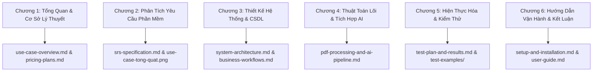

# DANH MỤC TÀI LIỆU KỸ THUẬT ĐỒ ÁN (PROJECT DOCUMENTATION SUITE)

## DỰ ÁN: NỀN TẢNG DỊCH THUẬT TÀI LIỆU PDF HỌC THUẬT & TRỢ LÝ AI (PDF-LINGUA)

| Thông tin | Chi tiết |
|---|---|
| **Tên dự án (EN)** | PDF-Lingua: Academic PDF Translation & AI Research Assistant |
| **Tên dự án (VN)** | Nền tảng Dịch thuật PDF Học thuật & Trợ lý Nghiên cứu AI |
| **Loại tài liệu** | Master Documentation Index & Thesis Mapping |
| **Viết tắt** | PDF-Lingua |
| **Phiên bản tài liệu** | 1.2 |
| **Ngày tạo** | 15/09/2026 |
| **Ngày chỉnh sửa lần cuối** | 20/11/2026 |
| **Trạng thái** | Hoàn thành (Release) |

---

## 1. Bản Đồ Tra Cứu Toàn Bộ Tài Liệu (Documentation Master Index)

Bảng điều hướng tổng hợp toàn bộ các tài liệu kỹ thuật, kiến trúc, kiểm thử và hướng dẫn vận hành của đồ án:

| STT | Nhóm Tài Liệu | Đường Dẫn Tệp Chi Tiết | Mô Tả Tóm Tắt Nội Dung |
| :---: | :--- | :--- | :--- |
| **01** | **Kiến Trúc Hệ Thống** | [`Docs/architecture-design/system-architecture.md`](file:///c:/University%20Coding%20Project/PDF-Lingua/Docs/architecture-design/system-architecture.md) | Sơ đồ kiến trúc 4 tầng, mô hình thực thể quan hệ ERD, cơ chế bảo mật Defense-in-Depth và phân vùng lưu trữ. |
| **02** | **Thuật Toán & AI** | [`Docs/ai-design/pdf-processing-and-ai-pipeline.md`](file:///c:/University%20Coding%20Project/PDF-Lingua/Docs/ai-design/pdf-processing-and-ai-pipeline.md) | Cơ chế Hybrid Fast Path (Digital vs Scanned), Smart Layout luồng đọc 2 cột, Smart Chunking và Tóm tắt Map-Reduce. |
| **03** | **Đặc Tả Yêu Cầu (SRS)**| [`Docs/software-requirement-specification/srs-specification.md`](file:///c:/University%20Coding%20Project/PDF-Lingua/Docs/software-requirement-specification/srs-specification.md) | Đặc tả 11 yêu cầu chức năng (FR), 4 yêu cầu phi chức năng (NFR), ma trận phân quyền tác nhân (Guest, Free, Pro, Admin). |
| **04** | **Kiểm Thử & CI/CD** | [`Docs/testing-documents/test-plan-and-results.md`](file:///c:/University%20Coding%20Project/PDF-Lingua/Docs/testing-documents/test-plan-and-results.md) | Báo cáo kết quả 10 test suites Frontend, kiểm thử Backend, ma trận an toàn bảo mật và tự động hóa GitHub Actions. |
| **05** | **Hướng Dẫn Cài Đặt** | [`Docs/installation-guide/setup-and-installation.md`](file:///c:/University%20Coding%20Project/PDF-Lingua/Docs/installation-guide/setup-and-installation.md) | Hướng dẫn cài Tesseract OCR tiếng Việt, cấu hình biến môi trường `.env`, khởi chạy một chạm qua `run.bat` và khắc phục sự cố. |
| **06** | **Luồng Nghiệp Vụ** | [`Docs/workflows/business-workflows.md`](file:///c:/University%20Coding%20Project/PDF-Lingua/Docs/workflows/business-workflows.md) | Sequence Diagrams chi tiết luồng bóc tách dịch thuật PDF, thanh toán nâng cấp Pro qua VietQR Napas247 / SePay Webhook. |
| **07** | **Hướng Dẫn Sử Dụng** | [`Docs/user-guide/user-guide.md`](file:///c:/University%20Coding%20Project/PDF-Lingua/Docs/user-guide/user-guide.md) | Cẩm nang thao tác dành cho người dùng cuối: dịch thuật song ngữ, hỏi đáp Copilot, tóm tắt và tải bản dịch. |
| **08** | **Mô Tả Use Case** | [`Docs/use-case/pdf-lingua-use-case-overview.md`](file:///c:/University%20Coding%20Project/PDF-Lingua/Docs/use-case/pdf-lingua-use-case-overview.md) | Sơ đồ Use case tổng quát, mô tả phạm vi tác nhân và hành vi tương tác hệ thống. |
| **09** | **Bảng Giá & Gói Cước** | [`Docs/pricing-plans/pricing-plans.md`](file:///c:/University%20Coding%20Project/PDF-Lingua/Docs/pricing-plans/pricing-plans.md) | Quy định chi tiết quyền lợi gói Miễn Phí (0đ) và Gói Chuyên Nghiệp (49.000đ/tháng, 399.000đ/năm). |
| **10** | **Tệp PDF Kiểm Thử** | [`Docs/test-examples/README.md`](file:///c:/University%20Coding%20Project/PDF-Lingua/Docs/test-examples/README.md) | Danh mục 5 tệp PDF thực tế đánh giá các trường hợp biên: đa ngôn ngữ, ký hiệu code, tiền tệ và bảng chữ cái tiếng Việt. |
| **11** | **Quy Chuẩn Màu Sắc** | [`Docs/color-theme/pdf-lingua-color-theme.md`](file:///c:/University%20Coding%20Project/PDF-Lingua/Docs/color-theme/pdf-lingua-color-theme.md) | Hệ thống bảng màu chuẩn, mã màu Hex/RGBA và quy chuẩn tương phản giao diện UI/UX. |

---

## 2. Bản Đồ Ánh Xạ Vào Cấu Trúc Báo Cáo Đồ Án Tốt Nghiệp

Dành cho sinh viên khi tổng hợp nội dung vào cuốn Báo cáo Khóa luận / Đồ án chuyên ngành CNTT:

- **Chương 1 (Tổng quan đề tài)**: Trích xuất bối cảnh từ `use-case/` và bài toán chi phí/giải pháp từ `pricing-plans/`.
- **Chương 2 (Phân tích yêu cầu)**: Toàn bộ nội dung bảng FR/NFR và phân quyền tác nhân từ `software-requirement-specification/`.
- **Chương 3 (Thiết kế kiến trúc)**: Sơ đồ 4 tầng, mô hình ERD từ `architecture-design/` và sơ đồ tương tác từ `workflows/`.
- **Chương 4 (Thuật toán & AI)**: Trọng tâm đề tài: Hybrid Fast Path, Smart Layout 2 cột, Smart Chunking, Map-Reduce từ `ai-design/`.
- **Chương 5 (Kiểm thử & Đánh giá)**: Báo cáo kết quả kiểm thử tự động, kiểm thử bảo mật và quy trình CI/CD từ `testing-documents/`.
- **Chương 6 (Vận hành & Hướng dẫn)**: Hướng dẫn cài đặt một chạm từ `installation-guide/` và cẩm nang người dùng từ `user-guide/`.

---

## 3. Tiêu Chuẩn Duy Trì & Đảm Bảo Chất Lượng Tài Liệu

- **Chuẩn ký tự quốc tế**: Toàn bộ các tệp tài liệu trong hệ thống tuân thủ nghiêm ngặt định dạng mã hóa `UTF-8` không kèm ký tự đặc biệt gây xung đột parser (`zero en-dash / zero em-dash`).
- **Liên kết điều hướng (Deep Links)**: Mỗi tài liệu đều chứa liên kết tuyệt đối và liên kết nội bộ giúp tra cứu nhanh chóng mã nguồn và tài liệu liên quan.
- **Sơ đồ trực quan hóa**: Mọi quy trình và kiến trúc đều đi kèm sơ đồ `Mermaid` chuẩn, hiển thị trực quan ngay trên giao diện GitHub và các trình xem Markdown hiện đại.

