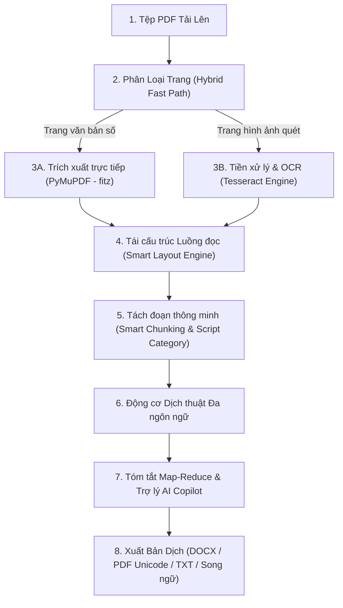
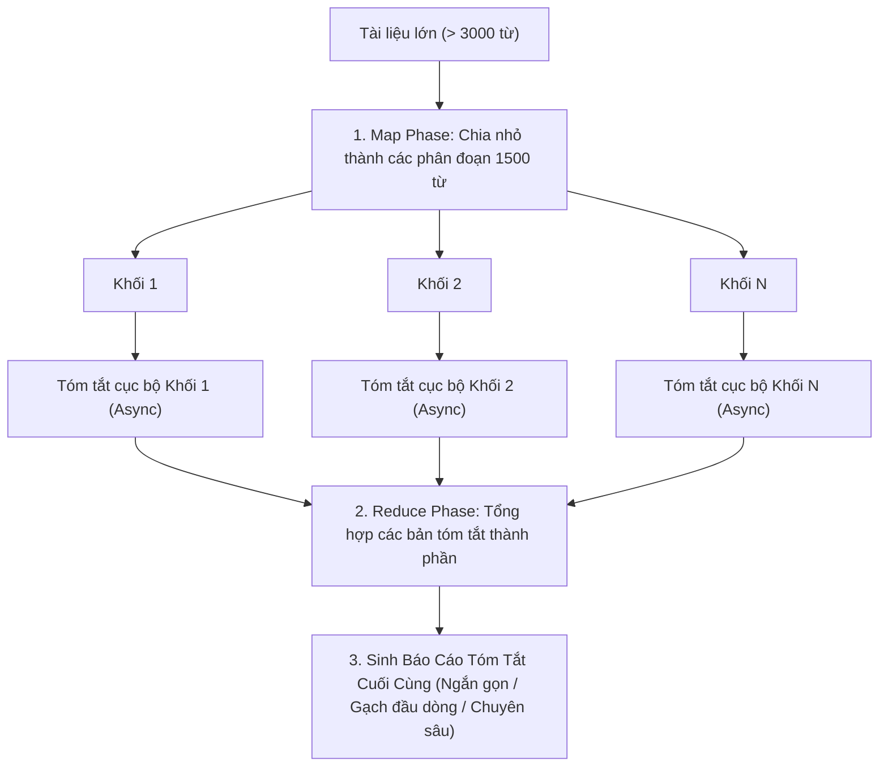

# THIẾT KẾ THUẬT TOÁN XỬ LÝ PDF, OCR & PIPELINE TRÍ TUỆ NHÂN TẠO

## DỰ ÁN: NỀN TẢNG DỊCH THUẬT TÀI LIỆU PDF HỌC THUẬT & TRỢ LÝ AI (PDF-LINGUA)

| Thông tin | Chi tiết |
|---|---|
| **Tên dự án (EN)** | PDF-Lingua: Academic PDF Translation & AI Research Assistant |
| **Tên dự án (VN)** | Nền tảng Dịch thuật PDF Học thuật & Trợ lý Nghiên cứu AI |
| **Loại tài liệu** | AI & Processing Pipeline Design Document |
| **Viết tắt** | PDF-Lingua |
| **Phiên bản tài liệu** | 1.2 |
| **Ngày tạo** | 15/09/2026 |
| **Ngày chỉnh sửa lần cuối** | 20/11/2026 |
| **Trạng thái** | Hoàn thành (Release) |

---

## 1. Tổng Quan Quy Trình Pipeline Xử Lý (End-to-End Pipeline)

Quy trình xử lý một tệp PDF từ khi người dùng tải lên đến khi hoàn tất bản dịch và sinh báo cáo AI được tự động hóa qua 5 giai đoạn:



---

## 2. Cơ Chế Hybrid Fast Path (Tự Động Phân Loại Trang Số vs Trang Scan)

Trong các tài liệu học thuật hoặc báo cáo thực tế, tệp PDF thường có tính chất hỗn hợp: một số trang là văn bản điện tử nguyên bản (Digital text), trong khi một số trang là hình ảnh chụp/scan (Scanned image).

Nếu chạy OCR cho toàn bộ tệp, thời gian xử lý sẽ rất lâu và tiêu tốn CPU. Nếu chỉ trích xuất text thuần thì các trang scan sẽ bị trống (0 chữ). **Cơ chế Hybrid Fast Path** giải quyết triệt để vấn đề này:

```mermaid
flowchart TD
    P["Duyệt từng trang PDF"] --> T1["Trích xuất ký tự thô qua Text Layer"]
    T1 --> C1{"Số lượng ký tự >= 25 ký tự?"}
    C1 -->|Đúng (Digital Page)| D1["Fast Path: Trích xuất tọa độ khối chữ trực tiếp"]
    C1 -->|Sai (Scanned/Image Page)| O1["Kiểm tra trang trống (is_blank_page)"]
    O1 --> C2{"Tỉ lệ điểm ảnh tối > 0.05%?"}
    C2 -->|Trang trắng hoàn toàn| D2["Bỏ qua OCR, đánh dấu trang trống"]
    C2 -->|Có nội dung scan| D3["Render ảnh độ phân giải cao (150-300 DPI)"]
    D3 --> D4["Xoay chuẩn OSD (0, 90, 180, 270 độ)"]
    D4 --> D5["OCR Tesseract tiếng Việt + tiếng Anh"]
    D1 --> M1["Hợp nhất dữ liệu văn bản theo trang"]
    D2 --> M1
    D5 --> M1
```

- **Tiết kiệm tài nguyên**: Giảm hơn 70% thời gian xử lý đối với các tệp PDF tài liệu văn phòng thông thường.
- **Lọc nhiễu trang trắng**: Tự động phát hiện và bỏ qua các trang trắng quét scan bị lấm chấm nhiễu hạt bụi (`content_ratio_threshold = 0.0005`), tránh gửi dữ liệu rác vào mô hình AI.

---

## 3. Thuật Toán Smart Layout & Tái Cấu Trúc Luồng Đọc Hai Cột

Một trong những hạn chế lớn nhất của việc đọc PDF thông thường là văn bản hai cột (báo cáo khoa học IEEE/ACM) thường bị đọc theo chiều ngang ngang qua hai cột, làm đảo lộn hoàn toàn thứ tự các câu.

### Nguyên lý giải quyết của Smart Layout:
1. **Phân tích tọa độ hình học (Bounding Boxes)**: Thu thập danh sách các khối văn bản gồm `(x0, top, x1, bottom, text)`.
2. **Xác định đường phân cách cột (Column Divider)**: Tính toán phân bố trục ngang `X` của trang để nhận diện khoảng trống giữa 2 cột (`gutter`).
3. **Sắp xếp thứ tự tự nhiên (Natural Reading Flow)**:
   - Phần Tiêu đề / Tóm tắt nằm trên cùng (chiếm toàn bộ chiều rộng) được đọc trước.
   - Cột bên trái được đọc tuần tự từ trên xuống dưới cho đến hết cột.
   - Cột bên phải được đọc tiếp theo từ trên xuống dưới.
   - Phần Chân trang / Bản quyền nằm dưới cùng được đọc sau cùng.

---

## 4. Thuật Toán Smart Chunking & Script Categorization

Dịch thuật tự động yêu cầu văn bản đầu vào không vượt quá độ dài cửa sổ ngữ cảnh (thường từ 1000 đến 1500 ký tự) nhưng **không được ngắt đôi câu văn**, không được làm hỏng link web, email, công thức toán hay bảng chữ cái.

### Phân loại hệ chữ (Script Category Algorithm):
Hệ thống sử dụng bảng tra cứu dải mã Unicode để nhận diện từng đoạn:
- **Latin / Vietnamese**: Hỗ trợ tiếng Việt đầy đủ dấu thanh (`Unicode Vietnamese Precomposed & Combining`).
- **CJK (Chinese, Japanese, Korean)**: Nhận diện chữ Hán, Hiragana, Katakana, Hangul.
- **Cyrillic**: Tiếng Nga và các ngôn ngữ Đông Âu.
- **Preserved Blocks (Khối bảo tồn)**:
  - Đường dẫn URL (`https://...`), Địa chỉ Email (`contact@...`).
  - Biến môi trường hệ thống (`.env`, `PORT=8000`).
  - Công thức vật lý / toán học (`E = mc^2`).
  - Dấu đầu dòng phân cấp danh sách (Số La Mã `I, II, III`, ký tự gạch đầu dòng `-`, `•`).

---

## 5. Cơ Chế Tóm Tắt Văn Bản Lớn Map-Reduce & Offline Fallback

Khi người dùng cần tóm tắt các tài liệu học thuật dài hàng chục trang (vượt quá giới hạn token đơn lẻ của mô hình LLM), hệ thống áp dụng kỹ thuật **Map-Reduce Summarization**:



### Cơ chế Offline Mock Fallback:
- Trong trường hợp mất kết nối mạng internet hoặc cổng API ngoài (B.AI / Gemini) báo lỗi thiếu hạn ngạch (`credit_insufficient`), hệ thống **tự động chuyển sang động cơ tóm tắt trích xuất offline (Extractive Heuristic Fallback)**.
- Phân tích tần suất từ khóa TF (Term Frequency) và chọn lọc các câu chủ đề quan trọng nhất mà không làm gián đoạn trải nghiệm của người dùng.

---

## 6. Trợ Lý AI Copilot Hỏi Đáp Theo Ngữ Cảnh (Document-Grounded QA)

Tính năng **Hỏi đáp AI Copilot** hoạt động theo mô hình RAG rút gọn trực tiếp từ nội dung đã bóc tách:
- **Ngữ cảnh hóa (Document In-Context)**: Trợ lý AI chỉ trả lời dựa trên chính xác thông tin có trong văn bản đã dịch hoặc trích xuất.
- **Chống ảo giác (Anti-Hallucination Guardrail)**: Nếu câu hỏi nằm ngoài phạm vi tài liệu, trợ lý AI sẽ phản hồi rõ ràng: *"Thông tin này không được đề cập trong nội dung tài liệu hiện tại."*
- **Hỗ trợ đa ngôn ngữ đối chiếu**: Người dùng có thể hỏi bằng tiếng Việt về một tài liệu gốc viết bằng tiếng Anh, tiếng Nhật hoặc tiếng Pháp.

