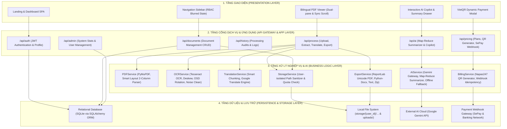
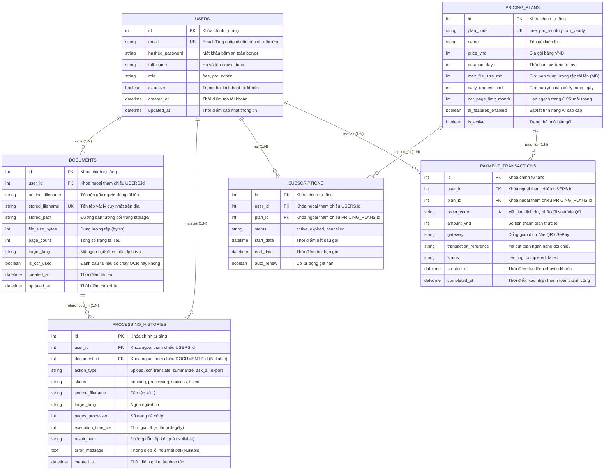
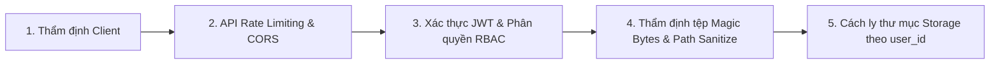

# TÀI LIỆU THIẾT KẾ KIẾN TRÚC HỆ THỐNG (ARCHITECTURE DESIGN DOCUMENT)

## DỰ ÁN: NỀN TẢNG DỊCH THUẬT TÀI LIỆU PDF HỌC THUẬT & TRỢ LÝ AI (PDF-LINGUA)

| Thông tin | Chi tiết |
|---|---|
| **Tên dự án (EN)** | PDF-Lingua: Academic PDF Translation & AI Research Assistant |
| **Tên dự án (VN)** | Nền tảng Dịch thuật PDF Học thuật & Trợ lý Nghiên cứu AI |
| **Loại tài liệu** | Architecture Design Document |
| **Viết tắt** | PDF-Lingua |
| **Phiên bản tài liệu** | 1.2 |
| **Ngày tạo** | 15/09/2026 |
| **Ngày chỉnh sửa lần cuối** | 20/11/2026 |
| **Trạng thái** | Hoàn thành (Release) |

---

## Mục lục

1. [Tóm tắt tổng quan (Executive Summary)](#1-tóm-tắt-tổng-quan-executive-summary)
   - [1.1. Mục đích tài liệu](#11-mục-đích-tài-liệu)
   - [1.2. Bối cảnh & Mục tiêu kỹ thuật](#12-bối-cảnh--mục-tiêu-kỹ-thuật)
2. [Quyết định thiết kế kiến trúc (Architectural Decisions)](#2-quyết-định-thiết-kế-kiến-trúc-architectural-decisions)
   - [2.1. Lựa chọn mô hình phân tầng Layered Architecture](#21-lựa-chọn-mô-hình-phân-tầng-layered-architecture)
   - [2.2. Lựa chọn Backend Framework: FastAPI & Python 3.12](#22-lựa-chọn-backend-framework-fastapi--python-312)
   - [2.3. Lựa chọn Frontend: Modern Vanilla JS SPA](#23-lựa-chọn-frontend-modern-vanilla-js-spa)
   - [2.4. Lựa chọn giải pháp trích xuất PDF: PyMuPDF kết hợp Tesseract OCR](#24-lựa-chọn-giải-pháp-trích-xuất-pdf-pymupdf-kết-hợp-tesseract-ocr)
   - [2.5. Lựa chọn cổng thanh toán: VietQR Napas247 qua SePay Webhook](#25-lựa-chọn-cổng-thanh-toán-vietqr-napas247-qua-sepay-webhook)
3. [Kiến trúc phân lớp (Layered Architecture)](#3-kiến-trúc-phân-lớp-layered-architecture)
   - [3.1. Sơ đồ kiến trúc tổng thể](#31-sơ-đồ-kiến-trúc-tổng-thể)
   - [3.2. Tầng giao diện người dùng (Presentation Layer)](#32-tầng-giao-diện-người-dùng-presentation-layer)
   - [3.3. Tầng cổng dịch vụ & Ứng dụng (API Gateway & Application Layer)](#33-tầng-cổng-dịch-vụ--ứng-dụng-api-gateway--application-layer)
   - [3.4. Tầng xử lý nghiệp vụ & AI (Business Logic & AI Processing Layer)](#34-tầng-xử-lý-nghiệp-vụ--ai-business-logic--ai-processing-layer)
   - [3.5. Tầng dữ liệu & Lưu trữ (Data Persistence & Storage Layer)](#35-tầng-dữ-liệu--lưu-trữ-data-persistence--storage-layer)
4. [Thiết kế các thành phần cốt lõi (Core Components Design)](#4-thiết-kế-các-thành-phần-cốt-lõi-core-components-design)
   - [4.1. Bộ phận tiếp nhận & Thẩm định an toàn tệp PDF (Ingestion & Sanitization)](#41-bộ-phận-tiếp-nhận--thẩm-định-an-toàn-tệp-pdf-ingestion--sanitization)
   - [4.2. Bộ phân loại luồng lai (Hybrid Fast Path Classifier)](#42-bộ-phân-loại-luồng-lai-hybrid-fast-path-classifier)
   - [4.3. Công cụ phân tích bố cục Smart Layout 2 cột](#43-công-cụ-phân-tích-bố-cục-smart-layout-2-cột)
   - [4.4. Động cơ phân đoạn Smart Chunking & Dịch thuật đa ngữ](#44-động-cơ-phân-đoạn-smart-chunking--dịch-thuật-đa-ngữ)
   - [4.5. Trợ lý AI Copilot & Tóm tắt Map-Reduce](#45-trợ-lý-ai-copilot--tóm-tắt-map-reduce)
   - [4.6. Cổng thanh toán VietQR & Xử lý Webhook SePay](#46-cổng-thanh-toán-vietqr--xử-lý-webhook-sepay)
5. [Kiến trúc dữ liệu (Data Architecture)](#5-kiến-trúc-dữ-liệu-data-architecture)
   - [5.1. Sơ đồ thực thể quan hệ (ERD)](#51-sơ-đồ-thực-thể-quan-hệ-erd)
   - [5.2. Đặc tả chi tiết các thực thể dữ liệu](#52-đặc-tả-chi-tiết-các-thực-thể-dữ-liệu)
   - [5.3. Ràng buộc toàn vẹn & Chiến lược đánh chỉ mục (Indexes)](#53-ràng-buộc-toàn-vẹn--chiến-lược-đánh-chỉ-mục-indexes)
6. [Mô hình bảo mật (Security Architecture)](#6-mô-hình-bảo-mật-security-architecture)
   - [6.1. Nguyên lý phòng thủ chiều sâu (Defense-in-Depth)](#61-nguyên-lý-phòng-thủ-chiều-sâu-defense-in-depth)
   - [6.2. Xác thực JWT & Phân quyền RBAC](#62-xác-thực-jwt--phân-quyền-rbac)
   - [6.3. Cách ly lưu trữ đa người dùng (Multi-tenant Storage Isolation)](#63-cách-ly-lưu-trữ-đa-người-dùng-multi-tenant-storage-isolation)
   - [6.4. Bảo vệ điểm cuối Webhook thanh toán](#64-bảo-vệ-điểm-cuối-webhook-thanh-toán)
7. [Đặc tả hiệu năng & Khả năng mở rộng (Performance & Scalability)](#7-đặc-tả-hiệu-năng--khả-năng-mở-rộng-performance--scalability)
8. [Phụ lục & Lịch sử phiên bản (Appendices & Revision History)](#8-phụ-lục--lịch-sử-phiên-bản-appendices--revision-history)

---

# 1. Tóm tắt tổng quan (Executive Summary)

## 1.1. Mục đích tài liệu

Tài liệu Thiết kế Kiến trúc Hệ thống (Architecture Design Document) này mô tả toàn diện cấu trúc kỹ thuật, giải pháp công nghệ, mô hình phân tầng, cấu trúc dữ liệu và các cơ chế bảo mật của nền tảng **PDF-Lingua**. Tài liệu là căn cứ kỹ thuật chính phục vụ quá trình lập trình, kiểm thử tải và bảo vệ Đồ án tốt nghiệp.

## 1.2. Bối cảnh & Mục tiêu kỹ thuật

Việc đọc và dịch các tài liệu khoa học định dạng PDF gặp nhiều rào cản lớn:
1. **Bố cục đa cột (2-column layouts)**: Các công cụ dịch thông thường trích xuất văn bản theo dòng ngang của toàn trang, dẫn đến câu văn bị xáo trộn giữa cột trái và cột phải, phá hỏng ngữ nghĩa khoa học.
2. **Tài liệu quét (Scanned PDFs)**: Nhiều tài liệu hội thảo và sách giáo trình chỉ có lớp ảnh chụp, đòi hỏi năng lực OCR quang học hỗ trợ dấu tiếng Việt chính xác.
3. **Thất thoát cấu trúc**: Bản dịch thông thường làm mất định dạng bảng biểu, công thức toán và liên kết trích dẫn.
4. **Trợ lý AI thiếu ngữ cảnh**: Các chatbot AI thông thường có giới hạn cửa sổ ngữ cảnh hoặc dễ sinh ảo giác (hallucination) khi không được định vị đúng vị trí trang tài liệu.

**Mục tiêu của PDF-Lingua**: Xây dựng một nền tảng Web tự chủ, gọn nhẹ, có khả năng phân luồng thông minh Hybrid Fast Path, tái cấu trúc luồng đọc 2 cột tự nhiên, tích hợp OCR tiếng Việt, dịch đối chiếu song ngữ và trợ lý AI Map-Reduce.

---

# 2. Quyết định thiết kế kiến trúc (Architectural Decisions)

Hệ thống tài liệu quyết định kiến trúc chi tiết (bối cảnh bài toán, các giải pháp đối trọng đã cân nhắc, phân tích ưu nhược điểm và sự đánh đổi kỹ thuật) được quản lý độc lập tại thư mục [Docs/architecture-design/adr/](file:///c:/University%20Coding%20Project/PDF-Lingua/Docs/architecture-design/adr/).

Bảng tóm tắt các quyết định kiến trúc then chốt:

| Quyết định thiết kế | Phương án được chọn | Lý do lựa chọn & Lợi ích kỹ thuật | Hồ sơ ADR chi tiết |
|---|---|---|:---:|
| **Kiến trúc hệ thống** | **Layered Clean Architecture** | Tách biệt hoàn toàn giữa giao diện, cổng API, tầng nghiệp vụ và tầng lưu trữ dữ liệu; tăng khả năng viết Unit Test độc lập và dễ dàng bảo trì. | Chi tiết tại Mục 3 |
| **Backend Framework** | **FastAPI (Python 3.12)** | Hỗ trợ lập trình bất đồng bộ (`asyncio`), tự động sinh tài liệu Swagger OpenAPI, hiệu năng cao xấp xỉ Node.js/Go và tương thích hoàn hảo với hệ sinh thái AI/ML của Python. | [ADR-004](file:///c:/University%20Coding%20Project/PDF-Lingua/Docs/architecture-design/adr/ADR-004-fastapi-backend-framework.md) |
| **Frontend Framework** | **Modern Vanilla JS (SPA)** | Loại bỏ hoàn toàn sự phụ thuộc vào các framework nặng (React, Vue, Angular), giảm thời gian tải ban đầu xuống dưới 1 giây, dễ dàng tích hợp và không phát sinh lỗi phiên bản dependency. | [ADR-003](file:///c:/University%20Coding%20Project/PDF-Lingua/Docs/architecture-design/adr/ADR-003-modern-vanilla-js-spa.md) |
| **Động cơ Trích xuất PDF** | **PyMuPDF + Tesseract OCR** | PyMuPDF cho tốc độ bóc tách văn bản số cực nhanh (< 200ms/trang). Khi phát hiện trang quét, hệ thống tự động gọi Tesseract OCR tiếng Việt (`vie.traineddata`) với thuật toán cân chỉnh góc nghiêng tự động. | [ADR-001](file:///c:/University%20Coding%20Project/PDF-Lingua/Docs/architecture-design/adr/ADR-001-hybrid-fast-path-extraction.md) |
| **Tái cấu trúc Luồng đọc** | **Smart Layout 2 cột** | Thuật toán phân tách hình học phân loại cột dựa trên Bounding Box và phân tích khoảng trống, bảo toàn trật tự câu văn học thuật. | [ADR-006](file:///c:/University%20Coding%20Project/PDF-Lingua/Docs/architecture-design/adr/ADR-006-smart-layout-reading-flow.md) |
| **Cơ sở dữ liệu** | **SQLite + SQLAlchemy ORM** | Phù hợp tuyệt đối cho môi trường triển khai đồ án và quy mô vừa: không cần cấu hình cụm DBMS phức tạp, tự đóng gói thành 1 tệp duy nhất, hỗ trợ ACID đầy đủ và dễ dàng chuyển dịch sang PostgreSQL khi mở rộng. | [ADR-005](file:///c:/University%20Coding%20Project/PDF-Lingua/Docs/architecture-design/adr/ADR-005-sqlite-sqlalchemy-persistence.md) |
| **Cổng thanh toán** | **VietQR Napas247 + SePay Webhook** | Giải pháp thanh toán phổ biến nhất tại Việt Nam: không yêu cầu thẻ tín dụng quốc tế, người dùng quét mã VietQR ngân hàng bất kỳ, Webhook tự động kích hoạt tài khoản trong vòng 3 giây. | [ADR-002](file:///c:/University%20Coding%20Project/PDF-Lingua/Docs/architecture-design/adr/ADR-002-vietqr-napas247-payment-gateway.md) |

---

# 3. Kiến trúc phân lớp (Layered Architecture)

## 3.1. Sơ đồ kiến trúc tổng thể

Hệ thống được tổ chức thành 4 phân tầng độc lập theo chuẩn phân lớp hiện đại:



## 3.2. Tầng giao diện người dùng (Presentation Layer)
- Xây dựng theo mô hình Single Page Application (SPA) với kiến trúc component hóa bằng JavaScript thuần.
- Quản lý trạng thái xác thực phía client (`AuthStateManager`): tự động điều chỉnh hiển thị giao diện theo vai trò (Khách, Free, Pro, Admin). Đối với tài khoản Khách, các mục menu cá nhân được tự động làm mờ và gắn tooltip điều hướng đăng nhập.
- Trình xem PDF song ngữ: Tích hợp kỹ thuật cuộn đồng bộ theo tỷ lệ phần trăm vị trí trang, giúp người đọc đối chiếu trực quan từng đoạn văn bản học thuật gốc và bản dịch.

## 3.3. Tầng cổng dịch vụ & Ứng dụng (API Gateway & Application Layer)
- Triển khai trên nền tảng FastAPI với router module hóa rõ ràng:
  - `auth.py`: Đăng ký, đăng nhập, cấp phát JWT và thẩm định quyền người dùng.
  - `process.py`: Điều phối luồng tải lên, bóc tách trang, dịch thuật và xuất tệp.
  - `documents.py`: Cung cấp các thao tác CRUD danh mục tài liệu của người dùng hiện tại.
  - `ai.py`: Xử lý yêu cầu tóm tắt Map-Reduce và hỏi đáp Copilot ngữ cảnh.
  - `pricing.py`: Trả về danh mục bảng giá, tạo mã VietQR và lắng nghe Webhook SePay.
  - `admin.py`: Điểm cuối quản trị dành riêng cho vai trò `admin`.
- Middleware & Dependencies: Áp dụng cơ chế Dependency Injection của FastAPI (`get_db`, `get_current_user`, `require_pro_user`, `require_admin`) để kiểm soát bảo mật chặt chẽ trước khi yêu cầu đi vào tầng xử lý nghiệp vụ.

## 3.4. Tầng xử lý nghiệp vụ & AI (Business Logic & AI Processing Layer)
- Chứa toàn bộ các thuật toán cốt lõi độc lập với framework web:
  - Bóc tách văn bản số và phân loại phân đoạn.
  - Xử lý ảnh số học và nhận dạng ký tự quang học.
  - Thuật toán Smart Chunking phân đoạn theo ngữ nghĩa.
  - Động cơ tóm tắt Map-Reduce và Copilot định vị ngữ cảnh tài liệu.
  - Bộ xuất bản ReportLab hỗ trợ phông chữ DejaVuSans Unicode hoàn chỉnh.

## 3.5. Tầng dữ liệu & Lưu trữ (Data Persistence & Storage Layer)
- **Cơ sở dữ liệu quan hệ**: SQLite được quản lý qua SQLAlchemy ORM với kết nối đồng bộ an toàn, tự động kích hoạt `PRAGMA foreign_keys = ON` để đảm bảo tính toàn vẹn dữ liệu.
- **Hệ thống tệp lưu trữ (Storage)**: Lưu trữ các tệp PDF gốc, tệp bóc tách trung gian và tệp bản dịch xuất bản. Phân vùng thư mục nghiêm ngặt theo `storage/{user_id}/` nhằm cách ly tuyệt đối dữ liệu giữa các tài khoản người dùng.

---

# 4. Thiết kế các thành phần cốt lõi (Core Components Design)

## 4.1. Bộ phận tiếp nhận & Thẩm định an toàn tệp PDF (Ingestion & Sanitization)
Thành phần tiếp nhận tệp áp dụng quy trình kiểm soát an toàn nghiêm ngặt trước khi ghi tệp vào đĩa:
1. **Kiểm tra giới hạn kích thước (Quota Check)**: Đối chiếu dung lượng tệp với hạn mức của gói cước hiện tại (Free: 20MB, Pro: 100MB).
2. **Kiểm tra Magic Bytes**: Đọc 8 bytes đầu tiên của tệp nhị phân để đảm bảo tệp bắt đầu bằng chuỗi `%PDF-1.`. Ngăn chặn hành vi đổi đuôi tệp nguy hại (ví dụ: đổi `.exe` thành `.pdf`).
3. **Thẩm định cấu trúc tài liệu**: Thử nghiệm mở tệp bằng PyMuPDF; nếu tệp bị mã hóa mật khẩu hoặc bị hỏng cấu trúc (corrupted), hệ thống từ chối ngay lập tức và trả thông báo lỗi thân thiện.
4. **Làm sạch đường dẫn (Path Sanitization)**: Tạo tên tệp vật lý duy nhất trên đĩa theo định dạng `{uuid4}_{safe_filename}` để ngăn chặn tấn công Path Traversal (`../../etc/passwd`).

## 4.2. Bộ phân loại luồng lai (Hybrid Fast Path Classifier)
Giải thuật phân luồng tối ưu hóa tốc độ và tài nguyên xử lý:
- Duyệt qua từng trang của tài liệu PDF:
  - Nếu số lượng ký tự văn bản trích xuất được từ trang $\ge 50$ ký tự $\rightarrow$ Phân loại là **Trang số (Digital Page)**. Hệ thống trích xuất văn bản số trực tiếp qua PyMuPDF với thời gian xử lý cực nhanh (< 200ms).
  - Nếu số lượng ký tự $< 50$ ký tự $\rightarrow$ Phân loại là **Trang quét (Scanned Page)**. Hệ thống chuyển trang sang dạng ảnh độ phân giải 300 DPI và kích hoạt pipeline Tesseract OCR.
- **Tối ưu hóa OCR**: Áp dụng bộ lọc khử nhiễu (Denoising), thuật toán xoay chiều tự động theo OSD (Orientation and Script Detection) và bỏ qua các trang trắng quét scan bị bám bụi bẩn.

## 4.3. Công cụ phân tích bố cục Smart Layout 2 cột
Thách thức lớn nhất trong việc dịch tài liệu học thuật là cấu trúc 2 cột:
1. PyMuPDF trích xuất từng khối văn bản (text blocks) kèm tọa độ không gian `(x0, y0, x1, y1)`.
2. Hệ thống tính toán điểm chia rãnh cột trung tâm (gutter) của trang:
   - Khối văn bản có tọa độ bao phủ toàn bộ chiều ngang trang ($x0 < \text{gutter}$ và $x1 > \text{gutter}$) được xác định là Tiêu đề hoặc Tóm tắt đầu bài báo (Header / Abstract).
   - Khối văn bản nằm hoàn toàn bên trái ($x1 \le \text{gutter}$) được gom vào Cột Trái.
   - Khối văn bản nằm hoàn toàn bên phải ($x0 \ge \text{gutter}$) được gom vào Cột Phải.
3. Tái cấu trúc luồng đọc: Sắp xếp theo thứ tự Tiêu đề $\rightarrow$ Toàn bộ nội dung Cột Trái (từ trên xuống) $\rightarrow$ Toàn bộ nội dung Cột Phải (từ trên xuống) $\rightarrow$ Chân trang.

## 4.4. Động cơ phân đoạn Smart Chunking & Dịch thuật đa ngữ
- **Smart Chunking**: Chia văn bản dài thành các đoạn nhỏ tối ưu (400 - 600 từ), sử dụng biểu thức chính quy nhận diện ranh giới câu (`[.!?]\s+`) và ngắt đoạn (`\n\n`), đảm bảo câu văn không bao giờ bị cắt vụn giữa chừng.
- **Bảo vệ thực thể (Entity Preservation)**: Trước khi gửi văn bản đến engine dịch thuật, hệ thống dùng mặt nạ regex để tạm thời thay thế các liên kết URL, email, biến mã nguồn, công thức toán và ký hiệu tiền tệ bằng các mã định danh token an toàn (ví dụ: `__ENTITY_URL_0__`), sau đó phục hồi nguyên vẹn vào bản dịch sau khi dịch xong.

## 4.5. Trợ lý AI Copilot & Tóm tắt Map-Reduce
- **Tóm tắt Map-Reduce cho tài liệu dài**:
  - *Pha Map*: Chia tài liệu thành các khối 3000 từ, gửi song song đến mô hình AI để tóm tắt các luận điểm cốt lõi của từng phần.
  - *Pha Reduce*: Gom toàn bộ các bản tóm tắt trung gian thành prompt tổng hợp và gửi đến AI để tạo ra bản báo cáo tóm tắt cuối cùng theo phong cách người dùng lựa chọn (Ngắn gọn, Gạch đầu dòng hoặc Chuyên sâu).
- **Cơ chế dự phòng Heuristic ngoại tuyến**: Nếu kết nối API AI đám mây bị ngắt hoặc timeout, hệ thống tự động kích hoạt thuật toán TextRank / TF-IDF trích xuất các câu có trọng số cao nhất trong tài liệu để trả về cho người dùng.

## 4.6. Cổng thanh toán VietQR & Xử lý Webhook SePay
- Khi người dùng nâng cấp gói, hệ thống sinh mã đơn hàng duy nhất `order_code` và tạo mã VietQR động chứa chính xác số tài khoản, tên chủ tài khoản, số tiền và nội dung chuyển khoản chuẩn.
- Khi người dùng hoàn tất chuyển khoản qua ứng dụng ngân hàng:
  - SePay phát hiện biến động số dư và gửi Webhook POST đến `/api/pricing/webhook/sepay`.
  - Backend xác thực chữ ký số API Key và kiểm tra tính hợp lệ của tài khoản nhận tiền.
  - Cơ chế **Idempotency**: Kiểm tra trạng thái giao dịch trong CSDL; nếu đơn hàng đã được xử lý trước đó, hệ thống lập tức trả về HTTP 200 mà không cộng lặp thời hạn gói.
  - Nếu đơn hàng hợp lệ: Chuyển trạng thái giao dịch sang `completed`, cập nhật role của người dùng thành `pro`, gia hạn thời gian gói trong bảng `subscriptions` và ghi nhật ký kiểm toán.

---

# 5. Kiến trúc dữ liệu (Data Architecture)

## 5.1. Sơ đồ thực thể quan hệ (ERD)

Cơ sở dữ liệu bao gồm 6 thực thể trung tâm được thiết kế chuẩn hóa mức 3NF, bảo đảm tính toàn vẹn tham chiếu thông qua khóa ngoại:



## 5.2. Đặc tả chi tiết các thực thể dữ liệu
- Bảng `users`: Quản lý danh tính và phân quyền truy cập. Cột `email` được đánh chỉ mục Unique và chuẩn hóa chữ thường trước khi ghi nhận (`@validates("email")`).
- Bảng `documents`: Đại diện cho các tệp PDF được lưu trữ. Mối quan hệ với `users` được cài đặt chính sách `ON DELETE CASCADE` đảm bảo khi xóa người dùng thì toàn bộ tài liệu liên quan được dọn dẹp sạch sẽ.
- Bảng `processing_histories`: Ghi nhận nhật ký kiểm toán (Audit Trail) của toàn bộ các thao tác xử lý trong hệ thống, phục vụ tra cứu lịch sử và thống kê hiệu năng.

## 5.3. Ràng buộc toàn vẹn & Chiến lược đánh chỉ mục (Indexes)
- Bật cờ `PRAGMA foreign_keys = ON` ngay khi khởi tạo phiên kết nối SQLite.
- Đánh chỉ mục Index trên các trường thường xuyên tra cứu và lọc:
  - `users.email`
  - `documents.user_id` và `documents.stored_filename`
  - `processing_histories.user_id` và `processing_histories.document_id`
  - `payment_transactions.order_code` và `payment_transactions.user_id`

---

# 6. Mô hình bảo mật (Security Architecture)

## 6.1. Nguyên lý phòng thủ chiều sâu (Defense-in-Depth)
Hệ thống thiết lập nhiều lớp kiểm soát bảo mật từ rìa ứng dụng đến tầng lưu trữ:



## 6.2. Xác thực JWT & Phân quyền RBAC
- Mật khẩu lưu trữ được băm bảo mật bằng thư viện `passlib` với thuật toán `bcrypt`.
- Phiên làm việc được quản lý bằng JWT Access Token chứa các trường claims tiêu chuẩn (`sub: user_id`, `role: user_role`, `exp: timestamp`).
- Các hàm kiểm tra phân quyền độc lập tại tầng phụ thuộc:
  - `require_authenticated_user`: Chặn khách vãng lai khi cố gắng gọi API xử lý tệp.
  - `require_pro_user`: Chặn người dùng Free khi cố gắng gọi API tóm tắt Map-Reduce hoặc Copilot.
  - `require_admin`: Chặn toàn bộ người dùng thông thường khi truy cập endpoint quản trị.

## 6.3. Cách ly lưu trữ đa người dùng (Multi-tenant Storage Isolation)
- Cấu trúc thư mục đĩa cứng được phân cấp:
  ```text
  storage/
  ├── 1/                     # Thư mục của người dùng user_id = 1
  │   ├── a1b2c3d4_paper.pdf
  │   └── a1b2c3d4_paper_translated_vi.docx
  ├── 2/                     # Thư mục của người dùng user_id = 2
  └── temp/                  # Thư mục chứa các tệp xử lý tạm
  ```
- Mỗi thao tác đọc hoặc tải tệp đều bắt buộc truy vấn CSDL để xác thực quyền sở hữu:
  `if document.user_id != current_user.id and not current_user.is_admin: raise HTTPException(403)`

## 6.4. Bảo vệ điểm cuối Webhook thanh toán
- Điểm cuối `/api/pricing/webhook/sepay` được bảo vệ bằng API Key / Bearer Token bí mật cấu hình qua biến môi trường `SEPAY_WEBHOOK_TOKEN`.
- Backend kiểm tra định dạng dữ liệu payload, đối chiếu số tài khoản người nhận với số tài khoản hệ thống đã đăng ký, và loại bỏ ngay lập tức các yêu cầu giả mạo.

---

# 7. Đặc tả hiệu năng & Khả năng mở rộng (Performance & Scalability)

| Tiêu chí | Mục tiêu thiết kế | Giải pháp kỹ thuật thực tế |
|---|---|---|
| **Thời gian đáp ứng API** | < 200ms cho các API CRUD | Sử dụng FastAPI bất đồng bộ (`async def`) và truy vấn SQLAlchemy tối ưu hóa chỉ mục. |
| **Xử lý tài liệu PDF lớn** | Hỗ trợ tệp tới 100MB | Bóc tách theo từng trang độc lập bằng PyMuPDF; giải phóng bộ nhớ (garbage collection) sau mỗi trang. |
| **Bảo toàn ngữ cảnh dịch** | 100% không đứt đoạn câu | Thuật toán Smart Chunking phân đoạn theo ranh giới câu và đoạn văn tự nhiên. |
| **Dung sai lỗi AI ngoài** | Khả dụng 99.5% | Cơ chế tự động rơi về Heuristic TextRank ngoại tuyến khi Gemini API gặp sự cố timeout. |
| **Mở rộng cơ sở dữ liệu** | Di chuyển dữ liệu mượt mà | SQLAlchemy ORM cho phép chuyển đổi từ SQLite sang PostgreSQL trong tương lai chỉ bằng việc đổi chuỗi kết nối `DATABASE_URL`. |

---

# 8. Phụ lục & Lịch sử phiên bản (Appendices & Revision History)

| Phiên bản | Ngày cập nhật | Tác giả | Tóm tắt nội dung thay đổi |
|---|---|---|---|
| `1.0` | 15/09/2026 | Nhóm Đồ Án | Thiết kế kiến trúc hệ thống ban đầu (FastAPI, SQLite, Vanilla JS). |
| `1.1` | 28/10/2026 | Nhóm Đồ Án | Bổ sung kiến trúc cổng thanh toán VietQR Napas247 và SePay Webhook. |
| `1.2` | 20/11/2026 | Nhóm Đồ Án | Hoàn thiện đặc tả kiến trúc phân lớp, sơ đồ ERD 6 bảng, quy trình bảo mật đa tầng và đồng bộ 100% với mã nguồn hiện tại. |
