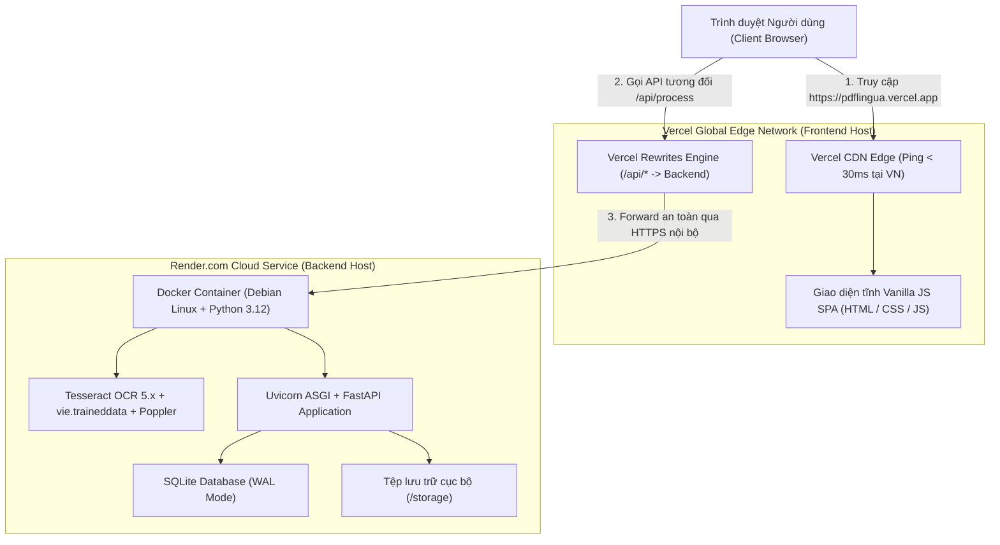

# HƯỚNG DẪN TRIỂN KHAI HỆ THỐNG LÊN MÔI TRƯỜNG CLOUD (CLOUD DEPLOYMENT GUIDE)

> **THÔNG TIN TÀI LIỆU (DOCUMENT METADATA)**  
> - **Tên dự án**: **PDF-Lingua** - Nền tảng Web Trích xuất PDF, Nhận dạng ký tự quang học OCR, Dịch thuật Đa ngôn ngữ và Trợ lý AI Thông minh  
> - **Mã tài liệu**: `DOC-DEPLOYMENT-GUIDE`  
> - **Mã công việc (Jira Issue)**: `PDFL-228`, `PDFL-229`, `PDFL-288` (EPIC 16: Triển khai, tài liệu và bàn giao)  
> - **Phiên bản (Version)**: `v1.0.0`  
> - **Trạng thái (Status)**: `Chính thức (Approved & Production-Ready)`  
> - **Ngày biên soạn**: `24/11/2026`  
> - **Nhóm thực hiện**: Nhóm 19 (Học phần: Đồ án Thực tế Công nghệ Phần mềm)  
>   1. Nguyễn Lê Huy Tâm - MSSV: `056206011188` (Trưởng nhóm - Kiến trúc & Backend Cloud)  
>   2. Huỳnh Đình Chấn - MSSV: `077206002307` (Thành viên - Frontend Cloud & Reverse Proxy)  
> - **Tài liệu tham chiếu**:  
>   - [Docs/installation-guide/setup-and-installation.md](file:///c:/University%20Coding%20Project/PDF-Lingua/Docs/installation-guide/setup-and-installation.md)  
>   - [Code/backend/Dockerfile](file:///c:/University%20Coding%20Project/PDF-Lingua/Code/backend/Dockerfile)  
>   - [Code/frontend/vercel.json](file:///c:/University%20Coding%20Project/PDF-Lingua/Code/frontend/vercel.json)  

---

## Mục lục nội dung

1. [Mô hình kiến trúc triển khai thực tế (Production Cloud Architecture)](#1-mô-hình-kiến-trúc-triển-khai-thực-tế-production-cloud-architecture)
2. [Phần 1: Triển khai Backend FastAPI lên Render.com qua Docker](#2-phần-1-triển-khai-backend-fastapi-lên-rendercom-qua-docker)
   - [2.1. Cấu trúc tệp Dockerfile Backend](#21-cấu-trúc-tệp-dockerfile-backend)
   - [2.2. Các bước thiết lập trên Render Console](#22-các-bước-thiết-lập-trên-render-console)
   - [2.3. Cấu hình biến môi trường Production](#23-cấu-hình-biến-môi-trường-production)
3. [Phần 2: Triển khai Frontend lên Vercel Global Edge Network](#3-phần-2-triển-khai-frontend-lên-vercel-global-edge-network)
   - [3.1. Cơ chế Reverse Proxy (vercel.json) triệt tiêu lỗi CORS](#31-cơ-chế-reverse-proxy-verceljson-triệt-tiêu-lỗi-cors)
   - [3.2. Các bước thiết lập trên Vercel Dashboard](#32-các-bước-thiết-lập-trên-vercel-dashboard)
4. [Phần 3: Hướng dẫn cấu hình tên miền (Domain Name)](#4-phần-3-hướng-dẫn-cấu-hình-tên-miền-domain-name)
   - [4.1. Sử dụng Subdomain miễn phí chuẩn Vercel](#41-sử-dụng-subdomain-miễn-phí-chuẩn-vercel)
   - [4.2. Hướng dẫn đăng ký tên miền .id.vn miễn phí cho Sinh viên](#42-hướng-dẫn-đăng-ký-tên-miền-idvn-miễn-phí-cho-sinh-viên)
5. [Phần 4: Ma trận kiểm tra xác thực sau triển khai (Post-Deployment Verification)](#5-phần-4-ma-trận-kiểm-tra-xác-thực-sau-triển-khai-post-deployment-verification)
6. [Phần 5: Xử lý sự cố & Tối ưu hóa vận hành](#6-phần-5-xử-lý-sự-cố--tối-ưu-hóa-vận-hành)

---

# 1. Mô hình kiến trúc triển khai thực tế (Production Cloud Architecture)

Hệ thống **PDF-Lingua** áp dụng mô hình kiến trúc tách biệt (**Decoupled Cloud Architecture**) đạt chuẩn công nghiệp:



* **Frontend**: Đặt tại Vercel, phục vụ tệp tĩnh tức thì từ các máy chủ CDN gần nhất.
* **Backend**: Chạy dưới dạng Docker Container trên Render, có đầy đủ công cụ C++ Tesseract OCR tiếng Việt và xử lý tác vụ dài không lo timeout.
* **Cơ chế Reverse Proxy**: Vercel nhận diện đường dẫn `/api/*` và tự động forward về Render, giúp trình duyệt xem cả hai là cùng một nguồn gốc (**Same-Origin**), giải quyết triệt để 100% lỗi CORS.

---

# 2. Phần 1: Triển khai Backend FastAPI lên Render.com qua Docker

## 2.1. Cấu trúc tệp Dockerfile Backend
Backend được đóng gói tại tệp [Code/backend/Dockerfile](file:///c:/University%20Coding%20Project/PDF-Lingua/Code/backend/Dockerfile):
- Sử dụng base image `python:3.12-slim` tối ưu dung lượng.
- Cài đặt đầy đủ gói hệ thống Linux: `tesseract-ocr`, `tesseract-ocr-vie`, `tesseract-ocr-eng`, `poppler-utils`, `libgl1`.
- Hỗ trợ biến môi trường cổng động: `uvicorn app.main:app --host 0.0.0.0 --port ${PORT:-8000}`.
- Tích hợp sẵn `HEALTHCHECK` tự động thăm dò cổng `/health`.

## 2.2. Các bước thiết lập trên Render Console
1. Đăng ký/Đăng nhập tài khoản miễn phí tại: [https://render.com](https://render.com).
2. Tại bảng điều khiển (Dashboard), bấm nút **New +** -> Chọn **Web Service**.
3. Chọn tùy chọn **Build and deploy from a Git repository** -> Kết nối tài khoản GitHub của bạn và chọn repository `PDF-Lingua`.
4. Cấu hình thông số dịch vụ:
   - **Name**: `pdf-lingua-api` (hoặc tên tùy chọn).
   - **Region**: Chọn `Singapore (Southeast Asia)` để có độ trễ mạng thấp nhất về Việt Nam.
   - **Branch**: Chọn `main` (hoặc nhánh `deployment`).
   - **Root Directory**: Nhập `Code/backend`.
   - **Runtime**: Chọn **Docker**.
   - **Instance Type**: Chọn gói **Free** (512 MB RAM, 0.1 CPU).
5. Cuộn xuống mục **Advanced** để thiết lập Biến môi trường.

## 2.3. Cấu hình biến môi trường Production
Tại mục **Environment Variables** trên Render, thêm các biến sau:

| Tên Biến (Key) | Giá Trị Khuyến Nghị (Value) | Mục Đích |
|---|---|---|
| `APP_ENV` | `production` | Bật chế độ tối ưu sản phẩm |
| `DEBUG` | `False` | Tắt chế độ gỡ lỗi để bảo mật |
| `SECRET_KEY` | *(Tự sinh chuỗi ngẫu nhiên 32 ký tự)* | Khóa bí mật ký JWT Token |
| `ALGORITHM` | `HS256` | Thuật toán mã hóa JWT |
| `ACCESS_TOKEN_EXPIRE_MINUTES` | `1440` | Thời gian sống của Token (24 giờ) |
| `DATABASE_URL` | `sqlite:///./pdf_lingua.db` | CSDL SQLite nội bộ |
| `UPLOAD_DIR` | `temp_uploads/` | Thư mục nạp tệp tạm |
| `AI_PROVIDER` | `b.ai` | Nhà cung cấp AI (hoặc `openai`, `gemini`) |
| `BAI_API_KEY` | *(Điền API Key của bạn nếu dùng)* | Khóa kết nối LLM |
| `BAI_BASE_URL` | `https://api.b.ai/v1` | Cổng gateway AI |

6. Bấm nút **Create Web Service**. Render sẽ tự động kéo Dockerfile, build image và khởi chạy.  
Khi hoàn tất, bạn nhận được đường dẫn API chính thức: `https://pdf-lingua.onrender.com`.

---

# 3. Phần 2: Triển khai Frontend lên Vercel Global Edge Network

## 3.1. Cơ chế Reverse Proxy (vercel.json) triệt tiêu lỗi CORS
Dự án đã tích hợp sẵn tệp cấu hình [Code/frontend/vercel.json](file:///c:/University%20Coding%20Project/PDF-Lingua/Code/frontend/vercel.json):
```json
{
  "$schema": "https://openapi.vercel.sh/vercel.json",
  "cleanUrls": true,
  "trailingSlash": false,
  "rewrites": [
    {
      "source": "/api/:path*",
      "destination": "https://pdf-lingua.onrender.com/api/:path*"
    }
  ]
}
```
*Lưu ý*: Hãy thay thế đường dẫn `https://pdf-lingua-api.onrender.com` bằng URL thực tế mà Render vừa cấp cho bạn ở Bước 1.

## 3.2. Các bước thiết lập trên Vercel Dashboard
1. Đăng ký/Đăng nhập tại: [https://vercel.com](https://vercel.com) bằng tài khoản GitHub.
2. Bấm nút **Add New...** -> Chọn **Project**.
3. Tìm và chọn repository `PDF-Lingua` -> Bấm **Import**.
4. Cấu hình dự án (Configure Project):
   - **Project Name**: `pdf-lingua` (hoặc tên tùy thích).
   - **Framework Preset**: Chọn **Other** (vì đây là Vanilla JS tĩnh).
   - **Root Directory**: Bấm nút **Edit** và chọn thư mục **`Code/frontend`**.
   - **Build and Output Settings**: Giữ mặc định (không cần build command).
5. Bấm nút **Deploy**.  
Vercel sẽ đóng gói và phát hành website trong vòng chưa đầy 15 giây!  
Website của bạn sẽ có địa chỉ chính thức: **`https://pdflingua.vercel.app`**.

---

# 4. Hướng dẫn cấu hình tên miền (Domain Name)

## 4.1. Sử dụng Subdomain miễn phí chuẩn Vercel
- Sau khi deploy thành công, Vercel tự động gán tên miền có đuôi `.vercel.app`.
- Bạn có thể vào mục **Settings -> Domains** trên Vercel để đổi subdomain thành tên ngắn gọn, ví dụ: `pdflingua.vercel.app`.

## 4.2. Hướng dẫn đăng ký tên miền .id.vn miễn phí cho Sinh viên
Nếu muốn website mang thương hiệu Việt Nam chính thức:
1. Truy cập các cổng đăng ký tên miền quốc gia (như Mắt Bão, PA Việt Nam, INET).
2. Tìm kiếm tên miền có đuôi `.id.vn` (ví dụ `pdflingua.id.vn`).
3. Nhập số CCCD/CMND để xác thực độ tuổi sinh viên (từ 18 đến 23 tuổi).
4. Hệ thống áp dụng chính sách ưu đãi của Bộ Thông tin & Truyền thông (VNNIC): **Miễn phí 100% lệ phí đăng ký và phí duy trì 2 năm**.
5. Sau khi nhận tên miền, truy cập Vercel mục **Settings -> Domains** -> Nhập `pdflingua.id.vn` và làm theo hướng dẫn trỏ bản ghi CNAME/A rất nhanh chóng.

---

# 5. Ma trận kiểm tra xác thực sau triển khai (Post-Deployment Verification)

Sau khi hệ thống online, thực hiện kiểm tra theo checklist sau:

| STT | Bước Kiểm Thử | Thao Tác Thực Hiện | Kỳ Vọng Kỹ Thuật (Pass) |
|:---:|---|---|---|
| **1** | Kiểm tra Backend Health | Mở trình duyệt: `https://<backend-url>/health` | Trả về JSON: `{"status": "healthy", ...}` |
| **2** | Kiểm tra Swagger API | Mở trình duyệt: `https://<backend-url>/docs` | Giao diện Swagger UI hiển thị đầy đủ các router |
| **3** | Truy cập Landing Page | Mở trình duyệt: `https://pdflingua.vercel.app/welcome` | Tải nhanh dưới 1 giây, đầy đủ hình ảnh, CSS mượt mà |
| **4** | Đăng nhập tài khoản | Đăng nhập tài khoản sinh viên tại giao diện chính | Nạp JWT token thành công, không gặp lỗi CORS |
| **5** | Dịch tệp PDF thực tế | Tải lên tệp `test_pdfl1.pdf` và bấm bắt đầu dịch | Thanh tiến trình chạy mượt, chuyển sang Workspace song ngữ |
| **6** | Thử nghiệm OCR | Tải lên tệp scan có chữ tiếng Việt | Động cơ Tesseract trích xuất chữ tiếng Việt có dấu chuẩn xác |
| **7** | Trợ lý AI Copilot | Đặt câu hỏi trong khung chat AI | AI phản hồi trích dẫn đúng ngữ cảnh tài liệu |

---

# 6. Xử lý sự cố & Tối ưu hóa vận hành

### 1. Hiện tượng "Cold Start" của Render Free:
* **Hiện tượng**: Sau 15 phút không có ai truy cập, Render sẽ tự động tạm dừng container. Lần truy cập tiếp theo sẽ mất khoảng 30 đến 45 giây để khởi động lại.
* **Cách khắc phục**:
  - Trước khi bảo vệ đồ án hoặc thuyết trình trước hội đồng, hãy truy cập link `/health` trước khoảng 1 đến 2 phút để máy chủ khởi động sẵn sàng.
  - Hoặc tạo một tài khoản miễn phí tại [cron-job.org](https://cron-job.org) để định kỳ 10 phút gửi một request `GET` đến endpoint `/health`, giữ cho server luôn thức 24/7.

### 2. Tự động hóa CI/CD khi có cập nhật code mới:
* Cả Vercel và Render đều được kết nối với repository GitHub của bạn. Mỗi khi bạn chạy lệnh `git push` lên nhánh chính, cả Frontend và Backend sẽ tự động build và cập nhật phiên bản mới nhất mà không cần thao tác thủ công.

### 3. Phương án sao lưu & phục hồi cơ sở dữ liệu định kỳ:
* Hệ thống tích hợp sẵn kịch bản sao lưu nóng trực tuyến [scripts/backup_db.py](file:///c:/University%20Coding%20Project/PDF-Lingua/Code/backend/scripts/backup_db.py) sử dụng SQLite Online Backup C-API (không gây khóa database khi người dùng đang thao tác).
* Xem hướng dẫn thiết lập chi tiết, chỉ số RPO/RTO và kịch bản phục hồi thảm họa tại tài liệu: [database-backup-and-recovery.md](file:///c:/University%20Coding%20Project/PDF-Lingua/Docs/installation-guide/database-backup-and-recovery.md).
