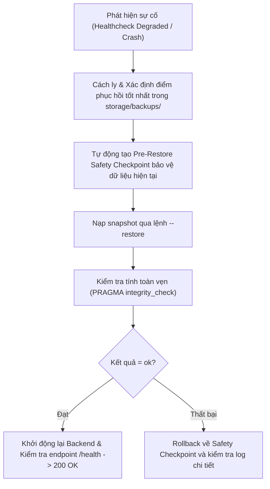

# Phương Án Sao Lưu & Phục Hồi Cơ Sở Dữ Liệu (Database Backup & Disaster Recovery Strategy)

> **Mã công việc (Jira Issue)**: PDFL-238  
> **Thuộc Epic**: EPIC 16 - Triển khai và Kiểm thử Môi trường Thực tế  
> **Áp dụng cho**: Cơ sở dữ liệu PDF-Lingua (SQLite WAL Mode / PostgreSQL Migration-ready)  
> **Mục tiêu**: Đảm bảo an toàn dữ liệu, tính sẵn sàng cao và khả năng phục hồi tức thì khi có sự cố.

---

## 1. Mục Tiêu & Các Chỉ Số Vận Hành (RPO / RTO)

Trong kỹ thuật phần mềm và vận hành hệ thống đám mây, phương án sao lưu và phục hồi dữ liệu được thiết kế bám sát hai chỉ số cốt lõi:

* **RPO (Recovery Point Objective - Mục tiêu điểm phục hồi)**: **< 24 giờ** đối với bản sao lưu snapshot định kỳ hàng ngày, và **< 1 giờ** khi kết hợp cơ chế Write-Ahead Logging (WAL mode). Trong trường hợp xấu nhất, dữ liệu bị mất không vượt quá chu kỳ sao lưu gần nhất.
* **RTO (Recovery Time Objective - Mục tiêu thời gian phục hồi)**: **< 5 phút**. Hệ thống có khả năng phục hồi dữ liệu nguyên vẹn từ bản snapshot và đưa dịch vụ trở lại trạng thái `healthy` trong vòng dưới 5 phút.

---

## 2. Kiến Trúc Sao Lưu Nóng (Online Hot Backup Architecture)

### 2.1. Thách thức kỹ thuật của sao lưu tệp cơ sở dữ liệu
Khi hệ thống đang phục vụ người dùng trực tuyến, các tiến trình nạp tài liệu, thanh toán gói cước và lịch sử xử lý liên tục thực hiện các thao tác ghi (Write Transactions). Nếu sao lưu bằng cách sao chép tệp nhị phân (`cp` hoặc `copy`) ở cấp độ hệ điều hành:
1. Có nguy cơ ghi đè dở dang (Torn Page) dẫn đến hỏng toàn bộ tệp database (`Database disk image is malformed`).
2. Gây nghẽn hoặc khóa giao dịch của người dùng khác (`database is locked`).

### 2.2. Giải pháp kỹ thuật áp dụng
Hệ thống triển khai cơ chế **Sao lưu nóng trực tuyến (Online Hot Backup)** thông qua SQLite Online Backup C-API (`sqlite3.Connection.backup`):
1. **Zero-downtime & Không gián đoạn giao dịch**: API sao lưu đọc các trang dữ liệu từ trang thái bộ nhớ đệm (shared cache/WAL) và truyền tải tuần tự sang tệp snapshot mà không chặn các truy vấn đọc/ghi của người dùng.
2. **Bảo đảm chuẩn ACID**: Bản sao lưu thu được luôn là một snapshot nhất quán tại thời điểm kết thúc sao lưu, bảo toàn 100% khóa ngoại (`FOREIGN KEY`) và tính toàn vẹn dữ liệu.
3. **Kiểm tra tính toàn vẹn tự động**: Mỗi bản snapshot sau khi tạo đều được tự động xác thực bằng câu lệnh `PRAGMA integrity_check;`. Nếu kết quả khác `ok`, tệp lỗi sẽ bị hủy ngay lập tức và ghi cảnh báo lỗi vào log hệ thống.

---

## 3. Công Cụ Sao Lưu Tự Động (`scripts/backup_db.py`)

Dự án cung cấp kịch bản tự động hóa [Code/backend/scripts/backup_db.py](file:///c:/University%20Coding%20Project/PDF-Lingua/Code/backend/scripts/backup_db.py) với đầy đủ tính năng:

### 3.1. Các lệnh thao tác cơ bản

```bash
# 1. Chạy sao lưu nóng tức thời (Tự động lưu vào storage/backups/ với định dạng timestamp):
python Code/backend/scripts/backup_db.py

# 2. Kiểm tra tính toàn vẹn của cơ sở dữ liệu hiện tại:
python Code/backend/scripts/backup_db.py --check-integrity

# 3. Chỉ định thư mục lưu trữ và thời gian lưu giữ (Retention Policy 60 ngày):
python Code/backend/scripts/backup_db.py --output-dir /var/backups/pdf_lingua --retention-days 60

# 4. Phục hồi dữ liệu từ một bản sao lưu cụ thể:
python Code/backend/scripts/backup_db.py --restore storage/backups/backup_20261125_090000.db
```

### 3.2. Chính sách vòng đời tệp sao lưu (Retention Policy)
* Mặc định, script lưu giữ các bản snapshot trong **30 ngày** gần nhất.
* Trong mỗi lần thực thi sao lưu thành công, công cụ sẽ tự động quét thư mục lưu trữ và dọn dẹp các tệp `backup_*.db` đã quá hạn để tránh làm đầy dung lượng ổ đĩa máy chủ.

---

## 4. Kịch Bản Phục Hồi Thảm Họa (Disaster Recovery Runbook)

Khi phát sinh sự cố bất khả kháng (hỏng ổ cứng, thao tác xóa nhầm dữ liệu, hoặc kiểm tra `/health` báo lỗi `database: disconnected`):



### Các bước thực hiện chi tiết:

1. **Bước 1: Xác định bản sao lưu hợp lệ**:
   Liệt kê danh sách các tệp sao lưu trong thư mục `storage/backups/`, chọn bản snapshot nguyên vẹn gần nhất trước thời điểm xảy ra sự cố.
2. **Bước 2: Tạo điểm kiểm soát an toàn trước phục hồi (Safety Checkpoint)**:
   Khi gọi lệnh `--restore`, script tự động tạo một tệp sao lưu dự phòng khẩn cấp mang tên `pre_restore_safety_YYYYMMDD_HHMMSS.db` từ cơ sở dữ liệu hiện có trước khi thực hiện ghi đè.
3. **Bước 3: Thực thi khôi phục**:
   Chạy lệnh phục hồi:
   ```bash
   python Code/backend/scripts/backup_db.py --restore storage/backups/backup_target.db
   ```
4. **Bước 4: Xác thực sau phục hồi**:
   Kiểm tra tính toàn vẹn cơ sở dữ liệu:
   ```bash
   python Code/backend/scripts/backup_db.py --check-integrity
   ```
5. **Bước 5: Kiểm tra dịch vụ trực tuyến**:
   Truy cập `https://<backend-url>/health` để xác nhận trường `"database": "connected"` và `"status": "healthy"`.

---

## 5. Tự Động Hóa Lịch Sao Lưu (Automated Scheduling)

### 5.1. Trên môi trường Linux / Docker Container (Cron Daemon)
Thiết lập cron job chạy tự động vào lúc **02:00 sáng mỗi ngày** (khung giờ thấp điểm ít người dùng):

```bash
# Mở bảng lập lịch cron:
crontab -e

# Bổ sung dòng sau:
0 2 * * * cd /app && /app/venv/bin/python /app/scripts/backup_db.py >> /app/storage/backups/backup.log 2>&1
```

### 5.2. Trên môi trường Windows Server (Task Scheduler)
Tạo tác vụ tự động hàng ngày thông qua PowerShell:

```powershell
$action = New-ScheduledTaskAction -Execute "python.exe" -Argument "Code\backend\scripts\backup_db.py" -WorkingDirectory "C:\University Coding Project\PDF-Lingua"
$trigger = New-ScheduledTaskTrigger -Daily -At 2am
Register-ScheduledTask -Action $action -Trigger $trigger -TaskName "PDFLingua_DailyDatabaseBackup" -Description "Sao lưu CSDL PDF-Lingua tự động lúc 2h sáng"
```

---

## 6. Định Hướng Mở Rộng Khi Nâng Cấp Sang PostgreSQL

Nhờ kiến trúc trừu tượng hóa bằng **SQLAlchemy ORM** và cấu hình kết nối độc lập qua biến môi trường `DATABASE_URL`:
* Khi chuyển đổi sang cụm máy chủ PostgreSQL (trên Supabase, AWS RDS hoặc Neon), toàn bộ schema và dữ liệu được di chuyển mượt mà thông qua `pg_dump` và `pg_restore`.
* Cơ chế sao lưu tự động của dịch vụ Cloud quản lý (Automated Daily Cloud Backups) kết hợp Point-in-Time Recovery (PITR) cho phép khôi phục dữ liệu chính xác đến từng giây.
