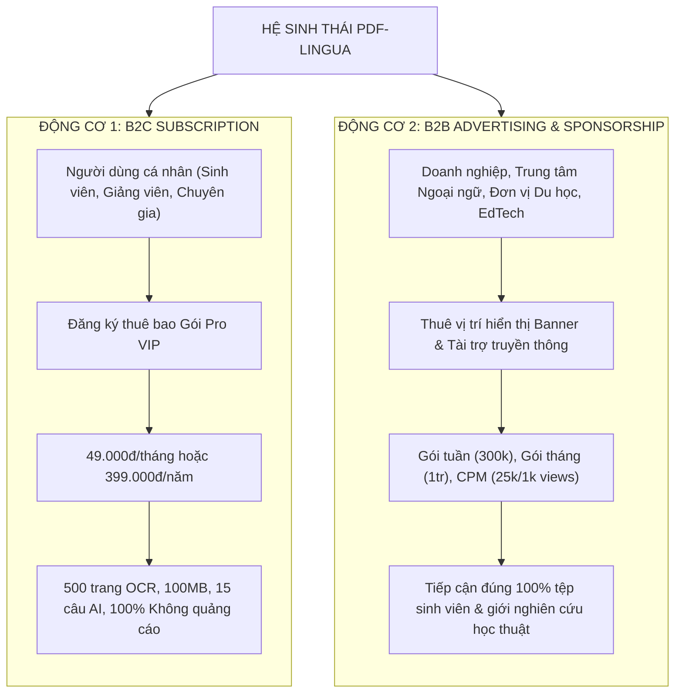
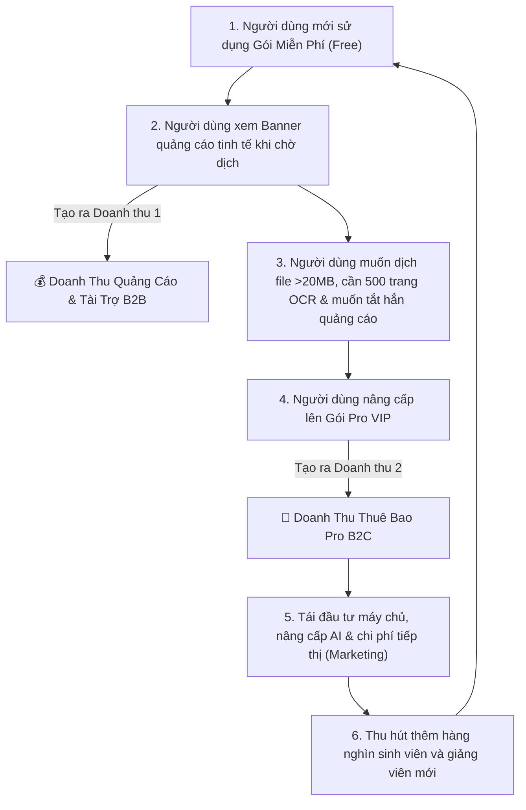

# CHIẾN LƯỢC PHÁT TRIỂN DOANH THU & MÔ HÌNH KINH DOANH KÉP (DUAL-ENGINE MONETIZATION STRATEGY)

## DỰ ÁN: NỀN TẢNG DỊCH THUẬT TÀI LIỆU PDF HỌC THUẬT & TRỢ LÝ AI (PDF-LINGUA)

| Thông tin | Chi tiết |
|---|---|
| **Dự án** | PDF-Lingua: Academic PDF Translation & AI Research Assistant |
| **Loại tài liệu** | Master Monetization Strategy & Business Model Comparison |
| **Mô hình cốt lõi** | Động Cơ Doanh Thu Kép: B2C Subscriptions + B2B Advertising/Sponsorship |
| **Phiên bản** | 1.0 |
| **Ngày lập** | 24/11/2026 |
| **Trạng thái** | Hoàn thành |

---

## 1. Tổng Quan Chiến Lược: Động Cơ Doanh Thu Kép (Dual-Engine Model)

Để đảm bảo tính bền vững tài chính và tối đa hóa khả năng sinh lời, **PDF-Lingua** không dựa vào một nguồn thu đơn lẻ mà vận hành đồng thời **2 động cơ kiếm tiền độc lập nhưng tương hỗ chặt chẽ**:

---

## 2. Bảng So Sánh Toàn Diện: Gói Pro VIP vs. Quảng Cáo & Tài Trợ

Bảng phân tích đối chiếu trực tiếp giữa hai phương thức kiếm tiền của dự án:

| Tiêu Chí So Sánh | Phương Thức 1: Bán Gói Pro VIP (B2C) | Phương Thức 2: Quảng Cáo & Tài Trợ (B2B) |
|---|---|---|
| **Bản chất mô hình** | Bán quyền truy cập tính năng cao cấp cho người dùng cuối (Software as a Service - SaaS). | Bán không gian hiển thị và sự chú ý của người dùng cho bên thứ ba (Media & Sponsorship). |
| **Đối tượng chi trả (Payer)** | Sinh viên, nghiên cứu sinh, giảng viên có nhu cầu xử lý tài liệu khối lượng lớn. | Trung tâm tiếng Anh, nhà xuất bản, công ty du học, nền tảng khóa học trực tuyến. |
| **Cơ cấu giá (Pricing)** | Cố định theo kỳ: **49.000 VNĐ / tháng** hoặc **399.000 VNĐ / năm** (tiết kiệm 32%). | Linh hoạt: **300.000đ/tuần**, **1.000.000đ/tháng**, **2.500.000đ độc quyền**, hoặc CPM (25.000đ/1.000 views). |
| **Kênh thu tiền (Payment Flow)** | Thanh toán tự động 24/7 qua cổng **VietQR Napas247 / SePay Webhook**, kích hoạt dưới 3s. | Chuyển khoản ngân hàng trực tiếp theo hợp đồng tài trợ truyền thông giữa Quản trị viên và Đối tác. |
| **Tác động trải nghiệm (UX)** | Tạo trải nghiệm đẳng cấp: Tốc độ cao, nhiều dung lượng và **100% sạch bóng quảng cáo**. | Xuất hiện tinh tế tại 4 vị trí chọn lọc (Sidebar, Loading modal khi chờ dịch), không làm xáo trộn luồng đọc. |
| **Độ nhạy với lưu lượng (Traffic)** | Ổn định, phụ thuộc vào mức độ hài lòng và tỷ lệ chuyển đổi (Conversion Rate thông thường 3-5%). | Phụ thuộc trực tiếp vào số lượng lượt xem trang (Pageviews) và số tệp PDF được tải lên hàng ngày. |
| **Ưu điểm lớn nhất** | Dòng tiền thuê bao định kỳ (MRR) ổn định, biên lợi nhuận ròng rất cao trên mỗi tài khoản. | Khai thác và kiếm tiền được từ **95% người dùng miễn phí**, biến chi phí server thành lợi nhuận. |
| **Thách thức chính** | Cần liên tục nâng cao chất lượng AI/OCR để thuyết phục người dùng gia hạn hàng tháng. | Cần kiểm duyệt nội dung khắt khe để tránh quảng cáo rác làm mất uy tín nền tảng học thuật. |
| **Tỷ trọng doanh thu kỳ vọng** | **60% - 70%** tổng doanh thu dự án khi hệ thống đi vào giai đoạn ổn định. | **30% - 40%** tổng doanh thu dự án (đóng vai trò nguồn thu đệm vững chắc trong giai đoạn đầu). |

---

## 3. Bánh Đà Cộng Hưởng Doanh Thu (The Monetization Flywheel)

Hai phương thức kiếm tiền không triệt tiêu nhau mà tạo thành một **vòng lặp tăng trưởng khép kín (Flywheel)**:

### Nguyên lý cộng hưởng:
- **Quảng cáo làm đòn bẩy bán gói Pro**: Sự xuất hiện của các banner tài trợ ở tài khoản miễn phí chính là động lực tự nhiên thôi thúc người dùng sẵn sàng chi trả 49.000đ/tháng để sở hữu đặc quyền Ad-Free.
- **Gói Pro bảo vệ trải nghiệm nghiên cứu chuyên sâu**: Những ai thực sự cần không gian làm việc chuyên nghiệp sẽ luôn hài lòng khi trả phí để nhận về sự tập trung tuyệt đối.

---

## 4. Danh Mục Hồ Sơ Kế Hoạch Chi Tiết

Để tra cứu chi tiết từng phương thức, vui lòng xem các tài liệu chuyên đề:

1. **[01-subscription-pro-plan.md](file:///c:/University%20Coding%20Project/PDF-Lingua/Docs/monetization-strategy/01-subscription-pro-plan.md)**: Đặc tả chi tiết kế hoạch khai thác Gói Pro VIP, phân tích giá trị độc quyền, quy trình thanh toán VietQR và phễu chuyển đổi Freemium.
2. **[02-advertising-and-sponsorship.md](file:///c:/University%20Coding%20Project/PDF-Lingua/Docs/monetization-strategy/02-advertising-and-sponsorship.md)**: Đặc tả chi tiết kế hoạch quảng cáo & tài trợ, 4 vị trí đặt banner trên giao diện, quy trình liên hệ thuê quảng cáo, bảng báo giá và chính sách kiểm duyệt nội dung.
3. **[Docs/pricing-plans/pricing-plans.md](file:///c:/University%20Coding%20Project/PDF-Lingua/Docs/pricing-plans/pricing-plans.md)**: Bảng so sánh hạn mức kỹ thuật chi tiết giữa Gói Miễn Phí và Gói Pro trên toàn hệ thống.
