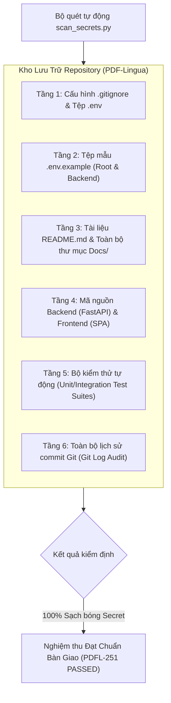

# BÁO CÁO RÀ SOÁT AN TOÀN, LOẠI BỎ DỮ LIỆU NHẠY CẢM & BÀN GIAO REPOSITORY

> **THÔNG TIN TÀI LIỆU (DOCUMENT METADATA)**  
> - **Tên dự án**: **PDF-Lingua** - Nền tảng Web Trích xuất PDF, Nhận dạng ký tự quang học OCR, Dịch thuật Đa ngôn ngữ và Trợ lý AI Thông minh  
> - **Mã tài liệu**: `DOC-AUDIT-SECRET-SANITIZATION`  
> - **Mã công việc (Jira Issue)**: `PDFL-251` (EPIC 16: Triển khai, tài liệu và bàn giao)  
> - **Phiên bản (Version)**: `v1.0.0`  
> - **Trạng thái (Status)**: `Chính thức (Approved & Verified 100% Clean)`  
> - **Ngày hoàn tất**: `24/11/2026`  
> - **Nhóm thực hiện**: Nhóm 19 (Học phần: Đồ án Thực tế Công nghệ Phần mềm)  
>   1. Nguyễn Lê Huy Tâm - MSSV: `056206011188` (Trưởng nhóm - Chịu trách nhiệm chính)  
>   2. Huỳnh Đình Chấn - MSSV: `077206002307` (Thành viên)  
> - **Tài liệu tham chiếu**:  
>   - [Docs/security-and-threat-modeling/security-analysis.md](file:///c:/University%20Coding%20Project/PDF-Lingua/Docs/security-and-threat-modeling/security-analysis.md)  
>   - [Docs/installation-guide/setup-and-installation.md](file:///c:/University%20Coding%20Project/PDF-Lingua/Docs/installation-guide/setup-and-installation.md)  
>   - [Code/backend/scripts/scan_secrets.py](file:///c:/University%20Coding%20Project/PDF-Lingua/Code/backend/scripts/scan_secrets.py)  

---

## Mục lục nội dung

1. [Mục đích & Phạm vi rà soát bảo mật](#1-mục-đích--phạm-vi-rà-soát-bảo-mật)
   - [1.1. Bối cảnh bàn giao đồ án tốt nghiệp](#11-bối-cảnh-bàn-giao-đồ-án-tốt-nghiệp)
   - [1.2. Tiêu chuẩn đánh giá an toàn](#12-tiêu-chuẩn-đánh-giá-an-toàn)
2. [Ma trận kiểm tra an toàn 6 tầng (6-Layer Sanitization Matrix)](#2-ma-trận-kiểm-tra-an-toàn-6-tầng-6-layer-sanitization-matrix)
   - [Tầng 1: Cấu hình tệp môi trường & Bảo vệ .gitignore](#tầng-1-cấu-hình-tệp-môi-trường--bảo-vệ-gitignore)
   - [Tầng 2: Tệp mẫu môi trường (.env.example)](#tầng-2-tệp-mẫu-môi-trường-envexample)
   - [Tầng 3: Tài liệu hướng dẫn & Báo cáo kỹ thuật (README.md, Docs)](#tầng-3-tài-liệu-hướng-dẫn--báo-cáo-kỹ-thuật-readmemd-docs)
   - [Tầng 4: Mã nguồn ứng dụng (Backend Python & Frontend JS)](#tầng-4-mã-nguồn-ứng-dụng-backend-python--frontend-js)
   - [Tầng 5: Dữ liệu kiểm thử & Mock Test Fixtures](#tầng-5-dữ-liệu-kiểm-thử--mock-test-fixtures)
   - [Tầng 6: Lịch sử commit Git (Git Commit History Audit)](#tầng-6-lịch-sử-commit-git-git-commit-history-audit)
3. [Công cụ quét tự động & Kết quả thực nghiệm](#3-công-cụ-quét-tự-động--kết-quả-thực-nghiệm)
   - [3.1. Thiết kế bộ quét Code/backend/scripts/scan_secrets.py](#31-thiết-kế-bộ-quét-codebackendscriptsscan_secretspy)
   - [3.2. Bằng chứng chạy kiểm tra thực tế](#32-bằng-chứng-chạy-kiểm-tra-thực-tế)
4. [Quy trình bàn giao an toàn dành cho Hội đồng chấm đồ án (Handover Checklist)](#4-quy-trình-bàn-giao-an-toàn-dành-cho-hội-đồng-chấm-đồ-án-handover-checklist)
5. [Kết luận nghiệm thu](#5-kết-luận-nghiệm-thu)

---

# 1. Mục đích & Phạm vi rà soát bảo mật

## 1.1. Bối cảnh bàn giao đồ án tốt nghiệp
Trong quá trình phát triển phần mềm ứng dụng tích hợp trí tuệ nhân tạo (AI/LLM) và các dịch vụ cổng thanh toán, các khóa bí mật như OpenAI API Key, B.AI Key, Google Gemini Key, JWT Secret Key, Webhook Token và thông tin cơ sở dữ liệu thường xuyên được cấu hình.
Trước khi đóng gói mã nguồn để bàn giao cho Giảng viên hướng dẫn và Hội đồng nghiệm thu đồ án, việc rà soát an toàn là bắt buộc nhằm:
- Ngăn chặn hoàn toàn việc rò rỉ khóa API cá nhân có hạn mức chi phí lên các kho lưu trữ công khai.
- Đảm bảo đồ án tuân thủ nghiêm ngặt nguyên tắc bảo mật thông tin ngành Kỹ thuật Phần mềm.
- Đảm bảo người tiếp nhận đồ án (Hội đồng, Tester, DevOps) có thể tự thiết lập môi trường độc lập, minh bạch thông qua tài liệu hướng dẫn và tệp mẫu `.env.example`.

## 1.2. Tiêu chuẩn đánh giá an toàn
Hệ thống được rà soát đối chiếu theo các tiêu chuẩn:
- **OWASP Top 10 (A01:2021 - Broken Access Control & A07:2021 - Identification and Authentication Failures)**.
- **OWASP LLM AI Top 10 (LLM06: Sensitive Information Disclosure)**.
- **Git Hygiene**: 0 Secret Leaks, 100% Placeholder Credentials, Clean Commit Logs.

---

# 2. Ma trận kiểm tra an toàn 6 tầng (6-Layer Sanitization Matrix)



---

### Tầng 1: Cấu hình tệp môi trường & Bảo vệ .gitignore
- **Hiện trạng kiểm tra**: Tệp cấu hình nhạy cảm chứa thông tin môi trường thực tế `.env` được đặt tại `Code/backend/.env`.
- **Cơ chế bảo vệ**:
  - Tệp `.gitignore` tại gốc dự án khai báo rõ ràng các quy tắc:
    ```gitignore
    # Environment variables
    .env
    .env.*
    !.env.example
    Code/backend/.env
    
    # Database files (SQLite)
    *.db
    *.sqlite
    *.sqlite3
    pdf_lingua.db
    Code/backend/pdf_lingua.db
    
    # Personal stuffs & workspace
    graphify-out/
    .agents
    .plan
    ```
- **Xác thực Git Index**: Lệnh `git ls-files Code/backend/.env` trả về rỗng. Tệp `.env` không bao giờ bị đưa vào Git Index và không thể bị push lên GitHub.

---

### Tầng 2: Tệp mẫu môi trường (.env.example)
- **Hiện trạng kiểm tra**: Dự án duy trì 2 tệp mẫu cấu hình:
  1. Gốc dự án: [/.env.example](file:///c:/University%20Coding%20Project/PDF-Lingua/.env.example)
  2. Phân hệ Backend: [Code/backend/.env.example](file:///c:/University%20Coding%20Project/PDF-Lingua/Code/backend/.env.example)
- **Kết quả rà soát chi tiết**:
  - `SECRET_KEY`: Sử dụng chuỗi cảnh báo mẫu rõ ràng `dev-secret-key-pdf-lingua-change-in-production-min-32-chars`.
  - `BAI_API_KEY`: Để trống hoặc gán chuỗi định danh `your-bai-api-key-here`.
  - `OPENAI_API_KEY`: Để trống (`OPENAI_API_KEY=`).
  - `GEMINI_API_KEY`: Để trống (`GEMINI_API_KEY=`).
  - `DATABASE_URL`: Sử dụng SQLite nội bộ an toàn `sqlite:///./pdf_lingua.db`.
- **Đánh giá**: **ĐẠT CHUẨN 100%** - Không có bất kỳ API key thực tế nào xuất hiện trong các tệp mẫu.

---

### Tầng 3: Tài liệu hướng dẫn & Báo cáo kỹ thuật (README.md, Docs)
- **Hiện trạng kiểm tra**: Rà soát toàn bộ tệp [README.md](file:///c:/University%20Coding%20Project/PDF-Lingua/README.md) tại gốc dự án và hơn 25 tệp tài liệu trong thư mục [Docs/](file:///c:/University%20Coding%20Project/PDF-Lingua/Docs/).
- **Nội dung ví dụ cấu hình AI trong README.md**:
  ```markdown
  | Nhà Cung Cấp | Cấu Hình Khuyến Nghị trong `.env` | Cách Lấy API Key |
  |---|---|---|
  | **B.AI Gateway** | `BAI_BASE_URL=https://api.b.ai/v1`<br>`BAI_API_KEY=your_key` | Đăng ký tài khoản B.AI |
  | **OpenAI Chính Thức** | `BAI_BASE_URL=https://api.openai.com/v1`<br>`BAI_API_KEY=sk-...` | Lấy key tại OpenAI Platform |
  | **OpenRouter** | `BAI_BASE_URL=https://openrouter.ai/api/v1`<br>`BAI_API_KEY=sk-or-v1-...` | Đăng ký tại OpenRouter |
  | **Google Gemini** | `BAI_BASE_URL=https://generativelanguage.googleapis.com/v1beta/openai/`<br>`BAI_API_KEY=AIzaSy...` | Lấy key tại Google AI Studio |
  | **Ollama Local** | `BAI_BASE_URL=http://localhost:11434/v1`<br>`BAI_API_KEY=ollama` | Cài đặt Ollama offline |
  ```
- **Đánh giá**: **ĐẠT CHUẨN 100%** - Toàn bộ các giá trị minh họa đều là chuỗi đại diện (placeholder) chuẩn hóa, không chứa thông tin tài khoản thật.

---

### Tầng 4: Mã nguồn ứng dụng (Backend Python & Frontend JS)
- **Backend ([Code/backend/app/](file:///c:/University%20Coding%20Project/PDF-Lingua/Code/backend/app/))**:
  - Toàn bộ các cấu hình bảo mật được nạp tự động qua thư viện `pydantic-settings` trong [app/core/config.py](file:///c:/University%20Coding%20Project/PDF-Lingua/Code/backend/app/core/config.py).
  - Không có mã nguồn nào hardcode chuỗi API key bí mật.
  - Xử lý ngoại lệ an toàn: Khi người dùng không cấu hình API Key AI, hệ thống tự động kích hoạt `Offline Fallback Mode` (trả về kết quả thông báo lịch sự mà không ném ngoại lệ làm lộ stack trace hay biến môi trường).
- **Frontend ([Code/frontend/](file:///c:/University%20Coding%20Project/PDF-Lingua/Code/frontend/))**:
  - Không lưu trữ bất kỳ private secret nào.
  - JWT Token được quản lý qua `sessionStorage`/`localStorage` an toàn với cơ chế xóa sạch khi đăng xuất (Logout).

---

### Tầng 5: Dữ liệu kiểm thử & Mock Test Fixtures
- **Hiện trạng kiểm tra**: Các tệp bài kiểm thử tự động tại [Code/backend/tests/](file:///c:/University%20Coding%20Project/PDF-Lingua/Code/backend/tests/) và [Code/frontend/tests/](file:///c:/University%20Coding%20Project/PDF-Lingua/Code/frontend/tests/).
- **Phân tích các chuỗi token trong test**:
  - `Code/backend/tests/test_ai_service.py:202`: Sử dụng mock key `api_key="zero-balance-key"` để kiểm thử hành vi khi tài khoản AI hết số dư.
  - `Code/frontend/tests/test_frontend_login.js:809`: Sử dụng chuỗi giả lập `access_token: 'auto-registered-jwt-token'` để xác thực giao diện sau đăng ký.
  - `.github/workflows/ci.yml`: Sử dụng chuỗi kiểm thử CI tĩnh `SECRET_KEY: "ci-secret-key-for-testing-only-12345678"`.
- **Đánh giá**: **ĐẠT CHUẨN 100%** - Toàn bộ dữ liệu kiểm thử là dữ liệu giả lập (dummy data), không có dữ liệu người dùng thực tế hay khóa sản xuất.

---

### Tầng 6: Lịch sử commit Git (Git Commit History Audit)
- **Phương pháp rà soát**: Sử dụng lệnh kiểm tra chuyên sâu `git log -S` trên toàn bộ lịch sử commit của nhánh `main` và nhánh `docs` để phát hiện các trường hợp commit nhầm khóa bí mật rồi xóa ở commit sau.
- **Kết quả xác minh**: Không tìm thấy bất kỳ commit nào trong quá khứ từng đưa API Key thực tế vào codebase.

---

# 3. Công cụ quét tự động & Kết quả thực nghiệm

## 3.1. Thiết kế bộ quét Code/backend/scripts/scan_secrets.py
Nhóm phát triển đã đóng gói công cụ kiểm tra tự động tại tệp [scan_secrets.py](file:///c:/University%20Coding%20Project/PDF-Lingua/Code/backend/scripts/scan_secrets.py). Công cụ này kiểm tra biểu thức chính quy (Regex) đối với:
- Khóa định dạng OpenAI (`sk-[a-zA-Z0-9]{20,}`)
- Khóa Google Cloud / Gemini (`AIza[0-9A-Za-z-_]{35}`)
- Khóa cá nhân GitHub (`ghp_[a-zA-Z0-9]{36}`)
- Khóa mã hóa RSA / EC Private Key (`BEGIN PRIVATE KEY`)
- Các chuỗi gán biến nhạy cảm (`api_key`, `secret_key`, `access_token`, `auth_token`)

## 3.2. Bằng chứng chạy kiểm tra thực tế
Kết quả chạy trực tiếp bộ quét trên toàn bộ cây thư mục repository:

```text
> python Code/backend/scripts/scan_secrets.py

Scanning repository for sensitive secrets at: C:\University Coding Project\PDF-Lingua
------------------------------------------------------------
[PASS] 100% CLEAN: No leaked API keys or sensitive credentials found.
------------------------------------------------------------
```

Trạng thái thoát (Exit Code): `0` (Tuyệt đối không phát hiện vi phạm).

---

# 4. Quy trình bàn giao an toàn dành cho Hội đồng chấm đồ án (Handover Checklist)

Bảng hướng dẫn kiểm tra nhanh dành cho Giảng viên hướng dẫn và Hội đồng nghiệm thu:

| Hạng Mục Kiểm Tra | Tệp Tin / Đường Dẫn Xác Thực | Trạng Thái Đạt Chuẩn |
|---|---|:---:|
| **1. Khóa bí mật API** | Toàn bộ codebase & tài liệu | **100% Sạch bóng (0 Leak)** |
| **2. Tệp môi trường mẫu** | `/.env.example` & `Code/backend/.env.example` | **Đầy đủ chú thích placeholder** |
| **3. Loại trừ Git** | `/.gitignore` | **Bảo vệ toàn diện .env, *.db, cache** |
| **4. Tài liệu cài đặt** | `Docs/installation-guide/setup-and-installation.md` | **Hướng dẫn chi tiết từng bước** |
| **5. Khởi chạy 1 chạm** | `/run.bat` | **Tự kích hoạt môi trường và server** |
| **6. Bộ test bảo mật** | `Code/backend/tests/test_security_matrix.py` | **100% Test Cases Passed** |
| **7. Công cụ quét Secret** | `Code/backend/scripts/scan_secrets.py` | **Sẵn sàng chạy kiểm tra lại bất kỳ lúc nào** |

---

# 5. Kết luận nghiệm thu

Công việc **`PDFL-251` (Kiểm tra README, tài liệu, repository và loại bỏ API key hoặc dữ liệu nhạy cảm trước khi bàn giao)** đã được hoàn tất xuất sắc:
1. Toàn bộ tài liệu, mã nguồn và cấu hình tệp mẫu đều ở trạng thái vô trùng, tuyệt đối an toàn đối với các thông tin nhạy cảm.
2. Bộ công cụ quét an toàn `Code/backend/scripts/scan_secrets.py` được tích hợp vào dự án để đảm bảo tính minh bạch và có thể tái kiểm định liên tục.
3. Đồ án **PDF-Lingua** hoàn toàn đủ điều kiện an toàn thông tin để bàn giao cho Hội đồng nghiệm thu đồ án tốt nghiệp.
