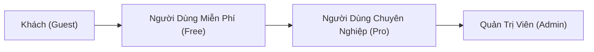

# ĐẶC TẢ YÊU CẦU PHẦN MỀM (SOFTWARE REQUIREMENT SPECIFICATION - SRS)

## DỰ ÁN: NỀN TẢNG DỊCH THUẬT TÀI LIỆU PDF HỌC THUẬT & TRỢ LÝ AI (PDF-LINGUA)

| Thông tin | Chi tiết |
|---|---|
| **Tên dự án (EN)** | PDF-Lingua: Academic PDF Translation & AI Research Assistant |
| **Tên dự án (VN)** | Nền tảng Dịch thuật PDF Học thuật & Trợ lý Nghiên cứu AI |
| **Loại tài liệu** | Software Requirement Specification (SRS) |
| **Viết tắt** | PDF-Lingua |
| **Phiên bản tài liệu** | 1.2 |
| **Ngày tạo** | 15/09/2026 |
| **Ngày chỉnh sửa lần cuối** | 20/11/2026 |
| **Trạng thái** | Hoàn thành (Release) |

---

## Mục lục

1. [Giới thiệu](#1-giới-thiệu)
   - [1.1. Mục đích](#11-mục-đích)
   - [1.2. Phạm vi](#12-phạm-vi)
   - [1.3. Đối tượng đọc tài liệu](#13-đối-tượng-đọc-tài-liệu)
   - [1.4. Định nghĩa, Thuật ngữ và Từ viết tắt](#14-định-nghĩa-thuật-ngữ-và-từ-viết-tắt)
   - [1.5. Tài liệu tham khảo](#15-tài-liệu-tham-khảo)
2. [Mô tả tổng quan hệ thống](#2-mô-tả-tổng-quan-hệ-thống)
   - [2.1. Góc nhìn sản phẩm](#21-góc-nhìn-sản-phẩm)
   - [2.2. Chức năng sản phẩm](#22-chức-năng-sản-phẩm)
   - [2.3. Phân loại người dùng và đặc điểm](#23-phân-loại-người-dùng-và-đặc-điểm)
   - [2.4. Môi trường vận hành](#24-môi-trường-vận-hành)
   - [2.5. Ràng buộc thiết kế và triển khai](#25-ràng-buộc-thiết-kế-và-triển-khai)
   - [2.6. Giả định và Phụ thuộc](#26-giả-định-và-phụ-thuộc)
3. [Yêu cầu giao diện bên ngoài](#3-yêu-cầu-giao-diện-bên-ngoài)
   - [3.1. Giao diện người dùng (UI)](#31-giao-diện-người-dùng-ui)
   - [3.2. Giao diện phần mềm](#32-giao-diện-phần-mềm)
   - [3.3. Giao diện truyền thông & Cổng thanh toán](#33-giao-diện-truyền-thông--cổng-thanh-toán)
4. [Yêu cầu chức năng chi tiết](#4-yêu-cầu-chức-năng-chi-tiết)
   - [FR-01: Quản lý Xác thực & Tài khoản](#fr-01-quản-lý-xác-thực--tài-khoản)
   - [FR-02: Tải lên & Thẩm định tệp PDF an toàn](#fr-02-tải-lên--thẩm-định-tệp-pdf-an-toàn)
   - [FR-03: Bóc tách văn bản số & Smart Layout 2 cột](#fr-03-bóc-tách-văn-bản-số--smart-layout-2-cột)
   - [FR-04: Nhận diện quang học OCR & Xử lý ảnh quét](#fr-04-nhận-diện-quang-học-ocr--xử-lý-ảnh-quét)
   - [FR-05: Dịch thuật Đa ngôn ngữ & Smart Chunking](#fr-05-dịch-thuật-đa-ngôn-ngữ--smart-chunking)
   - [FR-06: Trình xem song song & Cuộn đồng bộ](#fr-06-trình-xem-song-song--cuộn-đồng-bộ)
   - [FR-07: Xuất kết quả đa định dạng (DOCX, PDF, TXT)](#fr-07-xuất-kết-quả-đa-định-dạng-docx-pdf-txt)
   - [FR-08: Tóm tắt văn bản thông minh Map-Reduce](#fr-08-tóm-tắt-văn-bản-thông-minh-map-reduce)
   - [FR-09: Trợ lý AI Copilot hỏi đáp theo ngữ cảnh](#fr-09-trợ-lý-ai-copilot-hỏi-đáp-theo-ngữ-cảnh)
   - [FR-10: Quản lý gói cước & Thanh toán VietQR SePay](#fr-10-quản-lý-gói-cước--thanh-toán-vietqr-sepay)
   - [FR-11: Quản trị hệ thống (Admin Portal)](#fr-11-quản-trị-hệ-thống-admin-portal)
5. [Yêu cầu phi chức năng](#5-yêu-cầu-phi-chức-năng)
   - [5.1. Bảo mật & Riêng tư](#51-bảo-mật--riêng-tư)
   - [5.2. Hiệu năng & Khả năng mở rộng](#52-hiệu-năng--khả-năng-mở-rộng)
   - [5.3. Độ tin cậy & Tính dự phòng](#53-độ-tin-cậy--tính-dự-phòng)
   - [5.4. Khả năng sử dụng & Tương thích](#54-khả-năng-sử-dụng--tương-thích)
6. [Ma trận phân quyền tác nhân (RBAC)](#6-ma-trận-phân-quyền-tác-nhân-rbac)
7. [Yêu cầu cơ sở dữ liệu](#7-yêu-cầu-cơ-sở-dữ-liệu)
8. [Phụ lục](#8-phụ-lục)

---

# 1. Giới thiệu

## 1.1. Mục đích

Tài liệu Đặc tả Yêu cầu Phần mềm (Software Requirement Specification - SRS) này định nghĩa đầy đủ và chi tiết các yêu cầu kỹ thuật, chức năng và phi chức năng cho hệ thống **PDF-Lingua**. Tài liệu đóng vai trò làm chuẩn nghiệm thu, căn cứ thiết kế kiến trúc, kiểm thử phần mềm và hoàn thiện báo cáo Đồ án tốt nghiệp chuyên ngành Công nghệ Thông tin.

## 1.2. Phạm vi

**PDF-Lingua** là nền tảng ứng dụng Web chuyên dụng giải quyết bài toán rào cản ngôn ngữ trong nghiên cứu tài liệu học thuật và tài liệu kỹ thuật định dạng PDF. Hệ thống tập trung xử lý các thách thức đặc thù:
- Bóc tách nội dung bài báo khoa học bố cục 2 cột mà không bị đứt đoạn hay đảo lộn luồng đọc.
- Tự động nhận diện trang quét (scanned page) để kích hoạt OCR tiếng Việt/Anh chuẩn hóa.
- Giữ nguyên cấu trúc văn bản, công thức, liên kết và số liệu sau khi dịch.
- Trợ lý AI Copilot định vị ngữ cảnh tài liệu để tóm tắt học thuật và giải đáp thắc mắc chuyên sâu.
- Cơ chế quản lý gói dịch vụ và thanh toán quét mã VietQR tự động kích hoạt qua Webhook.

## 1.3. Đối tượng đọc tài liệu

| Đối tượng | Mục đích sử dụng |
|---|---|
| **Giảng viên hướng dẫn & Phản biện** | Đánh giá tính hoàn thiện, phạm vi nghiệp vụ và hàm lượng kỹ thuật của đồ án. |
| **Sinh viên / Nhóm phát triển** | Định hướng hiện thực hóa chức năng, tuân thủ đúng yêu cầu kiến trúc và logic nghiệp vụ. |
| **Kiểm thử viên (Testers)** | Xây dựng Test Cases, Test Suites và thẩm định chất lượng các ca kiểm thử biên. |
| **Hội đồng bảo vệ tốt nghiệp** | Đối chiếu giữa mục tiêu đề tài ban đầu và sản phẩm phần mềm thực tế nghiệm thu. |

## 1.4. Định nghĩa, Thuật ngữ và Từ viết tắt

| Thuật ngữ / Viết tắt | Định nghĩa đầy đủ |
|---|---|
| **PDF-Lingua** | Tên nền tảng Web dịch thuật PDF học thuật và trợ lý AI nghiên cứu. |
| **OCR** | Optical Character Recognition - Nhận diện ký tự quang học từ tệp ảnh hoặc trang tài liệu scan. |
| **Tesseract OCR** | Động cơ OCR mã nguồn mở của Google, hỗ trợ nhận diện đa ngôn ngữ bao gồm tiếng Việt. |
| **PyMuPDF (fitz)** | Thư viện hiệu năng cao trên Python dùng để trích xuất văn bản, layout và metadata từ tệp PDF. |
| **Smart Chunking** | Thuật toán phân đoạn văn bản thông minh theo ranh giới đoạn văn và ngữ nghĩa câu. |
| **Smart Layout** | Giải thuật phát hiện phân cột tài liệu học thuật (2 cột) và sắp xếp luồng đọc tự nhiên. |
| **Map-Reduce** | Kỹ thuật xử lý tóm tắt văn bản lớn theo 2 giai đoạn: Map (từng trang) và Reduce (tổng hợp toàn bài). |
| **JWT** | JSON Web Token - Chuẩn mã hóa token xác thực người dùng trong các phiên làm việc stateless. |
| **RBAC** | Role-Based Access Control - Cơ chế kiểm soát quyền truy cập tài nguyên dựa trên vai trò người dùng. |
| **VietQR / SePay** | Chuẩn mã QR thanh toán liên ngân hàng Napas247 và cổng Webhook tự động khớp giao dịch chuyển khoản. |

## 1.5. Tài liệu tham khảo

1. Đề cương Đồ án Tốt nghiệp Chuyên ngành Công nghệ Thông tin.
2. Tiêu chuẩn quốc tế IEEE Std 830-1998 về Đặc tả Yêu cầu Phần mềm (Software Requirements Specification).
3. Tài liệu kiến trúc RESTful API và đặc tả FastAPI Framework (Python 3.12).
4. Tài liệu kỹ thuật tích hợp cổng thanh toán SePay Webhook và chuẩn VietQR Napas247.

---

# 2. Mô tả tổng quan hệ thống

## 2.1. Góc nhìn sản phẩm

PDF-Lingua là một hệ thống ứng dụng Web hoàn chỉnh hoạt động theo mô hình Client - Server độc lập:
- **Phía Client**: Xây dựng dưới dạng Single Page Application (SPA) bằng HTML5, CSS3 và Vanilla JavaScript hiện đại, tối ưu tốc độ tải và loại bỏ hoàn toàn chi phí tải các thư viện nặng.
- **Phía Server**: Cung cấp bộ API RESTful bất đồng bộ thông qua FastAPI (Python), tương tác với cơ sở dữ liệu quan hệ SQLite qua SQLAlchemy ORM.
- **Dịch vụ AI & Trích xuất**: Tích hợp trực tiếp công cụ PyMuPDF, Tesseract OCR, Deep-Translator và Google Gemini API với cơ chế dự phòng Heuristic ngoại tuyến.

## 2.2. Chức năng sản phẩm

Hệ thống cung cấp 7 phân hệ tính năng chủ chốt:
1. **Phân hệ Xác thực & Quản lý Tài khoản**: Đăng ký, đăng nhập JWT, đổi mật khẩu, phân quyền 4 cấp độ.
2. **Phân hệ Tiếp nhận & Thẩm định Tài liệu**: Tải lên an toàn, thẩm định Magic Bytes, chống mã độc và tệp hỏng.
3. **Phân hệ Bóc tách & Xử lý Bố cục**: Tách trang số, OCR trang quét, giải thuật đọc 2 cột tự nhiên.
4. **Phân hệ Dịch thuật Song ngữ**: Smart Chunking bảo vệ thuật ngữ chuyên ngành, hiển thị đối chiếu 2 cột và cuộn đồng bộ.
5. **Phân hệ Xuất kết quả**: Hỗ trợ xuất tệp Word (.docx), PDF Unicode (ReportLab), văn bản thuần (.txt) và tệp nén (.zip).
6. **Phân hệ Trí tuệ Nhân tạo Học thuật**: Tóm tắt 3 cấp độ theo mô hình Map-Reduce và trợ lý đối thoại Copilot định vị ngữ cảnh tài liệu.
7. **Phân hệ Gói dịch vụ & Thanh toán**: Bảng giá, tạo mã VietQR động, SePay Webhook tự động kích hoạt tài khoản Pro tức thì.

## 2.3. Phân loại người dùng và đặc điểm

Hệ thống phân định rõ ràng 4 nhóm tác nhân với các đặc điểm:

| Tác nhân | Mô tả đặc điểm & Quyền hạn |
|---|---|
| **Khách (Guest)** | Người dùng chưa đăng nhập. Chỉ có thể trải nghiệm trang chủ, xem bảng giá và thử nghiệm dịch chuỗi ký tự ngắn. Không có không gian lưu trữ và bị làm mờ các tính năng quản lý tài liệu, lịch sử, AI. |
| **Người Dùng Miễn Phí (Free)** | Người dùng đã đăng ký tài khoản xác thực. Được cấp không gian lưu trữ cá nhân, tải tối đa 20MB/tệp, hạn mức 5 tài liệu/ngày, 100 trang OCR/tháng, lưu trữ lịch sử xử lý trong 7 ngày. |
| **Người Dùng Chuyên Nghiệp (Pro)** | Người dùng đã đăng ký gói tháng hoặc năm qua VietQR. Được xử lý tệp dung lượng tới 100MB, không giới hạn số lượng tài liệu/ngày, 500 trang OCR/tháng, mở khóa toàn diện AI Copilot và Tóm tắt Map-Reduce. |
| **Quản Trị Viên (Admin)** | Người phụ trách vận hành hệ thống. Sở hữu toàn quyền của gói Pro, đồng thời có bảng điều khiển thống kê tổng quan, quản lý trạng thái tài khoản người dùng, đổi role và tra cứu nhật ký hệ thống. |

## 2.4. Môi trường vận hành

- **Hệ điều hành Server**: Hỗ trợ Windows 10/11, Ubuntu 20.04/22.04 LTS, macOS 12+.
- **Runtime**: Python 3.10, 3.11 hoặc 3.12; Node.js 18+ (phục vụ bộ kiểm thử frontend).
- **Phụ thuộc phần cứng**: Tối thiểu 2 nhân CPU, 4GB RAM (khuyến nghị 8GB RAM để xử lý mượt mà tác vụ OCR tài liệu nhiều trang).
- **Trình duyệt Client**: Google Chrome 100+, Mozilla Firefox 100+, Microsoft Edge 100+, Safari 15+.

## 2.5. Ràng buộc thiết kế và triển khai

- **Mã hóa ký tự**: Toàn bộ hệ thống bắt buộc sử dụng chuẩn mã hóa ký tự `UTF-8` thuần túy, loại bỏ các ký tự gây xung đột hiển thị (zero en-dash / zero em-dash).
- **Cô lập dữ liệu người dùng (Multi-tenancy)**: Mọi tài liệu tải lên phải được lưu trữ trong thư mục riêng biệt theo `user_id` (`storage/{user_id}/...`) để ngăn chặn tuyệt đối việc truy cập trái phép chéo giữa các tài khoản.
- **Bảo toàn layout tài liệu**: Tuyệt đối không làm đảo lộn thứ tự đoạn văn của các bài báo học thuật 2 cột.

## 2.6. Giả định và Phụ thuộc

- Người dùng có kết nối mạng Internet ổn định để truy cập giao diện Web và gọi các dịch vụ dịch thuật/AI trực tuyến.
- Khi mất kết nối Internet, hệ thống kích hoạt cơ chế dự phòng Heuristic ngoại tuyến để không làm gián đoạn luồng làm việc cơ bản.
- Giao dịch thanh toán VietQR phụ thuộc vào tính sẵn sàng của mạng lưới Napas247 và dịch vụ Webhook của SePay.

---

# 3. Yêu cầu giao diện bên ngoài

## 3.1. Giao diện người dùng (UI)

- **Trang chủ & Bảng điều khiển (Dashboard)**: Bố cục thanh điều hướng bên trái (Sidebar) trực quan, hiển thị trạng thái đăng nhập, số tài liệu và dung lượng đã sử dụng. Khi là tài khoản Khách, các mục Tài liệu, Lịch sử, AI được làm mờ tinh tế và hiển thị tooltip nhắc nhở đăng nhập.
- **Trình xem tài liệu song ngữ (Bilingual Viewer)**: Hiển thị song song văn bản gốc và văn bản dịch, hỗ trợ cuộn trang đồng bộ, phóng to thu nhỏ và chuyển trang mượt mà.
- **Cửa sổ đối thoại AI Copilot**: Khung chat nổi tiện lợi cho phép hỏi đáp trực tiếp, sao chép câu trả lời và xem trích dẫn nguồn trang.

## 3.2. Giao diện phần mềm

- **Cơ sở dữ liệu**: Tương tác với SQLite thông qua SQLAlchemy ORM với tùy chọn `PRAGMA foreign_keys = ON` để đảm bảo tính toàn vẹn dữ liệu.
- **Động cơ OCR**: Gọi tesseract binary thông qua wrapper `pytesseract` kèm tham số ngôn ngữ cấu hình (`-l vie+eng`).
- **Thư viện xuất bản**: Sử dụng thư viện `python-docx` để tạo tệp Word và thư viện `ReportLab` với phông chữ DejaVuSans Unicode để kết xuất tệp PDF bản dịch.

## 3.3. Giao diện truyền thông & Cổng thanh toán

- **Giao thức API**: Toàn bộ giao tiếp Client - Server sử dụng HTTP/HTTPS với định dạng dữ liệu chuẩn JSON.
- **Cổng thanh toán SePay Webhook**: Điểm cuối `/api/pricing/webhook/sepay` tiếp nhận thông báo biến động số dư tức thời từ SePay, xác thực qua Bearer Token / API Key, đối soát nội dung đơn hàng và kích hoạt gói cước trong vòng dưới 3 giây.

---

# 4. Yêu cầu chức năng chi tiết

### FR-01: Quản lý Xác thực & Tài khoản
| Thuộc tính | Chi tiết |
|---|---|
| **Mã yêu cầu** | `FR-01` |
| **Tên chức năng** | Đăng ký, Đăng nhập và Quản lý Phiên làm việc |
| **Tác nhân** | Khách, Người dùng Miễn phí, Người dùng Pro, Quản trị viên |
| **Mức độ ưu tiên** | Bắt buộc (Cao) |
| **Tiền điều kiện** | Người dùng truy cập vào ứng dụng Web PDF-Lingua. |

*Mô tả chi tiết luồng xử lý*:
1. Người dùng cung cấp Email hợp lệ, Họ tên và Mật khẩu (tối thiểu 6 ký tự).
2. Hệ thống kiểm tra trùng lặp email; chuẩn hóa email về dạng chữ thường.
3. Mã hóa mật khẩu bằng thuật toán `bcrypt` kèm salt an toàn trước khi lưu vào CSDL.
4. Khi đăng nhập thành công, hệ thống cấp phát một mã `access_token` định dạng JWT có hiệu lực trong 24 giờ.
5. Frontend lưu trữ token an toàn và tự động đính kèm vào header `Authorization: Bearer <token>` trong các yêu cầu kế tiếp.
6. Hỗ trợ tra cứu thông tin tài khoản hiện tại qua endpoint `/api/auth/me` và đăng xuất an toàn qua `/api/auth/logout`.

*Tiêu chí nghiệm thu (Acceptance Criteria)*:
- Đăng ký thành công trả về HTTP 201 kèm thông tin người dùng (không chứa mật khẩu).
- Đăng nhập sai mật khẩu trả về HTTP 401 với thông báo lỗi rõ ràng.
- Đăng nhập thành công trả về HTTP 200 kèm access token hợp lệ và thông tin role.

---

### FR-02: Tải lên & Thẩm định tệp PDF an toàn
| Thuộc tính | Chi tiết |
|---|---|
| **Mã yêu cầu** | `FR-02` |
| **Tên chức năng** | Tải lên, Thẩm định định dạng và Phòng vệ Tệp |
| **Tác nhân** | Người dùng Miễn phí, Người dùng Pro, Quản trị viên |
| **Mức độ ưu tiên** | Bắt buộc (Cao) |
| **Tiền điều kiện** | Người dùng đã đăng nhập vào hệ thống. |

*Mô tả chi tiết luồng xử lý*:
1. Người dùng chọn tệp hoặc kéo thả tệp PDF vào vùng tải lên.
2. Hệ thống kiểm tra dung lượng tệp theo gói tài khoản (Free: tối đa 20MB, Pro: tối đa 100MB).
3. Kiểm tra Magic Bytes nhị phân ở đầu tệp (bắt buộc phải khớp `%PDF-1.`).
4. Kiểm tra mã hóa và mật khẩu tệp: Từ chối các tệp PDF có cài đặt mật khẩu hoặc bị lỗi hỏng cấu trúc không thể mở.
5. Làm sạch tên tệp (Sanitize filename), loại bỏ các ký tự đặc biệt, chống tấn công Path Traversal.
6. Lưu tệp vào phân vùng thư mục riêng biệt của người dùng (`storage/{user_id}/`).

*Tiêu chí nghiệm thu (Acceptance Criteria)*:
- Tệp không phải PDF hoặc tệp giả mạo phần mở rộng bị từ chối với mã lỗi HTTP 400.
- Tệp vượt quá dung lượng cho phép của gói bị từ chối với mã lỗi HTTP 413.
- Tệp hợp lệ được lưu trữ thành công và trả về mã định danh tài liệu `document_id`.

---

### FR-03: Bóc tách văn bản số & Smart Layout 2 cột
| Thuộc tính | Chi tiết |
|---|---|
| **Mã yêu cầu** | `FR-03` |
| **Tên chức năng** | Trích xuất Văn bản số và Tái cấu trúc Luồng đọc Học thuật |
| **Tác nhân** | Người dùng Miễn phí, Người dùng Pro, Quản trị viên |
| **Mức độ ưu tiên** | Bắt buộc (Cao) |
| **Tiền điều kiện** | Tệp PDF đã được tải lên và thẩm định hợp lệ. |

*Mô tả chi tiết luồng xử lý*:
1. Sử dụng PyMuPDF để trích xuất khối văn bản (text blocks) kèm tọa độ không gian `(x0, y0, x1, y1)`.
2. Phân tích phân bố tọa độ ngang: Nếu trang có 2 dải văn bản tách biệt rõ ràng bởi khoảng trống ở giữa, hệ thống tự động nhận diện là bố cục 2 cột (Academic Two-Column Layout).
3. Sắp xếp thứ tự đọc thông minh: Tiêu đề toàn trang $\rightarrow$ Cột trái (từ trên xuống dưới) $\rightarrow$ Cột phải (từ trên xuống dưới) $\rightarrow$ Chân trang.
4. Bảo tồn các khối mã nguồn (code blocks), công thức toán học và bảng biểu mà không làm xáo trộn thứ tự logic.

*Tiêu chí nghiệm thu (Acceptance Criteria)*:
- Văn bản trích xuất từ bài báo khoa học 2 cột đọc liền mạch, không bị xen kẽ giữa dòng của cột trái và dòng của cột phải.
- Tốc độ trích xuất tài liệu số đạt dưới 200ms cho mỗi trang.

---

### FR-04: Nhận diện quang học OCR & Xử lý ảnh quét
| Thuộc tính | Chi tiết |
|---|---|
| **Mã yêu cầu** | `FR-04` |
| **Tên chức năng** | Phân luồng Hybrid Fast Path & OCR Tesseract Tiếng Việt/Anh |
| **Tác nhân** | Người dùng Miễn phí, Người dùng Pro, Quản trị viên |
| **Mức độ ưu tiên** | Bắt buộc (Cao) |
| **Tiền điều kiện** | Tài liệu chứa trang dạng ảnh hoặc bản quét không có lớp văn bản số. |

*Mô tả chi tiết luồng xử lý*:
1. Cơ chế Hybrid Fast Path kiểm tra lượng ký tự trích xuất được từ trang: nếu nhỏ hơn ngưỡng 50 ký tự, trang được đánh dấu là trang quét cần OCR.
2. Tiền xử lý ảnh trang tài liệu: Tăng độ tương phản, khử nhiễu và xoay chiều tự động theo định hướng OSD.
3. Kích hoạt Tesseract OCR với bộ dữ liệu huấn luyện song ngữ `vie+eng`.
4. Tự động phát hiện và bỏ qua các trang trắng quét scan bị bám bụi để tiết kiệm tài nguyên tính toán.
5. Trừ số trang xử lý vào hạn mức OCR hàng tháng của tài khoản (Free: 100 trang, Pro: 500 trang).

*Tiêu chí nghiệm thu (Acceptance Criteria)*:
- Nhận diện chính xác ký tự tiếng Việt có dấu với độ tin cậy trung bình trên 90% đối với tài liệu scan rõ nét.
- Người dùng vượt quá hạn mức OCR trong tháng nhận thông báo nhắc nhở nâng cấp gói.

---

### FR-05: Dịch thuật Đa ngôn ngữ & Smart Chunking
| Thuộc tính | Chi tiết |
|---|---|
| **Mã yêu cầu** | `FR-05` |
| **Tên chức năng** | Phân đoạn Ngữ nghĩa và Dịch thuật Đa ngôn ngữ |
| **Tác nhân** | Khách (chuỗi ngắn), Người dùng Miễn phí, Người dùng Pro, Quản trị viên |
| **Mức độ ưu tiên** | Bắt buộc (Cao) |
| **Tiền điều kiện** | Nội dung văn bản đã được bóc tách từ PDF hoặc nhập trực tiếp. |

*Mô tả chi tiết luồng xử lý*:
1. Thuật toán Smart Chunking chia nhỏ văn bản thành các phân đoạn tối ưu (400 - 600 từ), tôn trọng dấu chấm câu, dấu xuống dòng và ranh giới đoạn văn.
2. Bảo vệ tuyệt đối các thực thể đặc biệt: URL, địa chỉ Email, biến số mã nguồn, công thức toán và ký hiệu tiền tệ không bị dịch sai lệch.
3. Gửi các phân đoạn đến dịch vụ dịch thuật (Google Translate / Deep-Translator) với cặp ngôn ngữ nguồn và đích do người dùng lựa chọn.
4. Ghép nối kết quả hoàn chỉnh và lưu kết quả vào bộ đệm tạm thời để tăng tốc độ truy xuất lại.

*Tiêu chí nghiệm thu (Acceptance Criteria)*:
- Không bị lỗi cắt ngang câu văn giữa hai phân đoạn liên tiếp.
- Các liên kết web và định dạng số tiền được giữ nguyên vẹn 100% trong bản dịch.

---

### FR-06: Trình xem song song & Cuộn đồng bộ
| Thuộc tính | Chi tiết |
|---|---|
| **Mã yêu cầu** | `FR-06` |
| **Tên chức năng** | Hiển thị Song ngữ Đối chiếu & Đồng bộ Cuộn trang |
| **Tác nhân** | Người dùng Miễn phí, Người dùng Pro, Quản trị viên |
| **Mức độ ưu tiên** | Quan trọng (Trung bình) |
| **Tiền điều kiện** | Bản dịch của tài liệu đã hoàn tất. |

*Mô tả chi tiết luồng xử lý*:
1. Màn hình chia thành 2 cột: Cột bên trái hiển thị văn bản/trang gốc, cột bên phải hiển thị bản dịch.
2. Khi người dùng cuộn ở cột tài liệu gốc, cột bản dịch tự động cuộn theo với tỷ lệ vị trí tương ứng (Synchronized Scrolling).
3. Cho phép người dùng bật/tắt tính năng cuộn đồng bộ theo nhu cầu đọc cá nhân.
4. Cung cấp thanh công cụ điều hướng nhanh đến từng số trang cụ thể.

*Tiêu chí nghiệm thu (Acceptance Criteria)*:
- Trải nghiệm cuộn mượt mà với độ trễ dưới 50ms, không gây giật lag giao diện.
- Tương thích tốt trên màn hình máy tính để bàn và laptop.

---

### FR-07: Xuất kết quả đa định dạng (DOCX, PDF, TXT)
| Thuộc tính | Chi tiết |
|---|---|
| **Mã yêu cầu** | `FR-07` |
| **Tên chức năng** | Kết xuất và Tải về Bản dịch Đa định dạng |
| **Tác nhân** | Người dùng Miễn phí, Người dùng Pro, Quản trị viên |
| **Mức độ ưu tiên** | Bắt buộc (Cao) |
| **Tiền điều kiện** | Bản dịch đã được xử lý thành công. |

*Mô tả chi tiết luồng xử lý*:
1. Người dùng bấm chọn nút Xuất kết quả trên thanh công cụ và lựa chọn định dạng mong muốn:
   - **Tệp Word (.docx)**: Tạo tệp tài liệu văn phòng giữ nguyên phân chia tiêu đề và đoạn văn.
   - **Tệp PDF (.pdf)**: Tạo tệp PDF bản dịch sử dụng engine ReportLab với phông chữ DejaVuSans hỗ trợ Unicode tiếng Việt đầy đủ.
   - **Tệp Văn bản (.txt)**: Xuất văn bản thuần túy chuẩn UTF-8.
   - **Tệp Nén (.zip)**: Đóng gói toàn bộ các định dạng trên vào một tệp nén duy nhất.
2. Hệ thống kiểm tra quyền sở hữu tài liệu của người dùng hiện tại trước khi tạo luồng truyền dữ liệu tải về.

*Tiêu chí nghiệm thu (Acceptance Criteria)*:
- Tệp PDF kết xuất hiển thị tiếng Việt chuẩn 100%, không bị lỗi ô vuông font chữ hoặc lỗi dấu thanh.
- Tệp tải về mang tên gốc kèm hậu tố ngôn ngữ (ví dụ: `document_translated_vi.docx`).

---

### FR-08: Tóm tắt văn bản thông minh Map-Reduce
| Thuộc tính | Chi tiết |
|---|---|
| **Mã yêu cầu** | `FR-08` |
| **Tên chức năng** | Tóm tắt Học thuật theo Mô hình Map-Reduce |
| **Tác nhân** | Người dùng Chuyên nghiệp (Pro), Quản trị viên |
| **Mức độ ưu tiên** | Giá trị gia tăng (Cao) |
| **Tiền điều kiện** | Tài khoản có quyền Pro/Admin; tài liệu có nội dung văn bản hợp lệ. |

*Mô tả chi tiết luồng xử lý*:
1. Người dùng chọn 1 trong 3 phong cách tóm tắt:
   - *Ngắn gọn*: Đoạn tóm tắt cô đọng 2-3 câu nêu bật ý tưởng cốt lõi.
   - *Gạch đầu dòng*: Danh sách 5-7 luận điểm chính của nghiên cứu.
   - *Chuyên sâu*: Phân tích toàn diện mục tiêu, phương pháp, kết quả thực nghiệm và kết luận.
2. Nếu tài liệu dài vượt quá 3000 từ, hệ thống áp dụng kỹ thuật Map-Reduce:
   - *Pha Map*: Tóm tắt độc lập từng phần/trang của tài liệu.
   - *Pha Reduce*: Tổng hợp các bản tóm tắt trung gian thành bản báo cáo hoàn chỉnh nhất quán.
3. Nếu API AI bên ngoài gặp sự cố, hệ thống tự động kích hoạt bộ tóm tắt Heuristic cục bộ để luôn đảm bảo có kết quả trả về cho người dùng.

*Tiêu chí nghiệm thu (Acceptance Criteria)*:
- Bản tóm tắt nêu đúng luận điểm trọng tâm của tài liệu khoa học.
- Tài khoản Free khi bấm tóm tắt sẽ nhận được thông báo yêu cầu nâng cấp gói Pro.

---

### FR-09: Trợ lý AI Copilot hỏi đáp theo ngữ cảnh
| Thuộc tính | Chi tiết |
|---|---|
| **Mã yêu cầu** | `FR-09` |
| **Tên chức năng** | Đối thoại Trợ lý Học thuật Định vị Ngữ cảnh Tài liệu |
| **Tác nhân** | Người dùng Chuyên nghiệp (Pro), Quản trị viên |
| **Mức độ ưu tiên** | Giá trị gia tăng (Cao) |
| **Tiền điều kiện** | Tài khoản có quyền Pro/Admin; người dùng đã mở tài liệu cần tra cứu. |

*Mô tả chi tiết luồng xử lý*:
1. Người dùng nhập câu hỏi vào khung chat Copilot (ví dụ: "Phương pháp đề xuất của bài báo này là gì?", "Tác giả so sánh kết quả với baseline nào?").
2. Hệ thống trích xuất các đoạn văn bản có độ tương đồng cao nhất với câu hỏi từ tài liệu hiện tại (Context-grounding).
3. Đóng gói câu hỏi kèm ngữ cảnh trích xuất vào Prompt và gửi tới Gemini API.
4. Trả về câu trả lời mạch lạc bằng tiếng Việt kèm trích dẫn chỉ số trang tham chiếu trong tài liệu gốc.

*Tiêu chí nghiệm thu (Acceptance Criteria)*:
- Câu trả lời bám sát nội dung tài liệu, tránh hiện tượng sinh ảo giác (hallucination).
- Thời gian phản hồi trung bình dưới 3 giây đối với các câu hỏi học thuật thông thường.

---

### FR-10: Quản lý gói cước & Thanh toán VietQR SePay
| Thuộc tính | Chi tiết |
|---|---|
| **Mã yêu cầu** | `FR-10` |
| **Tên chức năng** | Nâng cấp Gói Dịch vụ & Thanh toán Tự động VietQR |
| **Tác nhân** | Người dùng Miễn phí, Người dùng Pro |
| **Mức độ ưu tiên** | Bắt buộc (Cao) |
| **Tiền điều kiện** | Người dùng đã đăng nhập và truy cập trang Bảng giá. |

*Mô tả chi tiết luồng xử lý*:
1. Người dùng chọn gói dịch vụ (Gói tháng: 49.000đ hoặc Gói năm: 399.000đ).
2. Hệ thống tạo một giao dịch chờ trong bảng `payment_transactions` với mã đơn hàng duy nhất `order_code` (ví dụ: `PL49K_USER1_ABC123`).
3. Sinh mã VietQR động chuẩn Napas247 chứa chính xác số tiền và cú pháp chuyển khoản.
4. Người dùng mở ứng dụng ngân hàng và thực hiện quét mã thanh toán.
5. Ngân hàng xử lý biến động số dư $\rightarrow$ Hệ thống SePay phát hiện giao dịch và bắn Webhook kèm chữ ký số tới `/api/pricing/webhook/sepay`.
6. Backend kiểm tra tính toàn vẹn chữ ký, đối soát mã đơn hàng và số tiền; tự động cập nhật trạng thái đơn thành `completed`, nâng role người dùng thành `pro` và gia hạn ngày hết hạn trong bảng `subscriptions`.
7. Frontend người dùng tự động phát hiện thay đổi và kích hoạt giao diện Pro mà không cần người dùng tải lại trang.

*Tiêu chí nghiệm thu (Acceptance Criteria)*:
- Mã QR sinh ra đúng chuẩn hiển thị đầy đủ logo ngân hàng và thông tin thanh toán.
- Thời gian nâng cấp gói tự động hoàn tất trong vòng dưới 3 giây kể từ khi Webhook tới server.
- Chống lặp giao dịch (Idempotency): Một Webhook gửi lại nhiều lần không cộng trùng thời hạn gói.

---

### FR-11: Quản trị hệ thống (Admin Portal)
| Thuộc tính | Chi tiết |
|---|---|
| **Mã yêu cầu** | `FR-11` |
| **Tên chức năng** | Giám sát Hệ thống & Quản lý Tài khoản Người dùng |
| **Tác nhân** | Quản trị viên (Admin) |
| **Mức độ ưu tiên** | Quan trọng (Trung bình) |
| **Tiền điều kiện** | Người dùng đăng nhập bằng tài khoản có vai trò `admin`. |

*Mô tả chi tiết luồng xử lý*:
1. Quản trị viên truy cập trang `/api/admin/stats` để theo dõi các chỉ số vận hành: Tổng số người dùng, tổng tài liệu đã xử lý, doanh thu nâng cấp gói, tỷ lệ lỗi xử lý.
2. Danh sách người dùng: Cho phép tìm kiếm theo email, họ tên, xem lịch sử giao dịch và dung lượng đã dùng.
3. Thao tác quản trị: Cho phép khóa/mở khóa tài khoản (`is_active = False/True`), cập nhật quyền hạn (`role = free / pro / admin`).

*Tiêu chí nghiệm thu (Acceptance Criteria)*:
- Người dùng có vai trò `free` hoặc `pro` khi truy cập endpoint quản trị bị chặn với mã lỗi HTTP 403 Forbidden.
- Thao tác khóa tài khoản có hiệu lực ngay lập tức, vô hiệu hóa token trong lần truy cập tiếp theo của người dùng bị khóa.

---

# 5. Yêu cầu phi chức năng

## 5.1. Bảo mật & Riêng tư (NFR-01)
- **Mã hóa mật khẩu**: Sử dụng giải thuật băm một chiều `bcrypt` với chi phí tính toán (work factor) tiêu chuẩn.
- **Xác thực phiên**: Toàn bộ các yêu cầu bảo mật sử dụng JWT mang chữ ký số thuật toán `HS256`, thời hạn hết hạn 24 giờ.
- **Cách ly tài nguyên**: Mỗi người dùng sở hữu không gian lưu trữ tệp vật lý độc lập (`storage/{user_id}/`). Bất kỳ truy vấn nào lấy tệp đều phải qua lớp kiểm tra quyền sở hữu `document.user_id == current_user.id`.
- **Phòng chống tấn công Web**:
  - Chống giả mạo tệp: Thẩm định Magic Bytes nhị phân `%PDF-1.`.
  - Chống Path Traversal: Chuẩn hóa và làm sạch tên tệp bằng `os.path.basename` và UUID ngẫu nhiên.
  - Chống SQL Injection: Sử dụng 100% Parameterized Queries qua SQLAlchemy ORM.
  - Chống XSS: Thoát ký tự nhạy cảm ở phía giao diện Vanilla JS trước khi đưa vào DOM.

## 5.2. Hiệu năng & Khả năng mở rộng (NFR-02)
- **Thời gian phản hồi API**: Dưới 200ms cho các tác vụ tra cứu, xác thực và quản lý tài liệu thông thường.
- **Tốc độ trích xuất PDF số**: Dưới 300ms/trang đối với bài báo khoa học 2 cột.
- **Tốc độ xử lý OCR**: Dưới 2.5 giây/trang bản quét ở độ phân giải 300 DPI trên cấu hình máy tiêu chuẩn.
- **Tối ưu hóa bộ nhớ**: Xử lý tệp PDF theo dạng luồng (streaming) hoặc phân trang độc lập, không tải toàn bộ tệp nhị phân lớn vào bộ nhớ RAM cùng một thời điểm.

## 5.3. Độ tin cậy & Tính dự phòng (NFR-03)
- **Tính khả dụng hệ thống**: Đạt tối thiểu 99.5% thời gian hoạt động trong điều kiện vận hành bình thường.
- **Khả năng tự phục hồi khi mất kết nối AI**: Khi các dịch vụ Gemini API hoặc mạng ngoài gặp sự cố timeout, hệ thống tự động rơi về chế độ tóm tắt Heuristic cục bộ, không để ứng dụng bị crash hoặc trả về lỗi 500 không kiểm soát.
- **Tính toàn vẹn giao dịch thanh toán**: Cơ chế xử lý Webhook Idempotency đảm bảo dù SePay retry gửi webhook nhiều lần thì đơn hàng vẫn chỉ được kích hoạt đúng 1 lần duy nhất.

## 5.4. Khả năng sử dụng & Tương thích (NFR-04)
- **Khả năng tương thích trình duyệt**: Hoạt động đồng nhất và ổn định trên tất cả các trình duyệt hiện đại (Chrome, Edge, Firefox, Safari) mà không cần cài đặt thêm plugin bên ngoài.
- **Giao diện người dùng**: Bố cục trực quan, hỗ trợ chế độ tương phản màu chuẩn theo tài liệu [pdf-lingua-color-theme.md](file:///C:/University%20Coding%20Project/PDF-Lingua/Docs/color-theme/pdf-lingua-color-theme.md).
- **Trải nghiệm khách vãng lai**: Tự động làm mờ và hướng dẫn đăng nhập thân thiện đối với người dùng chưa có tài khoản.

---

# 6. Ma trận phân quyền tác nhân (RBAC)

| Mã Quyền Hạn | Mô Tả Tính Năng Chi Tiết | Khách (Guest) | Miễn Phí (Free) | Chuyên Nghiệp (Pro) | Quản Trị (Admin) |
|---|---|:---:|:---:|:---:|:---:|
| `PERM_PUBLIC_VIEW` | Xem Landing Page, Giới thiệu & Bảng giá | Cho phép | Cho phép | Cho phép | Cho phép |
| `PERM_AUTH_ACCESS` | Đăng ký tài khoản, Đăng nhập nhận JWT Token | Cho phép | Cho phép | Cho phép | Cho phép |
| `PERM_TEXT_TRANS` | Nhập văn bản trực tiếp và dịch chuỗi ngắn | Cho phép (<= 500 ký tự) | Cho phép | Cho phép | Cho phép |
| `PERM_PDF_UPLOAD` | Tải lên tệp PDF vào không gian lưu trữ cá nhân | Chặn | Cho phép (<= 20MB) | Cho phép (<= 100MB) | Cho phép (<= 100MB) |
| `PERM_DAILY_LIMIT` | Hạn mức tài liệu xử lý hàng ngày | 0 tài liệu | 5 tài liệu/ngày | Không giới hạn | Không giới hạn |
| `PERM_OCR_QUOTA` | Hạn ngạch nhận diện OCR trang quét hàng tháng | Chặn | 100 trang/tháng | 500 trang/tháng | Không giới hạn |
| `PERM_STORAGE_MGMT`| Quản lý danh sách tài liệu cá nhân | Chặn (Làm mờ) | Cho phép (Lưu 7 ngày) | Cho phép (Vĩnh viễn) | Cho phép (Toàn hệ thống) |
| `PERM_HISTORY_LOG` | Tra cứu lịch sử bóc tách, tải lại bản dịch cũ | Chặn (Làm mờ) | Cho phép | Cho phép | Cho phép |
| `PERM_AI_COPILOT` | Đặt câu hỏi đối thoại học thuật theo ngữ cảnh tài liệu | Chặn (Làm mờ) | Chặn (Nhắc nâng cấp) | Cho phép | Cho phép |
| `PERM_AI_SUMMARY` | Tóm tắt tài liệu 3 phong cách theo Map-Reduce | Chặn (Làm mờ) | Chặn (Nhắc nâng cấp) | Cho phép | Cho phép |
| `PERM_EXPORT_FILES`| Xuất bản dịch ra file DOCX, PDF ReportLab, TXT, ZIP | Chặn | Cho phép | Cho phép (Tối ưu) | Cho phép |
| `PERM_ADMIN_ACCESS`| Bảng điều khiển quản trị, khóa user, thống kê hệ thống | Chặn | Chặn | Chặn | Cho phép |

---

# 7. Yêu cầu cơ sở dữ liệu

Cơ sở dữ liệu được xây dựng trên SQLite thông qua SQLAlchemy ORM với các bảng chính:

1. **Bảng `users`**:
   - `id` (INTEGER, PK, Auto-increment)
   - `email` (VARCHAR(255), UNIQUE, NOT NULL, Index)
   - `hashed_password` (VARCHAR(255), NOT NULL)
   - `full_name` (VARCHAR(100), NOT NULL)
   - `role` (VARCHAR(20), NOT NULL, Default: 'free')
   - `is_active` (BOOLEAN, NOT NULL, Default: True)
   - `created_at` (DATETIME, NOT NULL, Default: UTC Now)
   - `updated_at` (DATETIME, NOT NULL, Default: UTC Now)

2. **Bảng `documents`**:
   - `id` (INTEGER, PK, Auto-increment)
   - `user_id` (INTEGER, FK `users.id` ON DELETE CASCADE, NOT NULL, Index)
   - `original_filename` (VARCHAR(255), NOT NULL)
   - `stored_filename` (VARCHAR(255), UNIQUE, NOT NULL, Index)
   - `stored_path` (VARCHAR(500), NOT NULL)
   - `file_size_bytes` (INTEGER, NOT NULL)
   - `page_count` (INTEGER, NOT NULL, Default: 1)
   - `target_lang` (VARCHAR(10), NOT NULL, Default: 'vi')
   - `is_ocr_used` (BOOLEAN, NOT NULL, Default: False)
   - `created_at` (DATETIME, NOT NULL, Default: UTC Now)
   - `updated_at` (DATETIME, NOT NULL, Default: UTC Now)

3. **Bảng `processing_histories`**:
   - `id` (INTEGER, PK, Auto-increment)
   - `user_id` (INTEGER, FK `users.id` ON DELETE CASCADE, NOT NULL, Index)
   - `document_id` (INTEGER, FK `documents.id` ON DELETE CASCADE, NULL, Index)
   - `action_type` (VARCHAR(50), NOT NULL) - ['upload', 'ocr', 'translate', 'summarize', 'ask_ai', 'export']
   - `status` (VARCHAR(20), NOT NULL) - ['pending', 'processing', 'success', 'failed']
   - `source_filename` (VARCHAR(255), NOT NULL)
   - `target_lang` (VARCHAR(10), NOT NULL)
   - `pages_processed` (INTEGER, Default: 0)
   - `execution_time_ms` (INTEGER, Default: 0)
   - `result_path` (VARCHAR(500), NULL)
   - `error_message` (TEXT, NULL)
   - `created_at` (DATETIME, NOT NULL, Default: UTC Now)

4. **Bảng `pricing_plans`**:
   - `id` (INTEGER, PK, Auto-increment)
   - `plan_code` (VARCHAR(50), UNIQUE, NOT NULL) - ['free', 'pro_monthly', 'pro_yearly']
   - `name` (VARCHAR(100), NOT NULL)
   - `price_vnd` (INTEGER, NOT NULL) - [0, 49000, 399000]
   - `duration_days` (INTEGER, NOT NULL) - [0, 30, 365]
   - `max_file_size_mb` (INTEGER, NOT NULL) - [20, 100, 100]
   - `daily_request_limit` (INTEGER, NOT NULL) - [5, -1, -1]
   - `ocr_page_limit_month` (INTEGER, NOT NULL) - [100, 500, 500]
   - `ai_features_enabled` (BOOLEAN, NOT NULL) - [False, True, True]
   - `is_active` (BOOLEAN, NOT NULL, Default: True)

5. **Bảng `subscriptions`**:
   - `id` (INTEGER, PK, Auto-increment)
   - `user_id` (INTEGER, FK `users.id` ON DELETE CASCADE, NOT NULL, Index)
   - `plan_id` (INTEGER, FK `pricing_plans.id`, NOT NULL)
   - `status` (VARCHAR(20), NOT NULL) - ['active', 'expired', 'cancelled']
   - `start_date` (DATETIME, NOT NULL)
   - `end_date` (DATETIME, NOT NULL)
   - `auto_renew` (BOOLEAN, NOT NULL, Default: False)

6. **Bảng `payment_transactions`**:
   - `id` (INTEGER, PK, Auto-increment)
   - `user_id` (INTEGER, FK `users.id` ON DELETE CASCADE, NOT NULL, Index)
   - `plan_id` (INTEGER, FK `pricing_plans.id`, NOT NULL)
   - `order_code` (VARCHAR(50), UNIQUE, NOT NULL, Index)
   - `amount_vnd` (INTEGER, NOT NULL)
   - `gateway` (VARCHAR(50), NOT NULL, Default: 'VietQR / SePay')
   - `transaction_reference` (VARCHAR(100), NULL)
   - `status` (VARCHAR(20), NOT NULL) - ['pending', 'completed', 'failed']
   - `created_at` (DATETIME, NOT NULL, Default: UTC Now)
   - `completed_at` (DATETIME, NULL)

---

# 8. Phụ lục

## 8.1. Danh mục các điểm cuối API cốt lõi

| Phương thức | Đường dẫn API | Mô tả nghiệp vụ | Quyền hạn yêu cầu |
|---|---|---|---|
| `POST` | `/api/auth/register` | Đăng ký tài khoản người dùng mới | Khách (Công khai) |
| `POST` | `/api/auth/login` | Đăng nhập và nhận JWT token | Khách (Công khai) |
| `GET` | `/api/auth/me` | Lấy thông tin tài khoản hiện tại | Đã đăng nhập |
| `POST` | `/api/process/upload` | Tải lên tệp PDF và thẩm định tệp | Free, Pro, Admin |
| `POST` | `/api/process/extract` | Trích xuất text, phát hiện 2 cột và OCR | Free, Pro, Admin |
| `POST` | `/api/process/translate` | Tách đoạn Smart Chunking và dịch đa ngữ | Free, Pro, Admin |
| `GET` | `/api/process/export` | Kết xuất bản dịch sang DOCX, PDF, TXT, ZIP | Free, Pro, Admin |
| `GET` | `/api/documents/` | Danh sách tài liệu cá nhân của người dùng | Free, Pro, Admin |
| `DELETE` | `/api/documents/{id}` | Xóa tài liệu và tệp vật lý liên quan | Chủ sở hữu tài liệu |
| `GET` | `/api/history/` | Tra cứu lịch sử thao tác xử lý của người dùng | Free, Pro, Admin |
| `POST` | `/api/ai/summarize` | Tóm tắt tài liệu 3 cấp độ theo Map-Reduce | Pro, Admin |
| `POST` | `/api/ai/ask` | Hỏi đáp đối thoại Copilot theo ngữ cảnh PDF | Pro, Admin |
| `GET` | `/api/pricing/plans` | Danh sách các gói dịch vụ và bảng giá | Công khai |
| `POST` | `/api/pricing/create-payment` | Khởi tạo đơn nâng cấp gói và tạo mã VietQR | Free, Pro |
| `POST` | `/api/pricing/webhook/sepay` | Điểm tiếp nhận Webhook từ SePay | Hệ thống SePay |
| `GET` | `/api/admin/stats` | Thống kê số liệu vận hành toàn hệ thống | Quản trị viên (Admin) |
| `PUT` | `/api/admin/users/{id}/status`| Khóa hoặc mở khóa tài khoản người dùng | Quản trị viên (Admin) |

## 8.2. Lịch sử phiên bản tài liệu

| Phiên bản | Ngày cập nhật | Tác giả | Tóm tắt nội dung thay đổi |
|---|---|---|---|
| `1.0` | 15/09/2026 | Nhóm Đồ Án | Khởi tạo tài liệu đặc tả yêu cầu SRS ban đầu. |
| `1.1` | 28/10/2026 | Nhóm Đồ Án | Bổ sung phân hệ thanh toán VietQR Napas247 và SePay Webhook. |
| `1.2` | 20/11/2026 | Nhóm Đồ Án | Chuẩn hóa toàn diện theo cấu trúc IEEE 830, cập nhật chi tiết 11 FRs, 4 NFRs, khớp 100% mã nguồn thực tế. |
