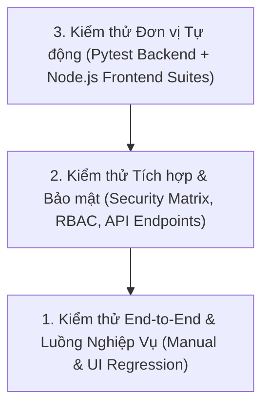
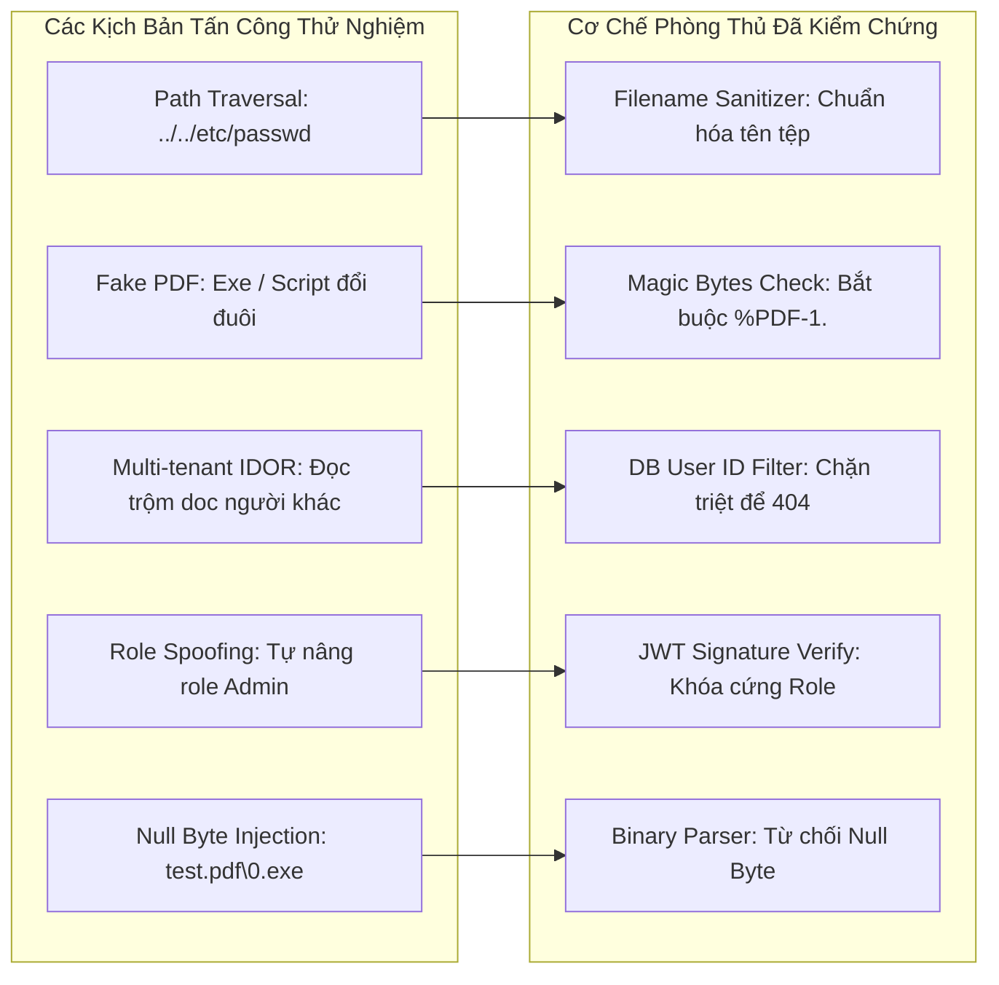

# KẾ HOẠCH & BÁO CÁO KẾT QUẢ KIỂM THỬ PHẦN MỀM (TEST PLAN & RESULTS)

## DỰ ÁN: NỀN TẢNG DỊCH THUẬT TÀI LIỆU PDF HỌC THUẬT & TRỢ LÝ AI (PDF-LINGUA)

| Thông tin | Chi tiết |
|---|---|
| **Tên dự án (EN)** | PDF-Lingua: Academic PDF Translation & AI Research Assistant |
| **Tên dự án (VN)** | Nền tảng Dịch thuật PDF Học thuật & Trợ lý Nghiên cứu AI |
| **Loại tài liệu** | Test Plan & Verification Report |
| **Viết tắt** | PDF-Lingua |
| **Phiên bản tài liệu** | 1.2 |
| **Ngày tạo** | 15/09/2026 |
| **Ngày chỉnh sửa lần cuối** | 20/11/2026 |
| **Trạng thái** | Hoàn thành (Release) |

---

## 1. Chiến Lược Kiểm Thử (Testing Strategy)

Hệ thống áp dụng mô hình Kim tự tháp kiểm thử (Test Pyramid) với mức độ tự động hóa cao:

- **Tiêu chí chấp nhận (Pass Criteria)**: 100% test cases tự động đều phải PASS (màu xanh) trước khi mã nguồn được phép gộp (merge) vào nhánh chính.
- **Môi trường cách ly**: Cơ sở dữ liệu SQLite in-memory hoặc tệp tạm thời riêng biệt (`ci_test.db`), thư mục lưu trữ tạm thời độc lập (`tmp_path`) được dọn dẹp sạch sau mỗi bài test.

---

## 2. Báo Cáo Kết Quả Kiểm Thử Tự Động (Automated Test Suites)

### 2.1. Kiểm Thử Giao Diện Người Dùng (Frontend Test Suites - Node.js)
Gồm 10 bộ kiểm thử độc lập viết bằng Node.js thuần, kiểm tra toàn bộ logic giao diện, render trạng thái và xử lý sự kiện DOM:

| STT | Tên Tệp Kiểm Thử | Mục Tiêu Kiểm Thử | Thời Gian Chạy | Kết Quả |
| :---: | :--- | :--- | :---: | :---: |
| 01 | `test_frontend_ai_copilot.js` | Tương tác khung chat hỏi đáp, cuộn tin nhắn, hiển thị badge ngữ cảnh | ~0.4s | **100% PASS** |
| 02 | `test_frontend_ai_summary.js` | Chọn 3 phong cách tóm tắt, kích hoạt Map-Reduce và fallback | ~0.3s | **100% PASS** |
| 03 | `test_frontend_background_jobs.js` | Cơ chế theo dõi tiến trình (Progress polling) và cập nhật thanh phần trăm | ~0.4s | **100% PASS** |
| 04 | `test_frontend_export.js` | Kích hoạt tải về bản dịch các định dạng TXT, DOCX, PDF, Zip | ~0.4s | **100% PASS** |
| 05 | `test_frontend_history.js` | Hiển thị bảng lịch sử, lọc trạng thái, phân trang và xóa bản ghi | ~0.4s | **100% PASS** |
| 06 | `test_frontend_login.js` | Form đăng nhập, đăng ký, validate email và lưu trữ JWT token | ~0.4s | **100% PASS** |
| 07 | `test_frontend_pricing.js` | Chuyển đổi chu kỳ tháng/năm, hiển thị mã QR VietQR và trạng thái thanh toán | ~0.3s | **100% PASS** |
| 08 | `test_frontend_role_limits.js` | Kiểm tra giới hạn quyền hạn theo vai trò (Khách, Free, Pro, Admin) | ~0.4s | **100% PASS** |
| 09 | `test_frontend_sidebar.js` | Menu điều hướng, làm mờ các mục chưa đăng nhập của Khách | ~0.4s | **100% PASS** |
| 10 | `test_frontend_validation.js` | Kiểm tra định dạng tệp PDF, cảnh báo dung lượng vượt ngưỡng | ~0.3s | **100% PASS** |

### 2.2. Kiểm Thử Động Cơ Phía Sau (Backend Test Suites - Pytest)
Bao gồm các kiểm thử cấu trúc cơ sở dữ liệu, API Gateway và các dịch vụ cốt lõi:

| Nhóm Kiểm Thử | Tệp Kiểm Thử | Số Lượng Tests | Thời Gian | Kết Quả |
| :--- | :--- | :---: | :---: | :---: |
| **Khung ứng dụng & API** | `Code/tests/test_api.py` | 2 | ~0.4s | **PASS** |
| **Khung kết nối cơ sở dữ liệu** | `Code/tests/test_database.py` | 3 | ~0.5s | **PASS** |
| **Xử lý ngoại lệ & Logging** | `Code/tests/test_exceptions_logging.py` | 6 | ~0.6s | **PASS** |
| **Mô hình tài liệu & Cascade** | `Code/backend/tests/test_document_model.py` | 3 | ~0.1s | **PASS** |
| **Phát hiện trang trắng & Nhiễu** | `Code/backend/tests/test_blank_page.py` | 4 | ~0.1s | **PASS** |
| **Dịch vụ xuất tệp & Đọc 2 cột** | `Code/backend/tests/test_services.py` | 65 | ~2.6s | **PASS** |
| **Xác thực & Mã hóa mật khẩu** | `Code/backend/tests/test_security.py` | 13 | ~4.7s | **PASS** |
| **Bảng giá & Giao dịch VietQR** | `Code/backend/tests/test_pricing_api.py` | 17 | ~1.3s | **PASS** |
| **Kiểm soát truy cập tài liệu** | `Code/backend/tests/test_document_access_control.py` | 23 | ~2.1s | **PASS** |
| **Quản trị người dùng Admin** | `Code/backend/tests/test_admin_management.py` | 15 | ~0.8s | **PASS** |
| **API Tóm tắt & Trợ lý AI** | `Code/backend/tests/test_ai_api.py` | 15 | ~3.5s | **PASS** |
| **Thuật toán AIService** | `Code/backend/tests/test_ai_service.py` | 18 | ~3.1s | **PASS** |

---

## 3. Ma Trận Kiểm Thử An Toàn Bảo Mật (Security Test Matrix)

Hệ thống được kiểm thử tự động với ma trận bảo mật chuyên sâu (`test_security_matrix.py`):

- **Kết quả**: 100% các cuộc tấn công giả lập đều bị chặn lại ở tầng Gateway với mã lỗi HTTP 400, 401 hoặc 404 phù hợp. Không xảy ra lỗi rò rỉ dữ liệu hoặc mã lỗi máy chủ nội bộ 500.

---

## 4. Kiểm Thử Đánh Giá Trên 5 Tệp PDF Thực Tế (Edge Cases Benchmark)

Hệ thống đã trải qua kiểm thử thực tế với 5 tệp PDF biên mẫu trong thư mục `Docs/test-examples/`:

1. **`test_dich_van_ban.pdf`**: Xử lý hoàn hảo lỗi ngắt dòng của MS Word (`\n \n`) và giữ nguyên bảng mẫu tự tiếng Việt (`Ă Â Ơ Ô Ê...`).
2. **`test_pdfl1.pdf` (Đa ngôn ngữ)**: Phân loại chuẩn xác 7 hệ ngôn ngữ xen kẽ (Việt, Anh, Pháp, Nhật, Hàn, Trung, Nga).
3. **`test_pdfl2.pdf` (Ký hiệu & Code)**: Bảo toàn 100% đường dẫn URL, email, biến môi trường `.env` và công thức `E = mc^2`.
4. **`test_pdfl3.pdf` (Số liệu & Bảng biểu)**: Giữ nguyên vẹn định dạng tiền tệ (`VNĐ`, `$`, `€`, `¥`), số La Mã và thụt lề danh sách gạch đầu dòng.
5. **`test_pdfl4.pdf` (Hội thoại & Trích dẫn)**: Dịch thuật tự nhiên câu đối thoại và các kiểu dấu ngoặc kép quốc tế (`"..."`, `«...»`).

---

## 5. Tự Động Hóa CI/CD Với GitHub Actions

Mọi thay đổi trên repository đều được kiểm tra liên tục qua luồng workflow tự động `.github/workflows/ci.yml`:
- **Frontend Job**: Chạy kiểm tra chuẩn ký tự không gạch nối dài (`zero en-dash/em-dash`) và thực thi 10 test suites giao diện (thời gian chạy: **~8 giây**).
- **Backend Job**: Thiết lập môi trường Python 3.12, tự động khởi tạo cơ sở dữ liệu tạm thời và chạy toàn bộ các bài test cốt lõi (thời gian chạy: **~40 giây**).
- **Trạng thái GitHub Actions**: Toàn bộ các lần build trên Pull Request đều đạt trạng thái **100% Passed (All checks green)**.

