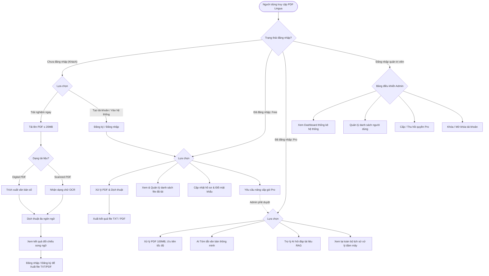

# Tài liệu mô tả Use Case tổng quát — PDF Lingua

> **THÔNG TIN TÀI LIỆU (DOCUMENT METADATA)**
> - **Tên dự án**: **PDF Lingua** – Nền tảng Web Trích xuất PDF, OCR, Dịch thuật Đa ngôn ngữ & Trợ lý AI
> - **Mã tài liệu**: `DOC-UC-OVERVIEW`
> - **Phiên bản (Version)**: `v1.2.0`
> - **Trạng thái (Status)**: `Chính thức (Approved)`
> - **Ngày tạo (Created Date)**: `24/10/2026`
> - **Ngày cập nhật gần nhất (Last Modified)**: `27/10/2026`
> - **Tham chiếu Jira Task**: `PDFL-21` (Xây dựng Use Case Diagram)
> - **Thuộc phân hệ**: `EPIC 01` (Phân tích yêu cầu và thiết kế hệ thống)
> - **Tài liệu tham chiếu trực quan**: [use-case-tong-quat.png](file:///c:/University%20Coding%20Project/PDF-Lingua/Docs/use-case/use-case-tong-quat.png)

---

## Lịch sử phiên bản (Revision History)

| Phiên bản | Ngày cập nhật | Người thực hiện | Trạng thái | Tóm tắt nội dung thay đổi |
| :---: | :---: | :--- | :---: | :--- |
| `v1.0.0` | 24/10/2026 | Nguyễn Lê Huy Tâm | Bản thảo | Khởi tạo tài liệu đặc tả Use Case sơ bộ theo danh mục 16 Epic trên Jira Backlog. |
| `v1.1.0` | 26/10/2026 | Huỳnh Đình Chấn | Xem xét | Bổ sung phân tích luồng nghiệp vụ cốt lõi cho Khách vãng lai (Guest) không cần đăng nhập. |
| `v1.2.0` | 27/10/2026 | Nhóm phát triển | Chính thức | Đồng bộ chuẩn hóa 100% với sơ đồ [use-case-tong-quat.png](file:///c:/University%20Coding%20Project/PDF-Lingua/Docs/use-case/use-case-tong-quat.png): Chuẩn hóa đúng 20 Use Case (UC-01 ➔ UC-20), chuẩn hóa quan hệ kế thừa 3 cấp (Pro ➔ Free ➔ Guest), xác lập cơ chế xử lý ngầm cho các bước kỹ thuật (Magic Bytes, Text Chunking) và hoàn thiện luồng End-to-End. |

---

## 1. Tổng quan

**PDF Lingua** là hệ thống web hỗ trợ người dùng tải lên và quản lý tài liệu PDF, trích xuất văn bản số trực tiếp, nhận dạng ký tự quang học (OCR) đối với PDF scan, dịch thuật đa ngôn ngữ và xuất kết quả song ngữ. Hệ thống còn cung cấp các chức năng AI nâng cao dành cho tài khoản Pro (tóm tắt văn bản, trợ lý hỏi đáp RAG trên tài liệu, lưu trữ lịch sử xử lý đám mây). Quản trị viên (Admin) có các chức năng quản lý người dùng, phân quyền gói cước và theo dõi hoạt động toàn hệ thống.

Tài liệu này chuẩn hóa và mô tả chi tiết **Use Case tổng quát** của hệ thống PDF Lingua, đồng bộ trực tiếp 100% với sơ đồ thiết kế tổng quát ([use-case-tong-quat.png](file:///c:/University%20Coding%20Project/PDF-Lingua/Docs/use-case/use-case-tong-quat.png)).

---

## 2. Mục tiêu và phạm vi hệ thống

Sơ đồ và tài liệu Use Case tổng quát phục vụ các mục tiêu:
- Thể hiện trực quan ranh giới hệ thống (*System Boundary*) và các tác nhân bên ngoài (*Actors*).
- Chuẩn hóa quyền hạn và luồng chức năng giữa 4 nhóm tác nhân: **Khách (Guest)**, **Người dùng Free**, **Người dùng Pro** và **Admin**.
- Làm căn cứ thiết kế sơ đồ hoạt động (Activity Diagram), sơ đồ tuần tự (Sequence Diagram), kiến trúc API và kịch bản kiểm thử (Test Cases).

Phạm vi chức năng bao gồm:
1. **Phân hệ Xác thực & Quản lý tài khoản**: Đăng ký, đăng nhập, đăng xuất, hồ sơ cá nhân, bảo mật mật khẩu.
2. **Phân hệ Xử lý PDF cốt lõi (Core Processing)**: Tải file, trích xuất văn bản số, nhận dạng OCR, quản lý tài liệu.
3. **Phân hệ Dịch thuật & Xuất kết quả**: Dịch thuật đa ngôn ngữ, hiển thị giao diện đối chiếu song ngữ, xuất kết quả TXT/PDF.
4. **Phân hệ AI Nâng cao (Gói Pro)**: AI tóm tắt văn bản, Trợ lý AI hỏi đáp tài liệu (RAG), lưu trữ lịch sử xử lý.
5. **Phân hệ Quản trị hệ thống (Admin)**: Dashboard thống kê, quản lý danh sách người dùng, cấp/thu hồi quyền Pro, khóa/mở khóa tài khoản.

---

## 3. Các tác nhân hệ thống (Actors)

Hệ thống PDF-Lingua phân định 4 nhóm tác nhân với mô hình kế thừa năng lực rõ ràng:

```
[Khách (Guest)] ◄───kế thừa─── [Người dùng Free] ◄───kế thừa─── [Người dùng Pro]

[Admin] (Tác nhân độc lập)
```

### 3.1. Khách (Guest)
- **Định nghĩa**: Người dùng vãng lai truy cập website mà chưa thực hiện đăng nhập tài khoản.
- **Quyền hạn & Luồng nghiệp vụ cốt lõi**:
  - Nhằm tạo trải nghiệm nhanh (*Try-before-register*), Khách được phép sử dụng trực tiếp luồng xử lý cơ bản ngay tại trang chủ: **Tải file PDF (≤ 20MB) ➔ Trích xuất văn bản số / Chạy OCR ➔ Dịch thuật đa ngôn ngữ ➔ Xem kết quả xử lý song ngữ trên màn hình**.
  - Không hỗ trợ lưu trữ dữ liệu cá nhân hay xuất file tải về trên phiên khách (muốn xuất file hoặc lưu lịch sử cần đăng ký tài khoản).
  - Có thể thực hiện **Đăng ký tài khoản mới** hoặc **Đăng nhập**.

### 3.2. Người dùng Free (Free User)
- **Định nghĩa**: Người dùng đã đăng ký tài khoản và đang sử dụng gói dịch vụ miễn phí.
- **Kế thừa & Quyền hạn**:
  - Kế thừa toàn bộ quyền của **Khách**: Tải PDF (hạn mức tiêu chuẩn ≤ 20MB/tệp), trích xuất văn bản số, OCR scan, dịch thuật và xem kết quả.
  - Được bổ sung các chức năng quản lý tài khoản và dữ liệu:
    - Đăng xuất.
    - Xem và cập nhật hồ sơ cá nhân.
    - Chỉnh sửa thông tin bảo mật của tài khoản (đổi mật khẩu).
    - Xem lại và quản lý danh sách tài liệu cá nhân đã tải lên (xóa tài liệu).
    - Xuất kết quả xử lý thành file TXT hoặc PDF.
    - Gửi yêu cầu nâng cấp lên gói Pro.

### 3.3. Người dùng Pro (Pro User)
- **Định nghĩa**: Người dùng trả phí hoặc được quản trị viên cấp quyền tài khoản Pro.
- **Kế thừa & Quyền hạn**:
  - Kế thừa toàn bộ quyền của **Người dùng Free** (kèm mở rộng hạn mức upload lên đến 100MB/tệp và ưu tiên tốc độ xử lý).
  - Mở khóa độc quyền các chức năng AI cao cấp:
    - **Tóm tắt văn bản bằng AI**: Tóm tắt tài liệu nhanh, dạng bullet points hoặc phân tích sâu.
    - **Trợ lý AI hỏi đáp tài liệu (RAG)**: Hỏi đáp tương tác dựa trên nội dung tài liệu, có trích dẫn số trang.
    - **Xem lại lịch sử xử lý**: Lưu trữ và tra cứu lịch sử các phiên trích xuất, bản dịch, câu hỏi RAG trên nền tảng đám mây.

### 3.4. Quản trị viên (Admin)
- **Định nghĩa**: Người quản trị vận hành hệ thống, được khởi tạo thông qua tài khoản quản trị đặc biệt.
- **Quyền hạn**:
  - Tác nhân độc lập quản lý toàn bộ hệ thống:
    - Đăng nhập và Đăng xuất trang quản trị.
    - Xem Dashboard thống kê hệ thống (tổng người dùng, dung lượng tài liệu, lưu lượng dịch/AI).
    - Quản lý danh sách người dùng.
    - Quản lý gói Pro (Cấp phát hoặc thu hồi quyền Pro thủ công cho người dùng).
    - Khóa / Mở khóa tài khoản người dùng vi phạm.

---

## 4. Danh mục 20 Use Case tổng quát

Bảng dưới đây chuẩn hóa 20 Use Case được biểu diễn trực quan trên sơ đồ [use-case-tong-quat.png](file:///c:/University%20Coding%20Project/PDF-Lingua/Docs/use-case/use-case-tong-quat.png):

| Mã UC | Tên Use Case trên sơ đồ | Tác nhân liên kết trực tiếp | Tác nhân được kế thừa | Phân hệ | Mô tả nghiệp vụ |
| :---: | :--- | :--- | :--- | :--- | :--- |
| **UC-01** | **Đăng nhập** | Khách, Admin | Người dùng Free, Pro | Xác thực | Xác thực email/mật khẩu và cấp mã JWT đưa người dùng vào hệ thống theo đúng vai trò. |
| **UC-02** | **Đăng kí tài khoản mới** | Khách | - | Xác thực | Tạo tài khoản mới bằng Email và Mật khẩu hợp lệ. |
| **UC-03** | **Tải lên tài liệu PDF** | Khách | Người dùng Free, Pro | Xử lý PDF | Tải file PDF từ máy lên hệ thống (Khách & Free: ≤ 20MB, Pro: ≤ 100MB). *(Ngầm kiểm tra MIME type & Magic Bytes)* |
| **UC-04** | **Trích xuất văn bản số từ PDF digital** | Khách | Người dùng Free, Pro | Xử lý PDF | Bóc tách lớp văn bản ký tự có sẵn trong tệp PDF số trực tiếp theo trang. |
| **UC-05** | **Nhận dạng OCR từ PDF scan** | Khách | Người dùng Free, Pro | Xử lý PDF | Chuyển trang scan thành ảnh và chạy Tesseract OCR nhận diện ký tự khi tài liệu không có text layer. |
| **UC-06** | **Dịch thuật đa ngôn ngữ** | Khách | Người dùng Free, Pro | Dịch thuật | Tự động nhận diện ngôn ngữ nguồn và dịch văn bản sang ngôn ngữ đích được chọn. *(Ngầm tự động chia nhỏ đoạn)* |
| **UC-07** | **Xem kết quả xử lý / kết quả dịch** | Khách | Người dùng Free, Pro | Dịch thuật | Hiển thị giao diện Workspace song ngữ đối chiếu văn bản gốc và bản dịch, hỗ trợ sao chép nội dung. |
| **UC-08** | **Đăng xuất** | Người dùng Free, Admin | Người dùng Pro | Xác thực | Hủy phiên đăng nhập hiện tại và xóa token xác thực an toàn phía client. |
| **UC-09** | **Xem và cập nhật hồ sơ cá nhân** | Người dùng Free | Người dùng Pro | Tài khoản | Xem thông tin tài khoản, ngày tham gia, gói cước và cập nhật tên hiển thị. |
| **UC-10** | **Chỉnh sửa thông tin bảo mật của tài khoản** | Người dùng Free | Người dùng Pro | Tài khoản | Thay đổi mật khẩu tài khoản bằng cách xác thực mật khẩu cũ và nhập mật khẩu mới. |
| **UC-11** | **Xem lại và quản lý lịch sử tài liệu đã tải lên** | Người dùng Free | Người dùng Pro | Xử lý PDF | Xem danh sách các file PDF cá nhân đã tải lên hệ thống và thực hiện xóa file khi không còn nhu cầu. |
| **UC-12** | **Xuất kết quả thành file TXT/PDF** | Người dùng Free | Người dùng Pro | Dịch thuật | Xuất văn bản trích xuất hoặc bản dịch thành file văn bản thuần (.txt UTF-8) hoặc tệp PDF đã dịch. |
| **UC-13** | **Nâng cấp lên gói Pro** | Người dùng Free | - | Gói cước | Xem bảng giá so sánh quyền lợi và gửi yêu cầu nâng cấp tài khoản lên gói Pro. |
| **UC-14** | **Tóm tắt văn bản bằng AI** | Người dùng Pro | - | AI Pro | Sử dụng mô hình LLM AI để tóm tắt nội dung tài liệu theo các phong cách (ngắn gọn, ý chính, chi tiết). |
| **UC-15** | **Trợ lý AI hỏi đáp tài liệu** | Người dùng Pro | - | AI Pro | Chat hỏi đáp trực tiếp với trợ lý AI dựa trên nội dung tài liệu (RAG), có trích dẫn nguồn trang. |
| **UC-16** | **Xem lại lịch sử xử lý** | Người dùng Pro | - | AI Pro | Tra cứu và mở lại toàn bộ lịch sử các phiên dịch thuật, tóm tắt và câu hỏi RAG được lưu trên đám mây. |
| **UC-17** | **Xem Dashboard thống kê** | Admin | - | Quản trị | Theo dõi các biểu đồ và chỉ số vận hành: tổng tài khoản, dung lượng lưu trữ, lượt xử lý PDF/Dịch/AI. |
| **UC-18** | **Quản lý danh sách người dùng** | Admin | - | Quản trị | Tìm kiếm, xem chi tiết thông tin, ngày tạo và trạng thái hoạt động của toàn bộ người dùng trong hệ thống. |
| **UC-19** | **Quản lý gói Pro** | Admin | - | Quản trị | Cấp phát hoặc thu hồi quyền Pro cho người dùng theo chính sách dịch vụ. |
| **UC-20** | **Khóa / Mở khóa tài khoản** | Admin | - | Quản trị | Tạm thời vô hiệu hóa quyền truy cập (`is_active = False`) hoặc mở lại tài khoản người dùng vi phạm. |

> 📌 **Ghi chú về các cơ chế xử lý nội bộ (Internal Processing Mechanisms)**:
> Một số thao tác kỹ thuật như *Kiểm tra tính hợp lệ & dung lượng file* (Magic Bytes, Quota) và *Phân đoạn văn bản thông minh* (Text Chunking chia nhỏ văn bản ≤ 4,000 ký tự chống timeout) là các bước xử lý tự động ngầm của Backend pipeline, phục vụ trực tiếp cho **UC-03** và **UC-06**. Trong sơ đồ tổng quát, các cơ chế này không tách thành các oval Use Case độc lập để đảm bảo tính tinh gọn, tập trung vào góc nhìn người dùng.

---

## 5. Quy tắc quan hệ UML trên sơ đồ

### 5.1. Liên kết giữa Actor và Use Case (Association)
- Thể hiện bằng **đường thẳng liền nét (solid line)** không có mũi tên giữa Actor và hình elip Use Case.
- Biểu thị rằng Actor đó là tác nhân chính trực tiếp tương tác, kích hoạt hoặc nhận kết quả từ Use Case.
- Một Use Case có thể có nhiều Actor liên kết trực tiếp nếu hành vi dùng chung (ví dụ: *Đăng nhập* liên kết với cả Khách và Admin; *Đăng xuất* liên kết với cả Người dùng Free và Admin).

### 5.2. Quan hệ kế thừa giữa các Actor (Generalization)
- Thể hiện bằng **đường thẳng liền nét có mũi tên tam giác rỗng (hollow triangle arrowhead)** hướng từ Actor con về Actor cha:
  - `Người dùng Free` ──▷ `Khách`: Người dùng Free thừa hưởng toàn bộ khả năng xử lý tài liệu của Khách.
  - `Người dùng Pro` ──▷ `Người dùng Free`: Người dùng Pro thừa hưởng toàn bộ khả năng xử lý tài liệu, quản lý tài khoản và xuất file của Người dùng Free.
- `Admin` là Actor độc lập quản trị, không kế thừa từ người dùng thông thường để đảm bảo nguyên tắc bảo mật và phân quyền rõ ràng (*Separation of Concerns*).

---

## 6. Luồng nghiệp vụ tổng thể (End-to-End Workflow)



---

## 7. Kết luận & Phê duyệt tài liệu

Tài liệu này xác nhận sơ đồ Use Case tổng quát [use-case-tong-quat.png](file:///c:/University%20Coding%20Project/PDF-Lingua/Docs/use-case/use-case-tong-quat.png) là hoàn toàn **chính xác, hợp lệ theo chuẩn UML** và phản ánh đúng 100% định hướng kiến trúc sản phẩm PDF-Lingua:
1. **Luồng Khách trải nghiệm trực tiếp**: Giúp tăng tỷ lệ tiếp cận và chuyển đổi người dùng mà không bắt buộc đăng nhập từ đầu.
2. **Cơ chế kế thừa 3 cấp**: `Khách` ➔ `Người dùng Free` ➔ `Người dùng Pro` logic và mạch lạc.
3. **Phân tách trách nhiệm quản trị**: `Admin` quản lý vận hành độc lập, kiểm soát an toàn hệ thống.
