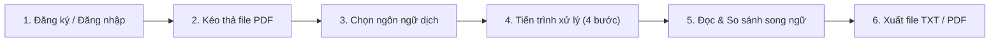

# Hướng Dẫn Sử Dụng & Bộ Quy Chuẩn Vận Hành PDF-Lingua (User Guide & Guidelines)

> **Tài liệu**: Hướng dẫn sử dụng chi tiết & Quy chuẩn vận hành ứng dụng Web PDF-Lingua  
> **Vị trí tệp**: `Docs/USER_GUIDE.md`  
> **Dự án**: **PDF-Lingua**: Nền tảng trích xuất văn bản PDF thông minh, OCR tài liệu scan và dịch thuật đa ngôn ngữ  
> **Phiên bản**: `1.0.0` (Cập nhật tháng 11/2026)

---

## 📖 Mục Lục

1. [Giới Thiệu Chung](#1-giới-thiệu-chung)
2. [Yêu Cầu Hệ Thống & Chuẩn Bị](#2-yêu-cầu-hệ-thống--chuẩn-bị)
3. [Hướng Dẫn Chi Tiết Từng Bước (Step-by-Step Guide)](#3-hướng-dẫn-chi-tiết-từng-bước-step-by-step-guide)
   - [3.1. Quản lý tài khoản (Đăng ký, Đăng nhập, Hồ sơ)](#31-quản-lý-tài-khoản-đăng-ký-đăng-nhập-hồ-sơ)
   - [3.2. Tải tài liệu PDF lên hệ thống (Upload Dropzone)](#32-tải-tài-liệu-pdf-lên-hệ-thống-upload-dropzone)
   - [3.3. Lựa chọn ngôn ngữ & Tiến trình xử lý](#33-lựa-chọn-ngôn-ngữ--tiến-trình-xử-lý)
   - [3.4. Thao tác trên không gian làm việc song ngữ (Dual-pane Workspace)](#34-thao-tác-trên-không-gian-làm-việc-song-ngữ-dual-pane-workspace)
   - [3.5. Xuất và tải kết quả về thiết bị](#35-xuất-và-tải-kết-quả-về-thiết-bị)
   - [3.6. Tra cứu Điều khoản, Bảo mật & Gửi phản hồi](#36-tra-cứu-điều-khoản-bảo-mật--gửi-phản-hồi)
4. [Bộ Quy Chuẩn Sử Dụng Tối Ưu (Best Practices & Guidelines)](#4-bộ-quy-chuẩn-sử-dụng-tối-ưu-best-practices--guidelines)
5. [Hạn Mức Sử Dụng Theo Phân Tầng Tài Khoản](#5-hạn-mức-sử-dụng-theo-phân-tầng-tài-khoản)
6. [Giải Quyết Sự Cố Thường Gặp (Troubleshooting / FAQ)](#6-giải-quyết-sự-cố-thường-gặp-troubleshooting--faq)

---

## 1. Giới Thiệu Chung

**PDF-Lingua** là giải pháp phần mềm web hiện đại được phát triển nhằm tự động hóa toàn diện quy trình tiếp cận tài liệu nước ngoài:
- **Trích xuất văn bản số (Digital PDF Extraction)**: Sử dụng các thư viện chuyên sâu (`pypdf`, `pdfplumber`) kết hợp thuật toán **Natural Reading Order** giữ nguyên cấu trúc dòng và thứ tự đọc tự nhiên của tài liệu đa cột (bài báo khoa học IEEE, giáo trình).
- **Nhận dạng ký tự quang học (OCR)**: Tích hợp công nghệ **Tesseract OCR Engine** với bộ từ điển ngôn ngữ kép (`vie + eng`), tự động nhận diện và bóc tách chữ từ tài liệu scan dạng ảnh chụp.
- **Dịch thuật đa ngôn ngữ ngữ nghĩa (Semantic Translation)**: Tự động phát hiện ngôn ngữ nguồn, chia nhỏ đoạn thông minh (Smart Chunking) chống nghẽn mạng và dịch sang Tiếng Việt cùng hơn 10 ngôn ngữ phổ biến trên thế giới.
- **Không gian làm việc trực quan (Dual-pane Workspace)**: Trình bày song song văn bản gốc và bản dịch, cho phép so sánh, dịch lại và xuất file nhanh chóng.

---

## 2. Yêu Cầu Hệ Thống & Chuẩn Bị

### 2.1. Phía Người Dùng (Client)
- **Thiết bị**: Máy tính để bàn (PC), Laptop, Máy tính bảng (Tablet) hoặc Điện thoại thông minh (Smartphone).
- **Trình duyệt khuyến nghị**: Google Chrome, Microsoft Edge, Mozilla Firefox, Apple Safari (phiên bản cập nhật trong vòng 2 năm gần nhất, bật hỗ trợ JavaScript).
- **Đường truyền mạng**: Kết nối Internet ổn định để đảm bảo việc tải tệp và gọi API dịch thuật diễn ra liền mạch.

### 2.2. Địa Chỉ Truy Cập (Môi Trường Phát Triển / Localhost)
- **Giao diện người dùng (Frontend)**: Mở bằng VS Code Live Server tại `http://localhost:5500` hoặc mở trực tiếp tệp `Code/frontend/index.html`.
- **Máy chủ ứng dụng (Backend API)**: Khởi chạy tại `http://127.0.0.1:8000`.
- **Tài liệu API Swagger tương tác**: `http://127.0.0.1:8000/docs`.

---

## 3. Hướng Dẫn Chi Tiết Từng Bước (Step-by-Step Guide)



### 3.1. Quản lý tài khoản (Đăng ký, Đăng nhập, Hồ sơ)

1. **Đăng ký tài khoản mới**:
   - Nhấn nút **"Đăng ký"** ở góc phải thanh điều hướng (Navbar).
   - Điền đầy đủ thông tin:
     - **Họ và tên**: Tùy chọn (tối đa 150 ký tự).
     - **Địa chỉ Email**: Định dạng hợp lệ (ví dụ: `nguyenvana@gmail.com`).
     - **Mật khẩu**: Tối thiểu **8 ký tự**, phải chứa ít nhất **1 chữ cái** và **1 chữ số**.
     - **Xác nhận mật khẩu**: Khớp chính xác với mật khẩu đã nhập.
   - Nhấn **"Tạo tài khoản"**.
   - > [!TIP]
     > **Tự động đăng nhập (Auto-login)**: Ngay sau khi đăng ký thành công, hệ thống sẽ **tự động đăng nhập** vào tài khoản mới và cập nhật thanh điều hướng hiển thị tên/avatar của bạn mà không bắt bạn phải gõ lại mật khẩu!

2. **Đăng nhập**:
   - Nhấn nút **"Đăng nhập"** trên thanh điều hướng.
   - Nhập email và mật khẩu của bạn rồi nhấn **"Đăng nhập"**.
   - Có thể bấm biểu tượng con mắt 👁️ ở góc ô nhập liệu để ẩn/hiện mật khẩu.

3. **Xem hồ sơ & Đổi thông tin cá nhân**:
   - Nhấn vào khu vực **Tên / Avatar** ở thanh điều hướng để mở **Modal Thông tin tài khoản**.
   - Tại đây bạn có thể:
     - Xem địa chỉ email, vai trò tài khoản (`FREE` / `PRO` / `ADMIN`), ngày tham gia.
     - Nhấn nút chỉnh sửa ✏️ cạnh Họ và tên để đổi tên hiển thị.
     - Mở mục **"Đổi mật khẩu"**: Nhập mật khẩu cũ, mật khẩu mới và xác nhận mật khẩu mới.

4. **Đăng xuất**:
   - Trong menu người dùng hoặc modal tài khoản, nhấn **"Đăng xuất"**. Hệ thống sẽ xóa sạch phiên lưu trữ và đưa bạn về trạng thái Khách vãng lai an toàn.

---

### 3.2. Tải tài liệu PDF lên hệ thống (Upload Dropzone)

1. Cuộn đến khu vực **"Kéo & thả tài liệu PDF vào đây"** ở giữa trang chủ.
2. Thao tác tải tệp:
   - **Cách 1**: Kéo tệp PDF từ máy tính và thả trực tiếp vào ô Dropzone nét đứt.
   - **Cách 2**: Nhấp chuột vào nút **"Chọn tệp từ thiết bị"** và chọn tệp `.pdf` từ cửa sổ duyệt file.
3. Sau khi chọn tệp, hệ thống sẽ hiển thị thẻ tệp gồm:
   - Tên tệp đầy đủ.
   - Dung lượng tệp (tính bằng MB).
   - Biểu tượng PDF định dạng chuẩn và nút xóa ✕ nếu muốn chọn lại tệp khác.

> [!WARNING]
> - Hệ thống **chỉ chấp nhận định dạng `.pdf`**. Các tệp ảnh (.png, .jpg) hoặc tài liệu văn bản (.docx, .txt) tải trực tiếp vào đây sẽ bị từ chối với thông báo cảnh báo màu đỏ.
> - Tài khoản **Miễn phí (Free / Guest)**: Dung lượng tệp tối đa **20 MB**, số trang tối đa **100 trang**.
> - Tài khoản **Nâng cao (Pro)**: Dung lượng tệp tối đa **100 MB**, số trang tối đa **500 trang**.

---

### 3.3. Lựa chọn ngôn ngữ & Tiến trình xử lý

1. **Lựa chọn ngôn ngữ**:
   - **Ngôn ngữ nguồn**: Hệ thống mặc định chọn **"Tự động phát hiện"** (`Auto-detect`). Bạn không cần lo lắng về ngôn ngữ gốc của tài liệu.
   - **Ngôn ngữ đích**: Nhấp vào menu thả xuống và chọn ngôn ngữ bạn muốn dịch sang:
     - 🇻🇳 **Tiếng Việt** (Mặc định)
     - 🇬🇧 **Tiếng Anh (English)**
     - 🇯🇵 **Tiếng Nhật (Japanese)**
     - 🇰🇷 **Tiếng Hàn (Korean)**
     - 🇨🇳 **Tiếng Trung (Chinese)**
     - 🇫🇷 **Tiếng Pháp (French)**, 🇩🇪 **Tiếng Đức (German)**,...
2. **Kích hoạt xử lý**:
   - Nhấn nút **"Bắt đầu trích xuất & Dịch thuật"**.
3. **Theo dõi Modal tiến trình 4 giai đoạn trực quan**:
   - `Giai đoạn 1`: Tải tệp lên máy chủ an toàn.
   - `Giai đoạn 2`: Kiểm tra cấu trúc tệp, phát hiện PDF số hay PDF scan.
   - `Giai đoạn 3`: Bóc tách văn bản số hoặc chạy bộ nhận dạng OCR Tesseract.
   - `Giai đoạn 4`: Chia đoạn thông minh và tổng hợp bản dịch.
   - *Khi thanh tiến trình đạt 100%, hệ thống tự động đóng modal và mở không gian làm việc Workspace.*

---

### 3.4. Thao tác trên không gian làm việc song ngữ (Dual-pane Workspace)

Không gian làm việc (Workspace) được thiết kế theo chuẩn màn hình đọc tài liệu chuyên nghiệp:

1. **Bố cục 2 cột song song**:
   - **Cột bên trái**: Hiển thị toàn bộ **Văn bản gốc** đã trích xuất từ PDF.
   - **Cột bên phải**: Hiển thị **Bản dịch đa ngôn ngữ** tương ứng.
2. **Các công cụ tiện ích trên thanh Toolbar**:
   - **Nút Sao chép (Copy) 📋**: Sao chép nhanh toàn bộ nội dung văn bản gốc hoặc bản dịch vào Clipboard chỉ với 1 cú click.
   - **Nút Dịch lại (Retranslate) 🔄**: Bạn muốn đổi sang ngôn ngữ khác (ví dụ từ Tiếng Việt sang Tiếng Nhật)? Chỉ cần chọn lại ngôn ngữ trên thanh công cụ và bấm "Dịch lại", hệ thống sẽ dịch tức thì mà không cần phải upload lại tệp PDF!
   - **Chuyển đổi giao diện xem**: Hỗ trợ xem song song (Side-by-side) hoặc xem tập trung từng cột trên thiết bị di động.

---

### 3.5. Xuất và tải kết quả về thiết bị

Sau khi hoàn tất việc đọc và biên dịch tài liệu, bạn có thể lưu trữ kết quả về máy tính qua 2 định dạng chuẩn:

1. **Xuất tệp Văn bản (`.txt`)**:
   - Nhấn nút **"Tải file TXT"**.
   - Tệp được xuất theo chuẩn **UTF-8 with BOM**, đảm bảo khi mở trên bất kỳ hệ điều hành nào (Windows Notepad, macOS TextEdit, Linux) đều hiển thị tiếng Việt có dấu chuẩn 100%, không bao giờ bị lỗi font hay biến dạng ký tự.
2. **Xuất tệp Tài liệu PDF (`.pdf`)**:
   - Nhấn nút **"Tải file PDF"**.
   - Hệ thống Backend sử dụng ReportLab biên soạn lại tài liệu với cấu trúc trang tiêu chuẩn, ngắt đoạn rõ ràng và hỗ trợ hiển thị tiếng Việt Unicode sắc nét.

---

### 3.6. Tra cứu Điều khoản, Bảo mật & Gửi phản hồi

Ở chân trang web (Footer), bạn có thể truy cập hệ thống chính sách minh bạch của dự án:
- **Điều khoản dịch vụ**: Quy định quyền sở hữu tài liệu, cam kết không sử dụng lại dữ liệu cá nhân của người dùng.
- **Chính sách bảo mật**: Chi tiết về mã hóa mật khẩu, vòng đời dọn dẹp file tạm và bảo mật phiên.
- **Liên hệ & Góp ý**: Form gửi ý kiến đóng góp, phản hồi chất lượng bản dịch hoặc báo cáo lỗi trực tiếp tới nhóm phát triển.

---

## 4. Bộ Quy Chuẩn Sử Dụng Tối Ưu (Best Practices & Guidelines)

Để đạt được tốc độ xử lý nhanh nhất và chất lượng bản dịch chính xác nhất, người dùng nên tuân thủ các quy chuẩn sau:

### 📄 Quy chuẩn 1: Chuẩn bị tệp PDF đầu vào
- **Tài liệu PDF số (Digital / Born-digital PDF)**: Các tệp PDF được xuất trực tiếp từ Word, LaTeX, Google Docs hoặc sách điện tử có lớp văn bản gốc sẽ cho **tốc độ xử lý gần như tức thì** và **độ chính xác trích xuất đạt 100%**.
- **Tài liệu PDF scan (Scanned / Image-only PDF)**:
  - Độ phân giải trang scan khuyến nghị từ **200 DPI đến 300 DPI**.
  - Đảm bảo trang tài liệu không bị xoay ngược 180 độ hoặc quá mờ nhòe.
  - Hạn chế tài liệu scan bị bóng đen ở nếp gấp sách để bộ nhận diện OCR không nhận nhầm thành ký tự lạ.

### ⚡ Quy chuẩn 2: Dung lượng và phân đoạn tài liệu
- Đối với sách giáo trình dày hàng trăm trang, khuyến nghị nên tách theo từng chương mục nhỏ (20-50 trang/lần) để:
  - Tối ưu hóa thời gian chờ đợi phản hồi từ máy chủ.
  - Giúp bản dịch giữ được tính liên kết ngữ cảnh chặt chẽ hơn.

### 🔒 Quy chuẩn 3: An toàn thông tin và quyền riêng tư
- Hệ thống PDF-Lingua tự động áp dụng chính sách **Zero-Retention File Policy** cho các tác vụ xử lý tạm: tệp tải lên sau khi hoàn tất trích xuất sẽ được tự động dọn sạch khỏi thư mục tạm.
- Không tải lên các tệp PDF chứa mã độc, tệp có phần mềm gián điệp hoặc tài liệu vi phạm pháp luật.

---

## 5. Hạn Mức Sử Dụng Theo Phân Tầng Tài Khoản

| Tiêu Chí / Tính Năng | Khách Vãng Lai (Guest) | Tài Khoản Miễn Phí (Free) | Tài Khoản Nâng Cao (Pro) |
|---|:---:|:---:|:---:|
| **Yêu cầu đăng nhập** | Không | Bắt buộc | Bắt buộc |
| **Giá dịch vụ** | Miễn phí | Miễn phí | 49.000đ/tháng hoặc 399.000đ/năm |
| **Dung lượng tối đa mỗi tệp** | **20 MB** | **20 MB** | **100 MB** |
| **Giới hạn số trang tối đa** | 100 trang | 100 trang | **500 trang** |
| **Trích xuất văn bản số** | ✅ Hỗ trợ | ✅ Hỗ trợ | ✅ Hỗ trợ |
| **Nhận dạng OCR PDF scan** | ✅ Hỗ trợ | ✅ Hỗ trợ | ✅ Ưu tiên tốc độ cao |
| **Dịch thuật đa ngôn ngữ** | ✅ Không giới hạn | ✅ Không giới hạn | ✅ Không giới hạn |
| **Định dạng tải xuống bản dịch** | TXT, PDF | TXT, PDF | **TXT, PDF, Word (.docx)** |
| **Trợ lý hỏi đáp AI Copilot** | ❌ Không hỗ trợ | ❌ **Không có** | ✅ **15 câu / ngày** |
| **Tóm tắt văn bản AI Summary** | ❌ Không hỗ trợ | ✅ Cơ bản | ✅ **Chuyên sâu & Thuật ngữ** |
| **Kho lưu trữ tài liệu cá nhân** | ❌ Không lưu | 5 tệp gần nhất | **Không giới hạn** |
| **Huy hiệu nhận diện tài khoản** | Không có huy hiệu | **Không có huy hiệu** | **Huy hiệu VIP** |

---

## 6. Giải Quyết Sự Cố Thường Gặp (Troubleshooting / FAQ)

### ❓ 1. Tại sao tôi bấm "Tải lên" nhưng hệ thống báo lỗi không thể kết nối đến máy chủ?
- **Nguyên nhân**: Máy chủ Backend FastAPI chưa được khởi chạy hoặc bị gián đoạn.
- **Khắc phục**: Kiểm tra xem terminal chạy Backend đã mở chưa. Khởi chạy bằng lệnh:
  ```powershell
  cd Code/backend
  .\venv\Scripts\uvicorn.exe app.main:app --reload --port 8000
  ```
  Sau đó tải lại trang web và thử lại.

### ❓ 2. Tại sao tệp của tôi không thể copy văn bản được nhưng khi tải lên hệ thống lại mất nhiều thời gian hơn bình thường?
- **Giải thích**: Đây là tệp **PDF scan** (dạng hình ảnh chụp). Hệ thống đã tự động kích hoạt engine OCR Tesseract để phân tích từng điểm ảnh và chuyển đổi thành văn bản. Quá trình này cần nhiều tài nguyên CPU hơn so với PDF số thông thường, vui lòng kiên nhẫn trong giây lát.

### ❓ 3. Tệp tải về có bị lỗi font chữ tiếng Việt khi mở trên Windows Notepad không?
- **Trả lời**: **Hoàn toàn không**. PDF-Lingua sử dụng chuẩn mã hóa **UTF-8 with BOM** cho tệp TXT và nhúng font chữ Unicode cho tệp PDF. Tệp tải về hiển thị dấu tiếng Việt sắc nét và chuẩn xác trên mọi phần mềm đọc văn bản phổ biến.

### ❓ 4. Làm cách nào để báo cáo một đoạn dịch thuật chưa chuẩn hoặc đóng góp ý kiến?
- **Khắc phục**: Cuộn xuống chân trang, nhấn vào liên kết **"Liên hệ"** để mở form phản hồi. Nhập ý kiến của bạn và bấm gửi, thông tin sẽ được chuyển thẳng đến nhóm phát triển để ghi nhận và cải tiến mô hình.

---

*Tài liệu này được biên soạn bởi Nhóm phát triển dự án **PDF-Lingua**. Mọi thắc mắc và đóng góp xin gửi về qua mục Liên hệ trên website hoặc qua kho mã nguồn GitHub chính thức.*

