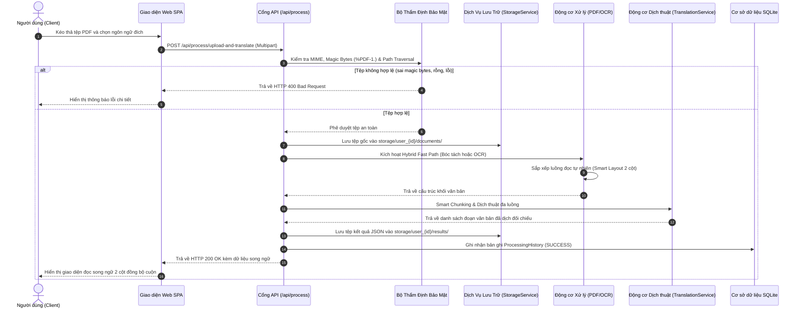
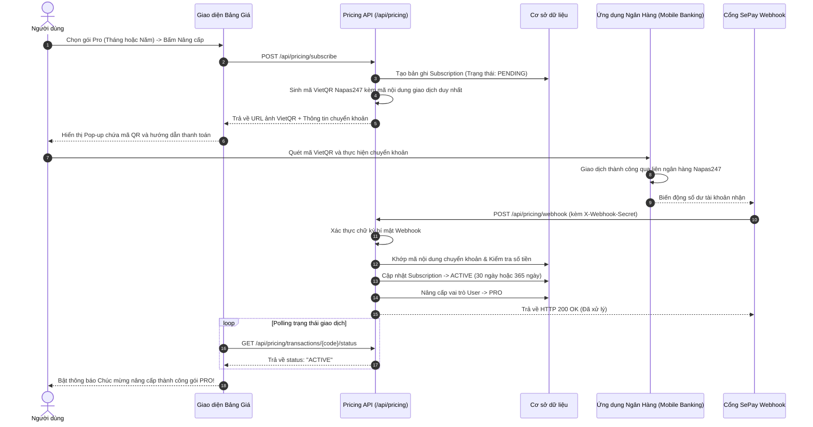
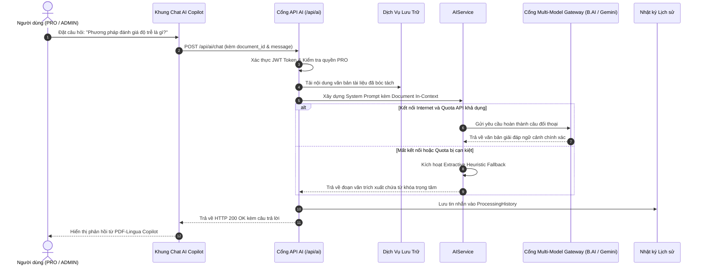
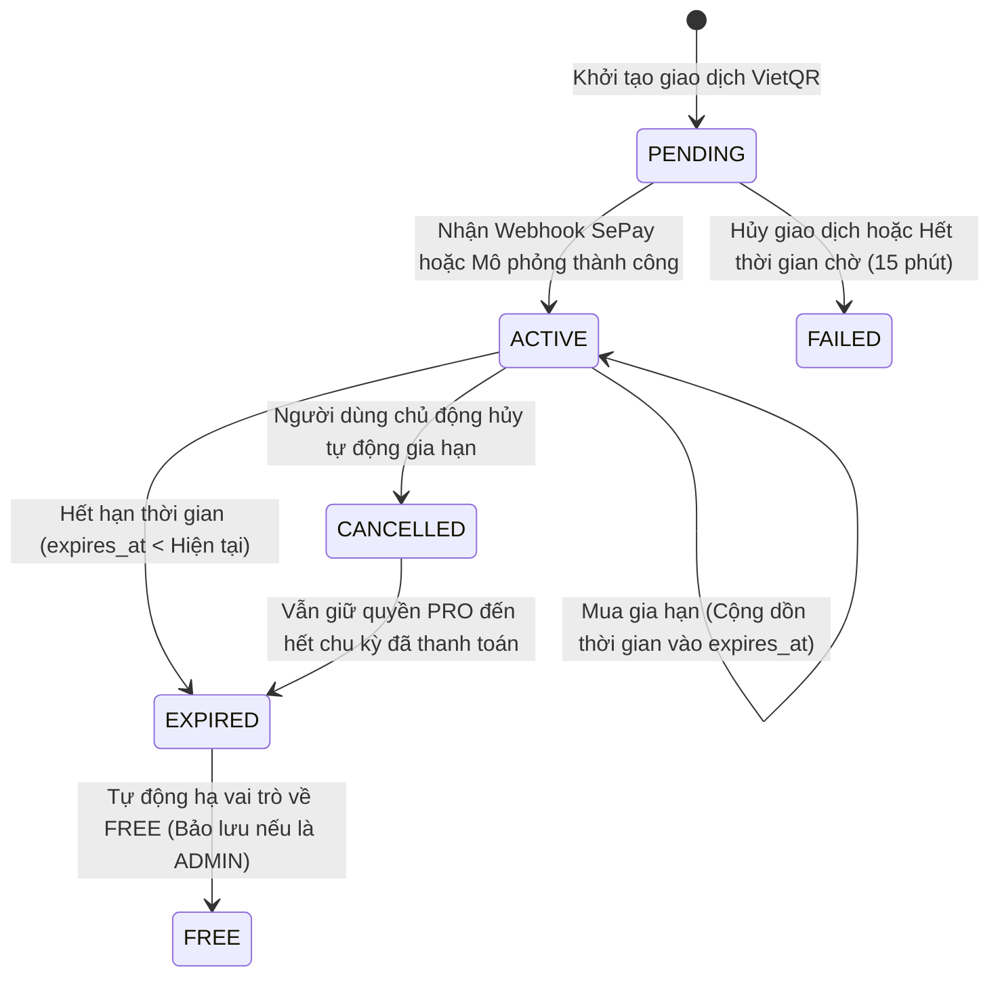

# QUY TRÌNH NGHIỆP VỤ & SƠ ĐỒ TUẦN TỰ (BUSINESS WORKFLOWS)

## DỰ ÁN: NỀN TẢNG DỊCH THUẬT TÀI LIỆU PDF HỌC THUẬT & TRỢ LÝ AI (PDF-LINGUA)

| Thông tin | Chi tiết |
|---|---|
| **Tên dự án (EN)** | PDF-Lingua: Academic PDF Translation & AI Research Assistant |
| **Tên dự án (VN)** | Nền tảng Dịch thuật PDF Học thuật & Trợ lý Nghiên cứu AI |
| **Loại tài liệu** | Business Workflows & Sequence Diagrams |
| **Viết tắt** | PDF-Lingua |
| **Phiên bản tài liệu** | 1.2 |
| **Ngày tạo** | 15/09/2026 |
| **Ngày chỉnh sửa lần cuối** | 20/11/2026 |
| **Trạng thái** | Hoàn thành (Release) |

---

## 1. Quy Trình Xử Lý & Dịch Thuật Tài Liệu PDF (PDF Translation Workflow)

Quy trình mô tả chuỗi tương tác từ khi người dùng tải tệp PDF lên đến khi nhận được bản dịch song ngữ:

---

## 2. Quy Trình Nâng Cấp Gói Cước Tự Động Qua VietQR & SePay Webhook

Quy trình tự động hóa kích hoạt tài khoản PRO không cần sự can thiệp thủ công của quản trị viên:

---

## 3. Quy Trình Tóm Tắt & Hỏi Đáp Ngữ Cảnh AI Copilot

Quy trình bóc tách câu hỏi, nạp ngữ cảnh tài liệu và sinh phản hồi thông minh:

---

## 4. Vòng Đời Trạng Thái Thuê Bao (Subscription State Lifecycle)

