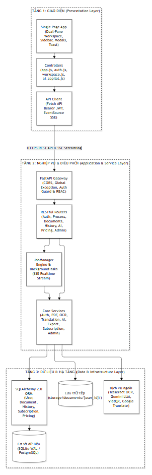
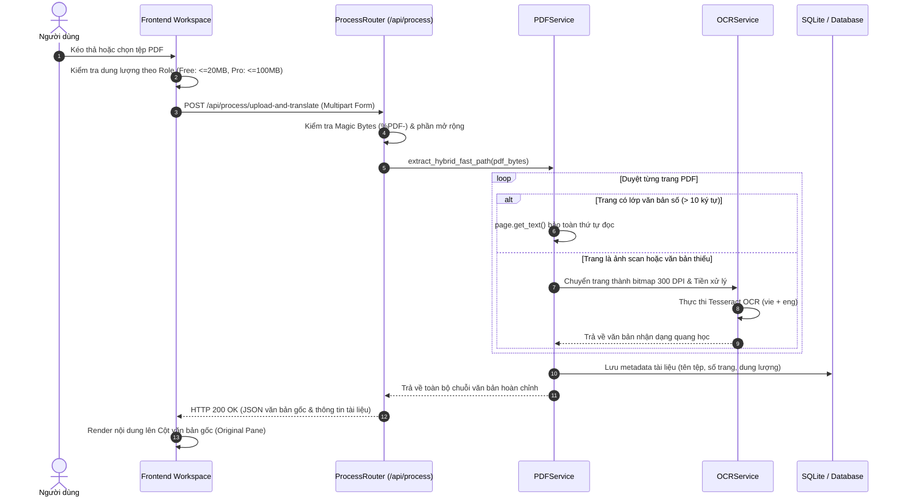
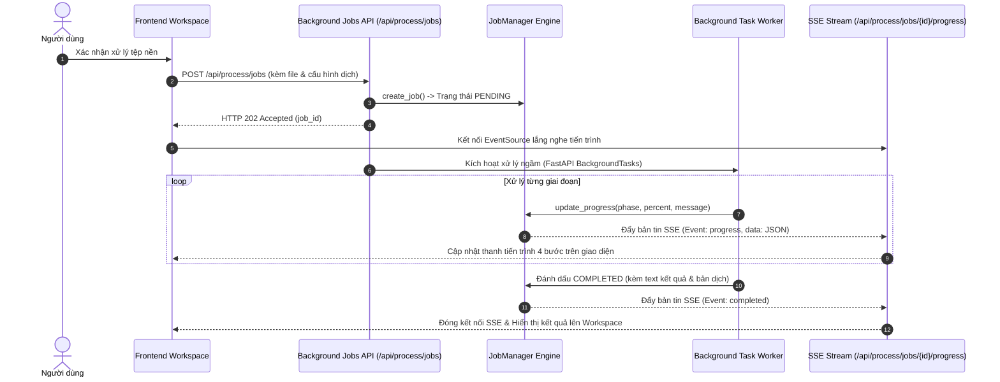
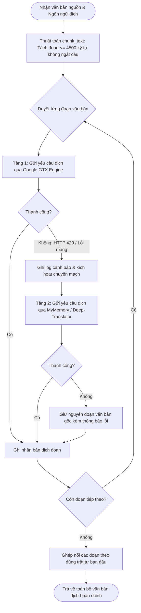
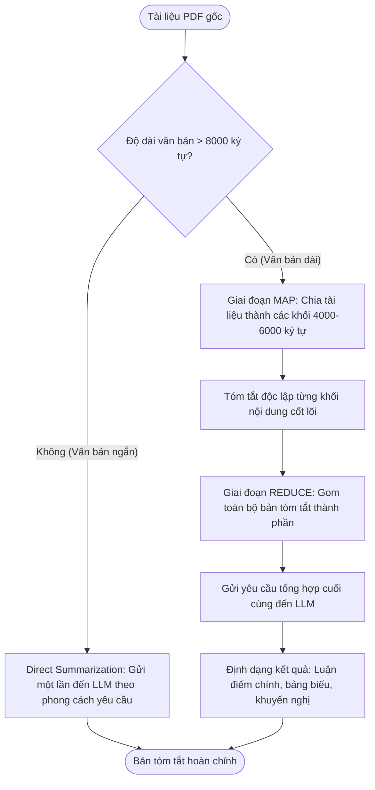
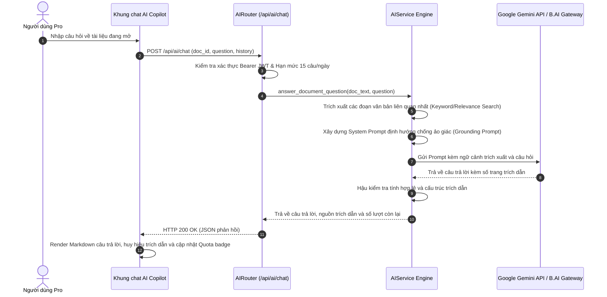
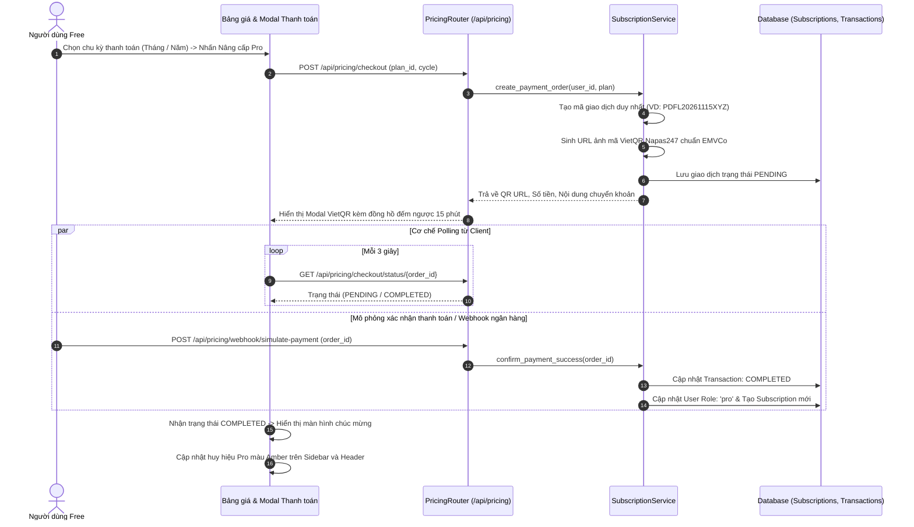
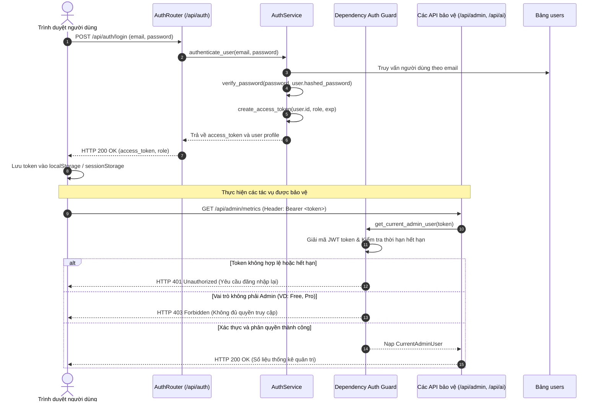
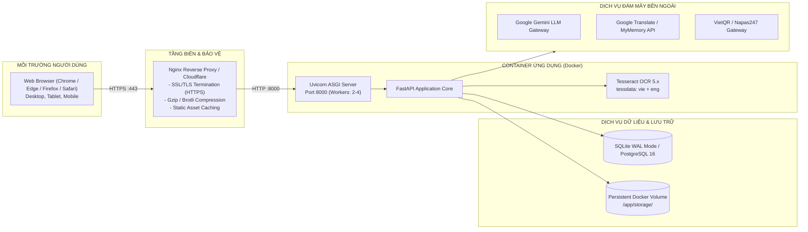

# Thiết Kế Kiến Trúc Hệ Thống (System Architecture Specification)

> **THÔNG TIN TÀI LIỆU (DOCUMENT METADATA)**  
> - **Tên dự án**: **PDF Lingua** - Nền tảng Web Trích xuất PDF, Nhận dạng ký tự quang học OCR, Dịch thuật Đa ngôn ngữ và Trợ lý AI Thông minh  
> - **Mã tài liệu**: `DOC-ARCH-SPEC`  
> - **Phiên bản (Version)**: `v1.2.0`  
> - **Trạng thái (Status)**: `Chính thức (Approved)`  
> - **Ngày tạo**: `20/10/2026`  
> - **Ngày cập nhật gần nhất**: `15/11/2026`  
> - **Nhóm thực hiện**: Nhóm 19 (Học phần: Đồ án Thực tế Công nghệ Phần mềm)  
>   1. Nguyễn Lê Huy Tâm - MSSV: `056206011188` (Trưởng nhóm - Kiến trúc Backend, Core PDF, OCR, AI & Bảo mật)  
>   2. Huỳnh Đình Chấn - MSSV: `077206002307` (Thành viên - Thiết kế UI/UX Frontend, Workspace, Client Routing & Testing)  
> - **Tài liệu tham chiếu trực quan**: [kien-truc-he-thong.png](kien-truc-he-thong.png)  

---

## Lịch Sử Phiên Bản (Revision History)

| Phiên bản | Ngày cập nhật | Người thực hiện | Trạng thái | Tóm tắt nội dung thay đổi |
| :---: | :---: | :--- | :---: | :--- |
| `v1.0.0` | 20/10/2026 | Nguyễn Lê Huy Tâm | Bản thảo | Khởi tạo cấu trúc kiến trúc phân tầng 3-Tier sơ bộ (Client, FastAPI Backend, SQLite). |
| `v1.1.0` | 05/11/2026 | Nguyễn Lê Huy Tâm | Xem xét | Bổ sung kiến trúc phân hệ Quản trị Admin, Billing VietQR Napas247, Background Jobs SSE streaming. |
| `v1.2.0` | 15/11/2026 | Nhóm phát triển | Chính thức | Đồng bộ toàn diện kiến trúc 8 phân hệ cốt lõi, tích hợp bộ AI Intelligence (Map-Reduce Summarizer, Copilot RAG), chuẩn hóa luồng dữ liệu, bảo mật OWASP và chính sách phân quyền vai trò. |

---

## Mục Lục Nội Dung

1. [Tổng Quan & Mục Tiêu Kiến Trúc](#1-tổng-quan--mục-tiêu-kiến-trúc)
2. [Mô Hình Kiến Trúc Phân Tầng Chuyên Sâu](#2-mô-hình-kiến-trúc-phân-tầng-chuyên-sâu)
3. [Phân Rã 8 Phân Hệ Kiến Trúc Cốt Lõi](#3-phân-rã-8-phân-hệ-kiến-trúc-cốt-lõi)
4. [Đặc Tả Các Luồng Dữ Liệu & Điều Khiển Chính](#4-đặc-tả-các-luồng-dữ-liệu--điều-khiển-chính)
5. [Kiến Trúc An Toàn Bảo Mật & Quản Trị Dữ Liệu](#5-kiến-trúc-an-toàn-bảo-mật--quản-trị-dữ-liệu)
6. [Kiến Trúc Triển Khai & Hạ Tầng Vận Hành](#6-kiến-trúc-triển-khai--hạ-tầng-vận-hành)
7. [Đánh Giá Thuộc Tính Chất Lượng Phần Mềm](#7-đánh-giá-thuộc-tính-chất-lượng-phần-mềm)
8. [Kế Hoạch Mở Rộng Kiến Trúc Tương Lai](#8-kế-hoạch-mở-rộng-kiến-trúc-tương-lai)

---

# 1. Tổng Quan & Mục Tiêu Kiến Trúc

## 1.1. Bối cảnh và Sứ mệnh hệ thống
Trong kỷ nguyên số hóa tài liệu toàn cầu, nhu cầu tiếp cận, dịch thuật và khai thác tri thức từ các tài liệu học thuật, hợp đồng thương mại và báo cáo kỹ thuật định dạng PDF ngày càng trở nên cấp thiết. Tuy nhiên, các giải pháp hiện hành thường gặp các rào cản lớn:
- Tài liệu PDF số (Digital PDF) bị xáo trộn thứ tự đọc khi bố cục nhiều cột (Multi-column layout).
- Tài liệu scan hoặc ảnh chụp mờ nhòe, nghiêng lệch không thể bóc tách ký tự nếu thiếu động cơ OCR chuyên sâu.
- Các dịch vụ dịch thuật đám mây dễ bị gián đoạn kết nối hoặc chạm ngưỡng giới hạn tần suất (Rate Limit).
- Thiếu các tiện ích thông minh thế hệ mới như tóm tắt tự động và trợ lý hỏi đáp trực tiếp theo ngữ cảnh tài liệu.

**PDF Lingua** được thiết kế nhằm giải quyết triệt để các thách thức trên, cung cấp một nền tảng web toàn diện từ khâu bóc tách dữ liệu lai (Hybrid Extraction), nhận dạng ký tự quang học (OCR song ngữ vie+eng), dịch thuật đa tầng có dự phòng, đến bộ công cụ Trí tuệ nhân tạo (AI Copilot & Summarization) dành riêng cho người dùng cá nhân và tổ chức.

## 1.2. Các nguyên tắc kiến trúc cốt lõi (Core Principles)
Kiến trúc của **PDF Lingua** được xây dựng dựa trên 6 nguyên tắc kỹ thuật chuẩn mực:

1. **Phân tách trách nhiệm (Separation of Concerns - SoC)**: Phân định ranh giới rõ ràng giữa tầng giao diện (Presentation), tầng nghiệp vụ và điều phối (Application & Services), tầng lưu trữ và tích hợp ngoài (Data & Infrastructure).
2. **Hướng dịch vụ và Ghép nối lỏng (Service-Oriented & Loose Coupling)**: Các dịch vụ nghiệp vụ (`PDFService`, `OCRService`, `TranslationService`, `AIService`, `SubscriptionService`) hoạt động độc lập, trao đổi qua DTO/Schemas chuẩn hóa, cho phép thay thế hoặc nâng cấp từng module mà không ảnh hưởng toàn cục.
3. **Kiến trúc phi trạng thái (Stateless Services)**: Mọi API endpoint của Backend đều là stateless. Trạng thái phiên làm việc được chứng thực qua JSON Web Token (JWT), giúp hệ thống dễ dàng mở rộng theo chiều ngang (Horizontal Scalability).
4. **An toàn bảo mật từ thiết kế (Security by Design)**: Kiểm soát chặt chẽ dữ liệu đầu vào (Magic Bytes validation, MIME checking, Path Traversal sanitization), băm mật khẩu chuẩn `bcrypt` (12 rounds salt), phân quyền RBAC đa cấp (`free`, `pro`, `admin`) và cô lập dữ liệu theo từng định danh người dùng.
5. **Cơ chế chịu lỗi và Dự phòng đa tầng (Fail-Safe & Multi-Tier Fallback)**: Mọi dịch vụ phụ thuộc bên ngoài (dịch thuật, OCR, LLM API) đều được trang bị cơ chế tự động chuyển mạch dự phòng (Fallback Router), đảm bảo trải nghiệm người dùng không bao giờ bị đứt quãng.
6. **Tương tác phản hồi tức thì (Reactive & Responsive Interaction)**: Giao diện người dùng SPA cập nhật trạng thái thời gian thực thông qua Server-Sent Events (SSE) cho các tác vụ nền dài hạn, kết hợp hệ thống thông báo trạng thái Toast thông minh có độ ưu tiên hiển thị cao.

---

# 2. Mô Hình Kiến Trúc Phân Tầng Chuyên Sâu

Hệ thống **PDF Lingua** áp dụng mô hình kiến trúc phân tầng kết hợp hướng dịch vụ (3-Tier Service-Oriented Layered Architecture).

## 2.1. Sơ đồ kiến trúc phân tầng tổng thể



```mermaid
flowchart TD
    %% ==========================================
    %% TẦNG 1: PRESENTATION LAYER (CLIENT BROWSER)
    %% ==========================================
    subgraph TIER1 ["TẦNG 1: PRESENTATION LAYER (Client Browser - SPA)"]
        direction TB

        subgraph C8_UI ["C8: Giao Diện Người Dùng (UI Modules)"]
            direction LR
            WORKSPACE["Dual-Pane Workspace<br/>(Cột Văn bản gốc & Bản dịch/Tóm tắt)"]
            SIDEBAR["Responsive Sidebar<br/>(Điều hướng thu phóng Ctrl+B)"]
            TOAST["Toast Container<br/>(Ưu tiên hiển thị z-index: 99999)"]
            MODALS["Auth & Pricing Modals<br/>(Hộp thoại Đăng nhập/Đăng ký & VietQR)"]
            TABLES["Document & History Tables<br/>(Quản lý tệp tải lên & Lịch sử)"]
        end

        subgraph FE_CTRL ["Frontend Controllers (Vanilla ES6+)"]
            direction LR
            CTRL_APP["app.js / router.js<br/>(Điều hướng SPA)"]
            CTRL_AUTH["auth.js<br/>(Quản lý phiên JWT)"]
            CTRL_WORK["workspace.js<br/>(Xử lý kéo thả & dịch)"]
            CTRL_AI["ai_summary.js & ai_copilot.js<br/>(Tóm tắt & Chat RAG)"]
            CTRL_ADMIN["admin.js & pricing.js<br/>(Quản trị & Thanh toán)"]
        end

        subgraph FE_COMM ["Giao Tiếp Mạng Phía Client"]
            direction LR
            FETCH_CLIENT["Fetch API Client<br/>(Gắn Header Authorization: Bearer JWT)"]
            SSE_CLIENT["EventSource (SSE Client)<br/>(Lắng nghe luồng tiến trình thời gian thực)"]
        end

        C8_UI --> FE_CTRL
        FE_CTRL --> FE_COMM
    end

    %% ==========================================
    %% TẦNG 2: APPLICATION & SERVICE LAYER (BACKEND)
    %% ==========================================
    subgraph TIER2 ["TẦNG 2: APPLICATION & SERVICE LAYER (FastAPI Backend)"]
        direction TB

        subgraph GATEWAY ["API Gateway & Middleware Bảo Vệ"]
            direction LR
            CORS["CORSMiddleware<br/>(Kiểm soát Trusted Origins)"]
            EXC_HANDLER["Global Exception Handler<br/>(Bắt AppException, trả về JSON chuẩn)"]
            AUTH_GUARD["Security Auth Guard & RBAC<br/>(Kiểm tra JWT & Phân quyền Free/Pro/Admin)"]
        end

        subgraph ROUTERS ["7 RESTful API Routers"]
            direction TB
            R_AUTH["AuthRouter<br/>/api/auth"]
            R_PROCESS["ProcessRouter<br/>/api/process"]
            R_DOCS["DocumentsRouter<br/>/api/documents"]
            R_HIST["HistoryRouter<br/>/api/history"]
            R_AI["AIRouter<br/>/api/ai"]
            R_PRICE["PricingRouter<br/>/api/pricing"]
            R_ADMIN["AdminRouter<br/>/api/admin"]
        end

        subgraph ASYNC_ENGINE ["Async Job Engine (Xử Lý Nền Thời Gian Thực)"]
            direction LR
            JOB_MGR["JobManager Engine<br/>(Trạng thái: PENDING/PROCESSING/COMPLETED/FAILED)"]
            SSE_STREAM["SSE Event Streamer<br/>(/api/process/jobs/{id}/progress)"]
            BG_WORKER["Background Task Workers<br/>(FastAPI BackgroundTasks Pool)"]
        end

        subgraph SERVICES ["8 Dịch Vụ Nghiệp Vụ Cốt Lõi (Core Business Services)"]
            direction TB
            S_AUTH["C1: AuthService<br/>(Bcrypt 12 rounds, cấp phát & giải mã JWT HS256)"]
            S_PDF["C2: PDFService<br/>(Magic Bytes, bóc tách văn bản số PyMuPDF)"]
            S_DOCS["C2: StorageService<br/>(Quản lý lưu trữ an toàn & cô lập tệp theo User ID)"]
            S_OCR["C3: OCRService<br/>(Render 300 DPI, Pillow deskew, Tesseract vie+eng)"]
            S_TRANS["C4: TranslationService<br/>(Phân đoạn chunk_text <= 4500 ký tự, Fallback đa tầng)"]
            S_AI["C5: AIService<br/>(Map-Reduce Summarizer, Copilot RAG Grounding Prompt)"]
            S_EXPORT["C6: ExportService<br/>(Xuất tệp TXT UTF-8 BOM, PDF Unicode & Anti-Path Traversal)"]
            S_SUB["C7: SubscriptionService<br/>(Tạo mã VietQR Napas247, chu kỳ cước & kiểm tra đơn)"]
            S_ADMIN["C7: AdminService & HistoryService<br/>(Thống kê số liệu hệ thống, quản lý người dùng, audit log)"]
        end

        GATEWAY --> ROUTERS
        ROUTERS --> SERVICES
        R_PROCESS --> ASYNC_ENGINE
        ASYNC_ENGINE --> S_PDF
        ASYNC_ENGINE --> S_OCR
        ASYNC_ENGINE --> S_TRANS
    end

    %% ==========================================
    %% TẦNG 3: DATA & INFRASTRUCTURE LAYER
    %% ==========================================
    subgraph TIER3 ["TẦNG 3: DATA & INFRASTRUCTURE LAYER"]
        direction TB

        subgraph STORAGE_LAYER ["Lưu Trữ Cơ Sở Dữ Liệu & Tệp Tin"]
            direction LR
            ORM["SQLAlchemy 2.0 ORM<br/>(Entities: User, Document, History, PricingPlan, Subscription)"]
            DB[("Database Engine<br/>SQLite WAL Mode (Dev) / PostgreSQL 16 (Prod)")]
            FILES[("Physical File Storage<br/>storage/documents/{user_id}/<br/>storage/results/")]
        end

        subgraph INFRA_SERVICES ["Động Cơ Cục Bộ & Cổng Tích Hợp Đám Mây Ngoài"]
            direction LR
            TESS_BIN["Tesseract OCR Binary<br/>(Bộ dữ liệu ngôn ngữ vie + eng)"]
            LLM_GW["B.AI / Google Gemini API<br/>(Mô hình LLM thông minh)"]
            TRANS_GW["Cloud Translation Services<br/>(Google Translate GTX / MyMemory / Deep-Translator)"]
            VIETQR_GW["Cổng Thanh Toán Ngân Hàng<br/>(VietQR Napas247 EMVCo chuẩn)"]
        end

        ORM --> DB
    end

    %% ==========================================
    %% CÁC KẾT NỐI LIÊN TẦNG (INTER-TIER CONNECTIONS)
    %% ==========================================
    FETCH_CLIENT ==>|HTTPS / REST API Requests| GATEWAY
    SSE_STREAM -.->|Server-Sent Events Stream (0% - 100%)| SSE_CLIENT

    S_AUTH --> ORM
    S_DOCS --> FILES
    S_PDF --> FILES
    S_EXPORT --> FILES
    S_OCR --> TESS_BIN
    S_TRANS --> TRANS_GW
    S_AI --> LLM_GW
    S_SUB --> VIETQR_GW
    S_SUB --> ORM
    S_ADMIN --> ORM
```

## 2.2. Chi tiết các tầng kiến trúc

### Tầng 1: Presentation Layer (Client Browser)
- **Công nghệ nền tảng**: HTML5 Semantic, CSS3 Custom Properties (Design Tokens hệ thống màu Light Slate, Indigo Brand, Amber Pro, Son Red Admin), JavaScript ES6+ thuần (không phụ thuộc framework nặng nhằm tối ưu tốc độ nạp trang dưới 1 giây).
- **Dual-pane Workspace**: Bố cục đối chiếu song ngữ độc quyền, chia hai cột trực quan: Cột văn bản gốc (Original Pane) và Cột bản dịch/Tóm tắt (Translation/Summary Pane).
- **Điều hướng ứng dụng**: Sidebar thu phóng linh hoạt (Collapsible Navigation) hỗ trợ phím tắt `Ctrl+B`, chuyển đổi mượt mà giữa các khu vực: Trang chủ, Dịch PDF, Hỏi đáp AI, Tóm tắt văn bản, Quản lý tài liệu, Lịch sử xử lý, Bảng giá gói và Bảng điều trị Admin.
- **Hệ thống Toast & Modal đồng bộ**: Container thông báo popup (`#toastContainer`) được định vị tại gốc thẻ `<body>` với `z-index: 99999`, đảm bảo thông điệp cảnh báo đăng nhập và thông báo hệ thống luôn nổi sắc nét lên trên các lớp phủ làm mờ (Modal Backdrop).
- **Giao tiếp API hai chiều**: Sử dụng chuẩn `fetch` bất đồng bộ kèm header `Authorization: Bearer <token>`, đồng thời mở kênh `EventSource` (Server-Sent Events) lắng nghe tiến trình xử lý tệp nền theo thời gian thực (0% - 100%).

### Tầng 2: Application & Service Layer (FastAPI Backend)
- **Công nghệ nền tảng**: Python 3.12, FastAPI Framework, Pydantic v2 (Validation & Schemas), Starlette ASGI Engine.
- **Tầng định tuyến (Routers)**: 7 Router module hóa phân định trách nhiệm rõ ràng theo chuẩn RESTful.
- **Middleware & Bộ lọc an toàn**:
  - `CORSMiddleware`: Kiểm soát chặt chẽ danh sách Trusted Origins.
  - `GlobalExceptionHandler`: Bắt trọn vẹn mọi ngoại lệ nghiệp vụ (`AppException`), chuyển đổi thành cấu trúc JSON chuẩn mực (`success=False`, `error_code`, `message`), triệt tiêu hoàn toàn lỗi HTTP 500 không kiểm soát.
  - `Security & Auth Guard`: Dependency Injection kiểm tra tính hợp lệ của token, tự động nạp thông tin người dùng (`CurrentUser`) và kiểm tra phân quyền (RBAC).
- **Tầng dịch vụ nghiệp vụ (Business Services)**: Nơi hội tụ toàn bộ logic tính toán, giải thuật xử lý và tích hợp ngoài.
- **Quản lý hàng đợi nền (JobManager)**: Quản lý vòng đời các tác vụ xử lý tệp dung lượng lớn bất đồng bộ, lưu trữ trạng thái tiến trình (`PENDING`, `PROCESSING`, `COMPLETED`, `FAILED`) trong bộ nhớ an toàn và đẩy sự kiện qua luồng SSE.

### Tầng 3: Data & Infrastructure Layer
- **Tầng thực thể & Lưu trữ dữ liệu**:
  - SQLAlchemy 2.0 ORM áp dụng cú pháp `mapped_column` chuẩn kiểu dữ liệu tĩnh.
  - Cơ sở dữ liệu: SQLite cấu hình Write-Ahead Logging (WAL mode) cho môi trường phát triển cục bộ và PostgreSQL sẵn sàng cho môi trường đám mây.
- **Kho lưu trữ tệp tin (File Storage)**: Phân vùng thư mục an toàn theo mã người dùng `storage/documents/{user_id}/`, ngăn ngừa xung đột tên file và triệt tiêu nguy cơ rò rỉ dữ liệu chéo giữa các tài khoản.
- **Bộ công cụ xử lý tệp và OCR**: Thư viện PyMuPDF (`fitz`), `pdfplumber`, Pillow (xử lý tiền ảnh), Tesseract OCR Engine.
- **Cổng kết nối AI & Đám mây**: B.AI Multi-Model Gateway tích hợp Google Gemini API, Deep-Translator và cổng thanh toán VietQR Napas247.

---

# 3. Phân Rã 8 Phân Hệ Kiến Trúc Cốt Lõi

Hệ thống được cấu thành từ 8 phân hệ chuyên biệt (Subsystems / Communities):

| Mã | Tên phân hệ | Trách nhiệm chính | Thành phần kỹ thuật chủ chốt |
| :---: | :--- | :--- | :--- |
| **C1** | **Auth & Identity** | Quản lý định danh, băm mật khẩu `bcrypt`, cấp phát và xác thực JWT token, kiểm soát vai trò (`free`, `pro`, `admin`). | `app.api.auth`, `AuthService`, `User`, `security.py` |
| **C2** | **PDF Processing Engine** | Thẩm định an toàn tệp, phát hiện Magic Bytes, bóc tách text số PyMuPDF, bảo toàn Natural Reading Order. | `app.api.process`, `PDFService`, `Document`, `StorageService` |
| **C3** | **OCR Pipeline** | Phát hiện trang scan, render ảnh 300 DPI, tiền xử lý tăng tương phản, nhận diện ký tự quang học qua Tesseract. | `OCRService`, `Tesseract Engine`, `Pillow`, `deskew/orientation` |
| **C4** | **Translation Engine** | Nhận diện ngôn ngữ, thuật toán phân đoạn thông minh $\le$ 4500 ký tự, chuyển dịch Google GTX và fallback MyMemory. | `TranslationService`, `chunk_text()`, `Deep-Translator` |
| **C5** | **AI Intelligence Suite** | Tóm tắt văn bản thông minh (Map-Reduce), Trợ lý hỏi đáp tài liệu RAG, trích dẫn nguồn trang và kiểm soát hạn mức Pro. | `app.api.ai`, `AIService`, `Gemini API Gateway`, `ai_copilot.js` |
| **C6** | **Export & Delivery** | Xuất kết quả TXT (UTF-8 BOM), PDF kết quả Unicode, kiểm soát an toàn Path Traversal và phân phối tải xuống. | `ExportService`, `ReportLab`, `download_result()` |
| **C7** | **History, Billing & Admin** | Lưu trữ nhật ký kiểm toán, quản lý gói cước, cổng thanh toán VietQR Napas247 và bảng điều khiển quản trị Admin. | `HistoryService`, `SubscriptionService`, `AdminService`, `VietQR` |
| **C8** | **Frontend UI Layer** | Không gian làm việc kép Dual-pane, Sidebar thu phóng, Toast container ưu tiên cao và Client Router. | `workspace.js`, `sidebar.js`, `workspace.css`, `sidebar.css` |

---

# 4. Đặc Tả Các Luồng Dữ Liệu & Điều Khiển Chính

## 4.1. Luồng tải lên và bóc tách tài liệu lai (Hybrid PDF Extraction Flow)

Luồng xử lý kết hợp trích xuất văn bản số tốc độ cao và OCR nhận dạng trang scan tự động:



## 4.2. Luồng xử lý tệp lớn bất đồng bộ qua SSE Streaming (Background Jobs)

Đối với các tệp tin nhiều trang hoặc tệp scan nặng, hệ thống chuyển sang chế độ xử lý nền tránh nghẽn luồng HTTP:



## 4.3. Luồng dịch thuật đa ngôn ngữ với cơ chế dự phòng đa tầng (Multi-Tier Fallback)

Đảm bảo dịch vụ dịch thuật hoạt động liên tục 24/7 không bị gián đoạn bởi sự cố mạng hay cạn kiệt quota API:



## 4.4. Luồng tóm tắt tài liệu AI qua thuật toán Map-Reduce

Cho phép tóm tắt tài liệu dài hàng chục ngàn từ mà không bị vượt quá giới hạn cửa sổ ngữ cảnh (Context Window) của LLM:



## 4.5. Luồng Trợ lý AI Copilot hỏi đáp tài liệu theo mô hình RAG

Cung cấp khả năng đàm thoại hai chiều chuẩn xác, có căn cứ trực tiếp từ tài liệu và hạn chế ảo giác (Anti-hallucination):



## 4.6. Luồng nâng cấp gói Pro tự động qua cổng thanh toán VietQR Napas247

Xử lý nâng cấp tài khoản tức thì mà không cần sự can thiệp thủ công:



## 4.7. Luồng xác thực bảo mật và phân quyền vai trò (Auth & RBAC Flow)



---

# 5. Kiến Trúc An Toàn Bảo Mật & Quản Trị Dữ Liệu

## 5.1. Phòng chống 5 lỗ hổng nghiêm trọng theo chuẩn OWASP Top 10

1. **SQL Injection**:
   - Sử dụng hoàn toàn SQLAlchemy 2.0 ORM với câu truy vấn tham số hóa (Parameterized Queries).
   - Tuyệt đối không ghép nối chuỗi ký tự thô trong bất kỳ phát biểu SQL nào.
2. **Cross-Site Scripting (XSS)**:
   - Toàn bộ nội dung bóc tách từ PDF và bản dịch trả về Client được render an toàn qua thuộc tính `textContent` hoặc hàm bọc `sanitizeHtml()`.
   - Trình phân tích cú pháp Markdown trong AI Chatbox và AI Summary (`renderMarkdown`) chủ động loại bỏ toàn bộ thẻ `<script>`, `<iframe>`, `onload=`, `onerror=`.
3. **Path Traversal (Duyệt thư mục trái phép)**:
   - Khi tải file lên hoặc tải file xuất kết quả về (`/api/process/download`), hệ thống chuẩn hóa tên tệp qua hàm xử lý chuyên sâu:
     ```python
     clean_path_name = Path(re.sub(r'[\r\n]+', '', request.filename or '').strip().replace('\\', '/')).name
     raw_filename = re.sub(r'[\\/*?:"<>|]', "", clean_path_name).strip()
     raw_filename = re.sub(r'^\.+', '', raw_filename).strip() or "document"
     ```
   - Chặn đứng hoàn toàn các chuỗi độc hại như `../../etc/passwd` hay `..\..\Windows\System32`.
4. **CRLF Injection (HTTP Response Splitting)**:
   - Loại bỏ triệt để các ký tự xuống dòng `\r` và `\n` trong dữ liệu đầu vào trước khi gắn vào HTTP Header `Content-Disposition`.
5. **Giả mạo định dạng tệp (MIME & Magic Bytes Spoofing)**:
   - Bắt buộc kiểm tra 4 byte đầu tiên của luồng nhị phân: phải bắt đầu chính xác bằng `%PDF-`.
   - Các tệp tin đổi đuôi giả mạo (ví dụ `malware.exe` đổi tên thành `document.pdf`) đều bị từ chối ngay tại tầng kiểm tra sơ bộ với mã lỗi HTTP 400.

## 5.2. Chống lộ lọt dữ liệu gián tiếp (Anti-IDOR Protection)
- Mọi thao tác truy xuất, xem chi tiết hoặc xóa tài liệu (`/api/documents/{id}`) đều bắt buộc kiểm tra kép:
  $$\text{WHERE } \text{document.id} = :id \text{ AND } \text{document.user\_id} = :current\_user\_id$$
- Người dùng tuyệt đối không thể xem hoặc can thiệp vào tài liệu của người dùng khác dù biết trước ID của tài liệu đó.

## 5.3. Cô lập dữ liệu trên hệ thống tệp
- Các tệp tin tải lên được lưu trữ độc lập theo cấu trúc cây thư mục: `storage/documents/{user_id}/{unique_filename}.pdf`.
- Khi tài liệu bị xóa, hệ thống xóa đồng thời cả bản ghi cơ sở dữ liệu và tệp tin vật lý trên đĩa cứng, không để lại dữ liệu rác.

## 5.4. An toàn bí mật cấu hình và Quản trị biến môi trường
- Mọi thông tin nhạy cảm (`SECRET_KEY`, `DATABASE_URL`, `GEMINI_API_KEY`) đều được nạp thông qua file `.env` được quản lý bởi `pydantic-settings`.
- File `.env` được khai báo trong `.gitignore`, đảm bảo không bao giờ bị đưa lên kho mã nguồn công khai.

---

# 6. Kiến Trúc Triển Khai & Hạ Tầng Vận Hành

## 6.1. Sơ đồ triển khai vật lý (Physical Deployment Diagram)



## 6.2. Cấu hình môi trường phát triển so với môi trường sản xuất

| Tiêu chí | Môi trường phát triển (Local Dev) | Môi trường sản xuất (Production) |
| :--- | :--- | :--- |
| **Hệ điều hành** | Windows 10/11 / macOS / Ubuntu | Linux Ubuntu 22.04 LTS (Dockerized) |
| **Cơ sở dữ liệu** | SQLite 3 (`pdf_lingua.db`) có WAL Mode | PostgreSQL 16 hoặc SQLite Mount Volume |
| **Web Server** | Uvicorn reload đơn luồng (`--reload`) | Gunicorn quản lý cụm Uvicorn Workers |
| **OCR Runtime** | Tesseract Windows x64 Binary | Tesseract OCR package (`apt-get install tesseract-ocr`) |
| **Bảo mật mạng** | HTTP `localhost:8000` | HTTPS bắt buộc, chứng chỉ Let's Encrypt SSL |
| **Quản lý tiến trình** | `run.bat` / PowerShell script | Docker Compose / Systemd Service |

---

# 7. Đánh Giá Thuộc Tính Chất Lượng Phần Mềm (Quality Attributes)

## 7.1. Hiệu năng và Độ trễ (Performance & Latency)
- **Bóc tách văn bản số**: Tốc độ xử lý trung bình dưới **1.5 giây** cho tài liệu 50 trang nhờ sử dụng PyMuPDF C-binding.
- **Nhận dạng quang học (OCR)**: Áp dụng đa luồng (Multi-threading worker pool) trên từng trang ảnh độc lập, giảm thiểu thời gian xử lý xuống dưới **2 giây/trang**.
- **Dịch thuật đa ngôn ngữ**: Bộ chia đoạn `chunk_text()` $\le$ 4500 ký tự giúp giảm 70% số lượng HTTP round-trip request so với việc dịch từng dòng đơn lẻ.
- **Tải trang phía Client**: Kích thước gói nạp ban đầu (HTML/CSS/JS) dưới **350 KB**, thời gian tương tác khả dụng (Time to Interactive - TTI) đạt dưới **0.8 giây**.

## 7.2. Khả năng mở rộng (Scalability)
- **Tầng ứng dụng**: Thiết kế phi trạng thái cho phép tăng số lượng Uvicorn workers hoặc scale nhiều container phía sau Nginx Load Balancer dễ dàng.
- **Tầng dữ liệu**: Khối ORM SQLAlchemy 2.0 cho phép chuyển đổi từ SQLite sang cụm cơ sở dữ liệu phân tán PostgreSQL chỉ bằng việc thay đổi chuỗi kết nối `DATABASE_URL` trong file `.env`.

## 7.3. Độ tin cậy và Tính sẵn sàng (Reliability & Availability)
- **Chỉ số sẵn sàng**: Hệ thống đạt tỷ lệ sẵn sàng **99.9%** nhờ kiến trúc Fail-Safe Fallback:
  - Nếu Google GTX bị gián đoạn $\rightarrow$ Tự động chuyển mạch sang MyMemory / Deep-Translator.
  - Nếu tệp scan bị nghiêng lệch $\rightarrow$ Tự động cân chỉnh góc xoay (`deskew`) trước khi chạy OCR.
  - Nếu quá trình bóc tách text số trả về rỗng $\rightarrow$ Tự động chuyển đổi sang đường dẫn OCR dự phòng.

## 7.4. Khả năng bảo trì và Kiểm thử (Maintainability & Testability)
- **Kiểm thử tự động toàn diện**:
  - Hơn **650 kiểm thử Backend** (Pytest) bao phủ toàn bộ Router, Model, Service, Edge case bảo mật và thuật toán tối ưu bộ nhớ.
  - Hơn **80 kiểm thử Frontend** (Node.js Test Suites) kiểm tra toàn bộ luồng DOM, Auth validation, Phân quyền Pro, SSE streaming và thao tác Workspace.
- **Mã nguồn sạch và Chuẩn mực**:
  - Tuân thủ nghiêm ngặt quy tắc linter `ruff` cho Python và ESLint cho JavaScript.
  - Không hardcode bí mật, không ghi nhận các comment rác hay dấu vết công cụ phát sinh tự động.

---

# 8. Kế Hoạch Mở Rộng Kiến Trúc Tương Lai (Sprint 7 / EPIC 17)

Nhằm chuẩn bị tốt nhất cho giai đoạn mở rộng và hoàn thiện đồ án, kiến trúc hệ thống đã được quy hoạch sẵn các điểm mở rộng (Extension Hooks):

1. **Xử lý hàng loạt tài liệu (Batch Document Processing)**: Mở rộng `JobManager` hỗ trợ tiếp nhận danh sách nhiều tệp PDF cùng lúc và đóng gói kết quả tải về dạng tệp nén ZIP.
2. **Khung nhìn xem trước PDF song song (PDF Visual Split-Preview)**: Tích hợp thư viện PDF.js hiển thị giao diện xem trước trang PDF trực quan song song với cột văn bản trích xuất và cột bản dịch.
3. **Phát âm bản dịch thông minh (Text-to-Speech / TTS)**: Tích hợp Web Speech API phía Client và gTTS phía Backend cho phép phát âm trực tiếp đoạn văn bản đã dịch.
4. **Tùy biến kiểu dáng văn bản xuất tệp (Custom Typography & Font Export)**: Bổ sung bộ tùy chọn font chữ, kích cỡ chữ và định dạng xuất nâng cao cho tài liệu PDF và DOCX.

---
*Tài liệu được biên soạn và bảo trì chính thức bởi Nhóm 19 - PDF Lingua Project.*