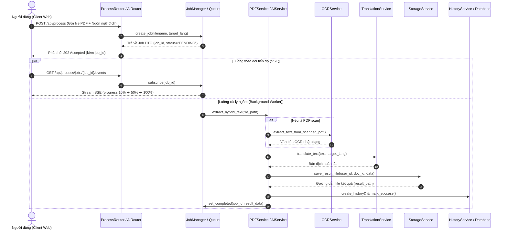

# Tài liệu mô tả Sơ đồ lớp (Class Diagram) tổng quát — PDF Lingua

> **THÔNG TIN TÀI LIỆU (DOCUMENT METADATA)**
> - **Tên dự án**: **PDF Lingua** – Nền tảng Web Trích xuất PDF, OCR, Dịch thuật Đa ngôn ngữ & Trợ lý AI
> - **Mã tài liệu**: `DOC-CD-OVERVIEW`
> - **Phiên bản (Version)**: `v1.2.0`
> - **Trạng thái (Status)**: `Chính thức (Approved)`
> - **Ngày tạo (Created Date)**: `24/10/2026`
> - **Ngày cập nhật gần nhất (Last Modified)**: `13/11/2026`
> - **Tham chiếu Jira Task**: `PDFL-271` (Xây dựng Sơ đồ lớp / Class Diagram chi tiết hệ thống)
> - **Thuộc phân hệ**: `EPIC 01` (Phân tích thiết kế hệ thống) & `EPIC 04` (Backend API và kiến trúc xử lý)
> - **Tài liệu tham chiếu trực quan**: [Class Diagram.png](file:///c:/Users/ADMIN/PDF-Lingua/Docs/class-diagram/Class%20Diagram.png) / [class_diagram.png](file:///c:/Users/ADMIN/PDF-Lingua/class_diagram.png)

---

## Lịch sử phiên bản (Revision History)

| Phiên bản | Ngày cập nhật | Người thực hiện | Trạng thái | Tóm tắt nội dung thay đổi |
| :---: | :---: | :--- | :---: | :--- |
| `v1.0.0` | 24/10/2026 | Nguyễn Lê Huy Tâm | Bản thảo | Khởi tạo cấu trúc Sơ đồ lớp sơ bộ gồm các thực thể cốt lõi: Auth, PDF processing, OCR, Dịch thuật và Database models. |
| `v1.1.0` | 05/11/2026 | Nguyễn Lê Huy Tâm | Xem xét | Bổ sung phân hệ Quản trị Admin (`AdminRouter`, `AdminService`), Gói cước và Thanh toán VietQR Napas247 (`PricingRouter`, `SubscriptionService`, `PricingPlan`, `Subscription`, `PaymentTransaction`). |
| `v1.2.0` | 13/11/2026 | Nhóm phát triển | Chính thức | **Đồng bộ hóa 100% với nhánh `main` mới nhất**: Bổ sung đầy đủ phân hệ Trí tuệ nhân tạo AI (`AIRouter`, `AIService`, `ActionType.CHAT`), chuẩn hóa kiến trúc 3 tầng (Presentation / Service / Data Layer), chuẩn hóa quan hệ kế thừa `Base` (SQLAlchemy DeclarativeBase), quan hệ 1-N, cơ chế kiểm soát hạn ngạch và quy hoạch mở rộng Jira Sprint 7 (EPIC 17). |

---

## 1. Tổng quan

**PDF Lingua** được xây dựng trên nền tảng kiến trúc hướng dịch vụ 3 tầng (**3-Tier Clean Architecture**) sử dụng **FastAPI** (Python) làm backend framework chính, kết hợp với cơ sở dữ liệu quan hệ quản lý qua **SQLAlchemy ORM**, bộ công cụ trích xuất tài liệu lai (**Hybrid PDF Engine & Tesseract OCR**), cổng dịch thuật đa ngôn ngữ và phân hệ **Trí tuệ nhân tạo (AI Intelligence)** tích hợp mô hình ngôn ngữ lớn (LLM Gateway).

Sơ đồ lớp (**Class Diagram**) của PDF Lingua mô tả cấu trúc tĩnh toàn diện của hệ thống phần mềm: phân định ranh giới trách nhiệm giữa các tầng điều khiển API (*Routers*), tầng xử lý nghiệp vụ & hàng đợi bất đồng bộ (*Services & Job Queue*), cùng tầng lưu trữ dữ liệu thực thể (*ORM Entities & Enums*), đồng thời xác lập chặt chẽ các mối quan hệ kế thừa, quan hệ 1-N, quan hệ sở hữu và quan hệ phụ thuộc.

Tài liệu này chuẩn hóa và mô tả chi tiết toàn bộ các lớp, thuộc tính, phương thức và các mối quan hệ trong sơ đồ [Class Diagram.png](file:///c:/Users/ADMIN/PDF-Lingua/Docs/class-diagram/Class%20Diagram.png).

---

## 2. Mục tiêu và phạm vi thiết kế sơ đồ lớp

### 2.1. Mục tiêu thiết kế
- **Mô hình hóa kiến trúc tĩnh**: Cung cấp bức tranh toàn cảnh, nhất quán về cấu trúc mã nguồn backend và tầng dữ liệu của PDF Lingua.
- **Phân tách trách nhiệm độc lập (Separation of Concerns)**: Đảm bảo nguyên tắc đơn trách nhiệm (Single Responsibility Principle - SRP), tách biệt rõ ràng giữa tầng giao tiếp client (Routers), tầng nghiệp vụ xử lý thuật toán (Services) và tầng lưu trữ thực thể (Entities).
- **Làm kim chỉ nam phát triển và kiểm thử**: Căn cứ phục vụ việc triển khai mã nguồn, định nghĩa DTO/Schemas, viết kiểm thử đơn vị (Unit Tests), kiểm thử tích hợp (Integration Tests) và đồng bộ tài liệu đồ án tốt nghiệp.

### 2.2. Phạm vi bao phủ của sơ đồ
Hệ thống lớp được thiết kế bao phủ toàn bộ 5 phân hệ chức năng chính:
1. **Phân hệ Xác thực & Quản lý Người dùng (Identity & Access Management)**: `AuthRouter`, `AuthService`, `User`, `UserRole`, `PasswordResetToken` *(Mở rộng)*.
2. **Phân hệ Xử lý PDF cốt lõi & Hàng đợi thời gian thực (PDF Processing & Realtime Queue)**: `ProcessRouter`, `JobManager`, `Job`, `PDFService`, `OCRService`, `TranslationService`, `ExportService`.
3. **Phân hệ Trí tuệ nhân tạo thông minh (AI Intelligence & Copilot RAG)**: `AIRouter`, `AIService`, `CitationSource` *(Mở rộng)*.
4. **Phân hệ Quản lý Tài liệu, Lưu trữ an toàn & Lịch sử kiểm toán (Storage & Audit Trail)**: `DocumentsRouter`, `HistoryRouter`, `StorageService`, `HistoryService`, `Document`, `ProcessingHistory`.
5. **Phân hệ Gói cước, Thanh toán VietQR & Quản trị hệ thống (Billing & Administration)**: `PricingRouter`, `AdminRouter`, `SubscriptionService`, `AdminService`, `PricingPlan`, `Subscription`, `PaymentTransaction`, `UserFeedback` *(Mở rộng)*.

---

## 3. Kiến trúc phân tầng hệ thống (3-Tier Layering)

Toàn bộ hệ thống lớp được phân bổ theo 3 tầng ngang rõ rệt:

```
┌───────────────────────────────────────────────────────────────────────────────┐
│ TẦNG 1: API PRESENTATION LAYER (7 FastAPI Routers)                             │
│ [AuthRouter] [ProcessRouter] [AIRouter] [DocumentsRouter]                    │
│ [HistoryRouter] [PricingRouter] [AdminRouter]                                 │
└──────────────────────────────────────┬────────────────────────────────────────┘
                                       │ calls (Dependency ..>)
┌──────────────────────────────────────▼────────────────────────────────────────┐
│ TẦNG 2: BUSINESS LOGIC, REALTIME QUEUE & AI SERVICES (12 Core Services)       │
│ [AuthService] [JobManager ── Job] [AIService] [StorageService]                │
│ [HistoryService] [SubscriptionService] [AdminService]                         │
│ [PDFService ──> OCRService ──> TranslationService ──> ExportService]          │
└──────────────────────────────────────┬────────────────────────────────────────┘
                                       │ maps / persists (CRUD)
┌──────────────────────────────────────▼────────────────────────────────────────┐
│ TẦNG 3: DOMAIN ENTITIES & DATA LAYER (SQLAlchemy ORM Models & Enums)          │
│ Base <|── [User] [Document] [ProcessingHistory] [PricingPlan]                 │
│      <|── [Subscription] [PaymentTransaction]                                 │
│ Enums: UserRole | ActionType | ProcessingStatus | JobStatus | PaymentMethod   │
└───────────────────────────────────────────────────────────────────────────────┘
```

---

## 4. Danh mục chi tiết các Lớp trong hệ thống

Bảng dưới đây thống kê đầy đủ toàn bộ các lớp trên sơ đồ thiết kế tổng quát:

| STT | Tên Lớp (Class Name) | Phân tầng | Bản chất / Stereotype | Trách nhiệm và chức năng chính trong hệ thống |
| :---: | :--- | :---: | :---: | :--- |
| **1** | `Base` | Tầng 3 | `<<DeclarativeBase>>` | Lớp cơ sở kế thừa trừu tượng của SQLAlchemy, lưu trữ `MetaData` và quản lý chu trình ánh xạ ORM giữa Python classes và bảng CSDL. |
| **2** | `AuthRouter` | Tầng 1 | `<<Router /api/auth>>` | Điểm tiếp nhận request xác thực: Đăng ký, đăng nhập JWT, lấy thông tin cá nhân (`/me`), cập nhật hồ sơ, đổi mật khẩu và đăng xuất. |
| **3** | `ProcessRouter` | Tầng 1 | `<<Router /api/process>>` | Tiếp nhận tải tệp PDF, khởi tạo job xử lý ngầm, stream tiến độ Server-Sent Events (SSE), dịch lại, tải kết quả và ghi nhận phản hồi. |
| **4** | `AIRouter` | Tầng 1 | `<<Router /api/ai>>` | Tiếp nhận yêu cầu AI: Tóm tắt văn bản đa phong cách (`/summarize`), hỏi đáp Copilot RAG (`/chat`), kiểm soát hạn mức và chặn người dùng Free. |
| **5** | `DocumentsRouter` | Tầng 1 | `<<Router /api/documents>>` | Quản lý danh mục tài liệu của người dùng: phân trang, xem chi tiết metadata, tải tệp gốc và xóa tệp an toàn. |
| **6** | `HistoryRouter` | Tầng 1 | `<<Router /api/history>>` | Tra cứu lịch sử phiên xử lý, tải lại dữ liệu kết quả JSON đã lưu, xóa lịch sử và dọn dẹp các bản ghi quá hạn. |
| **7** | `PricingRouter` | Tầng 1 | `<<Router /api/pricing>>` | Cung cấp bảng giá gói Pro, tạo đơn hàng chuyển khoản VietQR Napas247, kiểm tra trạng thái giao dịch và webhook thanh toán tự động. |
| **8** | `AdminRouter` | Tầng 1 | `<<Router /api/admin>>` | Cung cấp số liệu thống kê Dashboard Admin, quản lý danh sách người dùng, cấp/hạ quyền Pro và khóa/mở khóa tài khoản. |
| **9** | `AuthService` | Tầng 2 | `<<Service: Auth>>` | Xử lý logic băm mật khẩu một chiều (`bcrypt` 12 rounds), đối chiếu thông tin đăng nhập, sinh mã JWT token và cập nhật hồ sơ người dùng. |
| **10** | `JobManager` | Tầng 2 | `<<Manager: Realtime Queue>>` | Quản lý vòng đời các tác vụ nền (`Job`) trong bộ nhớ, cập nhật tiến độ (0-100%), thông báo trạng thái và đẩy sự kiện qua hàng đợi SSE. |
| **11** | `Job` | Tầng 2 | `<<Model / DTO>>` | Đối tượng mang dữ liệu đại diện cho một tiến trình xử lý PDF cụ thể (`job_id`, `status`, `progress`, `stage`, `result`, `error`). |
| **12** | `AIService` | Tầng 2 | `<<Service: AI Intelligence>>` | Tích hợp mô hình ngôn ngữ lớn (B.AI Gateway `gpt-5-mini`), giải thuật Map-Reduce cho tài liệu dài, trích xuất ngữ cảnh RAG và chống ảo giác. |
| **13** | `StorageService` | Tầng 2 | `<<Service: File Security>>` | Quản lý lưu trữ tệp vật lý: kiểm tra an toàn đường dẫn (`is_safe_path`), làm sạch tên file, cô lập thư mục theo `user_id` và lưu kết quả JSON. |
| **14** | `HistoryService` | Tầng 2 | `<<Service: Audit Log>>` | Ghi nhận nhật ký xử lý vào CSDL (`ProcessingHistory`), kiểm tra quyền sở hữu tài liệu, cập nhật thời gian thực thi và kết quả xử lý. |
| **15** | `SubscriptionService` | Tầng 2 | `<<Service: Multi Payment>>` | Quản lý gói cước Pro, tạo mã thanh toán VietQR Napas247, đối soát giao dịch nạp tiền, kích hoạt gói cước và xử lý webhook. |
| **16** | `AdminService` | Tầng 2 | `<<Service: Administration>>` | Tổng hợp chỉ số vận hành hệ thống (tổng user, dung lượng file, số lượt dịch/AI), phân trang danh sách người dùng và thay đổi vai trò tài khoản. |
| **17** | `PDFService` | Tầng 2 | `<<Service: Fast-Path Layout>>` | Đọc cấu trúc PDF số, đếm trang, phân loại tài liệu, trích xuất văn bản giữ nguyên thứ tự đọc tự nhiên (Natural Reading Order) và phát hiện PDF scan. |
| **18** | `OCRService` | Tầng 2 | `<<Service: Tesseract OCR>>` | Nhận diện ký tự quang học cho PDF scan: tiền xử lý ảnh (khử nhiễu Otsu, nhị phân hóa), nắn thẳng góc nghiêng (deskew) và chạy OCR `vie+eng`. |
| **19** | `TranslationService` | Tầng 2 | `<<Service: AI Translation>>` | Tự động nhận diện ngôn ngữ nguồn, giải thuật chia nhỏ văn bản (Text Chunking $\le$ 2,500 ký tự chống timeout) và dịch sang ngôn ngữ đích. |
| **20** | `ExportService` | Tầng 2 | `<<Service: Document Exporter>>` | Định dạng và xuất bản tài liệu: tạo file văn bản UTF-8 thuần (.txt) và tệp PDF song ngữ/bản dịch sử dụng font Unicode chuẩn (`DejaVuSans`). |
| **21** | `User` | Tầng 3 | `<<ORM: users>>` | Thực thể người dùng trong CSDL: lưu thông tin đăng nhập, vai trò (`FREE`, `PRO`, `ADMIN`), trạng thái hoạt động và các hàm tiện ích (`is_pro`, `is_admin`). |
| **22** | `Document` | Tầng 3 | `<<ORM: documents>>` | Thực thể tài liệu PDF: lưu thông tin file tải lên, dung lượng byte, số trang, đường dẫn lưu trữ bảo mật và cờ đánh dấu có dùng OCR hay không. |
| **23** | `ProcessingHistory` | Tầng 3 | `<<ORM: processing_histories>>` | Thực thể lưu vết kiểm toán: ghi lại từng hành vi xử lý (EXTRACT, TRANSLATE, SUMMARIZE, CHAT), thời gian chạy tính bằng mili-giây và đường dẫn kết quả. |
| **24** | `PricingPlan` | Tầng 3 | `<<ORM: pricing_plans>>` | Danh mục gói cước trong CSDL: mã gói (`pro_monthly`, `pro_yearly`), tên hiển thị, giá tiền VND, hạn mức dung lượng tệp (100MB) và số trang OCR tối đa. |
| **25** | `Subscription` | Tầng 3 | `<<ORM: subscriptions>>` | Thực thể quản lý chu kỳ thuê bao Pro của người dùng: trạng thái (`ACTIVE`, `EXPIRED`, `CANCELLED`), ngày bắt đầu, ngày hết hạn và cờ tự động gia hạn. |
| **26** | `PaymentTransaction` | Tầng 3 | `<<ORM: payment_transactions>>` | Thực thể lưu trữ giao dịch nạp tiền: mã giao dịch duy nhất, số tiền VND, phương thức thanh toán (`VIETQR`, `MOMO`), trạng thái nạp và link mã QR. |

---

## 5. Quy tắc các mối quan hệ UML trên sơ đồ

### 5.1. Quan hệ Kế thừa (Inheritance / Generalization: `<|--`)
- Thể hiện bằng **đường thẳng có mũi tên tam giác rỗng hướng về lớp cha**.
- Tất cả các thực thể dữ liệu ORM (`User`, `Document`, `ProcessingHistory`, `PricingPlan`, `Subscription`, `PaymentTransaction`) đều kế thừa trực tiếp từ lớp cơ sở **`Base`** (`SQLAlchemy DeclarativeBase`), giúp các thực thể sở hữu đầy đủ năng lực quản lý metadata, session flush và ánh xạ schema vào CSDL.

### 5.2. Quan hệ 1 - Nhiều (One-to-Many Association: `"1" --> "0..*"`)
- Thể hiện bằng **đường thẳng có mũi tên đơn hướng từ bảng cha sang bảng con kèm chỉ số bội (Multiplicity)**:
  - `User "1" --> "0..*" Document`: Một người dùng sở hữu nhiều tài liệu tải lên (có ràng buộc Cascade Delete khi xóa người dùng).
  - `Document "1" --> "0..*" ProcessingHistory`: Một tài liệu gắn liền với nhiều lần xử lý khác nhau (trích xuất, dịch thuật, tóm tắt, hỏi đáp AI).
  - `User "1" --> "0..*" ProcessingHistory`: Một người dùng có thể thực hiện nhiều lượt xử lý theo thời gian.
  - `User "1" --> "0..*" Subscription`: Một người dùng có thể kích hoạt nhiều chu kỳ gói dịch vụ Pro.
  - `PricingPlan "1" --> "0..*" Subscription`: Một gói cước định nghĩa chu kỳ cho nhiều lượt đăng ký của người dùng.
  - `Subscription "1" --> "0..*" PaymentTransaction`: Một chu kỳ thuê bao gắn liền với giao dịch xác nhận thanh toán.
  - `User "1" --> "0..*" PaymentTransaction`: Một người dùng thực hiện nhiều giao dịch chuyển khoản VietQR.

### 5.3. Quan hệ Tổng hợp & Sở hữu (Composition: `1 *-- *`)
- Thể hiện bằng **đường thẳng có hình thoi đặc màu xanh ở phía lớp sở hữu**:
  - `ProcessRouter "1" *-- "1" JobManager`: `ProcessRouter` sở hữu duy nhất một instance `JobManager` quản lý hàng đợi tiến trình trong suốt vòng đời của server.
  - `JobManager "1" *-- "0..*" Job`: `JobManager` trực tiếp tạo, quản lý và tiêu hủy danh sách các đối tượng tiến trình tác vụ (`Job`) trong RAM.

### 5.4. Quan hệ Phụ thuộc & Điều phối luồng (Dependency: `..>`)
- Thể hiện bằng **đường nét đứt có mũi tên hở kèm nhãn mô tả hành vi**:
  - **Tầng Router gọi Service**: `AuthRouter ..> AuthService` (`"invokes"`), `AIRouter ..> AIService` (`"invokes"`), `DocumentsRouter ..> StorageService` (`"stores"`), `HistoryRouter ..> HistoryService` (`"queries"`), `PricingRouter ..> SubscriptionService` (`"invokes"`), `AdminRouter ..> AdminService` (`"manages"`).
  - **Chuỗi xử lý nội bộ (Pipeline)**: `PDFService ..> OCRService` (`"scan fallback"` khi phát hiện file ảnh), `PDFService ..> TranslationService` (`"pipe text"` đưa văn bản đi dịch), `TranslationService ..> ExportService` (`"export data"` tạo file đầu ra).
  - **Giao tiếp lưu trữ & kiểm toán**: `AIRouter ..> ProcessingHistory` (`"audits action"`), `HistoryService ..> StorageService` (`"persists JSON"`).

---

## 6. Sơ đồ tương tác luồng dữ liệu kiến trúc (Data & Control Flow)

Dưới đây là sơ đồ luồng điều phối chính minh họa cách các Lớp trong sơ đồ Class Diagram phối hợp tương tác trong chu trình xử lý thực tế:



---

## 7. Quy hoạch các lớp mở rộng trong tương lai (Jira Sprint 7 / EPIC 17)

Để đảm bảo khả năng mở rộng hệ thống mà không làm phá vỡ kiến trúc sẵn có, sơ đồ lớp đã chuẩn bị sẵn các giao diện mở rộng:
1. **`PasswordResetToken` & `EmailService`** (`PDFL-258`): Phục vụ luồng gửi mã OTP qua email để khôi phục mật khẩu khi quên.
2. **`UserFeedback`** (`PDFL-261`): Mô hình hóa bảng tiếp nhận ý kiến đánh giá chất lượng dịch thuật và báo cáo lỗi tài liệu về cho Admin.
3. **`CitationSource`** (`PDFL-263`): Cấu trúc dữ liệu mang số trang (`page_number`) và đoạn trích dẫn (`quote_snippet`) giúp Copilot AI trích dẫn chính xác vị trí trong tài liệu gốc.
4. **`NotificationService`** (`PDFL-260`): Dịch vụ phát thông báo Toast thời gian thực khi tài liệu dung lượng lớn chạy ngầm hoàn tất.
5. **Mở rộng `ExportService`** (`PDFL-254`): Tích hợp phương thức `export_to_docx()` xuất bản dịch sang định dạng Microsoft Word.

---

## 8. Kết luận & Phê duyệt tài liệu

Tài liệu này xác nhận sơ đồ lớp tổng quát [Class Diagram.png](file:///c:/Users/ADMIN/PDF-Lingua/Docs/class-diagram/Class%20Diagram.png) và mã nguồn thiết kế [class_diagram.mmd](file:///c:/Users/ADMIN/PDF-Lingua/class_diagram.mmd):
1. **Tuân thủ 100% chuẩn mực UML 2.5**: Phân định chính xác các loại quan hệ (Kế thừa, 1-N, Composition, Dependency).
2. **Khớp nối hoàn toàn với Codebase nhánh `main`**: Phản ánh đầy đủ 7 API Routers, 12 Core Services, toàn bộ ORM Models và Module AI thông minh (AI Summarize & Copilot RAG).
3. **Sẵn sàng cho việc thẩm định và bảo vệ đồ án**: Đầy đủ tính khoa học, cấu trúc phân tầng mạch lạc và khả năng mở rộng trong tương lai.

