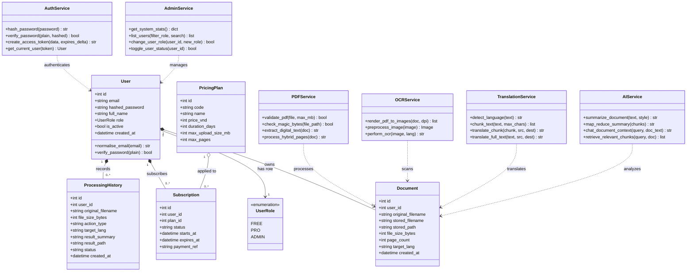

# Lược Đồ Lớp (Class Diagram)

> Sẽ hoàn thiện sơ đồ lớp sau

## 1. Sơ đồ Lớp tổng thể hệ thống

## 2. Đặc tả các Lớp Thực thể Dữ liệu (ORM Models)

1. **`User` (Thực thể Người dùng)**: Đại diện cho bảng `users`. Quản lý thông tin tài khoản, mật khẩu băm `bcrypt` (12 rounds salt), phân quyền qua Enum `UserRole` (`FREE`, `PRO`, `ADMIN`) và trạng thái hoạt động `is_active`.
2. **`Document` (Thực thể Tài liệu tải lên)**: Đại diện cho bảng `documents`. Lưu trữ siêu dữ liệu của tệp PDF (tên gốc, đường dẫn an toàn trên máy chủ, dung lượng bytes, số lượng trang).
3. **`ProcessingHistory` (Thực thể Lịch sử xử lý)**: Đại diện cho bảng `processing_histories`. Ghi nhận lịch sử bóc tách, dịch thuật hoặc tóm tắt cho tài khoản Pro.
4. **`PricingPlan` và `Subscription` (Thực thể Gói cước và Đăng ký)**: Định nghĩa các gói dịch vụ và theo dõi chu kỳ kích hoạt, mã đối soát giao dịch VietQR.

## 3. Đặc tả các Lớp Dịch vụ Nghiệp vụ (Service Layer)

1. **`PDFService`**: Thẩm định an toàn tệp PDF (kiểm tra MIME, magic bytes `%PDF-`), bóc tách văn bản số qua PyMuPDF, điều phối xử lý lai (hybrid).
2. **`OCRService`**: Render trang PDF sang ảnh bitmap 300 DPI, tăng cường tương phản bằng Pillow và nhận dạng quang học Tesseract OCR song ngữ `vie + eng`.
3. **`TranslationService`**: Nhận diện ngôn ngữ nguồn, chia nhỏ đoạn an toàn $\le$ 4500 ký tự không cắt ngang câu và chuyển đổi Fallback đa tầng (Google GTX $\rightarrow$ MyMemory / Deep-Translator).
4. **`AIService`**: Tóm tắt văn bản thông minh (kỹ thuật Map-Reduce) và Trợ lý AI hỏi đáp tài liệu theo ngữ cảnh RAG (15 câu/ngày).
5. **`AuthService`**: Quản lý băm mật khẩu `bcrypt`, xác thực thông tin đăng nhập và cấp phát token JWT an toàn.
6. **`AdminService`**: Tập hợp số liệu thống kê toàn hệ thống, tìm kiếm/lọc danh sách tài khoản, thực thi phân quyền và khóa/mở khóa tài khoản.
