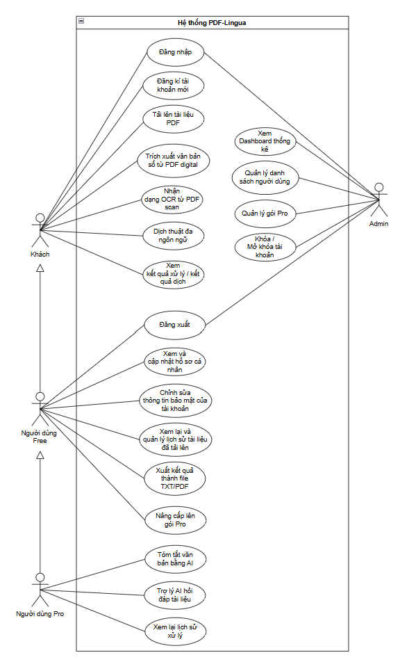

# Thiết Kế Use Case và Lược Đồ Use Case

> **Dự án**: PDF Lingua - Nền tảng Web Trích xuất PDF, OCR, Dịch thuật Đa ngôn ngữ và Trợ lý AI  
> **Nhóm thực hiện**: Nhóm 19 (Nguyễn Lê Huy Tâm, Huỳnh Đình Chấn)  
> **Mã tài liệu**: `DOC-UC-OVERVIEW` (Đồng bộ chuẩn hóa 100% với `use-case-tong-quat.png`)  

---

## 1. Xác định các Tác nhân (Actors) và mối quan hệ kế thừa

Hệ thống **PDF Lingua** phân định 4 nhóm tác nhân tương tác:

```text
[Khách (Guest)] <===kế thừa=== [Người dùng Free] <===kế thừa=== [Người dùng Pro]

[Quản trị viên (Admin)] (Tác nhân độc lập)
```

1. **Khách (Guest)**:
   - Người dùng vãng lai truy cập website nhưng chưa đăng nhập.
   - Nhằm tạo trải nghiệm nhanh (Try-before-register), Khách được phép trải nghiệm trực tiếp luồng xử lý cơ bản tại trang chủ: Tải PDF ($\le$ 20MB, tối đa 100 trang), trích xuất văn bản số, chạy OCR, dịch thuật đa ngôn ngữ và xem kết quả song ngữ trực tiếp trên màn hình.
   - Khách có thể đăng ký tài khoản mới hoặc đăng nhập.

2. **Người dùng Miễn phí (Free User)**:
   - Người dùng đã đăng ký tài khoản và đang sử dụng gói cước miễn phí.
   - Kế thừa toàn bộ quyền của Khách.
   - Được bổ sung các chức năng cá nhân: đăng xuất, xem và cập nhật hồ sơ cá nhân, đổi mật khẩu, quản lý danh sách tài liệu cá nhân đã tải lên, xuất kết quả ra file TXT/PDF Unicode, gửi yêu cầu nâng cấp gói Pro.

3. **Người dùng Nâng cao (Pro User)**:
   - Người dùng trả phí đã nâng cấp thành công gói Pro (qua cổng thanh toán VietQR) hoặc được Quản trị viên cấp quyền.
   - Kế thừa toàn bộ quyền của Free User; hạn mức tải lên mở rộng đến 100MB/tệp và 500 trang OCR.
   - Mở khóa độc quyền các chức năng cao cấp:
     - Tóm tắt văn bản thông minh bằng AI (kỹ thuật Map-Reduce).
     - Trợ lý AI hỏi đáp tài liệu theo ngữ cảnh RAG (15 câu/ngày).
     - Lưu trữ và tra cứu lịch sử các phiên xử lý trên đám mây.

4. **Quản trị viên (Admin)**:
   - Người quản trị vận hành hệ thống, sử dụng tài khoản đặc quyền khởi tạo an toàn.
   - Tác nhân độc lập quản lý toàn bộ hệ thống: xem Dashboard thống kê số liệu, quản lý danh sách tài khoản, khóa hoặc mở khóa tài khoản vi phạm, cấp phát hoặc thu hồi quyền gói Pro.

---

## 2. Sơ đồ Use Case tổng quát

Sơ đồ Use Case tổng quát của hệ thống (đồng bộ với file `Docs/use-case/use-case-tong-quat.png`):



---

## 3. Danh mục chuẩn hóa 20 Use Case của hệ thống

| Mã UC | Tên Use Case trên sơ đồ | Tác nhân liên kết trực tiếp | Tác nhân được kế thừa | Phân hệ | Mô tả nghiệp vụ |
| :---: | :--- | :--- | :--- | :--- | :--- |
| **UC-01** | **Đăng nhập** | Khách, Admin | Người dùng Free, Pro | Xác thực | Xác thực email/mật khẩu và cấp mã JWT đưa người dùng vào hệ thống theo đúng vai trò. |
| **UC-02** | **Đăng kí tài khoản mới** | Khách | - | Xác thực | Tạo tài khoản mới bằng Email và Mật khẩu hợp lệ (mã hóa bcrypt). |
| **UC-03** | **Tải lên tài liệu PDF** | Khách | Người dùng Free, Pro | Xử lý PDF | Tải file PDF từ máy lên hệ thống (Khách & Free: $\le$ 20MB, Pro: $\le$ 100MB). Kiểm tra Magic Bytes `%PDF-`. |
| **UC-04** | **Trích xuất văn bản số từ PDF digital** | Khách | Người dùng Free, Pro | Xử lý PDF | Bóc tách lớp văn bản ký tự có sẵn trong tệp PDF số trực tiếp theo từng trang. |
| **UC-05** | **Nhận dạng OCR từ PDF scan** | Khách | Người dùng Free, Pro | Xử lý PDF | Chuyển trang scan thành ảnh và chạy Tesseract OCR nhận diện ký tự khi tài liệu không có text layer. |
| **UC-06** | **Dịch thuật đa ngôn ngữ** | Khách | Người dùng Free, Pro | Dịch thuật | Tự động nhận diện ngôn ngữ nguồn và dịch văn bản sang ngôn ngữ đích được chọn (chia nhỏ đoạn an toàn). |
| **UC-07** | **Xem kết quả xử lý / kết quả dịch** | Khách | Người dùng Free, Pro | Dịch thuật | Hiển thị giao diện Workspace song ngữ đối chiếu văn bản gốc và bản dịch, hỗ trợ sao chép nội dung. |
| **UC-08** | **Đăng xuất** | Người dùng Free, Admin | Người dùng Pro | Xác thực | Hủy phiên đăng nhập hiện tại và xóa token xác thực an toàn phía client. |
| **UC-09** | **Xem và cập nhật hồ sơ cá nhân** | Người dùng Free | Người dùng Pro | Tài khoản | Xem thông tin tài khoản, ngày tham gia, gói cước và cập nhật tên hiển thị. |
| **UC-10** | **Chỉnh sửa thông tin bảo mật của tài khoản** | Người dùng Free | Người dùng Pro | Tài khoản | Thay đổi mật khẩu tài khoản bằng cách xác thực mật khẩu cũ và nhập mật khẩu mới. |
| **UC-11** | **Xem lại và quản lý lịch sử tài liệu đã tải lên** | Người dùng Free | Người dùng Pro | Xử lý PDF | Xem danh sách các file PDF cá nhân đã tải lên hệ thống và thực hiện xóa file khi không còn nhu cầu. |
| **UC-12** | **Xuất kết quả thành file TXT/PDF** | Người dùng Free | Người dùng Pro | Dịch thuật | Xuất văn bản trích xuất hoặc bản dịch thành file văn bản thuần (.txt UTF-8 BOM) hoặc tệp PDF đã dịch. |
| **UC-13** | **Nâng cấp lên gói Pro** | Người dùng Free | - | Gói cước | Xem bảng giá so sánh quyền lợi và gửi yêu cầu nâng cấp tài khoản qua cổng VietQR Napas247. |
| **UC-14** | **Tóm tắt văn bản bằng AI** | Người dùng Pro | - | AI Pro | Sử dụng mô hình LLM AI để tóm tắt nội dung tài liệu theo các phong cách (ngắn gọn, ý chính, chi tiết). |
| **UC-15** | **Trợ lý AI hỏi đáp tài liệu** | Người dùng Pro | - | AI Pro | Chat hỏi đáp trực tiếp với trợ lý AI dựa trên nội dung tài liệu (RAG), có trích dẫn nguồn trang. |
| **UC-16** | **Xem lại lịch sử xử lý** | Người dùng Pro | - | AI Pro | Tra cứu và mở lại toàn bộ lịch sử các phiên dịch thuật, tóm tắt và câu hỏi RAG được lưu trên đám mây. |
| **UC-17** | **Xem Dashboard thống kê** | Admin | - | Quản trị | Theo dõi các biểu đồ và chỉ số vận hành: tổng tài khoản, dung lượng lưu trữ, lượt xử lý PDF/Dịch/AI. |
| **UC-18** | **Quản lý danh sách người dùng** | Admin | - | Quản trị | Tìm kiếm, xem chi tiết thông tin, ngày tạo và trạng thái hoạt động của toàn bộ người dùng trong hệ thống. |
| **UC-19** | **Quản lý gói Pro** | Admin | - | Quản trị | Cấp phát hoặc thu hồi quyền Pro cho người dùng theo chính sách dịch vụ. |
| **UC-20** | **Khóa / Mở khóa tài khoản** | Admin | - | Quản trị | Tạm thời vô hiệu hóa quyền truy cập (`is_active = False`) hoặc mở lại tài khoản người dùng vi phạm. |

---

## 4. Đặc tả chi tiết các Use Case cốt lõi

### 4.1. Đặc tả UC-03: Tải lên tài liệu PDF và bóc tách nội dung
- **Mã Use Case**: UC-03
- **Tác nhân**: Khách (Guest), Người dùng Miễn phí (Free), Người dùng Nâng cao (Pro).
- **Tiền điều kiện**: Người dùng truy cập trang Workspace của ứng dụng.
- **Hậu điều kiện**: Tệp PDF được kiểm tra an toàn; văn bản bóc tách hiển thị ở cột trái màn hình làm việc.
- **Luồng sự kiện chính**:
  1. Người dùng kéo thả hoặc nhấn nút chọn tệp PDF trên giao diện.
  2. Giao diện kiểm tra dung lượng theo quyền hạn tài khoản (Free $\le$ 20MB, Pro $\le$ 100MB).
  3. Client gửi request `POST /api/process/upload-and-translate`.
  4. Backend kiểm tra magic bytes `%PDF-` để ngăn chặn giả mạo định dạng.
  5. Động cơ PyMuPDF bóc tách văn bản số từng trang theo thứ tự đọc tự nhiên.
  6. Nếu phát hiện trang tài liệu scan dạng ảnh, tự động kích hoạt Tesseract OCR để nhận diện chữ.
  7. Văn bản hoàn chỉnh được hiển thị trực tiếp lên Workspace.
- **Luồng ngoại lệ**:
  - *E1 - File sai định dạng*: Hiển thị thông báo "Tệp không phải định dạng PDF hợp lệ".
  - *E2 - File vượt quá dung lượng*: Hiển thị modal gợi ý nâng cấp gói Pro.
  - *E3 - File có mật khẩu bảo vệ*: Thông báo hệ thống chưa hỗ trợ tệp bị mã hóa.

### 4.2. Đặc tả UC-06: Dịch thuật đa ngôn ngữ
- **Mã Use Case**: UC-06
- **Tác nhân**: Khách (Guest), Người dùng Miễn phí (Free), Người dùng Nâng cao (Pro).
- **Tiền điều kiện**: Đã có nội dung văn bản trích xuất trên màn hình làm việc.
- **Hậu điều kiện**: Bản dịch xuất hiện ở cột phải màn hình song song với văn bản gốc.
- **Luồng sự kiện chính**:
  1. Người dùng chọn ngôn ngữ nguồn (hoặc Tự động nhận diện) và ngôn ngữ đích (Việt, Anh, v.v.).
  2. Người dùng nhấn nút Dịch thuật.
  3. Backend chia nhỏ văn bản thành các đoạn $\le$ 4500 ký tự.
  4. Hệ thống gọi động cơ dịch thuật chính (Google GTX).
  5. Nếu gặp lỗi hoặc Rate Limit, tự động kích hoạt động cơ dự phòng tầng 2 (MyMemory / Deep-Translator).
  6. Bản dịch hoàn chỉnh được ghép nối và gửi về hiển thị ở cột phải Workspace.

### 4.3. Đặc tả UC-13: Nâng cấp lên gói Pro (qua VietQR)
- **Mã Use Case**: UC-13
- **Tác nhân**: Người dùng Miễn phí (Free User).
- **Tiền điều kiện**: Người dùng đã đăng nhập tài khoản Free trên hệ thống.
- **Hậu điều kiện**: Giao dịch chuyển khoản được ghi nhận; tài khoản được thăng hạng Pro VIP.
- **Luồng sự kiện chính**:
  1. Người dùng mở trang bảng giá so sánh quyền lợi và chọn chu kỳ gói Pro (Tháng hoặc Năm).
  2. Hệ thống hiển thị Modal thanh toán chứa mã VietQR Napas247 (Ngân hàng VietinBank) với số tiền và nội dung chuyển khoản tự động gắn mã giao dịch duy nhất.
  3. Người dùng mở ứng dụng Mobile Banking quét mã và thanh toán.
  4. Người dùng bấm xác nhận "Tôi đã chuyển khoản" trên giao diện.
  5. Hệ thống ghi nhận và cập nhật quyền hạn `role = "pro"`, hiển thị huy hiệu Pro VIP Vàng kim.

