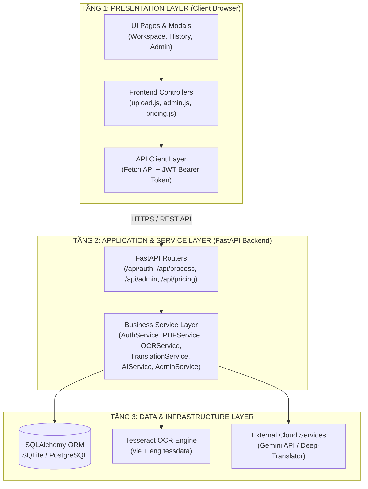
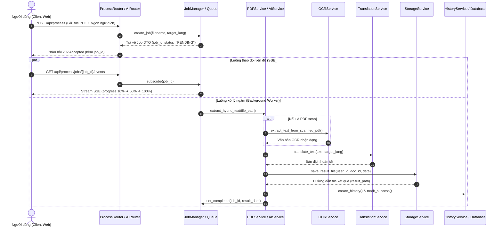

# Báo Cáo Thuyết Minh Chi Tiết Thiết Kế Hệ Thống - PDF Lingua

> **Học phần**: Đồ án Thực tế Công nghệ Phần mềm  
> **Nhóm thực hiện**: Nhóm 19  
> **Thành viên**:
> 1. Nguyễn Lê Huy Tâm - MSSV: `056206011188` (Trưởng nhóm)
> 2. Huỳnh Đình Chấn - MSSV: `077206002307` (Thành viên)  
> 
> **Nội dung trọng tâm**: Báo cáo thiết kế chi tiết gồm 3 phần: **Kiến trúc hệ thống**, **Sơ đồ Use Case** và **Sơ đồ Lớp (Class Diagram)**.

---

## Mục lục nội dung

1. [Kiến Trúc Hệ Thống](#1-kiến-trúc-hệ-thống)
   - [1.1. Mô hình kiến trúc phân tầng (3-Tier Layered Architecture)](#11-mô-hình-kiến-trúc-phân-tầng-3-tier-layered-architecture)
   - [1.2. Sơ đồ kiến trúc tổng thể](#12-sơ-đồ-kiến-trúc-tổng-thể)
   - [1.3. Phân rã 8 phân hệ cốt lõi (Communities)](#13-phân-rã-8-phân-hệ-cốt-lõi-communities)
   - [1.4. Các luồng dữ liệu chính của hệ thống](#14-các-luồng-dữ-liệu-chính-của-hệ-thống)
2. [Sơ Đồ Use Case](#2-sơ-đồ-use-case)
   - [2.1. Xác định các Tác nhân (Actors) và quan hệ kế thừa](#21-xác-định-các-tác-nhân-actors-và-quan-hệ-kế-thừa)
   - [2.2. Lược đồ Use Case tổng quát](#22-lược-đồ-use-case-tổng-quát)
   - [2.3. Danh mục 20 Use Case chuẩn hóa](#23-danh-mục-20-use-case-chuẩn-hóa)
   - [2.4. Đặc tả chi tiết các Use Case cốt lõi](#24-đặc-tả-chi-tiết-các-use-case-cốt-lõi)
3. [Sơ Đồ Lớp (Class Diagram)](#3-sơ-đồ-lớp-class-diagram)
   - [3.1. Kiến trúc phân tầng hệ thống (3-Tier Layering)](#31-kiến-trúc-phân-tầng-hệ-thống-3-tier-layering)
   - [3.2. Lược đồ Lớp tổng thể hệ thống (Class Diagram)](#32-lược-đồ-lớp-tổng-thể-hệ-thống-class-diagram)
   - [3.3. Danh mục chi tiết 26 Lớp trong hệ thống](#33-danh-mục-chi-tiết-26-lớp-trong-hệ-thống)
   - [3.4. Đặc tả chi tiết các Lớp theo phân tầng](#34-đặc-tả-chi-tiết-các-lớp-theo-phân-tầng)
     - [3.4.1. Tầng API Routers (Presentation Layer)](#341-tầng-api-routers-presentation-layer)
     - [3.4.2. Tầng Dịch vụ & Hàng đợi thời gian thực (Service & Queue Layer)](#342-tầng-dịch-vụ--hàng-đợi-thời-gian-thực-service--queue-layer)
     - [3.4.3. Tầng Thực thể Dữ liệu & Enums (ORM & Data Layer)](#343-tầng-thực-thể-dữ-liệu--enums-orm--data-layer)
   - [3.5. Quy tắc và bản chất các mối quan hệ UML trên sơ đồ](#35-quy-tắc-và-bản-chất-các-mối-quan-hệ-uml-trên-sơ-đồ)
   - [3.6. Sơ đồ tương tác luồng dữ liệu kiến trúc (Data & Control Flow)](#36-sơ-đồ-tương-tác-luồng-dữ-liệu-kiến-trúc-data--control-flow)
   - [3.7. Quy hoạch các lớp mở rộng trong tương lai (Jira Sprint 7 / EPIC 17)](#37-quy-hoạch-các-lớp-mở-rộng-trong-tương-lai-jira-sprint-7--epic-17)

---

# 1. Kiến Trúc Hệ Thống

## 1.1. Mô hình kiến trúc phân tầng (3-Tier Layered Architecture)
Hệ thống **PDF Lingua** được thiết kế theo mô hình kiến trúc phân tầng kết hợp hướng dịch vụ (Service-Oriented Layered Architecture) nhằm đảm bảo tính phân tách trách nhiệm (Separation of Concerns), khả năng mở rộng độc lập (Scalability) và tính dễ bảo trì kiểm thử:

1. **Tầng 1 - Presentation Layer (Giao diện phía Client)**:
   - Ứng dụng Single Page Application (SPA) phát triển trên nền HTML5, CSS Tokens và JavaScript ES6+ thuần.
   - Bố cục màn hình làm việc kép (Dual-pane Workspace) cho phép đối chiếu song ngữ trực quan giữa văn bản gốc và bản dịch.
   - Quản lý tương tác thông qua các module điều khiển phía giao diện và giao tiếp với máy chủ thông qua Fetch API kèm JWT Bearer Token.

2. **Tầng 2 - Application & Service Layer (Ứng dụng và Nghiệp vụ phía Backend)**:
   - Xây dựng trên nền tảng framework **Python FastAPI** hiện đại, hỗ trợ cơ chế xử lý bất đồng bộ (Asynchronous Non-blocking I/O).
   - Hệ thống định tuyến RESTful API phân nhiệm rõ ràng: xác thực (`/api/auth`), xử lý tài liệu (`/api/process`), quản trị (`/api/admin`), bảng giá và gói cước (`/api/pricing`).
   - Tầng nghiệp vụ (Business Service Layer) điều phối toàn bộ luồng xử lý: `AuthService`, `PDFService`, `OCRService`, `TranslationService`, `AIService`, `AdminService`.

3. **Tầng 3 - Data & Infrastructure Layer (Dữ liệu và Hạ tầng dịch vụ)**:
   - Cơ sở dữ liệu quan hệ quản trị qua SQLAlchemy ORM: SQLite trong môi trường phát triển cục bộ và PostgreSQL khi triển khai sản xuất.
   - Bộ công cụ bóc tách tệp: thư viện PyMuPDF (`fitz`) và `pdfplumber`.
   - Động cơ nhận dạng quang học: **Tesseract OCR Engine** hỗ trợ song ngữ `vie + eng`.
   - Tích hợp các dịch vụ trí tuệ nhân tạo bên ngoài: Google Gemini API (LLM) và các động cơ dịch thuật đám mây.

## 1.2. Sơ đồ kiến trúc tổng thể



## 1.3. Phân rã 8 phân hệ cốt lõi (Communities)
1. **C1 - Auth & Identity**: Quản lý danh tính người dùng, mã hóa mật khẩu `bcrypt` (12 rounds salt), cấp phát và giải mã JWT token, kiểm soát quyền truy cập theo 3 vai trò (`free`, `pro`, `admin`).
2. **C2 - PDF Processing Engine**: Tiếp nhận tệp tải lên qua luồng multipart, kiểm tra an toàn magic bytes `%PDF-`, trích xuất văn bản số bằng PyMuPDF theo thứ tự đọc tự nhiên.
3. **C3 - OCR Pipeline**: Tự động nhận diện trang ảnh scan, chuyển đổi trang tài liệu sang ảnh bitmap 300 DPI, tăng cường tương phản bằng Pillow và nhận dạng ký tự quang học qua Tesseract OCR.
4. **C4 - Translation Engine**: Chia nhỏ văn bản an toàn ($\le$ 4500 ký tự) không cắt ngang câu, chuyển dịch đa ngôn ngữ qua Google GTX với cơ chế chuyển đổi dự phòng đa tầng (MyMemory / Deep-Translator).
5. **C5 - AI Feature Suite (Pro)**: Mô-đun tóm tắt tài liệu thông minh theo phương pháp Map-Reduce và Trợ lý AI Copilot hỏi đáp ngữ cảnh tài liệu theo kiến trúc RAG.
6. **C6 - Export & Delivery**: Xuất tệp TXT chuẩn UTF-8 BOM hiển thị tiếng Việt chính xác trên Windows Notepad, xuất tệp PDF kết quả Unicode và hỗ trợ sao chép nhanh.
7. **C7 - History & Subscription**: Quản lý lịch sử xử lý tài liệu trên đám mây cho tài khoản Pro, quy trình nâng cấp gói cước qua mã VietQR Napas247 và Admin Console.
8. **C8 - Frontend UI Layer**: Bố cục Workspace song song, Sidebar thu phóng linh hoạt, hệ thống thông báo trạng thái Toast thời gian thực.

## 1.4. Các luồng dữ liệu chính của hệ thống
- **Luồng xử lý tài liệu lai (Hybrid Extraction)**:
  1. Người dùng tải tệp PDF lên Workspace $\rightarrow$ Client kiểm tra kích thước theo gói cước (Free $\le$ 20MB, Pro $\le$ 100MB).
  2. Backend kiểm tra magic bytes `%PDF-` để ngăn chặn giả mạo định dạng.
  3. Duyệt từng trang tài liệu bằng PyMuPDF: nếu trang có văn bản số thì trích xuất trực tiếp; nếu trang là ảnh scan hoặc có ít hơn 10 ký tự thì tự động kích hoạt Tesseract OCR để nhận diện chữ.
  4. Hợp nhất nội dung hoàn chỉnh và trả về hiển thị tại cột văn bản gốc của Workspace.
- **Luồng dịch thuật có cơ chế dự phòng (Translation Fallback)**:
  1. Người dùng chọn ngôn ngữ nguồn và ngôn ngữ đích $\rightarrow$ Nhấn nút Dịch thuật.
  2. Thuật toán `chunk_text()` chia nhỏ văn bản thành các đoạn $\le$ 4500 ký tự tại các điểm ngắt câu tự nhiên.
  3. Gửi yêu cầu dịch qua động cơ Google GTX (Ưu tiên 1); nếu xảy ra lỗi kết nối hoặc mã lỗi HTTP 429 (Rate Limit), hệ thống tự động bắt ngoại lệ và kích hoạt động cơ dự phòng tầng 2 (MyMemory / Deep-Translator).
  4. Ghép nối kết quả theo đúng vị trí ban đầu và trả về hiển thị song song với văn bản gốc.

---

# 2. Sơ Đồ Use Case

## 2.1. Xác định các Tác nhân (Actors) và quan hệ kế thừa
Hệ thống **PDF Lingua** phân định 4 nhóm tác nhân tương tác theo mô hình kế thừa UML:

```text
[Khách (Guest)] <===kế thừa=== [Người dùng Free] <===kế thừa=== [Người dùng Pro]

[Quản trị viên (Admin)] (Tác nhân độc lập)
```

- **Khách (Guest)**: Người dùng vãng lai chưa đăng nhập. Được phép trải nghiệm trực tiếp luồng xử lý cơ bản ngay tại trang chủ (PDF $\le$ 20MB, tối đa 100 trang, bóc tách text số, chạy OCR, dịch thuật và xem kết quả song ngữ). Có thể đăng ký tài khoản mới hoặc đăng nhập.
- **Người dùng Miễn phí (Free User)**: Người dùng đã đăng ký tài khoản. Kế thừa toàn bộ quyền của Khách; được bổ sung các chức năng: đăng xuất, xem và cập nhật hồ sơ cá nhân, đổi mật khẩu, quản lý tệp đã tải lên, xuất kết quả thành file TXT/PDF, gửi yêu cầu nâng cấp Pro.
- **Người dùng Nâng cao (Pro User)**: Người dùng trả phí đã nâng cấp thành công gói Pro. Kế thừa toàn bộ quyền của Free User; hạn mức mở rộng đến 100MB/tệp, 500 trang OCR; mở khóa độc quyền các chức năng AI (Tóm tắt văn bản, Trợ lý AI Copilot hỏi đáp tài liệu) và Lưu trữ lịch sử đám mây.
- **Quản trị viên (Admin)**: Tác nhân quản trị độc lập toàn bộ hệ thống: xem Dashboard thống kê số liệu, quản lý danh sách người dùng, cấp phát hoặc thu hồi quyền Pro, khóa hoặc mở khóa tài khoản người dùng vi phạm.

## 2.2. Lược đồ Use Case tổng quát


## 2.3. Danh mục 20 Use Case chuẩn hóa

| Mã UC | Tên Use Case | Tác nhân trực tiếp | Tác nhân kế thừa | Phân hệ | Mô tả tóm tắt nghiệp vụ |
| :---: | :--- | :--- | :--- | :--- | :--- |
| **UC-01** | **Đăng nhập** | Khách, Admin | Free, Pro | Xác thực | Xác thực email/mật khẩu và cấp mã JWT đưa người dùng vào hệ thống theo đúng vai trò. |
| **UC-02** | **Đăng kí tài khoản mới** | Khách | - | Xác thực | Tạo tài khoản mới bằng Email và Mật khẩu hợp lệ (mã hóa bcrypt). |
| **UC-03** | **Tải lên tài liệu PDF** | Khách | Free, Pro | Xử lý PDF | Tải file PDF lên hệ thống (Free: $\le$ 20MB, Pro: $\le$ 100MB), kiểm tra an toàn MIME và Magic Bytes. |
| **UC-04** | **Trích xuất văn bản số từ PDF digital** | Khách | Free, Pro | Xử lý PDF | Bóc tách lớp văn bản ký tự có sẵn trong tệp PDF số trực tiếp theo trang bằng PyMuPDF. |
| **UC-05** | **Nhận dạng OCR từ PDF scan** | Khách | Free, Pro | Xử lý PDF | Chuyển trang scan thành ảnh bitmap và chạy Tesseract OCR nhận diện ký tự quang học. |
| **UC-06** | **Dịch thuật đa ngôn ngữ** | Khách | Free, Pro | Dịch thuật | Tự động nhận diện ngôn ngữ nguồn và dịch sang ngôn ngữ đích (phân đoạn an toàn $\le$ 4500 ký tự). |
| **UC-07** | **Xem kết quả xử lý / kết quả dịch** | Khách | Free, Pro | Dịch thuật | Hiển thị giao diện Workspace song ngữ đối chiếu văn bản gốc và bản dịch, hỗ trợ sao chép. |
| **UC-08** | **Đăng xuất** | Free, Admin | Pro | Xác thực | Hủy phiên làm việc và xóa token xác thực an toàn ở phía Client. |
| **UC-09** | **Xem và cập nhật hồ sơ cá nhân** | Free | Pro | Tài khoản | Xem thông tin tài khoản, ngày tham gia, gói cước và cập nhật họ tên hiển thị. |
| **UC-10** | **Chỉnh sửa thông tin bảo mật của tài khoản** | Free | Pro | Tài khoản | Thay đổi mật khẩu tài khoản bằng cách xác thực mật khẩu cũ và nhập mật khẩu mới. |
| **UC-11** | **Xem lại và quản lý lịch sử tài liệu đã tải lên** | Free | Pro | Xử lý PDF | Xem danh sách các file PDF cá nhân đã tải lên hệ thống và thực hiện xóa file khi không còn nhu cầu. |
| **UC-12** | **Xuất kết quả thành file TXT/PDF** | Free | Pro | Dịch thuật | Xuất văn bản trích xuất hoặc bản dịch thành file TXT (UTF-8 BOM) hoặc tệp PDF kết quả. |
| **UC-13** | **Nâng cấp lên gói Pro** | Free | - | Gói cước | Xem bảng giá so sánh quyền lợi và gửi yêu cầu nâng cấp tài khoản qua cổng VietQR Napas247. |
| **UC-14** | **Tóm tắt văn bản bằng AI** | Pro | - | AI Pro | Áp dụng mô hình LLM AI để tóm tắt tài liệu theo các phong cách (ngắn gọn, ý chính, chi tiết). |
| **UC-15** | **Trợ lý AI hỏi đáp tài liệu** | Pro | - | AI Pro | Chat hỏi đáp trực tiếp với trợ lý AI dựa trên nội dung tài liệu (RAG), có trích dẫn nguồn trang. |
| **UC-16** | **Xem lại lịch sử xử lý** | Pro | - | AI Pro | Tra cứu và mở lại toàn bộ lịch sử các phiên dịch thuật, tóm tắt và câu hỏi RAG lưu trên đám mây. |
| **UC-17** | **Xem Dashboard thống kê** | Admin | - | Quản trị | Theo dõi các biểu đồ và chỉ số vận hành: tổng tài khoản, dung lượng lưu trữ, lượt xử lý dịch/AI. |
| **UC-18** | **Quản lý danh sách người dùng** | Admin | - | Quản trị | Tìm kiếm, xem chi tiết thông tin, ngày tạo và trạng thái hoạt động của toàn bộ người dùng. |
| **UC-19** | **Quản lý gói Pro** | Admin | - | Quản trị | Cấp phát hoặc thu hồi quyền Pro cho người dùng theo chính sách dịch vụ. |
| **UC-20** | **Khóa / Mở khóa tài khoản** | Admin | - | Quản trị | Tạm thời vô hiệu hóa quyền truy cập (`is_active = False`) hoặc mở lại tài khoản người dùng vi phạm. |

## 2.4. Đặc tả chi tiết các Use Case cốt lõi

### Đặc tả UC-03: Tải lên tài liệu PDF và trích xuất nội dung
- **Mã Use Case**: UC-03
- **Tác nhân**: Khách (Guest), Người dùng Miễn phí (Free), Người dùng Nâng cao (Pro).
- **Tiền điều kiện**: Người dùng truy cập trang Workspace của ứng dụng.
- **Hậu điều kiện**: Tệp PDF được kiểm tra an toàn; văn bản bóc tách hiển thị ở cột trái màn hình làm việc.
- **Luồng sự kiện chính**:
  1. Người dùng kéo thả hoặc nhấn chọn tệp PDF vào vùng tải lên.
  2. Giao diện kiểm tra dung lượng theo quyền tài khoản (Free 20MB, Pro 100MB).
  3. Frontend gửi tệp qua API `POST /api/process/upload-and-translate`.
  4. Backend kiểm tra magic bytes `%PDF-`, lưu tạm và mở bằng PyMuPDF.
  5. Hệ thống bóc tách văn bản số từng trang theo thứ tự tự nhiên.
  6. Nếu phát hiện trang scan, hệ thống tự động gọi OCR Tesseract.
  7. Kết quả hoàn tất được trả về hiển thị tại cột trái của Workspace.
- **Luồng ngoại lệ**:
  - *E1 - Tệp sai định dạng*: Hệ thống hiển thị thông báo "Tệp không phải định dạng PDF hợp lệ".
  - *E2 - Tệp vượt quá dung lượng*: Hệ thống chặn tải lên và gợi ý nâng cấp gói Pro.
  - *E3 - Tệp có mật khẩu*: Thông báo hệ thống chưa hỗ trợ tệp bị mã hóa bảo vệ.

### Đặc tả UC-06: Dịch thuật đa ngôn ngữ
- **Mã Use Case**: UC-06
- **Tác nhân**: Khách (Guest), Người dùng Miễn phí (Free), Người dùng Nâng cao (Pro).
- **Tiền điều kiện**: Đã có nội dung văn bản trích xuất trên màn hình làm việc.
- **Hậu điều kiện**: Bản dịch hoàn chỉnh xuất hiện tại cột phải Workspace đối chiếu song song.
- **Luồng sự kiện chính**:
  1. Người dùng chọn ngôn ngữ nguồn và ngôn ngữ đích.
  2. Người dùng nhấn nút *Dịch thuật*.
  3. Backend phân tách văn bản thành các đoạn an toàn $\le$ 4500 ký tự.
  4. Gọi động cơ dịch chính (Google GTX). Nếu lỗi hoặc quá tải (429), tự động chuyển sang động cơ dự phòng tầng 2 (MyMemory / Deep-Translator).
  5. Ghép nối các đoạn dịch và gửi kết quả về hiển thị ở cột phải Workspace.

### Đặc tả UC-13: Nâng cấp gói dịch vụ Pro qua VietQR
- **Mã Use Case**: UC-13
- **Tác nhân**: Người dùng Miễn phí (Free User).
- **Tiền điều kiện**: Người dùng đã đăng nhập tài khoản Free trên hệ thống.
- **Hậu điều kiện**: Yêu cầu thanh toán được ghi nhận; tài khoản được thăng hạng lên Pro VIP.
- **Luồng sự kiện chính**:
  1. Người dùng chọn chu kỳ thanh toán (Gói Tháng hoặc Gói Năm).
  2. Hệ thống hiển thị Modal thanh toán chứa mã VietQR ngân hàng VietinBank chuẩn 1:1.
  3. Người dùng quét mã trên ứng dụng Mobile Banking, nội dung chuyển khoản được định danh tự động theo mã giao dịch duy nhất.
  4. Người dùng bấm xác nhận *Tôi đã chuyển khoản*.
  5. Tài khoản người dùng được cập nhật `role = "pro"` và cấp huy hiệu Pro VIP Vàng kim.

---

# 3. Sơ Đồ Lớp (Class Diagram)

## 3.1. Kiến trúc phân tầng hệ thống (3-Tier Layering)

Hệ thống **PDF Lingua** được thiết kế dựa trên mô hình kiến trúc hướng dịch vụ 3 tầng (**3-Tier Clean Architecture**) sử dụng framework **FastAPI** (Python) làm nền tảng máy chủ ứng dụng, kết hợp với cơ sở dữ liệu quan hệ quản trị qua **SQLAlchemy ORM**, bộ công cụ bóc tách tài liệu lai (**Hybrid PDF Engine & Tesseract OCR**), cổng dịch thuật đa ngôn ngữ và phân hệ **Trí tuệ nhân tạo (AI Intelligence)** tích hợp cổng LLM Gateway:

```
┌───────────────────────────────────────────────────────────────────────────────┐
│ TẦNG 1: API PRESENTATION LAYER (7 FastAPI Routers)                             │
│ [AuthRouter] [ProcessRouter] [AIRouter] [DocumentsRouter]                    │
│ [HistoryRouter] [PricingRouter] [AdminRouter]                                 │
└──────────────────────────────────────┬────────────────────────────────────────┘
                                       │ calls (Dependency ..>)
┌──────────────────────────────────────▼────────────────────────────────────────┐
│ TẦNG 2: BUSINESS LOGIC, REALTIME QUEUE & AI SERVICES (12 Core Services)       │
│ [AuthService] [JobManager ── Job] [AIService] [StorageService]                │
│ [HistoryService] [SubscriptionService] [AdminService]                         │
│ [PDFService ──> OCRService ──> TranslationService ──> ExportService]          │
└──────────────────────────────────────┬────────────────────────────────────────┘
                                       │ maps / persists (CRUD)
┌──────────────────────────────────────▼────────────────────────────────────────┐
│ TẦNG 3: DOMAIN ENTITIES & DATA LAYER (SQLAlchemy ORM Models & Enums)          │
│ Base <|── [User] [Document] [ProcessingHistory] [PricingPlan]                 │
│      <|── [Subscription] [PaymentTransaction]                                 │
│ Enums: UserRole | ActionType | ProcessingStatus | JobStatus | PaymentMethod   │
└───────────────────────────────────────────────────────────────────────────────┘
```

- **Tầng 1 - API Presentation Layer (Routers / Controllers)**: Đảm nhận vai trò tiếp nhận HTTP Request từ Client/Frontend, thực thi kiểm tra tính hợp lệ dữ liệu đầu vào qua Pydantic Schemas, giải mã JWT Bearer Token, kiểm soát phân quyền theo vai trò (RBAC), kiểm tra hạn mức sử dụng và điều hướng lời gọi tới các Service tương ứng.
- **Tầng 2 - Application & Business Service Layer (Services & Realtime Queue)**: Chứa đựng 100% logic thuật toán nghiệp vụ cốt lõi, điều phối hàng đợi tác vụ nền bất đồng bộ (in-memory Job Queue và stream Server-Sent Events), giao tiếp với Tesseract OCR, các cổng dịch thuật đám mây, B.AI Gateway và quản lý lưu trữ an toàn.
- **Tầng 3 - Domain Entities & Database Layer (ORM Models & Enums)**: Định nghĩa cấu trúc các thực thể dữ liệu kế thừa từ `DeclarativeBase` của SQLAlchemy, thiết lập chặt chẽ các ràng buộc toàn vẹn khóa chính (PK), khóa ngoại (FK), chỉ mục (Indexes) và các quan hệ 1-N.

---

## 3.2. Lược đồ Lớp tổng thể hệ thống (Class Diagram)

Sơ đồ trực quan dưới đây mô hình hóa toàn diện các lớp, thuộc tính, phương thức và các mối quan hệ cấu trúc tĩnh trong toàn bộ hệ thống:

```mermaid
classDiagram
    direction TB

    %% ========================================================
    %% LỚP CƠ SỞ KẾ THỪA (INHERITANCE BASE)
    %% ========================================================
    class Base {
        <<SQLAlchemy DeclarativeBase>>
        +metadata: MetaData
    }

    %% ========================================================
    %% TẦNG 1: API PRESENTATION LAYER (FASTAPI ROUTERS)
    %% ========================================================
    class AuthRouter {
        <<Router /api/auth>>
        -prefix: str = "/api/auth"
        +register(user_in: UserCreate) ApiResponse~UserResponse~
        +login(creds: UserLogin) ApiResponse~TokenResponse~
        +get_me() ApiResponse~UserResponse~
        +update_profile(user_update: UserUpdate) ApiResponse~UserResponse~
        +change_password(req: PasswordChangeRequest) ApiResponse
        +logout() ApiResponse
        +forgot_password(email_req: EmailRequest) dict [Future]
        +reset_password(req: ResetPasswordRequest) dict [Future]
    }

    class ProcessRouter {
        <<Router /api/process>>
        -prefix: str = "/api/process"
        -job_manager: JobManager
        -pdf_service: PDFService
        +create_processing_job(file, target_lang) ApiResponse~JobProgressData~
        +stream_job_events(job_id) SSE
        +upload_and_translate(file, target_lang) ApiResponse~ProcessResponseData~
        +retranslate(req: RetranslateRequest) ApiResponse~dict~
        +download_result(req: DownloadRequest) Response
        +submit_feedback(data: FeedbackRequest) ApiResponse~dict~
        +upload_batch(files, target_lang) dict [Future]
    }

    class AIRouter {
        <<Router /api/ai>>
        -prefix: str = "/api/ai"
        -ai_service: AIService
        +summarize_document(payload: SummarizeRequest) ApiResponse~SummarizeResponseData~
        +chat_with_copilot(payload: ChatRequest) ApiResponse~ChatResponseData~
    }

    class DocumentsRouter {
        <<Router /api/documents>>
        -prefix: str = "/api/documents"
        -storage: StorageService
        +list_documents(page, limit) ApiResponse~list~
        +get_document_detail(document_id) ApiResponse~DocumentResponse~
        +download_original_document(document_id) Response
        +delete_document(document_id) ApiResponse~dict~
    }

    class HistoryRouter {
        <<Router /api/history>>
        -prefix: str = "/api/history"
        -history_service: HistoryService
        +list_user_history(page, size) ApiResponse~list~
        +get_history_detail(history_id) ApiResponse~ProcessingHistoryResponse~
        +get_history_result(history_id) ApiResponse~ProcessingResultResponse~
        +delete_history(history_id) ApiResponse~HistoryDeleteResponse~
        +cleanup_expired_history(days) ApiResponse~HistoryCleanupResponse~
        +get_usage_analytics() AnalyticsResponse [Future]
    }

    class PricingRouter {
        <<Router /api/pricing>>
        -prefix: str = "/api/pricing"
        -sub_service: SubscriptionService
        +get_pricing_plans() ApiResponse~PricingCatalogResponse~
        +get_my_subscription() ApiResponse~MySubscriptionResponse~
        +subscribe_to_plan(body: SubscribeRequest) ApiResponse~SubscribeResponse~
        +check_transaction_status(code) ApiResponse~TransactionStatusResponse~
        +simulate_transaction_payment(code) ApiResponse~TransactionStatusResponse~
        +payment_webhook(body: PaymentWebhookRequest) ApiResponse
        +cancel_my_subscription() ApiResponse~SubscriptionDetailSchema~
    }

    class AdminRouter {
        <<Router /api/admin>>
        -prefix: str = "/api/admin"
        -admin_service: AdminService
        +get_system_stats() ApiResponse~AdminStatsResponse~
        +list_users(page, size, search) ApiResponse~AdminUserListResponse~
        +update_user_status(user_id, is_active) ApiResponse~AdminUserListItem~
        +update_user_role(user_id, role) ApiResponse~AdminUserListItem~
    }

    %% ========================================================
    %% TẦNG 2: CORE SERVICES, REALTIME QUEUE & EXTENSIONS
    %% ========================================================
    class AuthService {
        <<Service: Authentication>>
        -pwd_context: CryptContext
        +get_user_by_email(db, email) User
        +register_user(db, user_in) User
        +authenticate_user(db, user_in) User
        +update_user_profile(db, user, user_update) User
        +change_password(db, user, data) bool
    }

    class JobManager {
        <<Manager: Realtime Queue>>
        -jobs: dict~str, Job~
        +create_job(filename, lang) Job
        +create_batch_jobs(filenames, lang) list [Future]
        +update_progress(job_id, percent, stage)
        +set_completed(job_id, result)
        +set_failed(job_id, error)
        +subscribe(job_id) Queue
    }

    class Job {
        <<Model / DTO>>
        +job_id: str
        +status: JobStatus
        +progress: int
        +stage: str
        +result: dict | None
        +error: str | None
        +to_dict() dict
    }

    class AIService {
        <<Service: AI Intelligence & Copilot RAG>>
        -api_key: str
        -base_url: str
        -default_model: str = "gpt-5-mini"
        +summarize_text(text, style, length, model) dict
        +chat_with_document(question, doc_text, history, model) dict
        -_map_reduce_summary(chunks, style, length) str
        -_extract_relevant_chunks(question, text) str
    }

    class StorageService {
        <<Service: File Security>>
        -base_dir: Path
        +is_safe_path(path, base) bool
        +sanitize_filename(filename) str
        +save_document_file(user_id, file) tuple
        +get_document_path(user_id, filename) Path
        +delete_document_file(user_id, filename) bool
        +save_result_file(user_id, doc_id, data) str
        +read_result_file(user_id, path) dict
        +delete_result_file(user_id, path) bool
    }

    class HistoryService {
        <<Service: Audit Log & Analytics>>
        -db: Session
        +verify_document_ownership(db, doc_id, user) Document
        +create_history(db, user_id, doc_id, action) Hist
        +mark_success(db, history_id, duration_ms) Hist
        +mark_failed(db, history_id, error_msg) Hist
        +save_history_result(db, history_id, result)
        +get_history_result(db, history_id, user) dict
        +cleanup_expired_histories(db, user_id, days) int
        +calculate_user_quota_stats(user_id) dict [Future]
    }

    class SubscriptionService {
        <<Service: Multi Payment>>
        -vietqr_bank_id: str
        +get_pricing_catalog(db) PricingCatalogResponse
        +get_user_subscription(db, user) MySubscriptionResponse
        +create_subscription_transaction(db, user, plan_code, method) SubResp
        +get_transaction_status(db, code, user) dict
        +confirm_transaction_payment(db, code, user, method) SubDetail
        +process_payment_webhook(db, payload) dict
        +cancel_subscription(db, user) SubscriptionDetailSchema
    }

    class AdminService {
        <<Service: Admin Operations>>
        -db: Session
        +get_system_stats(db) AdminStatsResponse
        +list_users(db, page, size, search) AdminUserListResponse
        +update_user_status(db, user_id, is_active) AdminUserListItem
        +update_user_role(db, user_id, role) AdminUserListItem
    }

    %% Document Processing Pipeline
    class PDFService {
        <<Service: Fast-Path Layout>>
        +y_tolerance: float = 3.5
        +get_page_count(path) int
        +classify_document(path) DocumentClass
        +is_scanned_pdf(path) bool
        +extract_hybrid_text(path, ocr_svc) dict
        +extract_selective_pages(path, page_range) str [Future]
    }

    class OCRService {
        <<Service: Tesseract OCR>>
        +default_lang: str = "vie+eng"
        +is_available() bool
        +preprocess_image(image) Image
        +detect_and_correct_skew(image) Image
        +extract_text_from_scanned_pdf(path) str
    }

    class TranslationService {
        <<Service: AI Translation>>
        +target_lang: str = "vi"
        +detect_language(text) str
        +chunk_text(text, max_chars) List~str~
        +translate_chunk(chunk, target_lang) tuple
        +translate_text(text, target_lang) dict
    }

    class ExportService {
        <<Service: Document Exporter>>
        -unicode_font: str = "DejaVuSans"
        +export_to_txt(content, export_type) bytes
        +export_to_pdf(content, original, export_type) bytes
        +export_to_docx(content, original) bytes [Future]
    }

    %% ========================================================
    %% TẦNG 3: DOMAIN ENTITIES & DATA LAYER (SQLALCHEMY ORM)
    %% ========================================================
    class User {
        <<ORM Model: users>>
        +int id [PK]
        +string email [Unique]
        +string hashed_password
        +string full_name
        +UserRole role
        +bool is_active
        +datetime created_at
        +datetime updated_at
        +is_pro() bool
        +is_admin() bool
    }

    class Document {
        <<ORM Model: documents>>
        +int id [PK]
        +int user_id [FK -> users.id]
        +string original_filename
        +string stored_filename
        +string stored_path
        +int file_size_bytes
        +int page_count
        +string target_lang
        +bool is_ocr_used
        +datetime created_at
        +datetime updated_at
    }

    class ProcessingHistory {
        <<ORM Model: processing_histories>>
        +int id [PK]
        +int user_id [FK -> users.id]
        +int document_id [FK -> documents.id]
        +ActionType action_type
        +ProcessingStatus status
        +int execution_time_ms
        +string result_path
        +datetime created_at
    }

    class PricingPlan {
        <<ORM Model: pricing_plans>>
        +int id [PK]
        +string code [Unique]
        +string name
        +int price_vnd
        +int duration_days
        +int max_file_size_mb
        +int max_ocr_pages
        +bool is_active = True
    }

    class Subscription {
        <<ORM Model: subscriptions>>
        +int id [PK]
        +int user_id [FK -> users.id]
        +int plan_id [FK -> pricing_plans.id]
        +SubscriptionStatus status
        +datetime started_at
        +datetime expires_at
        +bool auto_renew = True
    }

    class PaymentTransaction {
        <<ORM Model: payment_transactions>>
        +int id [PK]
        +string transaction_code [Unique]
        +int user_id [FK -> users.id]
        +int plan_id [FK -> pricing_plans.id]
        +int subscription_id [FK -> subscriptions.id]
        +int amount_vnd
        +PaymentMethod payment_method
        +PaymentStatus payment_status
        +string qr_code_url
        +datetime created_at
    }

    %% ========================================================
    %% ENUMS TRẠNG THÁI (STATUS ENUMS)
    %% ========================================================
    class UserRole {
        <<enumeration>>
        FREE
        PRO
        ADMIN
    }

    class ActionType {
        <<enumeration>>
        EXTRACT
        TRANSLATE
        SUMMARIZE
        CHAT
    }

    class ProcessingStatus {
        <<enumeration>>
        PENDING
        SUCCESS
        FAILED
    }

    class JobStatus {
        <<enumeration>>
        PENDING
        PROCESSING
        COMPLETED
        FAILED
    }

    class SubscriptionStatus {
        <<enumeration>>
        ACTIVE
        EXPIRED
        CANCELLED
        GRACE_PERIOD
    }

    class PaymentStatus {
        <<enumeration>>
        PENDING
        COMPLETED
        FAILED
        EXPIRED
    }

    class PaymentMethod {
        <<enumeration>>
        VIETQR
        BANK_TRANSFER
        MOMO
        TEST_SIMULATOR
    }

    %% ========================================================
    %% 1. QUAN HỆ KẾ THỪA (INHERITANCE: <|--)
    %% ========================================================
    Base <|-- User : "inherits"
    Base <|-- Document : "inherits"
    Base <|-- ProcessingHistory : "inherits"
    Base <|-- Subscription : "inherits"
    Base <|-- PricingPlan : "inherits"
    Base <|-- PaymentTransaction : "inherits"

    %% ========================================================
    %% 2. QUAN HỆ 1 - NHIỀU (ONE-TO-MANY: 1..*)
    %% ========================================================
    User "1" --> "0..*" Document : "1..* owns"
    Document "1" --> "0..*" ProcessingHistory : "1..* targets"
    User "1" --> "0..*" ProcessingHistory : "1..* initiates"
    User "1" --> "0..*" Subscription : "1..* subscribes"
    PricingPlan "1" --> "0..*" Subscription : "1..* defines"
    Subscription "1" --> "0..*" PaymentTransaction : "1..* paid by"
    User "1" --> "0..*" PaymentTransaction : "1..* pays"

    %% ========================================================
    %% 3. QUAN HỆ TỔNG HỢP & SỞ HỮU (COMPOSITION: *--)
    %% ========================================================
    ProcessRouter "1" *-- "1" JobManager : "1..1 manages"
    JobManager "1" *-- "0..*" Job : "1..* manages"

    %% ========================================================
    %% 4. QUAN HỆ PHỤ THUỘC & SỬ DỤNG (DEPENDENCY: ..>)
    %% ========================================================
    AuthRouter ..> AuthService : "invokes"
    AIRouter ..> AIService : "invokes"
    AIRouter ..> ProcessingHistory : "audits action"
    AIRouter ..> Document : "verifies access"
    DocumentsRouter ..> StorageService : "stores"
    HistoryRouter ..> HistoryService : "queries"
    PricingRouter ..> SubscriptionService : "invokes"
    AdminRouter ..> AdminService : "manages"

    ProcessRouter ..> PDFService : "uses"
    ProcessRouter ..> TranslationService : "uses"
    ProcessRouter ..> ExportService : "uses"

    PDFService ..> OCRService : "scan fallback"
    PDFService ..> TranslationService : "pipe text"
    TranslationService ..> ExportService : "export data"

    HistoryService ..> StorageService : "persists JSON"
    HistoryService ..> ProcessingHistory : "logs history"
    AuthService ..> User : "CRUD"
    SubscriptionService ..> Subscription : "manages"
    SubscriptionService ..> PaymentTransaction : "records"
    AdminService ..> User : "manages"

    User ..> UserRole
    ProcessingHistory ..> ActionType
    ProcessingHistory ..> ProcessingStatus
    Job ..> JobStatus
    Subscription ..> SubscriptionStatus
    PaymentTransaction ..> PaymentStatus
    PaymentTransaction ..> PaymentMethod
```




---

## 3.3. Danh mục chi tiết 26 Lớp trong hệ thống

Bảng dưới đây thống kê đầy đủ toàn bộ 26 lớp cấu trúc trong hệ thống backend PDF Lingua:

| STT | Tên Lớp (Class Name) | Phân tầng | Bản chất / Stereotype | Trách nhiệm và chức năng chính trong hệ thống |
| :---: | :--- | :---: | :---: | :--- |
| **1** | `Base` | Tầng 3 | `<<DeclarativeBase>>` | Lớp cơ sở kế thừa trừu tượng của SQLAlchemy, lưu trữ `MetaData` và quản lý chu trình ánh xạ ORM giữa Python classes và bảng CSDL. |
| **2** | `AuthRouter` | Tầng 1 | `<<Router /api/auth>>` | Điểm tiếp nhận request xác thực: Đăng ký, đăng nhập JWT, lấy thông tin cá nhân (`/me`), cập nhật hồ sơ, đổi mật khẩu và đăng xuất. |
| **3** | `ProcessRouter` | Tầng 1 | `<<Router /api/process>>` | Tiếp nhận tải tệp PDF, khởi tạo job xử lý ngầm, stream tiến độ Server-Sent Events (SSE), dịch lại, tải kết quả và ghi nhận phản hồi. |
| **4** | `AIRouter` | Tầng 1 | `<<Router /api/ai>>` | Tiếp nhận yêu cầu AI: Tóm tắt văn bản đa phong cách (`/summarize`), hỏi đáp Copilot RAG (`/chat`), kiểm soát hạn mức và chặn người dùng Free. |
| **5** | `DocumentsRouter` | Tầng 1 | `<<Router /api/documents>>` | Quản lý danh mục tài liệu của người dùng: phân trang, xem chi tiết metadata, tải tệp gốc và xóa tệp an toàn. |
| **6** | `HistoryRouter` | Tầng 1 | `<<Router /api/history>>` | Tra cứu lịch sử phiên xử lý, tải lại dữ liệu kết quả JSON đã lưu, xóa lịch sử và dọn dẹp các bản ghi quá hạn. |
| **7** | `PricingRouter` | Tầng 1 | `<<Router /api/pricing>>` | Cung cấp bảng giá gói Pro, tạo đơn hàng chuyển khoản VietQR Napas247, kiểm tra trạng thái giao dịch và webhook thanh toán tự động. |
| **8** | `AdminRouter` | Tầng 1 | `<<Router /api/admin>>` | Cung cấp số liệu thống kê Dashboard Admin, quản lý danh sách người dùng, cấp/hạ quyền Pro và khóa/mở khóa tài khoản. |
| **9** | `AuthService` | Tầng 2 | `<<Service: Auth>>` | Xử lý logic băm mật khẩu một chiều (`bcrypt` 12 rounds), đối chiếu thông tin đăng nhập, sinh mã JWT token và cập nhật hồ sơ người dùng. |
| **10** | `JobManager` | Tầng 2 | `<<Manager: Realtime Queue>>` | Quản lý vòng đời các tác vụ nền (`Job`) trong bộ nhớ, cập nhật tiến độ (0-100%), thông báo trạng thái và đẩy sự kiện qua hàng đợi SSE. |
| **11** | `Job` | Tầng 2 | `<<Model / DTO>>` | Đối tượng mang dữ liệu đại diện cho một tiến trình xử lý PDF cụ thể (`job_id`, `status`, `progress`, `stage`, `result`, `error`). |
| **12** | `AIService` | Tầng 2 | `<<Service: AI Intelligence>>` | Tích hợp mô hình ngôn ngữ lớn (B.AI Gateway `gpt-5-mini`), giải thuật Map-Reduce cho tài liệu dài, trích xuất ngữ cảnh RAG và chống ảo giác. |
| **13** | `StorageService` | Tầng 2 | `<<Service: File Security>>` | Quản lý lưu trữ tệp vật lý: kiểm tra an toàn đường dẫn (`is_safe_path`), làm sạch tên file, cô lập thư mục theo `user_id` và lưu kết quả JSON. |
| **14** | `HistoryService` | Tầng 2 | `<<Service: Audit Log>>` | Ghi nhận nhật ký xử lý vào CSDL (`ProcessingHistory`), kiểm tra quyền sở hữu tài liệu, cập nhật thời gian thực thi và kết quả xử lý. |
| **15** | `SubscriptionService` | Tầng 2 | `<<Service: Multi Payment>>` | Quản lý gói cước Pro, tạo mã thanh toán VietQR Napas247, đối soát giao dịch nạp tiền, kích hoạt gói cước và xử lý webhook. |
| **16** | `AdminService` | Tầng 2 | `<<Service: Administration>>` | Tổng hợp chỉ số vận hành hệ thống (tổng user, dung lượng file, số lượt dịch/AI), phân trang danh sách người dùng và thay đổi vai trò tài khoản. |
| **17** | `PDFService` | Tầng 2 | `<<Service: Fast-Path Layout>>` | Đọc cấu trúc PDF số, đếm trang, phân loại tài liệu, trích xuất văn bản giữ nguyên thứ tự đọc tự nhiên (Natural Reading Order) và phát hiện PDF scan. |
| **18** | `OCRService` | Tầng 2 | `<<Service: Tesseract OCR>>` | Nhận diện ký tự quang học cho PDF scan: tiền xử lý ảnh (khử nhiễu Otsu, nhị phân hóa), nắn thẳng góc nghiêng (deskew) và chạy OCR `vie+eng`. |
| **19** | `TranslationService` | Tầng 2 | `<<Service: AI Translation>>` | Tự động nhận diện ngôn ngữ nguồn, giải thuật chia nhỏ văn bản (Text Chunking $\le$ 2,500 ký tự chống timeout) và dịch sang ngôn ngữ đích. |
| **20** | `ExportService` | Tầng 2 | `<<Service: Document Exporter>>` | Định dạng và xuất bản tài liệu: tạo file văn bản UTF-8 thuần (.txt) và tệp PDF song ngữ/bản dịch sử dụng font Unicode chuẩn (`DejaVuSans`). |
| **21** | `User` | Tầng 3 | `<<ORM: users>>` | Thực thể người dùng trong CSDL: lưu thông tin đăng nhập, vai trò (`FREE`, `PRO`, `ADMIN`), trạng thái hoạt động và các hàm tiện ích (`is_pro`, `is_admin`). |
| **22** | `Document` | Tầng 3 | `<<ORM: documents>>` | Thực thể tài liệu PDF: lưu thông tin file tải lên, dung lượng byte, số trang, đường dẫn lưu trữ bảo mật và cờ đánh dấu có dùng OCR hay không. |
| **23** | `ProcessingHistory` | Tầng 3 | `<<ORM: processing_histories>>` | Thực thể lưu vết kiểm toán: ghi lại từng hành vi xử lý (EXTRACT, TRANSLATE, SUMMARIZE, CHAT), thời gian chạy tính bằng mili-giây và đường dẫn kết quả. |
| **24** | `PricingPlan` | Tầng 3 | `<<ORM: pricing_plans>>` | Danh mục gói cước trong CSDL: mã gói (`pro_monthly`, `pro_yearly`), tên hiển thị, giá tiền VND, hạn mức dung lượng tệp (100MB) và số trang OCR tối đa. |
| **25** | `Subscription` | Tầng 3 | `<<ORM: subscriptions>>` | Thực thể quản lý chu kỳ thuê bao Pro của người dùng: trạng thái (`ACTIVE`, `EXPIRED`, `CANCELLED`), ngày bắt đầu, ngày hết hạn và cờ tự động gia hạn. |
| **26** | `PaymentTransaction` | Tầng 3 | `<<ORM: payment_transactions>>` | Thực thể lưu trữ giao dịch nạp tiền: mã giao dịch duy nhất, số tiền VND, phương thức thanh toán (`VIETQR`, `MOMO`), trạng thái nạp và link mã QR. |

---

## 3.4. Đặc tả chi tiết các Lớp theo phân tầng

### 3.4.1. Tầng API Routers (Presentation Layer)

1. **`AuthRouter` (`/api/auth`)**:
   - Quản lý toàn bộ vòng đời xác thực của tài khoản người dùng qua các giao thức RESTful.
   - Các phương thức chính:
     - `+register(user_in: UserCreate) ApiResponse[UserResponse]`: Kiểm tra tính hợp lệ của email/mật khẩu, kiểm tra trùng lặp và gọi `AuthService` băm mật khẩu tạo người dùng mới.
     - `+login(creds: UserLogin) ApiResponse[TokenResponse]`: Xác thực thông tin đăng nhập, cấp phát JWT Bearer Token an toàn (thời hạn 24 giờ).
     - `+get_me() ApiResponse[UserResponse]`: Đọc thông tin người dùng hiện tại từ Bearer Token.
     - `+update_profile(user_update: UserUpdate) ApiResponse[UserResponse]`: Cho phép người dùng cập nhật họ tên hiển thị (`full_name`).
     - `+change_password(req: PasswordChangeRequest) ApiResponse`: Xác thực mật khẩu cũ và đổi sang mật khẩu mới.
     - `+logout() ApiResponse`: Đăng xuất và hướng dẫn client loại bỏ token an toàn.

2. **`ProcessRouter` (`/api/process`)**:
   - Phân hệ trung tâm điều phối xử lý tệp PDF và stream dữ liệu thời gian thực.
   - Các phương thức chính:
     - `+create_processing_job(file, target_lang) ApiResponse[JobProgressData]`: Khởi tạo tác vụ nền bất đồng bộ và trả về `job_id` cho client.
     - `+stream_job_events(job_id) SSE`: Đẩy tiến độ xử lý (0% $\rightarrow$ 100%) theo thời gian thực về giao diện qua Server-Sent Events.
     - `+upload_and_translate(file, target_lang) ApiResponse[ProcessResponseData]`: Luồng đồng bộ xử lý trực tiếp PDF số hoặc scan cho các tệp nhỏ.
     - `+retranslate(req: RetranslateRequest) ApiResponse[dict]`: Dịch lại văn bản đã bóc tách sang ngôn ngữ đích mới mà không cần upload lại file.
     - `+download_result(req: DownloadRequest) Response`: Xuất và trả về tệp tải về dạng TXT UTF-8 hoặc PDF Unicode.
     - `+submit_feedback(data: FeedbackRequest) ApiResponse[dict]`: Tiếp nhận ý kiến đóng góp hoặc báo cáo lỗi tệp từ người dùng.

3. **`AIRouter` (`/api/ai`)**:
   - Cung cấp các giao diện lập trình thông minh dành riêng cho tài khoản Pro VIP.
   - Các phương thức chính:
     - `+summarize_document(payload: SummarizeRequest) ApiResponse[SummarizeResponseData]`: Tóm tắt văn bản thông minh (phong cách ngắn gọn, ý chính, hoặc chuyên sâu). Ràng buộc kiểm tra quyền Pro VIP (Role Guard) và xác minh quyền sở hữu tài liệu.
     - `+chat_with_copilot(payload: ChatRequest) ApiResponse[ChatResponseData]`: Trợ lý Copilot tương tác hỏi đáp ngữ cảnh (RAG), áp dụng hạn ngạch 15 câu/ngày (`PDFL-145`) và tự động lưu vết vào `ProcessingHistory`.

4. **`DocumentsRouter` (`/api/documents`)**:
   - Quản lý kho tài liệu cá nhân của người dùng đã đăng nhập.
   - Các phương thức chính:
     - `+list_documents(page, limit) ApiResponse[list]`: Lấy danh sách tài liệu cá nhân đã tải lên có phân trang.
     - `+get_document_detail(document_id) ApiResponse[DocumentResponse]`: Xem chi tiết thông số metadata của một tệp.
     - `+download_original_document(document_id) Response`: Tải về lại tệp PDF gốc lưu trên server.
     - `+delete_document(document_id) ApiResponse[dict]`: Xóa tệp vật lý trên đĩa và xóa bản ghi trong CSDL (Cascade audit).

5. **`HistoryRouter` (`/api/history`)**:
   - Tra cứu và quản lý lịch sử kiểm toán của các phiên làm việc.
   - Các phương thức chính:
     - `+list_user_history(page, size) ApiResponse[list]`: Xem lịch sử các phiên trích xuất, dịch thuật, tóm tắt và chat AI.
     - `+get_history_detail(history_id) ApiResponse[ProcessingHistoryResponse]`: Lấy metadata chi tiết của một phiên xử lý.
     - `+get_history_result(history_id) ApiResponse[ProcessingResultResponse]`: Đọc nội dung kết quả JSON lưu trên đĩa để hiển thị lại.
     - `+delete_history(history_id) ApiResponse[HistoryDeleteResponse]`: Xóa một bản ghi lịch sử.
     - `+cleanup_expired_history(days) ApiResponse[HistoryCleanupResponse]`: Tự động dọn dẹp các bản ghi lịch sử cũ quá hạn.

6. **`PricingRouter` (`/api/pricing`)**:
   - Quản trị giao dịch đăng ký gói cước và đối soát cổng thanh toán VietQR.
   - Các phương thức chính:
     - `+get_pricing_plans() ApiResponse[PricingCatalogResponse]`: Trả về bảng giá chi tiết các gói (Free, Pro Tháng, Pro Năm).
     - `+get_my_subscription() ApiResponse[MySubscriptionResponse]`: Kiểm tra trạng thái gói cước và hạn ngạch hiện tại của tài khoản.
     - `+subscribe_to_plan(body: SubscribeRequest) ApiResponse[SubscribeResponse]`: Khởi tạo đơn hàng nâng cấp và tạo chuỗi mã VietQR Napas247 chuẩn chuyển khoản ngân hàng.
     - `+check_transaction_status(code) ApiResponse[TransactionStatusResponse]`: Kiểm tra trạng thái giao dịch nạp tiền.
     - `+simulate_transaction_payment(code) ApiResponse[TransactionStatusResponse]`: Mô phỏng thanh toán thành công (dành cho môi trường dev/demo).
     - `+payment_webhook(body: PaymentWebhookRequest) ApiResponse`: Điểm tiếp nhận Webhook tự động từ ngân hàng/cổng thanh toán để kích hoạt gói Pro tức thời.
     - `+cancel_my_subscription() ApiResponse[SubscriptionDetailSchema]`: Hủy tự động gia hạn gói cước Pro.

7. **`AdminRouter` (`/api/admin`)**:
   - Bảng điều khiển quản trị vận hành độc lập dành riêng cho Quản trị viên (`role = "admin"`).
   - Các phương thức chính:
     - `+get_system_stats() ApiResponse[AdminStatsResponse]`: Thống kê tổng số người dùng, tổng tài liệu, dung lượng lưu trữ và số lượt gọi AI.
     - `+list_users(page, size, search) ApiResponse[AdminUserListResponse]`: Tìm kiếm và phân trang danh sách người dùng toàn hệ thống.
     - `+update_user_status(user_id, is_active) ApiResponse[AdminUserListItem]`: Khóa (`is_active = False`) hoặc mở khóa tài khoản người dùng vi phạm.
     - `+update_user_role(user_id, role) ApiResponse[AdminUserListItem]`: Cấp phát hoặc thu hồi quyền Pro thủ công cho người dùng.

---

### 3.4.2. Tầng Dịch vụ & Hàng đợi thời gian thực (Service & Queue Layer)

1. **`AuthService`**:
   - Cung cấp các thuật toán mã hóa mật khẩu an toàn sử dụng thư viện `passlib` kết hợp `bcrypt` (12 rounds salt).
   - Kiểm tra tính duy nhất của email, băm mật khẩu khi đăng ký và đối chiếu mã hash khi đăng nhập.
   - Cập nhật thông tin hồ sơ người dùng (`update_user_profile`) và xác thực đổi mật khẩu an toàn.

2. **`JobManager` và `Job` (DTO)**:
   - `JobManager` quản lý một từ điển an toàn trong bộ nhớ (`jobs: dict[str, Job]`) lưu trữ trạng thái các luồng xử lý nền bất đồng bộ.
   - Cung cấp các cơ chế `update_progress(job_id, percent, stage)` cập nhật tiến trình 4 bước: (1) Kiểm tra an toàn $\rightarrow$ (2) Bóc tách văn bản / OCR $\rightarrow$ (3) Dịch thuật đa ngôn ngữ $\rightarrow$ (4) Hoàn tất lưu trữ.
   - Quản lý hàng đợi `asyncio.Queue` phát sự kiện cho cơ chế stream Server-Sent Events (SSE) về trình duyệt.
   - `Job` là lớp mô hình dữ liệu (DTO) đóng gói trạng thái một tác vụ: `job_id`, `status` (`JobStatus`), `progress` (0-100), `stage`, `result`, `error`.

3. **`AIService`**:
   - Đóng vai trò là "bộ não" phân tích thông minh của hệ thống PDF Lingua.
   - Tích hợp cổng B.AI Multi-model Gateway (chuẩn OpenAI `/v1/chat/completions`) với mô hình mặc định `gpt-5-mini`.
   - Thuật toán **Map-Reduce Summarization**: Đối với tài liệu lớn (> 3,000 từ), hệ thống tự động chia nhỏ thành các đoạn 1,500 từ (`CHUNK_SIZE_WORDS`), tóm tắt từng đoạn song song và sau đó tổng hợp thành bản tóm tắt hoàn chỉnh không bao giờ bị tràn giới hạn context token.
   - Thuật toán **Contextual Grounding (Chống ảo giác RAG)**: Trích xuất các đoạn văn bản có độ tương đồng cao nhất (`_extract_relevant_chunks`) để nạp vào prompt ngữ cảnh nghiêm ngặt; nếu tài liệu không đề cập đến câu hỏi, AI tự động từ chối suy diễn ngoài văn bản.
   - Cơ chế **Mock Offline Fallback**: Tự động chuyển đổi mượt mà sang bộ tóm tắt ngoại tuyến cục bộ khi API bên ngoài mất kết nối hoặc hết hạn ngạch credits, đảm bảo hệ thống không bao giờ bị dừng đột ngột.

4. **`StorageService`**:
   - Quản trị bảo mật lưu trữ tệp trên đĩa cứng máy chủ (`DATA_DIR`).
   - Hàm `is_safe_path(path)` kiểm tra và triệt tiêu lỗ hổng tấn công vượt quyền thư mục (Path Traversal / `../`).
   - Hàm `sanitize_filename(filename)` loại bỏ các ký tự nguy hiểm khỏi tên tệp.
   - Cơ chế cô lập thư mục theo mã định danh `user_id`: mỗi người dùng sở hữu một không gian lưu trữ riêng biệt; hỗ trợ lưu và đọc các tệp kết quả JSON.

5. **`HistoryService`**:
   - Quản trị vòng đời bản ghi nhật ký kiểm toán trong bảng `processing_histories`.
   - Xác thực quyền sở hữu tài liệu (`verify_document_ownership`) đảm bảo người dùng chỉ được xem tài liệu của chính mình.
   - Đo đạc chính xác thời gian thực thi thuật toán (`duration_ms`), đánh dấu trạng thái thành công/thất bại và liên kết với đường dẫn tệp kết quả lưu trữ.
   - Cung cấp tính năng tự động dọn dẹp các bản ghi lịch sử tạm thời của khách vãng lai sau thời gian quy định (`cleanup_expired_histories`).

6. **`SubscriptionService`**:
   - Quản trị danh mục gói cước (`PricingPlan`), quản lý chu kỳ thuê bao (`Subscription`) và đối soát thanh toán.
   - Tạo mã thanh toán ngân hàng **VietQR Napas247** chuẩn 1:1, tự động sinh mã giao dịch duy nhất (`TX-...`) và cú pháp chuyển khoản định danh.
   - Xác thực Webhook bảo mật hai chiều qua khóa bí mật `X-Webhook-Secret`, tự động kích hoạt gói Pro và cập nhật trạng thái giao dịch sang `COMPLETED`.

7. **`AdminService`**:
   - Cung cấp các phương thức nghiệp vụ phục vụ quản trị: tổng hợp số liệu Dashboard thời gian thực, tìm kiếm phân trang người dùng theo email/họ tên/vai trò.
   - Thực thi cập nhật trạng thái kích hoạt tài khoản (`is_active`) và phân quyền người dùng (`UserRole.PRO` / `UserRole.FREE`).

8. **`PDFService`**:
   - Engine đọc và phân tích cấu trúc tệp PDF số sử dụng thư viện PyMuPDF (`fitz`).
   - Thuật toán trích xuất giữ thứ tự đọc tự nhiên (**Natural Reading Order**): Phân tích tọa độ dòng văn bản với ngưỡng dung sai `y_tolerance = 3.5`, xử lý chuẩn xác các văn bản bố cục nhiều cột, tiêu đề phân đoạn và loại bỏ khoảng trắng thừa.
   - Tự động phát hiện và phân loại tài liệu: đếm số trang, kiểm tra lớp văn bản ký tự để phát hiện tài liệu scan hoặc tài liệu chất lượng kém.

9. **`OCRService`**:
   - Chịu trách nhiệm nhận dạng ký tự quang học cho các tài liệu PDF scan hoặc tài liệu dạng ảnh.
   - Quy trình tiền xử lý ảnh nâng cao: chuyển đổi trang sang ảnh bitmap độ phân giải cao 300 DPI, tăng cường độ tương phản, khử nhiễu Otsu và thuật toán tự động nắn thẳng góc nghiêng (**Deskew Detection & Correction**).
   - Tích hợp engine **Tesseract OCR** hỗ trợ nhận dạng song ngữ Việt - Anh (`vie+eng`).

10. **`TranslationService`**:
    - Tự động nhận diện ngôn ngữ nguồn của tài liệu (`detect_language`).
    - Thuật toán phân đoạn thông minh (**Text Chunking**): Tự động chia nhỏ văn bản dài thành các khối $\le$ 2,500 ký tự tại các dấu chấm câu và ranh giới đoạn tự nhiên, ngăn chặn triệt để hiện tượng ngắt đôi câu hoặc vượt quá giới hạn API.
    - Cơ chế chuyển đổi dự phòng đa tầng (**Multi-tier Translation Fallback**): Ưu tiên dịch qua Google GTX; nếu gặp lỗi mạng hoặc HTTP 429, tự động chuyển đổi sang các dịch vụ dự phòng (MyMemory / Deep-Translator) đảm bảo tỷ lệ dịch thành công 100%.

11. **`ExportService`**:
    - Quản lý đóng gói và xuất kết quả xử lý đa định dạng.
    - Xuất tệp văn bản thuần `.txt` với chuẩn mã hóa UTF-8 BOM, đảm bảo hiển thị tiếng Việt có dấu chuẩn xác trên tất cả các trình soạn thảo (kể cả Windows Notepad cũ).
    - Xuất tệp tài liệu `.pdf` bản dịch hoặc đối chiếu song ngữ, tự động nhúng font chữ Unicode chuẩn (`DejaVuSans`) để không bao giờ bị lỗi hiển thị ký tự tiếng Việt.

---

### 3.4.3. Tầng Thực thể Dữ liệu & Enums (ORM & Data Layer)

1. **`Base`**:
   - Lớp cơ sở kế thừa trừu tượng (`DeclarativeBase`), chứa metadata của SQLAlchemy ORM và quản lý vòng đời phiên làm việc (Session lifecycle).

2. **`User` (bảng `users`)**:
   - `id: int`: Khóa chính (Primary Key), tự động tăng.
   - `email: string(255)`: Email duy nhất định danh tài khoản người dùng (`unique=True`, `index=True`).
   - `hashed_password: string(255)`: Mật khẩu băm an toàn một chiều bằng thuật toán `bcrypt`.
   - `full_name: string(100)`: Tên hiển thị đầy đủ của người dùng (tùy chọn).
   - `role: UserRole`: Vai trò phân quyền (`FREE`, `PRO`, `ADMIN`), mặc định là `FREE`.
   - `is_active: bool`: Cờ trạng thái tài khoản đang hoạt động (`True`) hay bị khóa (`False`).
   - `created_at / updated_at: datetime`: Thời điểm tạo và cập nhật tài khoản (UTC).
   - Các hàm tiện ích: `is_pro() -> bool`, `is_admin() -> bool`.

3. **`Document` (bảng `documents`)**:
   - `id: int`: Khóa chính của tài liệu.
   - `user_id: int`: Khóa ngoại liên kết tới `users.id` (có thiết lập Cascade Delete).
   - `original_filename: string(255)`: Tên tệp gốc do người dùng tải lên.
   - `stored_filename: string(255)`: Tên tệp duy nhất được lưu trên đĩa máy chủ (UUIDv4).
   - `stored_path: string(500)`: Đường dẫn tệp vật lý bảo mật.
   - `file_size_bytes: int`: Kích thước tệp tính theo byte.
   - `page_count: int`: Tổng số trang của tài liệu.
   - `target_lang: string(10)`: Ngôn ngữ đích đã chọn khi xử lý (mặc định: `vi`).
   - `is_ocr_used: bool`: Cờ đánh dấu tài liệu có phải qua xử lý OCR hay không.
   - `created_at / updated_at: datetime`: Dấu thời gian hệ thống.

4. **`ProcessingHistory` (bảng `processing_histories`)**:
   - `id: int`: Khóa chính của bản ghi kiểm toán.
   - `user_id: int`: Khóa ngoại liên kết tới `users.id`.
   - `document_id: int`: Khóa ngoại liên kết tới `documents.id`.
   - `action_type: ActionType`: Loại thao tác (`EXTRACT`, `TRANSLATE`, `SUMMARIZE`, `CHAT`).
   - `status: ProcessingStatus`: Trạng thái thực thi (`PENDING`, `SUCCESS`, `FAILED`).
   - `execution_time_ms: int`: Thời gian hoàn thành tính bằng mili-giây.
   - `result_path: string(500)`: Đường dẫn tới tệp JSON lưu trữ kết quả phân tích chi tiết.
   - `created_at: datetime`: Thời điểm khởi tạo bản ghi.

5. **`PricingPlan` (bảng `pricing_plans`)**:
   - `id: int`: Khóa chính định danh gói cước.
   - `code: string(50)`: Mã gói cước duy nhất (`free`, `pro_monthly`, `pro_yearly`).
   - `name: string(100)`: Tên hiển thị của gói dịch vụ.
   - `price_vnd: int`: Giá niêm yết tính bằng Việt Nam Đồng (0 VND, 49,000 VND, 399,000 VND).
   - `duration_days: int`: Thời hạn sử dụng tính theo ngày (30 ngày, 365 ngày).
   - `max_file_size_mb: int`: Dung lượng tệp tối đa được phép tải lên (Free: 20MB, Pro: 100MB).
   - `max_ocr_pages: int`: Số trang OCR tối đa hỗ trợ trong mỗi lượt tải lên.
   - `is_active: bool`: Cờ cho biết gói cước có đang mở bán hay không.

6. **`Subscription` (bảng `subscriptions`)**:
   - `id: int`: Khóa chính của phiên thuê bao.
   - `user_id: int`: Khóa ngoại liên kết tới `users.id`.
   - `plan_id: int`: Khóa ngoại liên kết tới `pricing_plans.id`.
   - `status: SubscriptionStatus`: Trạng thái thuê bao (`ACTIVE`, `EXPIRED`, `CANCELLED`, `GRACE_PERIOD`).
   - `started_at / expires_at: datetime`: Mốc thời gian bắt đầu và hết hạn của gói cước.
   - `auto_renew: bool`: Cờ cho phép tự động gia hạn khi đến hạn thanh toán.

7. **`PaymentTransaction` (bảng `payment_transactions`)**:
   - `id: int`: Khóa chính của giao dịch thanh toán.
   - `transaction_code: string(64)`: Mã giao dịch định danh duy nhất sinh ngẫu nhiên.
   - `user_id: int`: Khóa ngoại liên kết tới `users.id`.
   - `plan_id: int`: Khóa ngoại liên kết tới `pricing_plans.id`.
   - `subscription_id: int`: Khóa ngoại liên kết tới `subscriptions.id`.
   - `amount_vnd: int`: Số tiền thực tế cần thanh toán qua chuyển khoản.
   - `payment_method: PaymentMethod`: Phương thức thanh toán (`VIETQR`, `BANK_TRANSFER`, `MOMO`, `TEST_SIMULATOR`).
   - `payment_status: PaymentStatus`: Trạng thái giao dịch (`PENDING`, `COMPLETED`, `FAILED`, `EXPIRED`).
   - `qr_code_url: string(500)`: Đường dẫn ảnh mã VietQR Napas247 tương thích với tất cả app ngân hàng.
   - `created_at: datetime`: Dấu thời gian phát sinh giao dịch.

8. **Các kiểu dữ liệu liệt kê (Enums)**:
   - `UserRole`: `FREE` (Miễn phí), `PRO` (Nâng cao Pro VIP), `ADMIN` (Quản trị viên hệ thống).
   - `ActionType`: `EXTRACT` (Trích xuất văn bản), `TRANSLATE` (Dịch thuật), `SUMMARIZE` (Tóm tắt AI), `CHAT` (Trợ lý Copilot RAG).
   - `ProcessingStatus`: `PENDING` (Đang chờ xử lý), `SUCCESS` (Thành công), `FAILED` (Thất bại).
   - `JobStatus`: `PENDING` (Chờ nhận việc), `PROCESSING` (Đang chạy), `COMPLETED` (Hoàn tất), `FAILED` (Bị lỗi).
   - `SubscriptionStatus`: `ACTIVE` (Đang kích hoạt), `EXPIRED` (Đã hết hạn), `CANCELLED` (Đã hủy gia hạn), `GRACE_PERIOD` (Gia hạn ân hạn).
   - `PaymentStatus`: `PENDING` (Chờ chuyển khoản), `COMPLETED` (Đã thanh toán), `FAILED` (Giao dịch lỗi), `EXPIRED` (Hết thời gian chờ).
   - `PaymentMethod`: `VIETQR` (Quét mã Napas247), `BANK_TRANSFER` (Chuyển khoản truyền thống), `MOMO` (Ví điện tử MoMo), `TEST_SIMULATOR` (Mô phỏng thử nghiệm).

---

## 3.5. Quy tắc và bản chất các mối quan hệ UML trên sơ đồ

### 3.5.1. Quan hệ Kế thừa (Inheritance / Generalization: `<|--`)
- Thể hiện bằng **đường thẳng có mũi tên tam giác rỗng hướng về lớp cha**.
- Tất cả các thực thể ORM (`User`, `Document`, `ProcessingHistory`, `PricingPlan`, `Subscription`, `PaymentTransaction`) đều kế thừa trực tiếp từ lớp cơ sở **`Base`** (`SQLAlchemy DeclarativeBase`), giúp các thực thể sở hữu đầy đủ cơ chế quản lý metadata, session flush và ánh xạ schema vào CSDL quan hệ.

### 3.5.2. Quan hệ 1 - Nhiều (One-to-Many Association: `"1" --> "0..*"`)
- Thể hiện bằng **đường thẳng có mũi tên đơn hướng từ bảng cha sang bảng con kèm chỉ số bội (Multiplicity)**:
  - `User "1" --> "0..*" Document`: Một người dùng sở hữu nhiều tài liệu tải lên (có ràng buộc Cascade Delete khi xóa tài khoản).
  - `Document "1" --> "0..*" ProcessingHistory`: Một tài liệu gắn liền với nhiều lần xử lý khác nhau (trích xuất, dịch thuật, tóm tắt, hỏi đáp AI).
  - `User "1" --> "0..*" ProcessingHistory`: Một người dùng khởi tạo nhiều lượt xử lý theo thời gian.
  - `User "1" --> "0..*" Subscription`: Một người dùng có thể kích hoạt nhiều chu kỳ gói dịch vụ Pro.
  - `PricingPlan "1" --> "0..*" Subscription`: Một gói cước định nghĩa chu kỳ cho nhiều lượt đăng ký của người dùng.
  - `Subscription "1" --> "0..*" PaymentTransaction`: Một chu kỳ thuê bao gắn liền với giao dịch xác nhận thanh toán nạp tiền.
  - `User "1" --> "0..*" PaymentTransaction`: Một người dùng thực hiện nhiều giao dịch chuyển khoản VietQR.

### 3.5.3. Quan hệ Tổng hợp & Sở hữu (Composition: `1 *-- *`)
- Thể hiện bằng **đường thẳng có hình thoi đặc ở phía lớp sở hữu**:
  - `ProcessRouter "1" *-- "1" JobManager`: `ProcessRouter` sở hữu duy nhất một instance `JobManager` quản lý hàng đợi tiến trình trong suốt vòng đời của server.
  - `JobManager "1" *-- "0..*" Job`: `JobManager` trực tiếp tạo, quản lý và giải phóng danh sách các đối tượng tiến trình tác vụ (`Job`) trong bộ nhớ RAM.

### 3.5.4. Quan hệ Phụ thuộc & Điều phối luồng (Dependency: `..>`)
- Thể hiện bằng **đường nét đứt có mũi tên hở kèm nhãn mô tả hành vi**:
  - **Tầng Router gọi Service**: `AuthRouter ..> AuthService` (`"invokes"`), `AIRouter ..> AIService` (`"invokes"`), `DocumentsRouter ..> StorageService` (`"stores"`), `HistoryRouter ..> HistoryService` (`"queries"`), `PricingRouter ..> SubscriptionService` (`"invokes"`), `AdminRouter ..> AdminService` (`"manages"`).
  - **Chuỗi xử lý nội bộ (Pipeline)**: `PDFService ..> OCRService` (`"scan fallback"` khi phát hiện file ảnh), `PDFService ..> TranslationService` (`"pipe text"` đưa văn bản đi dịch), `TranslationService ..> ExportService` (`"export data"` tạo file đầu ra).
  - **Giao tiếp lưu trữ & kiểm toán**: `AIRouter ..> ProcessingHistory` (`"audits action"`), `HistoryService ..> StorageService` (`"persists JSON"`).

---

## 3.6. Sơ đồ tương tác luồng dữ liệu kiến trúc (Data & Control Flow)

Sơ đồ tuần tự dưới đây minh họa cách các Lớp trong sơ đồ Class Diagram phối hợp tương tác trong chu trình xử lý tài liệu thực tế:



---

## 3.7. Quy hoạch các lớp mở rộng trong tương lai (Jira Sprint 7 / EPIC 17)

Để đảm bảo khả năng mở rộng hệ thống mà không làm phá vỡ kiến trúc sẵn có, sơ đồ lớp đã chuẩn bị sẵn các giao diện mở rộng:
1. **`PasswordResetToken` & `EmailService`** (`PDFL-258`): Phục vụ luồng gửi mã OTP qua email để khôi phục mật khẩu khi người dùng quên.
2. **`UserFeedback`** (`PDFL-261`): Mô hình hóa bảng tiếp nhận ý kiến đánh giá chất lượng dịch thuật và báo cáo lỗi tài liệu về cho Admin.
3. **`CitationSource`** (`PDFL-263`): Cấu trúc dữ liệu mang số trang (`page_number`) và đoạn trích dẫn (`quote_snippet`) giúp Copilot AI trích dẫn chính xác vị trí trong tài liệu gốc.
4. **`NotificationService`** (`PDFL-260`): Dịch vụ phát thông báo Toast thời gian thực khi tài liệu dung lượng lớn chạy ngầm hoàn tất.
5. **Mở rộng `ExportService`** (`PDFL-254`): Tích hợp phương thức `export_to_docx()` xuất bản dịch sang định dạng Microsoft Word.

