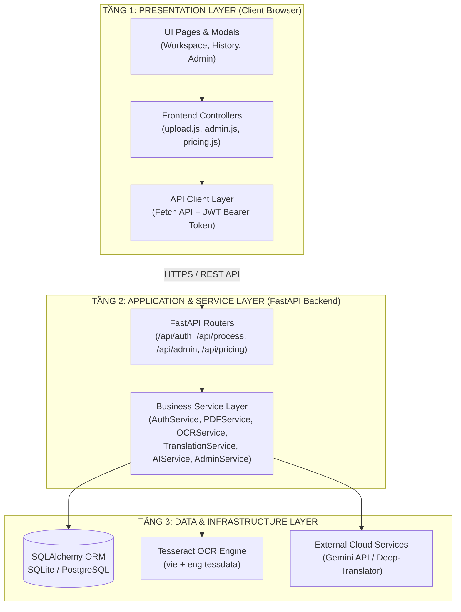
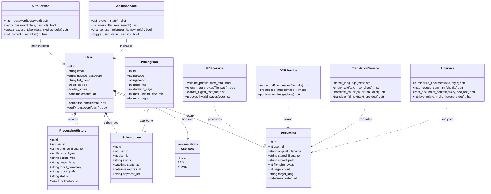

# Báo Cáo Thuyết Minh Chi Tiết Thiết Kế Hệ Thống - PDF Lingua

> **Học phần**: Đồ án Thực tế Công nghệ Phần mềm  
> **Nhóm thực hiện**: Nhóm 19  
> **Thành viên**:
> 1. Nguyễn Lê Huy Tâm - MSSV: `056206011188` (Trưởng nhóm)
> 2. Huỳnh Đình Chấn - MSSV: `077206002307` (Thành viên)  
> 
> **Nội dung trọng tâm**: Báo cáo thiết kế chi tiết gồm 3 phần: **Kiến trúc hệ thống**, **Sơ đồ Use Case** và **Sơ đồ Lớp (Class Diagram)**.

---

## Mục lục nội dung

1. [Kiến Trúc Hệ Thống](#1-kiến-trúc-hệ-thống)
   - [1.1. Mô hình kiến trúc phân tầng (3-Tier Layered Architecture)](#11-mô-hình-kiến-trúc-phân-tầng-3-tier-layered-architecture)
   - [1.2. Sơ đồ kiến trúc tổng thể](#12-sơ-đồ-kiến-trúc-tổng-thể)
   - [1.3. Phân rã 8 phân hệ cốt lõi (Communities)](#13-phân-rã-8-phân-hệ-cốt-lõi-communities)
   - [1.4. Các luồng dữ liệu chính của hệ thống](#14-các-luồng-dữ-liệu-chính-của-hệ-thống)
2. [Sơ Đồ Use Case](#2-sơ-đồ-use-case)
   - [2.1. Xác định các Tác nhân (Actors) và quan hệ kế thừa](#21-xác-định-các-tác-nhân-actors-và-quan-hệ-kế-thừa)
   - [2.2. Lược đồ Use Case tổng quát](#22-lược-đồ-use-case-tổng-quát)
   - [2.3. Danh mục 20 Use Case chuẩn hóa](#23-danh-mục-20-use-case-chuẩn-hóa)
   - [2.4. Đặc tả chi tiết các Use Case cốt lõi](#24-đặc-tả-chi-tiết-các-use-case-cốt-lõi)
3. [Sơ Đồ Lớp (Class Diagram)](#3-sơ-đồ-lớp-class-diagram)
   - [3.1. Lược đồ Lớp tổng thể hệ thống](#31-lược-đồ-lớp-tổng-thể-hệ-thống)
   - [3.2. Đặc tả các Lớp Thực thể Dữ liệu (ORM Models)](#32-đặc-tả-các-lớp-thực-thể-dữ-liệu-orm-models)
   - [3.3. Đặc tả các Lớp Xử lý Nghiệp vụ (Service Layer)](#33-đặc-tả-các-lớp-xử-lý-nghiệp-vụ-service-layer)

---

# 1. Kiến Trúc Hệ Thống

## 1.1. Mô hình kiến trúc phân tầng (3-Tier Layered Architecture)
Hệ thống **PDF Lingua** được thiết kế theo mô hình kiến trúc phân tầng kết hợp hướng dịch vụ (Service-Oriented Layered Architecture) nhằm đảm bảo tính phân tách trách nhiệm (Separation of Concerns), khả năng mở rộng độc lập (Scalability) và tính dễ bảo trì kiểm thử:

1. **Tầng 1 - Presentation Layer (Giao diện phía Client)**:
   - Ứng dụng Single Page Application (SPA) phát triển trên nền HTML5, CSS Tokens và JavaScript ES6+ thuần.
   - Bố cục màn hình làm việc kép (Dual-pane Workspace) cho phép đối chiếu song ngữ trực quan giữa văn bản gốc và bản dịch.
   - Quản lý tương tác thông qua các module điều khiển phía giao diện và giao tiếp với máy chủ thông qua Fetch API kèm JWT Bearer Token.

2. **Tầng 2 - Application & Service Layer (Ứng dụng và Nghiệp vụ phía Backend)**:
   - Xây dựng trên nền tảng framework **Python FastAPI** hiện đại, hỗ trợ cơ chế xử lý bất đồng bộ (Asynchronous Non-blocking I/O).
   - Hệ thống định tuyến RESTful API phân nhiệm rõ ràng: xác thực (`/api/auth`), xử lý tài liệu (`/api/process`), quản trị (`/api/admin`), bảng giá và gói cước (`/api/pricing`).
   - Tầng nghiệp vụ (Business Service Layer) điều phối toàn bộ luồng xử lý: `AuthService`, `PDFService`, `OCRService`, `TranslationService`, `AIService`, `AdminService`.

3. **Tầng 3 - Data & Infrastructure Layer (Dữ liệu và Hạ tầng dịch vụ)**:
   - Cơ sở dữ liệu quan hệ quản trị qua SQLAlchemy ORM: SQLite trong môi trường phát triển cục bộ và PostgreSQL khi triển khai sản xuất.
   - Bộ công cụ bóc tách tệp: thư viện PyMuPDF (`fitz`) và `pdfplumber`.
   - Động cơ nhận dạng quang học: **Tesseract OCR Engine** hỗ trợ song ngữ `vie + eng`.
   - Tích hợp các dịch vụ trí tuệ nhân tạo bên ngoài: Google Gemini API (LLM) và các động cơ dịch thuật đám mây.

## 1.2. Sơ đồ kiến trúc tổng thể



## 1.3. Phân rã 8 phân hệ cốt lõi (Communities)
1. **C1 - Auth & Identity**: Quản lý danh tính người dùng, mã hóa mật khẩu `bcrypt` (12 rounds salt), cấp phát và giải mã JWT token, kiểm soát quyền truy cập theo 3 vai trò (`free`, `pro`, `admin`).
2. **C2 - PDF Processing Engine**: Tiếp nhận tệp tải lên qua luồng multipart, kiểm tra an toàn magic bytes `%PDF-`, trích xuất văn bản số bằng PyMuPDF theo thứ tự đọc tự nhiên.
3. **C3 - OCR Pipeline**: Tự động nhận diện trang ảnh scan, chuyển đổi trang tài liệu sang ảnh bitmap 300 DPI, tăng cường tương phản bằng Pillow và nhận dạng ký tự quang học qua Tesseract OCR.
4. **C4 - Translation Engine**: Chia nhỏ văn bản an toàn ($\le$ 4500 ký tự) không cắt ngang câu, chuyển dịch đa ngôn ngữ qua Google GTX với cơ chế chuyển đổi dự phòng đa tầng (MyMemory / Deep-Translator).
5. **C5 - AI Feature Suite (Pro)**: Mô-đun tóm tắt tài liệu thông minh theo phương pháp Map-Reduce và Trợ lý AI Copilot hỏi đáp ngữ cảnh tài liệu theo kiến trúc RAG.
6. **C6 - Export & Delivery**: Xuất tệp TXT chuẩn UTF-8 BOM hiển thị tiếng Việt chính xác trên Windows Notepad, xuất tệp PDF kết quả Unicode và hỗ trợ sao chép nhanh.
7. **C7 - History & Subscription**: Quản lý lịch sử xử lý tài liệu trên đám mây cho tài khoản Pro, quy trình nâng cấp gói cước qua mã VietQR Napas247 và Admin Console.
8. **C8 - Frontend UI Layer**: Bố cục Workspace song song, Sidebar thu phóng linh hoạt, hệ thống thông báo trạng thái Toast thời gian thực.

## 1.4. Các luồng dữ liệu chính của hệ thống
- **Luồng xử lý tài liệu lai (Hybrid Extraction)**:
  1. Người dùng tải tệp PDF lên Workspace $\rightarrow$ Client kiểm tra kích thước theo gói cước (Free $\le$ 20MB, Pro $\le$ 100MB).
  2. Backend kiểm tra magic bytes `%PDF-` để ngăn chặn giả mạo định dạng.
  3. Duyệt từng trang tài liệu bằng PyMuPDF: nếu trang có văn bản số thì trích xuất trực tiếp; nếu trang là ảnh scan hoặc có ít hơn 10 ký tự thì tự động kích hoạt Tesseract OCR để nhận diện chữ.
  4. Hợp nhất nội dung hoàn chỉnh và trả về hiển thị tại cột văn bản gốc của Workspace.
- **Luồng dịch thuật có cơ chế dự phòng (Translation Fallback)**:
  1. Người dùng chọn ngôn ngữ nguồn và ngôn ngữ đích $\rightarrow$ Nhấn nút Dịch thuật.
  2. Thuật toán `chunk_text()` chia nhỏ văn bản thành các đoạn $\le$ 4500 ký tự tại các điểm ngắt câu tự nhiên.
  3. Gửi yêu cầu dịch qua động cơ Google GTX (Ưu tiên 1); nếu xảy ra lỗi kết nối hoặc mã lỗi HTTP 429 (Rate Limit), hệ thống tự động bắt ngoại lệ và kích hoạt động cơ dự phòng tầng 2 (MyMemory / Deep-Translator).
  4. Ghép nối kết quả theo đúng vị trí ban đầu và trả về hiển thị song song với văn bản gốc.

---

# 2. Sơ Đồ Use Case

## 2.1. Xác định các Tác nhân (Actors) và quan hệ kế thừa
Hệ thống **PDF Lingua** phân định 4 nhóm tác nhân tương tác theo mô hình kế thừa UML:

```text
[Khách (Guest)] <===kế thừa=== [Người dùng Free] <===kế thừa=== [Người dùng Pro]

[Quản trị viên (Admin)] (Tác nhân độc lập)
```

- **Khách (Guest)**: Người dùng vãng lai chưa đăng nhập. Được phép trải nghiệm trực tiếp luồng xử lý cơ bản ngay tại trang chủ (PDF $\le$ 20MB, tối đa 100 trang, bóc tách text số, chạy OCR, dịch thuật và xem kết quả song ngữ). Có thể đăng ký tài khoản mới hoặc đăng nhập.
- **Người dùng Miễn phí (Free User)**: Người dùng đã đăng ký tài khoản. Kế thừa toàn bộ quyền của Khách; được bổ sung các chức năng: đăng xuất, xem và cập nhật hồ sơ cá nhân, đổi mật khẩu, quản lý tệp đã tải lên, xuất kết quả thành file TXT/PDF, gửi yêu cầu nâng cấp Pro.
- **Người dùng Nâng cao (Pro User)**: Người dùng trả phí đã nâng cấp thành công gói Pro. Kế thừa toàn bộ quyền của Free User; hạn mức mở rộng đến 100MB/tệp, 500 trang OCR; mở khóa độc quyền các chức năng AI (Tóm tắt văn bản, Trợ lý AI Copilot hỏi đáp tài liệu) và Lưu trữ lịch sử đám mây.
- **Quản trị viên (Admin)**: Tác nhân quản trị độc lập toàn bộ hệ thống: xem Dashboard thống kê số liệu, quản lý danh sách người dùng, cấp phát hoặc thu hồi quyền Pro, khóa hoặc mở khóa tài khoản người dùng vi phạm.

## 2.2. Lược đồ Use Case tổng quát


## 2.3. Danh mục 20 Use Case chuẩn hóa

| Mã UC | Tên Use Case | Tác nhân trực tiếp | Tác nhân kế thừa | Phân hệ | Mô tả tóm tắt nghiệp vụ |
| :---: | :--- | :--- | :--- | :--- | :--- |
| **UC-01** | **Đăng nhập** | Khách, Admin | Free, Pro | Xác thực | Xác thực email/mật khẩu và cấp mã JWT đưa người dùng vào hệ thống theo đúng vai trò. |
| **UC-02** | **Đăng kí tài khoản mới** | Khách | - | Xác thực | Tạo tài khoản mới bằng Email và Mật khẩu hợp lệ (mã hóa bcrypt). |
| **UC-03** | **Tải lên tài liệu PDF** | Khách | Free, Pro | Xử lý PDF | Tải file PDF lên hệ thống (Free: $\le$ 20MB, Pro: $\le$ 100MB), kiểm tra an toàn MIME và Magic Bytes. |
| **UC-04** | **Trích xuất văn bản số từ PDF digital** | Khách | Free, Pro | Xử lý PDF | Bóc tách lớp văn bản ký tự có sẵn trong tệp PDF số trực tiếp theo trang bằng PyMuPDF. |
| **UC-05** | **Nhận dạng OCR từ PDF scan** | Khách | Free, Pro | Xử lý PDF | Chuyển trang scan thành ảnh bitmap và chạy Tesseract OCR nhận diện ký tự quang học. |
| **UC-06** | **Dịch thuật đa ngôn ngữ** | Khách | Free, Pro | Dịch thuật | Tự động nhận diện ngôn ngữ nguồn và dịch sang ngôn ngữ đích (phân đoạn an toàn $\le$ 4500 ký tự). |
| **UC-07** | **Xem kết quả xử lý / kết quả dịch** | Khách | Free, Pro | Dịch thuật | Hiển thị giao diện Workspace song ngữ đối chiếu văn bản gốc và bản dịch, hỗ trợ sao chép. |
| **UC-08** | **Đăng xuất** | Free, Admin | Pro | Xác thực | Hủy phiên làm việc và xóa token xác thực an toàn ở phía Client. |
| **UC-09** | **Xem và cập nhật hồ sơ cá nhân** | Free | Pro | Tài khoản | Xem thông tin tài khoản, ngày tham gia, gói cước và cập nhật họ tên hiển thị. |
| **UC-10** | **Chỉnh sửa thông tin bảo mật của tài khoản** | Free | Pro | Tài khoản | Thay đổi mật khẩu tài khoản bằng cách xác thực mật khẩu cũ và nhập mật khẩu mới. |
| **UC-11** | **Xem lại và quản lý lịch sử tài liệu đã tải lên** | Free | Pro | Xử lý PDF | Xem danh sách các file PDF cá nhân đã tải lên hệ thống và thực hiện xóa file khi không còn nhu cầu. |
| **UC-12** | **Xuất kết quả thành file TXT/PDF** | Free | Pro | Dịch thuật | Xuất văn bản trích xuất hoặc bản dịch thành file TXT (UTF-8 BOM) hoặc tệp PDF kết quả. |
| **UC-13** | **Nâng cấp lên gói Pro** | Free | - | Gói cước | Xem bảng giá so sánh quyền lợi và gửi yêu cầu nâng cấp tài khoản qua cổng VietQR Napas247. |
| **UC-14** | **Tóm tắt văn bản bằng AI** | Pro | - | AI Pro | Áp dụng mô hình LLM AI để tóm tắt tài liệu theo các phong cách (ngắn gọn, ý chính, chi tiết). |
| **UC-15** | **Trợ lý AI hỏi đáp tài liệu** | Pro | - | AI Pro | Chat hỏi đáp trực tiếp với trợ lý AI dựa trên nội dung tài liệu (RAG), có trích dẫn nguồn trang. |
| **UC-16** | **Xem lại lịch sử xử lý** | Pro | - | AI Pro | Tra cứu và mở lại toàn bộ lịch sử các phiên dịch thuật, tóm tắt và câu hỏi RAG lưu trên đám mây. |
| **UC-17** | **Xem Dashboard thống kê** | Admin | - | Quản trị | Theo dõi các biểu đồ và chỉ số vận hành: tổng tài khoản, dung lượng lưu trữ, lượt xử lý dịch/AI. |
| **UC-18** | **Quản lý danh sách người dùng** | Admin | - | Quản trị | Tìm kiếm, xem chi tiết thông tin, ngày tạo và trạng thái hoạt động của toàn bộ người dùng. |
| **UC-19** | **Quản lý gói Pro** | Admin | - | Quản trị | Cấp phát hoặc thu hồi quyền Pro cho người dùng theo chính sách dịch vụ. |
| **UC-20** | **Khóa / Mở khóa tài khoản** | Admin | - | Quản trị | Tạm thời vô hiệu hóa quyền truy cập (`is_active = False`) hoặc mở lại tài khoản người dùng vi phạm. |

## 2.4. Đặc tả chi tiết các Use Case cốt lõi

### Đặc tả UC-03: Tải lên tài liệu PDF và trích xuất nội dung
- **Mã Use Case**: UC-03
- **Tác nhân**: Khách (Guest), Người dùng Miễn phí (Free), Người dùng Nâng cao (Pro).
- **Tiền điều kiện**: Người dùng truy cập trang Workspace của ứng dụng.
- **Hậu điều kiện**: Tệp PDF được kiểm tra an toàn; văn bản bóc tách hiển thị ở cột trái màn hình làm việc.
- **Luồng sự kiện chính**:
  1. Người dùng kéo thả hoặc nhấn chọn tệp PDF vào vùng tải lên.
  2. Giao diện kiểm tra dung lượng theo quyền tài khoản (Free 20MB, Pro 100MB).
  3. Frontend gửi tệp qua API `POST /api/process/upload-and-translate`.
  4. Backend kiểm tra magic bytes `%PDF-`, lưu tạm và mở bằng PyMuPDF.
  5. Hệ thống bóc tách văn bản số từng trang theo thứ tự tự nhiên.
  6. Nếu phát hiện trang scan, hệ thống tự động gọi OCR Tesseract.
  7. Kết quả hoàn tất được trả về hiển thị tại cột trái của Workspace.
- **Luồng ngoại lệ**:
  - *E1 - Tệp sai định dạng*: Hệ thống hiển thị thông báo "Tệp không phải định dạng PDF hợp lệ".
  - *E2 - Tệp vượt quá dung lượng*: Hệ thống chặn tải lên và gợi ý nâng cấp gói Pro.
  - *E3 - Tệp có mật khẩu*: Thông báo hệ thống chưa hỗ trợ tệp bị mã hóa bảo vệ.

### Đặc tả UC-06: Dịch thuật đa ngôn ngữ
- **Mã Use Case**: UC-06
- **Tác nhân**: Khách (Guest), Người dùng Miễn phí (Free), Người dùng Nâng cao (Pro).
- **Tiền điều kiện**: Đã có nội dung văn bản trích xuất trên màn hình làm việc.
- **Hậu điều kiện**: Bản dịch hoàn chỉnh xuất hiện tại cột phải Workspace đối chiếu song song.
- **Luồng sự kiện chính**:
  1. Người dùng chọn ngôn ngữ nguồn và ngôn ngữ đích.
  2. Người dùng nhấn nút *Dịch thuật*.
  3. Backend phân tách văn bản thành các đoạn an toàn $\le$ 4500 ký tự.
  4. Gọi động cơ dịch chính (Google GTX). Nếu lỗi hoặc quá tải (429), tự động chuyển sang động cơ dự phòng tầng 2 (MyMemory / Deep-Translator).
  5. Ghép nối các đoạn dịch và gửi kết quả về hiển thị ở cột phải Workspace.

### Đặc tả UC-13: Nâng cấp gói dịch vụ Pro qua VietQR
- **Mã Use Case**: UC-13
- **Tác nhân**: Người dùng Miễn phí (Free User).
- **Tiền điều kiện**: Người dùng đã đăng nhập tài khoản Free trên hệ thống.
- **Hậu điều kiện**: Yêu cầu thanh toán được ghi nhận; tài khoản được thăng hạng lên Pro VIP.
- **Luồng sự kiện chính**:
  1. Người dùng chọn chu kỳ thanh toán (Gói Tháng hoặc Gói Năm).
  2. Hệ thống hiển thị Modal thanh toán chứa mã VietQR ngân hàng VietinBank chuẩn 1:1.
  3. Người dùng quét mã trên ứng dụng Mobile Banking, nội dung chuyển khoản được định danh tự động theo mã giao dịch duy nhất.
  4. Người dùng bấm xác nhận *Tôi đã chuyển khoản*.
  5. Tài khoản người dùng được cập nhật `role = "pro"` và cấp huy hiệu Pro VIP Vàng kim.


---

# 3. Sơ Đồ Lớp (Class Diagram)

## 3.1. Lược đồ Lớp tổng thể hệ thống
Sơ đồ dưới đây mô hình hóa toàn bộ các Lớp Thực thể Dữ liệu (ORM Models), các quan hệ hướng đối tượng (Association, Composition, Dependency) và các Lớp Dịch vụ Nghiệp vụ (Service Layer):



## 3.2. Đặc tả các Lớp Thực thể Dữ liệu (ORM Models)

1. **Lớp `User` (Thực thể Người dùng)**:
   - Đại diện cho bảng cơ sở dữ liệu `users`.
   - `id: int`: Khóa chính (Primary Key), tự động tăng.
   - `email: string`: Email định danh duy nhất của tài khoản (được tự động chuẩn hóa về chữ thường).
   - `hashed_password: string`: Mật khẩu đã băm bằng thuật toán `bcrypt` với 12 salt rounds.
   - `full_name: string`: Tên đầy đủ hiển thị của người dùng.
   - `role: UserRole`: Quyền hạn tài khoản (`FREE`, `PRO`, `ADMIN`).
   - `is_active: bool`: Cờ đánh dấu trạng thái tài khoản đang hoạt động hay bị khóa.
   - `created_at: datetime`: Thời điểm tạo tài khoản.
   - Phương thức: `normalise_email(email)`, `verify_password(plain_password)`.

2. **Lớp `Document` (Thực thể Tài liệu đã tải lên)**:
   - Đại diện cho bảng `documents`.
   - `id: int`: Khóa chính của tài liệu.
   - `user_id: int`: Khóa ngoại liên kết tới bảng `users(id)`.
   - `original_filename: string`: Tên file gốc người dùng tải lên.
   - `stored_path: string`: Đường dẫn lưu trữ file an toàn trên máy chủ.
   - `file_size_bytes: int`: Kích thước file tính bằng byte.
   - `page_count: int`: Tổng số trang của tài liệu.

3. **Lớp `ProcessingHistory` (Thực thể Lịch sử xử lý)**:
   - Đại diện cho bảng `processing_histories`.
   - `id: int`: Khóa chính của bản ghi lịch sử.
   - `user_id: int`: Khóa ngoại liên kết tới `users(id)`.
   - `action_type: string`: Loại thao tác (`extract`, `translate`, `summarize`).
   - `result_summary: string`: Bản tóm tắt kết quả hoặc đường dẫn lưu file kết quả.
   - `status: string`: Trạng thái xử lý (`completed`, `failed`).

4. **Lớp `PricingPlan` và `Subscription` (Thực thể Gói cước và Đăng ký)**:
   - `PricingPlan`: Lưu trữ định nghĩa gói cước (`code`, `name`, `price_vnd`, `max_upload_size_mb`).
   - `Subscription`: Quản lý phiên đăng ký gói Pro của người dùng (`starts_at`, `expires_at`, `status`, `payment_ref`).

## 3.3. Đặc tả các Lớp Xử lý Nghiệp vụ (Service Layer)

1. **`PDFService`**:
   - Chịu trách nhiệm thẩm định an toàn tệp PDF: kiểm tra dung lượng theo gói (`validate_pdf`), kiểm tra magic bytes mở đầu tệp (`check_magic_bytes`).
   - Bóc tách văn bản số bằng thư viện PyMuPDF (`extract_digital_text`).
   - Điều phối xử lý trang kết hợp giữa trích xuất số và nhận dạng OCR (`process_hybrid_pages`).

2. **`OCRService`**:
   - Chuyển đổi trang PDF sang ảnh bitmap chất lượng 300 DPI (`render_pdf_to_images`).
   - Tiền xử lý ảnh tăng độ tương phản bằng bộ lọc Pillow (`preprocess_image`).
   - Nhận dạng ký tự quang học qua Tesseract OCR hỗ trợ song ngữ `vie + eng` (`perform_ocr`).

3. **`TranslationService`**:
   - Tự động nhận diện ngôn ngữ nguồn (`detect_language`).
   - Phân đoạn văn bản an toàn $\le$ 4500 ký tự không ngắt giữa câu (`chunk_text`).
   - Điều phối dịch thuật có cơ chế Fallback đa tầng chống lỗi quá tải dịch vụ (`translate_full_text`).

4. **`AIService`**:
   - Kết nối với Google Gemini API để phân tích ngữ nghĩa chuyên sâu.
   - Tóm tắt văn bản thông minh theo phương pháp Map-Reduce cho tài liệu dài (`summarize_document`).
   - Trợ lý AI Copilot hỏi đáp ngữ cảnh tài liệu theo kiến trúc RAG (`chat_document_context`).

5. **`AuthService`**:
   - Đóng gói logic băm mật khẩu `bcrypt` và xác minh mật khẩu đăng nhập.
   - Cấp phát và giải mã JSON Web Token (JWT) theo thuật toán mã hóa `HS256`.

6. **`AdminService`**:
   - Cung cấp các hàm thống kê tổng hợp số liệu toàn hệ thống (`get_system_stats`).
   - Tìm kiếm, lọc và phân trang danh sách người dùng (`list_users`).
   - Thực thi cấp/thu hồi quyền Pro và khóa/mở khóa tài khoản người dùng (`change_user_role`, `toggle_user_status`).
